# Build ML From Scratch — Then the Hugging Face Way

Learn to **build** machine-learning models, not just call them — from a scalar
autograd engine all the way to fine-tuning and serving an LLM. The trick of this
course: you build **everything twice**. First from scratch, so you understand
every moving part; then the Hugging Face way, so you can move fast and ship real
work. You **see every concept as a picture** — loss surfaces, attention
heatmaps, feature maps, denoising trajectories — because intuition comes from
images, not equations alone. And you write the core algorithms in **two
languages**: **Python** for reach and ecosystem, and **Zig** for understanding —
where nothing is hidden, memory is explicit, and you finally see what the tensor
library was doing all along.

This is a hands-on course. There is no "watch me code." Every module is a
walkthrough you run on your own machine, an Apple-silicon Mac, with optional
cloud acceleration when you want it.

---

## How to use this course

Each **module** is a self-contained folder under `modules/` and follows the same
shape:

- **README walkthrough** — the narrative. Read it top to bottom; it explains the
  concept, the math you actually need, and what you are about to build.
- **Runnable scripts** — every code block is a real script you launch with
  [uv](https://docs.astral.sh/uv/). No hidden setup: `uv run script.py` just
  works.
- **Exercises with solutions** — you write code; a reference solution lives in
  `solutions/` so you can check yourself (peek only after you try).
- **Figures** — generated plots and diagrams in `figures/`. Regenerate them
  yourself; seeing the picture is the point.
- **A checkpoint** — each module ends with a short "you should now be able
  to…" checklist. Don't move on until you can tick every box.

**Do the modules in order.** Later modules assume the tools, vocabulary, and
code you built earlier. Foundations (01–03) are load-bearing for everything that
follows. The one exception is the optional **Track 0 · Origins** prologue
(00a–00c): it depends on nothing, and nothing depends on it, so take it first or
dip into it whenever a later idea makes you wonder where it came from.

Before module 01, work through **[SETUP.md](SETUP.md)** to verify your
toolchain. If your Mac ever feels too small — a big fine-tune, a hungry GPU
job — **[CLOUD.md](CLOUD.md)** shows the optional cloud lane.

Prefer a cohesive reader with search, local progress, knowledge checks, and
installable offline support? It is live at
**<https://wynch.github.io/ml-course/reader/>** — install it once and the whole
course, figures and explorables included, works with the network off. CI rebuilds
it from the modules on every push, so it never drifts from this repository. To
build it yourself, or to prepare a reader/core/full pack, see
**[OFFLINE.md](OFFLINE.md)**.

---

## The learning path

```mermaid
flowchart TD
    subgraph O["Origins · 00a–00c (optional)"]
        M00A["00a · perceptron"] --> M00B["00b · Bayes, k-NN & PCA"] --> M00C["00c · kernels & Hopfield"]
    end
    subgraph F["Foundations · 01–03"]
        M01["01 · autograd"] --> M02["02 · neural networks"] --> M03["03 · tokenization"]
    end
    subgraph T["Transformers & LLMs · 04–07"]
        M04["04 · attention & transformer"] --> M05["05 · transformers library"] --> M05A["05½ · data & evaluation"] --> M06["06 · fine-tuning"] --> M07["07 · inference internals"]
    end
    subgraph B["Breadth · 08–10, 33"]
        M08["08 · vision"]
        M09["09 · diffusion"]
        M10["10 · agents"]
        M33["33 · text by denoising"]
    end
    subgraph L["Looking inside · 11–13, 32"]
        M11["11 · inside a language model"]
        M12["12 · features and dictionaries"]
        M13["13 · inside vision and JEPA models"]
        M32["32 · is the explanation real?"]
    end
    subgraph H["How learning works · 14–16, 29–30"]
        M14["14 · how training finds a solution"]
        M15["15 · geometry of representations"]
        M16["16 · self-supervised learning and JEPA"]
        M29["29 · learning new, keeping old"]
        M30["30 · without a backward pass"]
    end
    subgraph R["Other recipes · 17–18, 27"]
        M17["17 · learning from preferences"]
        M18["18 · beyond attention"]
        M27["27 · memory as a matrix"]
    end
    subgraph W["Why they work · 19–20"]
        M19["19 · scaling laws"]
        M20["20 · in-context learning"]
    end
    subgraph U["Using models well · 21–23, 28, 34"]
        M22["22 · reasoning at test time"]
        M34["34 · prompts as parameters"]
        M21["21 · retrieval and memory"]
        M23["23 · compression"]
        M28["28 · fewer bits, trained in"]
    end
    subgraph A["Acting and planning · 24–26, 31, 35"]
        M24["24 · reinforcement learning"]
        M25["25 · world models and planning"]
        M26["26 · RL with a checker"]
        M35["35 · evolution with an LLM"]
        M31["31 · a world model from pixels"]
    end
    O -.-> F
    F --> T --> B
    T --> L
    F --> H
    T --> R
    T --> W
    T --> U
    F --> A
    M08 -.-> M09 -.-> M10 -.-> M33
    M11 --> M12 --> M13 -.-> M32
    M14 --> M15 --> M16 -.-> M29 --> M30
    M17 -.-> M18 --> M27
    M19 --> M20
    M22 --> M34 -.-> M21 -.-> M23 --> M28
    M24 --> M25 --> M26 --> M35 -.-> M31

    classDef track fill:#eef,stroke:#88a,color:#113;
    classDef origins fill:#fdf2df,stroke:#a86b0e,color:#4a2f05;
    class F,T,B,L,H,R,W,U,A track;
    class O origins;
```



**Origins** is an optional prologue — the classic math behind modern ML, after
Anil Ananthaswamy's *Why Machines Learn*. Take it before Track 1 or alongside
it; nothing later depends on it, and everything later rhymes with it. Tracks 1
to 3 then build on each other. **Foundations** gives you autograd, a
network, and a tokenizer written by hand. **Transformers & LLMs** turns those
into attention, a real model library, fine-tuning, and fast inference.
**Breadth** takes the same ideas sideways into vision, diffusion, and agents,
then writes text by denoising instead of left to right.
**Looking inside** opens a trained model while it runs: hooks, probes,
activation patching, neurons read on both signs, then sparse autoencoders and
steering, then the same tools on vision models and a JEPA encoder, then the
controls that tell a real finding from an artefact. It needs track 2, not
track 3. **How learning works** asks what training does:
optimisers, schedules and grokking, the shape a trained network leaves in its
data, learning without labels, what a model forgets when it learns something
new, and learning without a backward pass. It needs track 1; module 29 also
uses module 04's char-GPT and module 06's LoRA. **Other recipes** trains a
model from preferences instead of labels, swaps attention for a state carried
from token to token, and writes to that state with the delta rule. It needs
track 2. **Why they work** fits the
curves that plan big models, then trains a small transformer that learns a
task from the examples in its prompt. It needs track 2. **Using models well**
spends more tokens on each question, tunes the prompt of a frozen model as
if it were a weight, fetches the right passage for the model to read, makes
a model smaller, then trains one with ternary weights; read 22, then 34,
then 21, then 23, then 28. It needs track 2. **Acting and planning**
learns from reward instead of labels, plans inside a learned model of the
world, trains a language model against a program that checks its answers,
lets a language model propose programs that a checker keeps or throws out,
and learns a world model from pixels. It needs track 1; module 25 also uses
module 16's JEPA, module 26 uses modules 17 and 22, and module 35 uses
modules 22 and 26.

The suggested order runs track by track: after module 10 comes 33; after 13,
32; after 16, 29 and 30; after 18, 27; then 19, 20, 22, 34, 21, 23, 28, 24,
25, 26, 35, 31.

---

## Modules

### Track 0 — Origins (optional prologue)

The classic math behind modern ML, after Anil Ananthaswamy's *Why Machines
Learn* — the same ideas, rebuilt here in original code and figures. Three
numpy-level modules with no deep learning in them at all: a learning rule with a
proof, three algorithms that predate every network in this course and still run
inside them, and the curve that broke the textbook. **Optional** — nothing after
it depends on it. Take it before Track 1 as a warm-up, or alongside it when you
want to know where an idea came from.

| # | Module | What you build |
|---|--------|----------------|
| 00a | [perceptron](modules/00a-perceptron) | The **Rosenblatt perceptron** with its mistake bound, and least squares two ways — **in Python and Zig**. |
| 00b | [bayes-knn-pca](modules/00b-bayes-knn-pca) | **Naive Bayes**, **k-NN** against the Cover-Hart ceiling, and **PCA by power iteration** — all from scratch. |
| 00c | [kernels-hopfield](modules/00c-kernels-hopfield) | A dual **SVM**, the **kernel trick**, a **Hopfield** memory, and a measured **double-descent** curve. |

### Tracks 1–9 — the main line

| # | Module | What you build |
|---|--------|----------------|
| 01 | [autograd](modules/01-autograd) | A scalar autograd engine, in **Python and Zig** — reverse-mode backprop from first principles. |
| 02 | [neural-networks](modules/02-neural-networks) | A numpy MLP trained on **FashionMNIST**, loaded via Hugging Face `datasets`. |
| 03 | [tokenization](modules/03-tokenization) | **BPE from scratch** in Python and Zig, then the real **SmolLM3** tokenizer, with a **Gradio** playground. |
| 04 | [attention-transformer](modules/04-attention-transformer) | Attention from scratch → a tiny **char-GPT**, with **attention heatmaps**. |
| 05 | [transformers-library](modules/05-transformers-library) | `pipeline`, `AutoModel`, **SmolLM2-360M anatomy**, and sampling strategies. |
| 05½ | [data-evaluation](modules/05a-data-evaluation) | Splits, confusion matrices, thresholds, calibration, slices, and leakage checks **from scratch**. |
| 06 | [fine-tuning](modules/06-fine-tuning) | **TRL SFT + LoRA** on SmolLM2-360M (SmolLM3-3B in the cloud job), an **MLX** Mac lane, and **trackio** tracking. |
| 07 | [inference-internals](modules/07-inference-internals) | **KV cache**, quantization, and a **Zig inference capstone**. |
| 08 | [vision](modules/08-vision) | Fine-tune a **ViT**, and visualize its **feature maps**. |
| 09 | [diffusion](modules/09-diffusion) | A toy denoiser from scratch → the **`diffusers`** library. |
| 10 | [agents](modules/10-agents) | Build agents with **smolagents** and the **Model Context Protocol (MCP)**. |
| 11 | [inside-a-language-model](modules/11-inside-a-language-model) | **Hooks**, a per-layer **probe**, **activation patching**, and **neuron poles** on SmolLM2-360M, with **nnsight**. |
| 12 | [features-and-dictionaries](modules/12-features-and-dictionaries) | **Toy superposition**, a **sparse autoencoder** from scratch, GPT-2's published SAE through **SAELens**, and a **steering** demo. |
| 13 | [inside-vision-and-jepa](modules/13-inside-vision-and-jepa) | **One InceptionV1 channel** tested on drawn and real images, **feature visualisation** with Lucent, a per-block **probe** and three neurons in **CLIP**, and **probes on a JEPA encoder**. |
| 14 | [how-training-finds-a-solution](modules/14-how-training-finds-a-solution) | **SGD**, **momentum** and **Adam** on toy losses and an MLP, **learning-rate schedules**, **loss slices** and sharpness, and **grokking** with and without weight decay. |
| 15 | [geometry-of-representations](modules/15-geometry-of-representations) | A ReLU net's **linear regions** cut exactly, the **intrinsic dimension** of the data, and **linear CKA** between two trained nets. |
| 16 | [self-supervised-and-jepa](modules/16-self-supervised-and-jepa) | **SimCLR**, **masked reconstruction** and an **I-JEPA**-style objective on one small CNN; **collapse** shown and blocked (stop-grad, EMA, VICReg variance, **SIGReg**); a **DINOv2** probe. |
| 17 | [learning-from-preferences](modules/17-learning-from-preferences) | **Bradley-Terry** by hand, a **reward head** on a frozen model, **DPO** derived and checked against **TRL**, then trained with **LoRA**, and the **length bias** in all of it. |
| 18 | [beyond-attention](modules/18-beyond-attention) | A **GRU**, a fixed diagonal recurrence and a **selective (Mamba-style) scan** against the tiny GPT; memory per generated token; **Mamba-130M** against GPT-2. |
| 19 | [scaling-laws](modules/19-scaling-laws) | Six **char-GPTs** from 51k to 3.2M parameters on the same data, **L(N)** and **L(D)** fitted, and why a toy grid fakes a **compute-optimal** size. |
| 20 | [in-context-learning](modules/20-in-context-learning) | A 2-block transformer that **regresses in context**, set against **least squares**, ridge, k-NN and one gradient step; then **few-shot** SST-2 on SmolLM2-360M. |
| 21 | [retrieval-and-memory](modules/21-retrieval-and-memory) | **Embeddings** by mean pooling, **BM25** over a hand-built **inverted index**, and a **RAG** loop on SQuAD with the right paragraph as the ceiling. |
| 22 | [reasoning-at-test-time](modules/22-reasoning-at-test-time) | **Chain of thought**, **self-consistency** and **best-of-n** on 200 GSM8K problems with Qwen3-1.7B on **MLX**: accuracy against tokens spent. |
| 23 | [compression](modules/23-compression) | **Distillation** into a half-size student, **magnitude pruning**, **int8 and 4-bit quantisation** by hand, then MLX's own 4-bit copy. |
| 24 | [reinforcement-learning](modules/24-reinforcement-learning) | **Bandits**, tabular **Q-learning**, then **REINFORCE** and **PPO** on a CartPole written by hand from its equations. |
| 25 | [world-models-and-planning](modules/25-world-models-and-planning) | An 8 × 8 **grid world**, a one-hot model and a **JEPA** of it, and **planning by random shooting** in each. |
| 26 | [rl-with-a-checker](modules/26-rl-with-a-checker) | **GRPO**, **Dr. GRPO** and **RLOO** by hand on a char-GPT that adds numbers, graded by a program; then TRL's **GRPOTrainer** with LoRA on SmolLM2-360M. |
| 27 | [memory-as-a-matrix](modules/27-memory-as-a-matrix) | Linear attention, decay, the **delta rule** and the **gated delta rule** as writes into a matrix; recall against state size; a **Gated DeltaNet** hybrid on MLX. |
| 28 | [fewer-bits-trained-in](modules/28-fewer-bits-trained-in) | The char-GPT trained with **ternary weights** against float models rounded to 4 and 2 bits at the same file size; then a **KV cache** rounded to 8–2 bits. |
| 29 | [learning-new-keeping-old](modules/29-learning-new-keeping-old) | **Forgetting** under full fine-tuning, LoRA, **replay** and self-distillation; **loss of plasticity** and continual backprop; a forgetting probe on SmolLM2-360M. |
| 30 | [learning-without-a-backward-pass](modules/30-learning-without-a-backward-pass) | One MLP trained by backprop, checkpointing, **MeZO**, **forward-forward**, **Mono-Forward** and **predictive coding**: memory and accuracy of each. |
| 31 | [world-model-from-pixels](modules/31-world-model-from-pixels) | A small **JEPA world model** trained end to end on frames with **SIGReg**; planning by random shooting and **CEM**; PLDM's terms on module 25's grid. |
| 32 | [is-the-explanation-real](modules/32-is-the-explanation-real) | **SAEs** and **transcoders** on a model whose true neurons are known, against a **random-weight copy** and a second seed; an **attribution graph** checked by ablation. |
| 33 | [text-by-denoising](modules/33-text-by-denoising) | The char-GPT without its causal mask, trained as a **masked diffusion** model beside an autoregressive twin; **block diffusion** with a KV cache; **flow matching** on the spiral. |
| 34 | [prompts-as-parameters](modules/34-prompts-as-parameters) | The instruction of a frozen Qwen3-1.7B tuned like a weight: **APE**, **OPRO**, a **TextGrad**-style step and a **GEPA**-style loop by hand, one budget, seeds and a held-out split; then **DSPy**'s GEPA. |
| 35 | [evolution-with-an-llm-mutator](modules/35-evolution-with-an-llm-mutator) | A **FunSearch-style loop** on online bin packing: islands, parents by score, a local **Qwen3-4B** as mutator, a sandboxed checker with dedupe; against random search, sampling with no selection, a loop with **no verifier**, and **OpenEvolve**. |

---

## Explorables

All thirty-nine modules — the three Origins modules, the thirty-five numbered ones and the
evaluation bridge — ship an **interactive, in-browser
explainer**: a single HTML file with no dependencies, no build step and no
network calls. Where a module
produced real artifacts (trained weights, merge lists, attention matrices,
measured timings), its explorable inlines them, so what you drag and scrub is
the same data your own runs produce.

Modules 34 and 35 build theirs, and their quizzes, from **learnkit**, a small
kit of web components copied into `learnkit/` (its `VERSION` file
names the commit): slides (`<lk-deck>`), a guess before the answer
(`<lk-predict>`), a replay of a recorded run (`<lk-stepper>`) and a quiz read
from JSON (`<lk-quiz>`), whose missed questions come back on later days. They
still make no network calls.

Serve the repo root and open the gallery:

```bash
python3 -m http.server        # then browse to
# http://localhost:8000/explorables/
```

| Explorable | Module | What you do |
|---|---|---|
| [The perceptron, one mistake at a time](explorables/00a-perceptron.html) | 00a | Drag the margin, watch the line snap on every mistake, replay the module's real run, then flip on XOR. |
| [Principal components, by hand](explorables/00b-pca.html) | 00b | Drag a point cloud and watch power iteration hunt the principal axis, with the module's real scree data alongside. |
| [Double descent & the kernel lift](explorables/00c-double-descent.html) | 00c | Scrub the polynomial degree until the error spikes and falls again, then send circles up into a third dimension. |
| [Gradient descent & backprop](explorables/01-gradient-descent.html) | 01 | Roll a ball down a non-convex loss surface, then step a real computation graph forward and backward. |
| [Neural-net playground](explorables/02-nn-playground.html) | 02 | Train the from-scratch net **in your browser** on two moons and watch the decision boundary bend. |
| [BPE, one merge at a time](explorables/03-bpe-stepper.html) | 03 | Step through the real first 60 merges, then apply them to text you type. |
| [Attention, one query at a time](explorables/04-attention.html) | 04 | Drive a Q·Kᵀ heatmap with causal mask and temperature — toy vectors or the real tiny-GPT heads. |
| [Anatomy of a transformer](explorables/05-transformer-anatomy.html) | 05 | Send a pulse up the decoder stack, hover components for real shapes, read a **logit lens**. |
| [The honest scorecard](explorables/05a-evaluation-lab.html) | 05½ | Move a threshold, inspect every error, compare slices, and introduce leakage to manufacture a fake improvement. |
| [Low rank: what LoRA actually trains](explorables/06-lora-rank.html) | 06 | Drag the rank slider and watch a real trained **ΔW** rebuild from 7 singular directions. |
| [KV cache & int8](explorables/07-kv-cache.html) | 07 | Run the decode loop with the cache on and off, every attention cell counted, then quantize. |
| [Convolution vs patches](explorables/08-conv-vs-patches.html) | 08 | Slide real kernels over a real image, then watch it become a **ViT** patch sequence. |
| [Diffusion on a spiral](explorables/09-diffusion.html) | 09 | Scrub a spiral into pure noise, then run the trained denoiser live to pull it back out. |
| [The ReAct loop](explorables/10-agent-loop.html) | 10 | Play a real agent transcript message by message — including the run where it fails. |
| [Inside a language model](explorables/11-inside-a-language-model.html) | 11 | Browse three SmolLM2 neurons pole by pole, then hover a probe curve and a patching heatmap. |
| [Features and dictionaries](explorables/12-features-and-dictionaries.html) | 12 | Move the toy model's sparsity, then browse SAE latents, raw neurons and GPT-2 features by their top contexts. |
| [Inside vision and JEPA models](explorables/13-inside-vision-and-jepa.html) | 13 | Scrub channels 45–65 of InceptionV1's layer 4e across six image sets, see Lucent's renders, browse three CLIP neurons, compare JEPA probes. |
| [How training finds a solution](explorables/14-how-training-finds-a-solution.html) | 14 | Race three optimisers on a 2-D loss from any start and rate, browse the learning-rate grid, replay the grokking curves. |
| [Geometry of representations](explorables/15-geometry-of-representations.html) | 15 | Drag a segment across a small ReLU net's regions, change the width, watch the count; intrinsic dimension and CKA alongside. |
| [Self-supervised learning and JEPA](explorables/16-self-supervised-and-jepa.html) | 16 | Train a 2-D JEPA live and switch stop-grad, the EMA target and the variance term; replay the CIFAR-10 collapse runs and the probes. |
| [Learning from preferences](explorables/17-learning-from-preferences.html) | 17 | Drag item scores and watch the pair probabilities, move β and watch one pair's DPO loss, read replies before and after training. |
| [Beyond attention](explorables/18-beyond-attention.html) | 18 | Step a KV cache and two recurrent states token by token, and drive a two-state recurrence by its decays and its gate. |
| [Scaling laws](explorables/19-scaling-laws.html) | 19 | Browse the six real curves, drag N and D on a fitted surface and read the loss and the cost, see which size wins at each budget. |
| [In-context learning](explorables/20-in-context-learning.html) | 20 | Place points and watch a trained net's guess and the least-squares line move together; browse the error curves and the few-shot prompts. |
| [Retrieval and memory](explorables/21-retrieval-and-memory.html) | 21 | Type a question and see BM25 and cosine rank 200 paragraphs side by side, with each word's part of the BM25 score. |
| [Reasoning at test time](explorables/22-reasoning-at-test-time.html) | 22 | Browse the real replies, eight samples per problem, slide n and watch the vote and the accuracy curves move. |
| [Compression](explorables/23-compression.html) | 23 | Quantise a block of real weights at the bits and group size you pick and watch the error histogram; see what pruning removes. |
| [Reinforcement learning](explorables/24-reinforcement-learning.html) | 24 | Play the bandit by hand against the three rules, replay a trained CartPole episode, browse the curves and the clip. |
| [World models and planning](explorables/25-world-models-and-planning.html) | 25 | Draw walls, drop the agent and the goal, and watch both planners choose their moves, with the path each one imagines. |
| [RL with a checker](explorables/26-rl-with-a-checker.html) | 26 | Flip the rewards in a group and watch GRPO's, Dr. GRPO's and RLOO's advantages; replay training; slide k and compare pass@k before and after. |
| [Memory as a matrix](explorables/27-memory-as-a-matrix.html) | 27 | Write key-value pairs into a state you can see and read them back under each rule; see which pairs survive, recall against state size, and two real models' memory as the context grows. |
| [Fewer bits, trained in](explorables/28-fewer-bits-trained-in.html) | 28 | Compare ternary weights trained in with float weights rounded after, at the same file size; round the keys a real model cached and see what mlx-lm's quantised cache keeps. |
| [Learning something new without losing the old](explorables/29-learning-new-keeping-old.html) | 29 | Every run on one scatter: forgetting against the new-text gain or the KL from the start model; plain backprop losing the ability to learn; where a LoRA step's memory goes. |
| [Learning without a backward pass](explorables/30-learning-without-a-backward-pass.html) | 30 | Train five small networks live, one rule each, side by side; read what each adds to memory as the network deepens and how predictive coding's error fades layer by layer. |
| [A world model from pixels](explorables/31-world-model-from-pixels.html) | 31 | Drop the agent and the goal, see the planner's cost over the rooms, and watch CEM's imagined paths narrow round by round; switch PLDM's terms on module 25's grid. |
| [Is the explanation real?](explorables/32-is-the-explanation-real.html) | 32 | Browse SAE and transcoder latents with the true neuron beside each, on a trained and a random model; click through an attribution graph and compare it with real ablations. |
| [Text by denoising](explorables/33-text-by-denoising.html) | 33 | Watch a line of Shakespeare unmask step by step, slide from 1 to 128 steps, play a block-diffusion line, and see when repeated data lets diffusion pass a left-to-right model. |
| [Prompts as parameters](explorables/34-prompts-as-parameters.html) | 34 | Step through the slides, predict the best optimiser's test score, replay any of the twelve runs event by event, and read every chosen instruction with its score per label. |
| [Evolution with an LLM as the mutator](explorables/35-evolution-with-an-llm-mutator.html) | 35 | Step through the slides, predict the held-out bins, replay one run prompt by prompt, and pack a held-out instance with four rules side by side. |

### Quizzes

Each of the thirty-five numbered modules — plus the three Origins modules and the 05½
bridge lab — ships a
**10-question quiz**, every question grounded in that module's own code, figures
and measured numbers, with an explanation revealed as soon as you answer. Start at
[`quizzes/index.html`](quizzes/index.html), which lists all thirty-nine and shows your
score for each. Nothing is uploaded: answers and scores stay in your browser's
`localStorage`, and every quiz has a Reset button.

### Course map

The **course map** is a visual dashboard of the whole course on a single page:
one card per module with its signature figure, the measured results that module
actually produced, and direct links to its explorable and quiz. Progress
checkboxes let you tick modules off as you finish them; like the quizzes, they
are stored in your browser and uploaded nowhere.

Read it live at **<https://wynch.github.io/ml-course/map.html>**, or open
`map.html` when serving the repo root locally.

Regenerate it after changing a figure or a number:

```bash
uv run tools/coursemap/build_map.py
```

The source of truth is `tools/coursemap/template.html` — edit that, never the
generated `map.html`, which is the template with every module figure inlined as
a data: URI. The map first lived as a one-off claude.ai artifact; the copy
published here on GitHub Pages is now the maintained home.

### Research companion

[`research/`](research/) holds four pages that connect the course to current
research, all built around one question: *why* does this work?

- **Hidden Patch** ([`research/index.html`](research/index.html)): eighteen
  chapters on predictive learning and JEPA, collapse, implicit bias,
  generalization, interpretability, reasoning, world models, edge efficiency and
  artificial life, each with live labs, three takeaways and a quiz.
- **The Why Atlas** ([`research/why-atlas.html`](research/why-atlas.html)):
  about 85 people and papers linked to fourteen "why" questions.
- **JEPA field map** ([`research/jepa-field-map.html`](research/jepa-field-map.html)):
  the JEPA literature, filterable by theme.
- **Edge research agenda** ([`research/agenda.html`](research/agenda.html)):
  eleven open questions one person can work on with a laptop or a phone, each
  with a first experiment written down before any code and the papers behind
  it.

They are plain HTML with self-hosted fonts and no runtime network calls, and the
reader bundles them, so they work offline at `reader/research/`.

---

## Toolchain

The course targets an **Apple-silicon Mac** and a small, modern toolset:

- **[uv](https://docs.astral.sh/uv/)** — Python environment and script runner (one per module).
- **[Zig](https://ziglang.org/)** — the from-scratch systems lane.
- **[`hf` CLI](https://huggingface.co/docs/huggingface_hub/guides/cli)** — Hub auth, downloads, and cloud Jobs.
- Optional per-module extras: **PyTorch**, **mlx-lm**, **Gradio**, **graphviz**.

Full verification steps and per-module setup live in **[SETUP.md](SETUP.md)**.
The optional cloud lane — HF Jobs, trackio, Spaces, ZeroGPU — is in
**[CLOUD.md](CLOUD.md)**.

The multi-language philosophy has its own page: **[docs/algorithm-cards.md](docs/algorithm-cards.md)**
explains the "algorithm card" format — the same algorithm side by side in
Python and Zig — and lists the cards this course ships.

---

## Built on

This course stands on the shoulders of the free, open
[Hugging Face learning platform](https://huggingface.co/learn). Each track draws
directly from one or more of these courses — go deeper there any time. For the
full catalog, a module-by-module map, certifications, and suggested continuation
paths — plus a second part covering the best verified free resources *beyond*
Hugging Face, from interactive explainers to university courses and annotated
implementations — see **[RESOURCES.md](RESOURCES.md)**.

- **[LLM Course](https://huggingface.co/learn/llm-course)** — transformers, tokenizers, `datasets`, and fine-tuning.
- **[smol-course](https://huggingface.co/learn/smol-course)** — SmolLM3, TRL, LoRA, and small-model fine-tuning.
- **[Agents Course](https://huggingface.co/learn/agents-course)** — smolagents and agentic patterns.
- **[MCP Course](https://huggingface.co/learn/mcp-course)** — the Model Context Protocol.
- **[Community Computer Vision Course](https://huggingface.co/learn/computer-vision-course)** — ViT and vision transfer learning.
- **[Diffusion Course](https://huggingface.co/learn/diffusion-course)** — denoising diffusion and `diffusers`.
- **[Deep RL Course](https://huggingface.co/learn/deep-rl-course)** — reinforcement learning foundations.
- **[Open-Source AI Cookbook](https://huggingface.co/learn/cookbook)** — practical, task-focused recipes.
