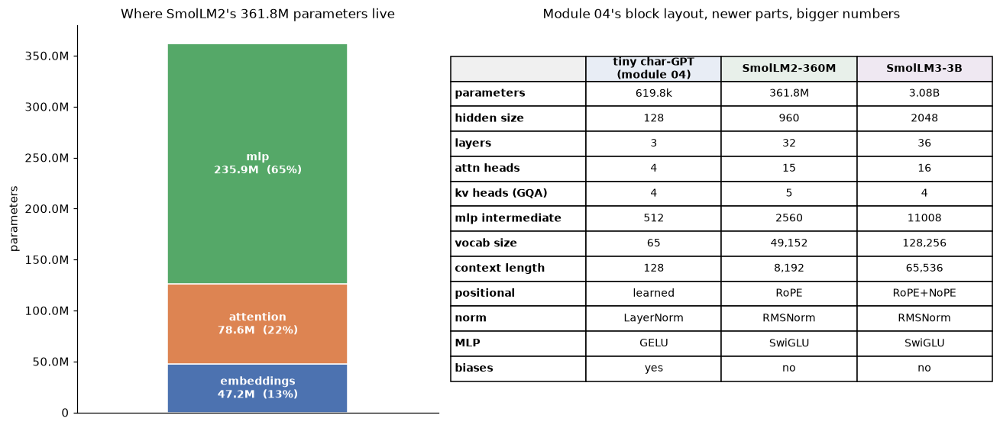
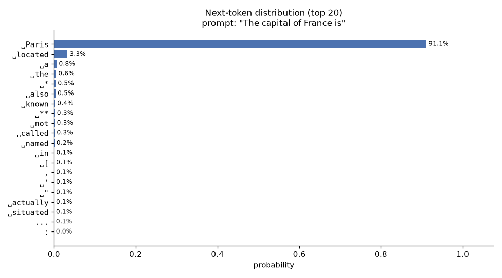
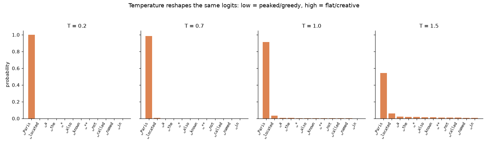
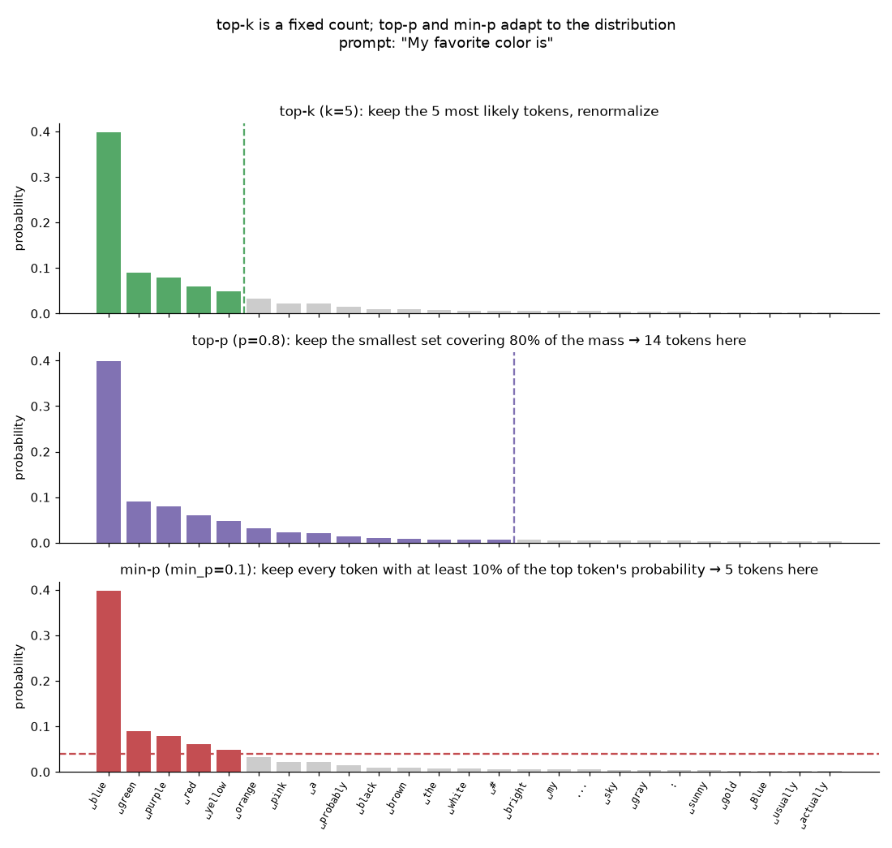
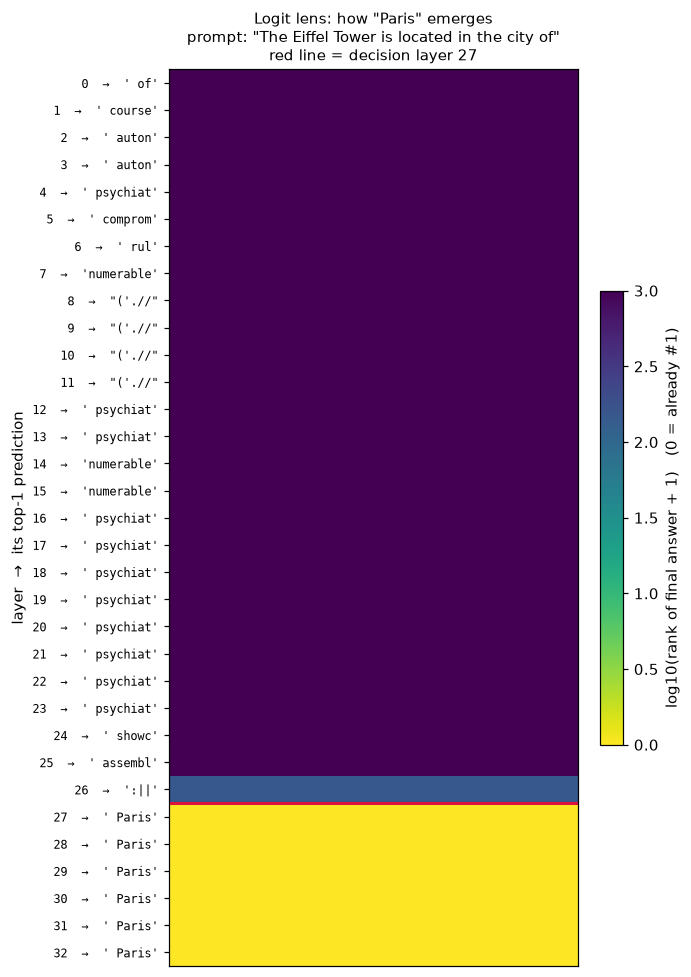
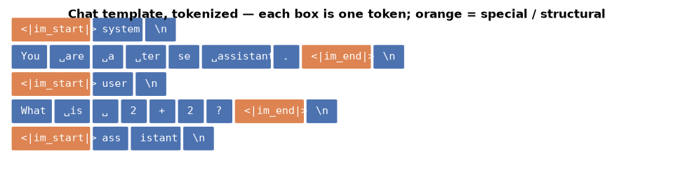
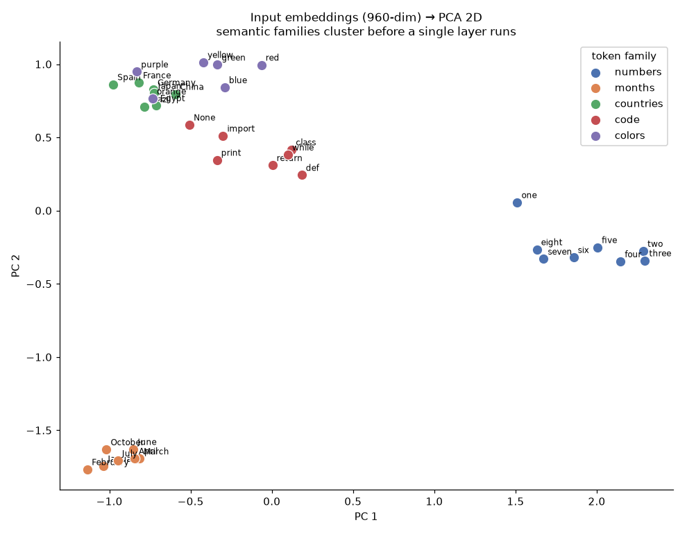
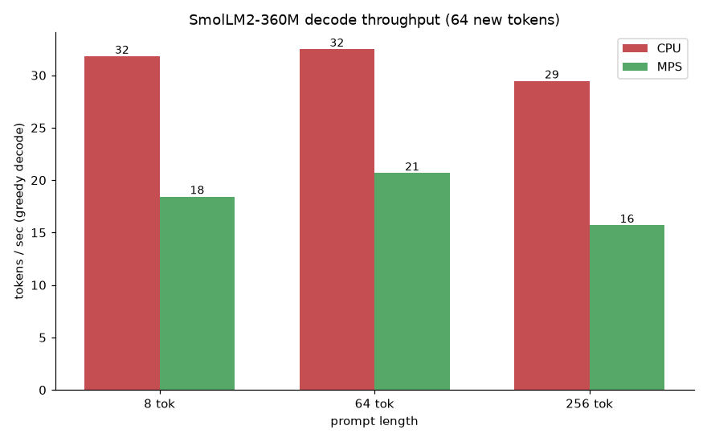

# Module 05 — The transformers library: anatomy of a real LLM

In module 04 you built a transformer **by hand**: attention, the residual
stream, a decoder block, a sampling loop — ~300 lines to make a tiny char-GPT
mumble Shakespeare. It worked, and now you know exactly what every line does.

This module is the **pivot**. Same layout of blocks, but you stop writing it
and start *wielding* it. You load a real, pretrained, 360-million-parameter
instruction model — **SmolLM2-360M-Instruct** — with three lines of Hugging
Face code, then take it apart: where its parameters live, how it turns a
960-dimensional vector into a next-token choice, how temperature and top-p (keep
only the likeliest tokens that cover a share `p` of the probability) bend that
choice, at which layer it "decides" on an answer (the *logit lens* reads each
layer's guess through the output head; the *decision layer* is where the final
answer takes first place and keeps it), and how its embedding space already
knows that July is a month and `def` is code. Everything is a
picture, and every picture comes from the real model running on your Mac.

**🕹 Interactive:** [Anatomy of a transformer](../../explorables/05-transformer-anatomy.html) —
watch a pulse carry one token up the decoder stack, hover any component for its
real tensor shapes, and read SmolLM2's logit lens layer by layer.

**✅ Quiz:** [10 questions](../../quizzes/05.html) — check yourself once you have taken SmolLM2 apart.

## Goals

By the end you will be able to:

- reach for `pipeline()` to do text-generation, sentiment, and zero-shot
  classification in three lines each — and explain what it hides;
- load any causal LM with `AutoTokenizer` / `AutoModelForCausalLM`, walk its
  module tree, and account for **where every parameter lives**;
- connect the giant to the toy: SmolLM2 keeps your module-04 block's layout
  with newer parts and bigger numbers — and SmolLM3-3B is the same recipe,
  bigger still;
- read a next-token distribution and predict how **temperature**, **top-k**,
  **top-p** and **min-p** will reshape it;
- use the **logit lens** to watch an answer converge layer by layer, and find
  the "decision layer";
- dissect a **chat template** down to the special tokens, and see the embedding
  space cluster numbers, months, countries, and code;
- run all of this on **MPS**, and know when MPS is *not* the fast lane.

## The pivot: three lines vs three hundred

Here is the entire "generate text" experience now:

```python
from transformers import pipeline
gen = pipeline("text-generation", model="HuggingFaceTB/SmolLM2-360M-Instruct")
print(gen([{"role": "user", "content": "One surprising fact about octopuses?"}],
          max_new_tokens=64)[0]["generated_text"][-1]["content"])
```

That is the same computation you wrote in module 04 — tokenize, embed, run N
decoder blocks, project to logits, sample, repeat — with the tokenizer,
weights, KV cache (the stored keys and values of past tokens, so each new token
needs one new row rather than a rerun of the whole prompt; module 07 builds
one), and sampling loop all folded behind one call. The rest of
this module pries that call back open, but with a *real* model inside.

## What you'll see

**Where 361.8M parameters live.** Load the model, walk its modules, and total
the tensors by role. Two-thirds of SmolLM2 is **MLP**; attention is only ~22%;
the embedding table (shared with the output head) is ~13%
(`results/anatomy.json`).

The layout is the same as your module-04 block: norm, attention, add, norm,
MLP, add. The parts are newer: RMSNorm for LayerNorm, a gated SwiGLU MLP for
GELU, rotary positions (RoPE) for a learned table, grouped-query attention
(GQA: 15 query heads share 5 key/value heads, which shrinks the KV cache), and
no biases. SmolLM3-3B keeps that recipe and drops RoPE from every fourth layer.
Module 04's "What changed since GPT-2" table explains each swap. The figure
puts the three models side by side; the tiny char-GPT column is module 04's
committed checkpoint, 619,776 parameters.



**A confident next token.** One forward pass gives logits over all 49,152
tokens. After `"The capital of France is"`, the model puts **91%** on `␣Paris`
(`results/sampling.json`). The sampling and lens labs feed raw text with no
chat template, as one would a base model, to read the Instruct model's plain
completion; the chat template comes later.



**Temperature reshapes the same logits.** Divide the logits by `T` before the
softmax: low `T` sharpens toward greedy, high `T` flattens toward chaos. Nothing
about the model changed — only how we read its scores.



**top-k is a count; top-p is a budget; min-p is a ratio.** For an open-ended
prompt (`"My favorite color is"`) the distribution is *flat* — a dozen colors
are all plausible. `top-k=5` always keeps exactly 5; `top-p=0.8` keeps however
many it takes to cover 80% of the mass (here 14). top-p **adapts** to how
confident the model is; top-k does not. **min-p** (`min_p=0.1`) keeps every
token with at least a tenth of the top token's probability: `␣blue` holds 40%
here, so the bar sits at 4% and 5 tokens pass. When the top token is sure, the
bar rises and almost nothing passes; when it is unsure, more tokens do.
llama.cpp's default sampler uses it, and transformers takes `min_p=`
([Nguyen et al., 2407.01082](https://arxiv.org/abs/2407.01082)).



**The logit lens: watch an answer appear.** Take each layer's hidden state,
push it through the *final* norm and output head, and see what token it would
predict. For `"The Eiffel Tower is located in the city of"`, the early and
middle layers predict junk; the correct answer `␣Paris` only snaps to rank #1
at **layer 27 of 32** (71%), and then stays, ending at 98.5%, the model's own
output (`results/logit_lens.json`). In this reading the model gives no usable
answer until layer 27. Do not read too much into the junk: the logit lens
reads every layer in the last layer's terms, which early layers do not use.
The tuned lens trains one small affine map per layer and reads them more
faithfully ([Belrose et al., 2303.08112](https://arxiv.org/abs/2303.08112)).

One detail of the code: in transformers 5.x, `hidden_states[-1]` has already
been through the final norm, so `logit_lens.py` applies the norm to every row
but the last. Normalizing the last row twice reads 79% where the model says
98.5%, and on `"The capital of France is"` it flips the answer to `␣located`.



**A chat template is exact.** An instruct model was trained on a specific
wrapper. `apply_chat_template` builds it; here every token is a box and the
structural special tokens (`<|im_start|>`, `<|im_end|>`) are orange. Note that
`system` / `user` / `assistant` are *ordinary* tokens — only the delimiters are
special.

Templates also add text you never wrote. Send SmolLM2 one user message and no
system message, and its template still inserts a system turn: "You are a
helpful AI assistant named SmolLM, trained by Hugging Face". `build_chat_prompt`
and the Gradio app therefore send a system turn the learner never typed. Print
`apply_chat_template(..., tokenize=False)` before you trust a prompt.



**Meaning is geometry.** The input embedding matrix is a learned map. Project a
few hand-picked tokens to 2D with PCA and the families separate — numbers,
months, countries, code keywords, colors — *before a single layer runs*. A
nearest-neighbour lookup confirms it: `July`'s nearest tokens are `June`, then
`July` without its leading space, then `August` and `September`. One word can
be two tokens.



## Get the model

SmolLM2-360M-Instruct is ~700 MB and lives in your **Hugging Face cache**
(`~/.cache/huggingface`), never in this repo. You can pull it eagerly with the
`hf` CLI:

```bash
hf download HuggingFaceTB/SmolLM2-360M-Instruct
```

…or just let the code fetch it lazily on first use — the `AutoModel` call below
downloads and caches it the first time, then loads instantly forever after:

```python
from transformers import AutoModelForCausalLM, AutoTokenizer
tok = AutoTokenizer.from_pretrained("HuggingFaceTB/SmolLM2-360M-Instruct")
model = AutoModelForCausalLM.from_pretrained("HuggingFaceTB/SmolLM2-360M-Instruct")
```

The bigger sibling is
[SmolLM3-3B](https://huggingface.co/HuggingFaceTB/SmolLM3-3B): ~3.08B
parameters, a 128,256-token vocab, trained at 64k context and stretched to 128k
with YaRN, with RoPE dropped from every fourth layer
([SmolLM3 blog](https://huggingface.co/blog/smollm3)). The anatomy and
logit-lens scripts run on it if you swap the model id. The chat template does
not carry over: it adds a metadata block (knowledge cutoff, today's date) and a
`/think` reasoning switch to the system turn. (We read SmolLM3's `config.json`
for the comparison table but do **not** download its weights.)

## Hands-on walkthrough

Everything runs from the `python/` uv project. Sync once:

```bash
cd modules/05-transformers-library/python
```

```bash
uv sync
```

**First contact** — text-generation, sentiment, and zero-shot in three-line
calls. The first run downloads two task models, pinned in `pipelines.py`: a
DistilBERT sentiment model (~256 MB) and `facebook/bart-large-mnli` for
zero-shot (~1.5 GB):

```bash
uv run python src/pipelines.py
```

**Anatomy** — walk the module tree, print the parameter budget, and (with
`--figure`) draw the treemap + tiny-GPT/SmolLM2/SmolLM3 comparison:

```bash
uv run python src/anatomy.py --figure
```

**Sampling lab** — next-token distribution, temperature sweep, top-k vs top-p vs min-p:

```bash
uv run python src/sampling_lab.py --figures
```

**Logit lens** — the layer-by-layer convergence table and heatmap (try your own
`--prompt`):

```bash
uv run python src/logit_lens.py --figure
```

**Chat template + embeddings** — dissect the template, then project embeddings:

```bash
uv run python src/chat_template.py --figure
```

```bash
uv run python src/embeddings.py --figure
```

**Regenerate every figure in this README** in one shot (~1–2 min on MPS):

```bash
uv run python src/figures.py
```

## The Gradio playground

Chat with SmolLM2 while a bar panel shows the distribution of the **first token
of its reply** to your last message, after temperature, top-k and top-p. Move
a slider and the panel redraws for the same message, so you can watch it
sharpen, flatten or lose its tail:

```bash
uv run python app.py
```

The build + a headless launch/close is exercised in `tests/test_app.py`, so the
test suite never leaves a server running.

## A note on devices: MPS is not always the fast lane

Every script picks **MPS** (the Apple GPU) automatically via `get_device()`.
But exercise (c) measures a surprise: for this 360M model doing **single-token
greedy decode**, plain **CPU is faster than MPS** on this machine (29–32 against
16–21 tokens/sec, prompt pass included; `results/tokens_per_sec.json`).
Autoregressive decoding runs one tiny matmul per step, and the per-step
kernel-launch overhead on MPS (the fixed cost the CPU pays to hand each small
job to the GPU) outweighs its throughput advantage at batch size 1. MPS wins on big, *parallel* work (long prompts, large batches,
training) — not on skinny sequential loops. Measure, don't assume.



## Exercises

Skeletons with `# TODO(you):` live in [`exercises/`](exercises/); verified
reference solutions are in [`solutions/`](solutions/). Run an exercise from
`python/` with `uv run python ../exercises/<file>.py`. The tests check the
reference solutions by default. To check yours:

```bash
CHECK=exercises uv run pytest tests/test_solutions.py -v
```

- **(a) `exercise_a_greedy.py`** — implement **greedy decoding by hand** from
  raw logits (argmax, append, repeat — no `.generate`), then the sampling
  variant, and confirm greedy is deterministic while sampling is seeded.
- **(b) `exercise_b_decision_layer.py`** — use the logit-lens tools to find the
  **decision layer** for three prompts. You'll find they differ: `"…city of"` →
  Paris decides at layer 27, `"…symbol for gold is"` → Au only at the very last
  layer, `"Two plus two equals"` → four at layer 26 (`results/logit_lens.json`).
- **(c) `exercise_c_tokens_per_sec.py`** — implement the timing core and measure
  **tokens/sec on MPS vs CPU** for three prompt lengths, producing the figure
  above.

## Run all the tests

```bash
uv run pytest
```

This loads the real model and runs real generations, so it takes a couple of
minutes the first time.

## Checkpoint — you should now be able to…

- use `pipeline()` for several tasks and articulate exactly what it abstracts
  away relative to your module-04 code;
- load a model with `AutoModelForCausalLM`, walk `named_parameters()`, and say
  where the parameters live (MLP ≫ attention > embeddings ≫ norms);
- place the tiny char-GPT, SmolLM2-360M, and SmolLM3-3B on one continuum — same
  layout, newer parts, bigger numbers;
- take raw logits and reason about temperature, top-k, top-p and min-p before
  running anything;
- run the logit lens and interpret a decision layer;
- read a chat template at the token level and explain why the wrapper matters;
- reason about MPS vs CPU for a given workload instead of assuming the GPU wins.

## Links

- Hugging Face **LLM Course**, Chapter 1 — [Transformer models](https://huggingface.co/learn/llm-course/chapter1)
- Hugging Face **LLM Course**, Chapter 2 — [Using Transformers](https://huggingface.co/learn/llm-course/chapter2)
- Hugging Face **LLM Course**, Chapter 3 — [Fine-tuning a model](https://huggingface.co/learn/llm-course/chapter3)
- Hugging Face **LLM Course**, Chapter 4 — [Sharing models and tokenizers](https://huggingface.co/learn/llm-course/chapter4)
- [`transformers` documentation](https://huggingface.co/docs/transformers)
- [SmolLM2-360M-Instruct model card](https://huggingface.co/HuggingFaceTB/SmolLM2-360M-Instruct)
- [SmolLM3-3B model card](https://huggingface.co/HuggingFaceTB/SmolLM3-3B) — the "same recipe, bigger" upgrade
