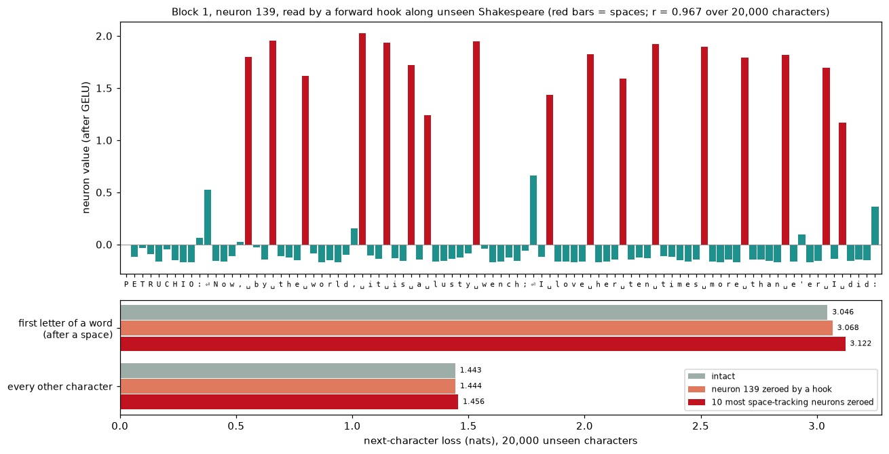
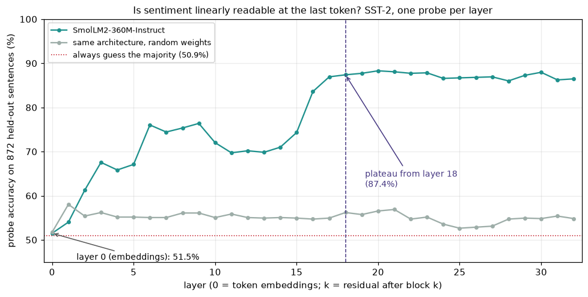
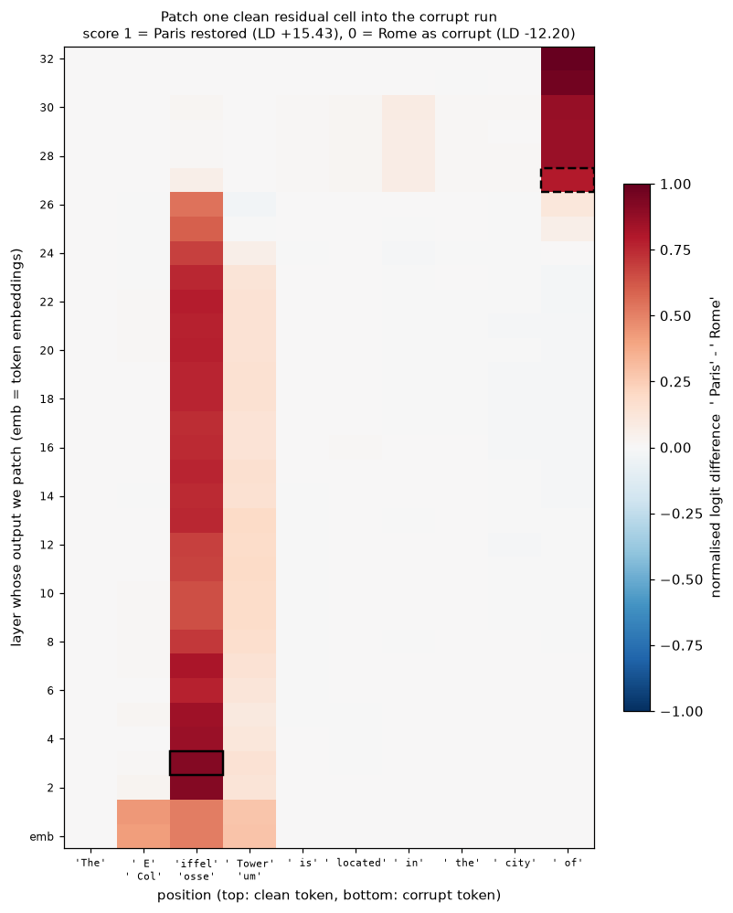
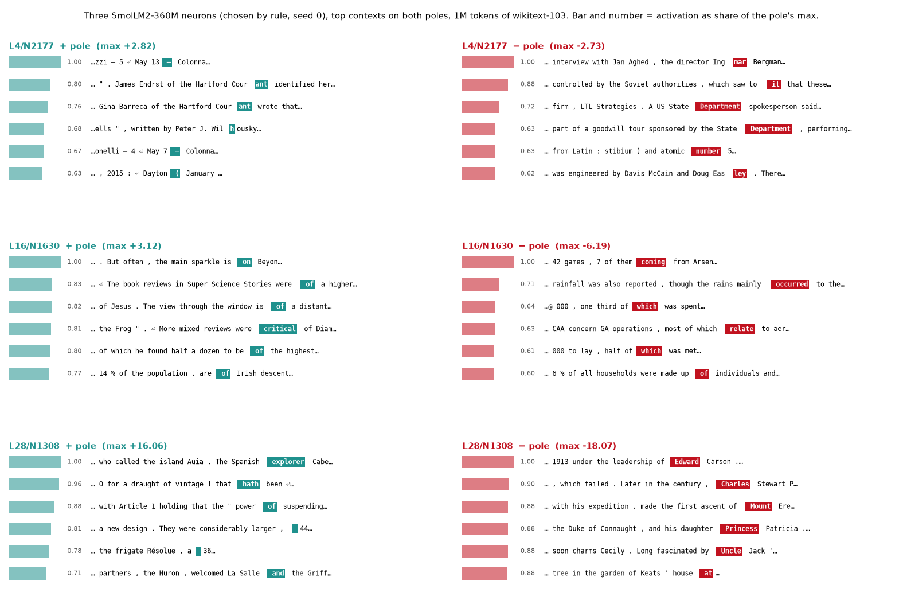

# Module 11: Inside a language model

Modules 04 to 10 built models and used them. This module opens one up while it
runs and asks what it holds. It covers four tools, each on a real model, each
with a figure and the numbers beside it:

1. **Hooks**: read and edit one neuron of module 04's char-GPT with plain PyTorch.
2. **A linear probe**: at which layer of SmolLM2-360M is sentiment readable?
3. **Activation patching**: where does SmolLM2 keep "Eiffel Tower" until it says Paris?
4. **Neuron poles**: what three SmolLM2 neurons respond to, on both signs.

Every number in this README comes from a JSON file in [`results/`](results/),
written by the script that measured it.

This is the first module of track 4, **Looking inside**. Next,
[module 12](../12-features-and-dictionaries/README.md) asks whether neurons are
the right thing to read: toy superposition, sparse autoencoders, and steering.

**🕹 Interactive:** [Inside a language model](../../explorables/11-inside-a-language-model.html):
browse the three neurons pole by pole, hover the probe curve and the patching
heatmap.

**✅ Quiz:** [10 questions](../../quizzes/11.html): check yourself once you have run the four scripts.

## Goals

By the end you will be able to:

- write a forward hook that reads a module's output, and one that edits it;
- extract the residual stream at every layer and fit a probe per layer;
- explain why a probe needs a random-weight control;
- patch one clean activation into a corrupt run and read the heatmap;
- read an MLP neuron by its top contexts on both its positive and its negative pole;
- say what each of these tools can and cannot show.

## Setup

```bash
cd modules/11-inside-a-language-model/python
```

```bash
uv sync
```

| Need | Size | Where |
|---|---|---|
| Module 04's trained char-GPT | 2.5 MB | committed: `../04-attention-transformer/artifacts/` |
| SmolLM2-360M-Instruct | ~700 MB | Hugging Face cache; module 05 already fetched it |
| SST-2 (`stanfordnlp/sst2`) | ~3 MB download, 5.3 MB cached | Hugging Face datasets cache, on first run of `probe.py` |
| wikitext-103, first 1M tokens | ~2.6 MB read from a 157 MB file | `~/.cache/huggingface/mlcourse/`, on first run of `poles.py` |

Wikitext's train file is 157 MB of Parquet, cut into row groups of 1,000
lines. `src/corpus.py` opens it over HTTP and reads row groups until it has one
million tokens: 15 row groups, 9,678 lines, about 2.6 MB of the file.

**The laptop guard.** Every script imports `src/common.py` before torch. It sets
`PYTORCH_MPS_HIGH_WATERMARK_RATIO=0.5`: the Apple GPU may take at most half of
the working set Metal recommends, 5.92 GB on this 16 GB Mac. A run that grows
past it stops with an error instead of pushing the Mac into swap. Torch also needs the low mark below the high one, so
it sets `PYTORCH_MPS_LOW_WATERMARK_RATIO=0.4`. Each script logs its peak memory
(process RSS from `getrusage`, and `torch.mps.driver_allocated_memory()`) and its
time into its results file:

| Script | Minutes | Peak RSS | Peak MPS driver |
|---|---|---|---|
| `src/hooks.py` | 0.02 | 0.61 GB | 0 (runs on the CPU) |
| `src/probe.py` | 1.3 | 2.61 GB | 2.48 GB |
| `src/patching.py` | 0.12 | 2.51 GB | 2.46 GB |
| `src/poles.py` | 4.2 | 3.13 GB | 3.46 GB |

Measured on an Apple M5 with 16 GB, torch 2.14.1. No script holds two big
models at once: `probe.py` frees the trained model before it builds the
random one.

**Tools.** The SmolLM2 sections use [nnsight](https://nnsight.net) 0.8. It
worked on this stack (torch 2.14.1, transformers 5.20.1). Two checks before
trusting it, both in `results/patching.json`:

- nnsight's traced forward against the plain Hugging Face forward: max abs
  difference in logits 0.0;
- one forward pass on MPS against the same weights on the CPU: max abs
  difference in logits 1.5 × 10⁻⁴ (logits span −22.9 to 22.0), same top-1
  token at every position.

Four things about nnsight 0.8 that cost time here:

- `LanguageModel("repo id", device_map="mps")` needs `accelerate`. We load the
  model with `transformers` and wrap it: `TransformersModel(model, tokenizer=tok)`.
- Read sites in the order the model runs them. Asking for layer 5's MLP input
  after layer 5's output raises `OutOfOrderError`.
- Only names bound at the top level of the `with` block and marked `.save()`
  survive it. Build one tensor (`torch.stack(...)`) and save that.
- `tracer.stop()` skips the rest of the forward by raising an exception. Its
  traceback keeps every frame of the forward alive. In our first run of
  `poles.py`, MPS memory grew by about 1 GB per batch and hit the cap; a
  `gc.collect()` after each batch fixed it.

## 1 · Hooks, from scratch

A forward hook is a function PyTorch calls right after a module runs. It sees
the module's input and output. If it returns nothing, it only reads. If it
returns a tensor, that tensor replaces the output, and the rest of the network
runs on the edited value. Libraries such as nnsight and TransformerLens build
on this mechanism.

```python
def hook(module, inputs, output):
    seen.append(F.gelu(output)[0, :, neuron])     # read: return nothing
handle = model.blocks[1].mlp.fc.register_forward_hook(hook)
model(ids[None])
handle.remove()                                    # or it fires on every later call
```

`src/hooks.py` loads the char-GPT that module 04 trained, from its committed
weight file. It records all 1,536 MLP neurons (3 blocks × 512) over 20,000
characters of the validation split, which the model never trained on. Then it
picks one neuron by a stated rule: the one whose value tracks "this character
is a space" most closely.

The winner is **block 1, neuron 139**: Pearson r = 0.967. Its mean value is
1.822 on spaces and −0.082 elsewhere. Read along an unseen passage, it fires on
every space and stays near zero on letters:



**Editing.** A second hook sets the neuron to zero (GELU(0) = 0, so it zeroes
the pre-activation). Loss on the next character, in nats, over the same 20,000
characters:

| | After a space (3,038 chars) | Elsewhere (16,961 chars) |
|---|---|---|
| Intact | 3.046 | 1.443 |
| Neuron 139 zeroed | 3.068 | 1.445 |
| The 10 most space-like neurons zeroed (r ≥ 0.83) | 3.122 | 1.456 |

The neuron reads cleanly, but removing it barely hurts. Removing all ten
space-tracking neurons hurts little more: the loss on the first letter of a
word goes from 3.046 to 3.122 nats, elsewhere from 1.443 to 1.456. So the
model must also mark word starts some other way; this run does not say where.
A neuron that explains a pattern is not the same as a neuron the model needs.

## 2 · A linear probe, layer by layer

A probe asks whether a fact is *linearly readable* from the residual stream at
some layer: can a straight line in that 960-dimensional space separate the
cases? `src/probe.py` feeds SST-2 movie-review sentences to SmolLM2-360M,
keeps the residual vector at the last token after every block, and fits one
logistic regression per layer (2,000 training sentences, 872 held-out ones,
features standardised, C = 0.1).

Two controls:

- **Layer 0**, the token embeddings before any block runs. The last token is
  usually a full stop or a word, so this shows what that one token gives away.
- **The same architecture with random weights** (seed 0). A probe can find
  patterns in any big random projection of the words. If it scored well here,
  a high score on the trained model would tell us about the probe, not the model.

The random-weight control is honest but weak: a deep transformer at random
init mixes tokens poorly, so 58% is a low bar. A stronger one is a
bag-of-words logistic regression on the sentence itself; that is the bar a
model's layers should beat. This module does not run it.



| | Accuracy |
|---|---|
| Always guess the majority class | 50.9% |
| Layer 0 (embeddings) | 51.5% |
| Random weights, best layer (layer 1) | 58.0% |
| Trained, layer 9 | 76.4% |
| Trained, layer 11 | 69.7% |
| Trained, layer 16 | 83.6% |
| **Trained, plateau from layer 18** | **87.4%** |
| Trained, best (layer 20) | 88.3% |
| Trained, last layer (32) | 86.5% |

The plateau rule, fixed before reading the curve: the first layer within one
point of the best. Sentiment arrives in two steps: a first rise to 76.4% by
layer 9, a dip, then a jump between layers 15 and 17. From layer 18 on, the
curve stays between 86.0% and 88.3%. The random-weight curve stays flat,
between 51.7% and 58.0% at every depth.

A probe shows that the information is *there*, in a form a line can read. It
does not show that the model *uses* it. Patching intervenes, and so gets
closer; section 3 says how far.

## 3 · Activation patching

Two prompts that differ only in the landmark, both 10 tokens long:

| | Prompt | Next token |
|---|---|---|
| clean | `The Eiffel Tower is located in the city of` | ` Paris` |
| corrupt | `The Colosseum is located in the city of` | ` Rome` |

The landmark takes positions 1 to 3 in both (` E`, `iffel`, ` Tower` against
` Col`, `osse`, `um`). `src/patching.py` runs the clean prompt once and keeps
its residual stream. Then it reruns the corrupt prompt 330 times, each time
pasting one clean vector into one (layer, position) cell. The metric is the
logit difference LD = logit(` Paris`) − logit(` Rome`), scaled so that 0 is the
corrupt run (LD = −12.20) and 1 is the clean run (LD = +15.43).



The heatmap shows two places:

- **On the landmark, early to middle.** Patching position 2 (`iffel`) restores
  0.919 of the answer at layer 3 (solid box). The landmark positions restore at
  least half the answer from the embeddings up to layer 26.
- **On the last token, late.** At ` of`, patching restores at most 0.004 up to
  layer 24, 0.061 at layer 25 and 0.11 at layer 26, then 0.792 at layer 27
  (dashed box) and 1.0 at layer 32.

So the model holds "Eiffel Tower" on the landmark tokens for most of its
depth, and moves it to the last position at layer 27. Module 05's logit lens
found ` Paris` reaching rank 1 at layer 27 too. Two methods, one layer.

The positions in between (` is` to ` city`) never pass 0.08: the model does
not park the landmark there.

Read the heatmap for what it tests. This run pastes clean into corrupt, which
asks whether a cell is *enough* to bring Paris back. The reverse, pasting
corrupt into clean, asks whether the model *needs* that cell. The two can
disagree (Heimersheim & Nanda,
[How to use and interpret activation patching](https://arxiv.org/abs/2404.15255)).
One prompt pair is also one example, not a rule.

## 4 · Neuron poles

In SmolLM2's SwiGLU MLP, a neuron's value is

```
value = silu(gate_proj(x)) * up_proj(x)        # what down_proj reads; 2,560 per layer
```

It can be large and positive or large and negative, so each neuron has two
**poles**. The Goodfire essay [Neural networks are already
clean](https://already-clean.goodfire.com/) (Cammarata, 2026) reads neurons
this way, pole by pole, and reports that about 90% of Qwen3-32B's poles do
one main job. Those audits are preliminary: the technical paper is not out
yet, and no outside group has checked the result. `src/poles.py` shows the method on three neurons.

It runs SmolLM2 over the first 999,936 tokens of wikitext-103 (3,906 rows of
256 tokens) and keeps, for every neuron in layers 4, 16 and 28, the strongest
contexts on each sign, one per row. Layers here count from 0 as in
`model.model.layers[i]`: `L28/N1308` is neuron 1,308 of `layers[28].mlp`.

**How the three were chosen.** Not by hand. In each of the three layers, keep
the neurons whose two poles are both alive (top value at least 1% of the
layer's median top for that sign), then draw one with
`numpy.random.default_rng(0)`. All 2,560 neurons passed in every layer, so the
draw was from the whole layer.



What the ten contexts per pole show, read by hand:

| Neuron | + pole | − pole |
|---|---|---|
| L4/N2177 (max +2.82 / −2.73) | the dash between dates or numbers in a list (`1895 –`), and word pieces such as `Cour·ant` | the second piece of a name (`Ing·mar`, `Eas·ley`) and `State Department` (three of ten) |
| L16/N1630 (max +3.12 / −6.19) | mostly a preposition straight after *is* or *were* (`is on`, `were of`, `was at`) | the verb or `which` after a share (`7 of them coming`, `one third of which`, `most of which relate`) |
| L28/N1308 (max +16.06 / −18.07) | mixed: `explorer` after a nationality, `hath`, `power of`, a space before a number | mostly the first word of a name or place, often after a preposition or comma (`of Edward`, `Charles`, `Mount`, `Princess`, `Uncle`) |

Read by eye, some poles look like one job; some look like two or a mix. In
L28/N1308 the positive pole is a mix and the negative pole reads cleanly; a
reading of the positive side alone would miss it. In all 60 top contexts
`silu(gate)` is positive, so in these contexts the sign of `up_proj` sets the
pole. The essay's "double negative" (both negative, product positive) does
not occur among them.

**This is a demo, not a measurement.** Three neurons and a reader's eye prove
nothing about the other 81,917. A measurement needs more: 100 neurons, both
poles, a labeller checked against a control, and an expectation written down
before the run. That is a separate experiment, outside this course; this
module does not run it.

## The logit lens

Module 05 already built the logit lens: push each layer's residual through the
final norm and the output head, and read what it would predict. It found
` Paris` reaching rank 1 at layer 27 for the same prompt used in section 3.
See [module 05](../05-transformers-library/README.md) and its
[explorable](../../explorables/05-transformer-anatomy.html), panel 3. This
module does not rebuild it.

## Run it

Each script prints its numbers, writes `results/<name>.json`, and with
`--figures` redraws its figure.

```bash
uv run python src/hooks.py --figures
```

```bash
uv run python src/probe.py --figures
```

```bash
uv run python src/patching.py --figures
```

```bash
uv run python src/poles.py --figures
```

Redraw every figure from the committed JSON, with no model loaded:

```bash
uv run python src/figures.py
```

Rewrite the explorable's data block from the JSON:

```bash
uv run python src/export_explorable.py
```

## Exercises

Skeletons with `# TODO(you):` live in [`exercises/`](exercises/); reference
solutions are in [`solutions/`](solutions/). Each asks you to predict before
you run.

- **(a) `exercise_a_hooks.py`**: write the reading hook and an editing
  *pre*-hook that scales one neuron by k, on module 04's char-GPT. Runs on the
  CPU in a second.
- **(b) `exercise_b_plain_probe.py`**: extract the probe's residuals with plain
  `register_forward_hook` calls, no nnsight, and write the plateau rule. The
  test checks your vectors against nnsight's.
- **(c) `exercise_c_patch_cell.py`**: patch one (layer, position) cell with two
  hooks and normalise the logit difference. The test checks three cells
  against the heatmap.

## Tests

```bash
uv run pytest
```

Thirteen tests, under 10 seconds once SmolLM2 is cached. They check the
solutions against the scripts, the committed results against the laptop
budget, and the explorable against the results.

## To go further

Larger open models come with public sparse-autoencoder sets, which read
features instead of raw neurons ([module 12](../12-features-and-dictionaries/README.md) explains them). Each needs a
licence click on the Hugging Face Hub, so this module ships no code for them. [Gemma 3 1B](https://huggingface.co/google/gemma-3-1b-pt)
with [Gemma Scope 2](https://huggingface.co/google/gemma-scope-2), and
[Gemma 2 2B](https://huggingface.co/google/gemma-2-2b) with
[Gemma Scope](https://huggingface.co/google/gemma-scope), are the two to start with. [Llama 3.2 1B](https://huggingface.co/meta-llama/Llama-3.2-1B)
is the same recipe as SmolLM2, larger. [Neuronpedia](https://www.neuronpedia.org)
lets you browse neurons and features of these models in a browser.
[ARENA chapter 1](https://learn.arena.education/) (transformer
interpretability) works through hooks, probes, patching and circuits at length. For the field
as a whole, read the course's research page
[Interpretability](../../research/interp.html), and Sharkey et al.,
[Open Problems in Mechanistic Interpretability](https://arxiv.org/abs/2501.16496)
(2025), a map of what is still open. One caution before module 12: on sparse
probing, sparse autoencoders did not reliably beat simple baselines such as a probe on
the raw activations (Kantamneni et al.,
[Are Sparse Autoencoders Useful?](https://arxiv.org/abs/2502.16681), 2025),
which backs this module's "demo, not a measurement" stance.

## Checkpoint: you should now be able to…

- register, use and remove a forward hook and a pre-hook, for reading and for editing;
- say why a neuron that tracks a pattern can still be one the model barely needs;
- fit a probe per layer and name the layer where accuracy plateaus;
- explain what the random-weight control rules out;
- read a patching heatmap: where the information sits, and when it moves;
- read a SwiGLU neuron on both poles, and say why three neurons prove nothing.

## Links

- [nnsight documentation](https://nnsight.net)
- [PyTorch `register_forward_hook`](https://docs.pytorch.org/docs/stable/generated/torch.nn.Module.html#torch.nn.Module.register_forward_hook)
- Meng et al., [Locating and Editing Factual Associations in GPT](https://arxiv.org/abs/2202.05262) (2022), the source of causal tracing
- Belinkov, [Probing Classifiers: Promises, Shortcomings, and Advances](https://arxiv.org/abs/2102.12452) (2021)
- Cammarata, [Neural networks are already clean](https://already-clean.goodfire.com/) (Goodfire, 2026)
- [SmolLM2-360M-Instruct model card](https://huggingface.co/HuggingFaceTB/SmolLM2-360M-Instruct)
