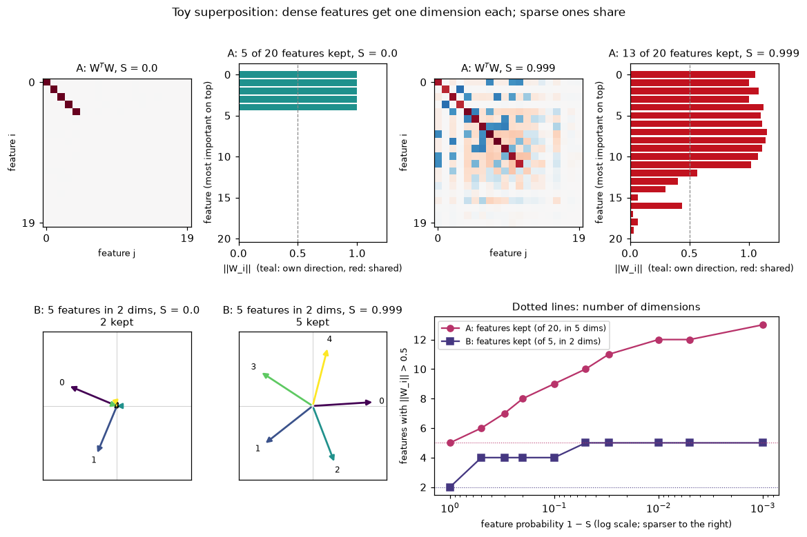
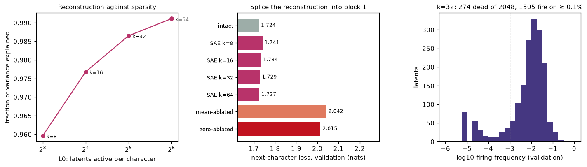
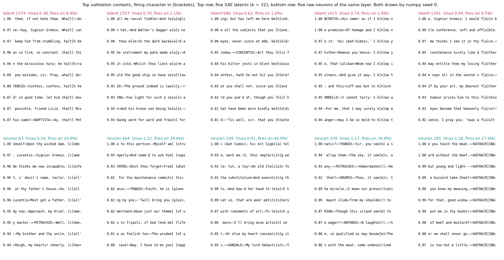
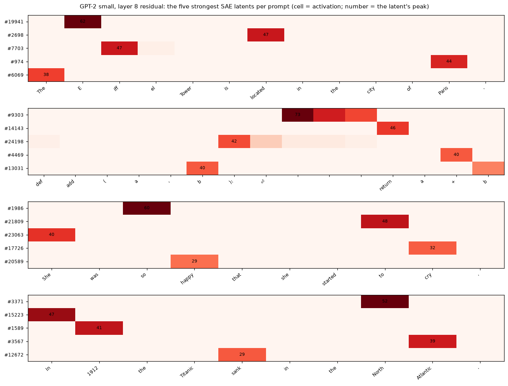
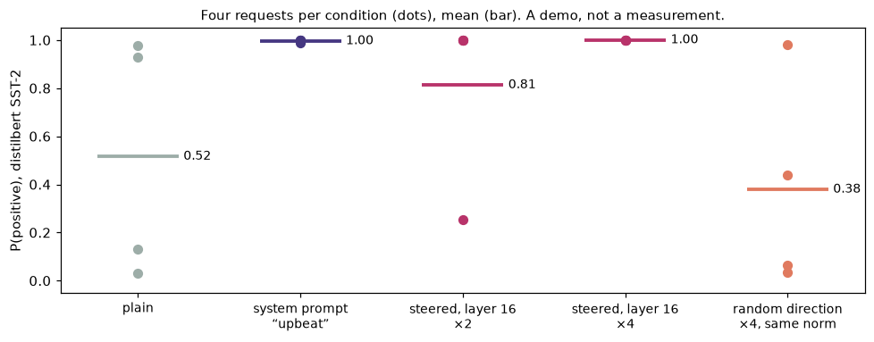

# Module 12: Features and dictionaries

Module 11 read single neurons. This module asks whether neurons are the right
thing to read, and tries the main alternative: a **sparse autoencoder** (SAE),
which rewrites each activation as a few directions picked from a large
dictionary. It has four sections, each with a figure and the numbers beside it:

1. **Toy superposition**: when does a small model pack more features than it has dimensions?
2. **An SAE from scratch** on module 04's char-GPT: how well it rebuilds the layer, and what its latents read as.
3. **A published SAE, the library way**: GPT-2 small, layer 8, through SAELens and TransformerLens.
4. **Steering against prompting**: a demo on SmolLM2-360M-Instruct.

Every number in this README comes from a JSON file in [`results/`](results/),
written by the script that measured it.

This is the second module of track 4, **Looking inside**. A third, on vision
models, is planned.

**🕹 Interactive:** [Features and dictionaries](../../explorables/12-features-and-dictionaries.html):
move the sparsity of the toy model, browse SAE latents and raw neurons by their
top contexts, see which GPT-2 latents fire on a prompt.

**✅ Quiz:** [10 questions](../../quizzes/12.html): check yourself once you have run the four scripts.

## Goals

By the end you will be able to:

- train the toy model of superposition and say what sparsity changes;
- write a TopK sparse autoencoder and train it on a layer's activations;
- measure an SAE: variance explained, L0, dead latents, and the loss when its output replaces the layer;
- load a published SAE with SAELens, and by hand from its weight file;
- add a steering vector during generation, and say why a sentiment score alone cannot judge it;
- say what each of these tools can and cannot show.

## Setup

```bash
cd modules/12-features-and-dictionaries/python
```

```bash
uv sync
```

| Need | Size | Where |
|---|---|---|
| Module 04's trained char-GPT | 2.5 MB | committed: `../04-attention-transformer/artifacts/` |
| GPT-2 small (`gpt2`) | 548 MB | Hugging Face cache, on first run of `gpt2_sae.py` |
| GPT-2 SAE, layer 8 only (`jbloom/GPT2-Small-SAEs-Reformatted`) | 151 MB, plus a 98 KB sparsity file | Hugging Face cache, on first run of `gpt2_sae.py` |
| wikitext-103, first 2 row groups | 0.37 MB read from a 157 MB file | `~/.cache/huggingface/mlcourse/`, on first run of `gpt2_sae.py` |
| SmolLM2-360M-Instruct | ~700 MB | Hugging Face cache; module 05 already fetched it |
| distilbert fine-tuned on SST-2 | ~260 MB | Hugging Face cache; module 05 already fetched it |

`src/corpus.py` reads wikitext the way module 11 does: it opens the Parquet
file over HTTP and reads only the row groups it needs. Two row groups hold
2,000 lines and 626,180 characters, more than the 65,024 GPT-2 tokens section 3
uses.

**The laptop guard.** Every script imports `src/common.py` before torch. It sets
`PYTORCH_MPS_HIGH_WATERMARK_RATIO=0.5` and `PYTORCH_MPS_LOW_WATERMARK_RATIO=0.4`:
the Apple GPU may take at most 5.92 GB on this 16 GB Mac, and a run that grows
past that stops with an error instead of pushing the Mac into swap. Each script
logs its time and peak memory (process RSS from `getrusage`, and
`torch.mps.driver_allocated_memory()`) into its results file:

| Script | Minutes | Peak RSS | Peak MPS driver |
|---|---|---|---|
| `src/toy.py` | 0.94 | 0.35 GB | 0 (runs on the CPU) |
| `src/sae.py` | 3.74 | 1.72 GB | 4.96 GB |
| `src/gpt2_sae.py` | 0.67 | 2.03 GB | 3.24 GB |
| `src/steer.py` | 0.30 | 2.39 GB | 1.43 GB |

Measured on an Apple M5 with 16 GB, torch 2.14.1. No script holds two big
models at once: `steer.py` frees SmolLM2 before it loads the sentiment scorer.
Most of `sae.py`'s MPS memory is the one million training activations
(1,003,776 × 512 floats, 2 GB), kept on the GPU.

**Tools.** Section 3 pins TransformerLens 3.9 and SAELens 6 in this module's
own uv project. They installed beside torch 2.14.1 and transformers 5.20.1
with no conflict (TransformerLens 3.9.0, SAELens 6.54.5), so no fallback was
needed. Exercise (c) still loads the SAE by hand from its weight file, in a
dozen lines, and checks it against SAELens.

**MPS against CPU.** One GPT-2 forward pass on "The Eiffel Tower is located
in the city of Paris.", on MPS and then on the CPU: max abs difference in
logits 1.7 × 10⁻⁴ (logits span −134.6 to −38.9), same top-1 token at every
position. In `results/gpt2_sae.json`, `mps_vs_cpu`.

## 1 · Toy superposition

The toy model from Elhage et al., [Toy Models of
Superposition](https://transformer-circuits.pub/2022/toy_model/index.html)
(2022). It has *n* features and only *m* < *n* dimensions to hold them:

```
h  = W x                  # squeeze n features into m dimensions
x' = ReLU(Wᵀ h + b)       # read the n features back out
loss = Σᵢ Iᵢ (xᵢ − x'ᵢ)²   # Iᵢ: how much feature i matters
```

Each feature is zero with probability S, the **sparsity**, and uniform on
[0, 1] otherwise. Column Wᵢ is the direction the model gives feature i. A
feature counts as kept when ‖Wᵢ‖ > 0.5, and as sharing when the other
features' columns project onto its direction (Σⱼ≠ᵢ (Ŵᵢ·Wⱼ)² > 0.1).
`src/toy.py` trains two setups at ten sparsities, three seeds each, and keeps
the seed with the lowest loss:

- **A**: 20 features in 5 dimensions, importance 0.7ⁱ (the paper's main setup);
- **B**: 5 features in 2 dimensions, importance 0.9ⁱ, so every direction fits on the page.



| S | A: kept (of 20) | A: of those, sharing | B: kept (of 5) |
|---|---|---|---|
| 0 | 5 | 0 | 2 |
| 0.5 | 6 | 2 | 4 |
| 0.7 | 7 | 4 | 4 |
| 0.8 | 8 | 6 | 4 |
| 0.9 | 9 | 8 | 4 |
| 0.95 | 10 | 10 | 5 |
| 0.97 | 11 | 11 | 5 |
| 0.99 | 12 | 12 | 5 |
| 0.995 | 12 | 12 | 5 |
| 0.999 | 13 | 13 | 5 |

With dense features (S = 0), each model keeps exactly as many features as it
has dimensions, each on its own axis, and drops the rest: Wᵀ W is five dots on
the diagonal. As features get rarer, the model keeps more of them than it has
dimensions. They share directions, and the ReLU clips most of the crosstalk,
because two rare features seldom fire together. At S = 0.999 setup A keeps 13
features in 5 dimensions, and setup B lays its 5 features out as a pentagon in
2.

**What this shows, and what it does not.** It shows that a ReLU readout *can*
store more sparse features than it has dimensions, and that sparsity sets how
many. It is a toy with made-up, independent features. It says nothing about
whether a trained language model does this. The Goodfire essay [Neural
networks are already clean](https://already-clean.goodfire.com/) (Cammarata,
2026) finds no fault with the toy but disputes that step: it argues that real
networks reuse what features share instead of packing unrelated ones. The
course wiki's concept page *Superposition* lists the senses of the word and
where the essay and the toy-model paper part.

To train a toy model and an SAE live in the browser, see the research page
[Interpretability](../../research/interp.html#superposition).

## 2 · A sparse autoencoder, from scratch

If a layer stores more features than it has neurons, a neuron will mix
several of them. A **sparse autoencoder** tries to pull them apart. It maps an
activation x to a wide, mostly-zero code z, then rebuilds x from it:

```
z  = TopK(ReLU(W_enc (x − b_pre) + b_enc))   # 2,048 latents; keep the k largest, zero the rest
x' = W_dec z + b_pre                         # each column of W_dec has norm 1
```

Each column of W_dec is a dictionary entry. A **latent** is one entry of z:
the hope is that each latent fires for one thing.

**TopK, not L1.** The older recipe adds an L1 penalty on z to the loss. TopK
(Gao et al., [Scaling and evaluating sparse
autoencoders](https://arxiv.org/abs/2406.04093), 2024) keeps the k largest
values instead. We chose it for two reasons: k *is* the L0 (latents active per
input), so one knob sets the sparsity directly; and nothing pulls the kept
values toward zero, which an L1 penalty does at the cost of reconstruction.

`src/sae.py` hooks the input of `blocks[1].mlp.proj` in module 04's char-GPT:
the 512 post-GELU neurons of block 1, the layer module 11 read. It records them
on every character of the training split (1,003,776 characters) and trains one
SAE per k in {8, 16, 32, 64}: 2,048 latents, Adam at 10⁻³, 2,000 steps of
4,096 characters. All numbers below come from the validation split (111,488
characters), which neither module 04 nor the SAE trained on. Run a second
time on the same Mac, `sae.py` gave the same numbers to the last digit;
another chip or torch version may not.

To test what the SAE keeps, a hook replaces the 512 neurons with the SAE's
rebuild, and `mlp.proj` runs on that. Two baselines replace them with their
training mean, or with zeros.



| | Variance explained | L0 | Dead latents (of 2,048) | Next-char loss (nats) | Loss gap closed |
|---|---|---|---|---|---|
| Intact model | | | | 1.724 | |
| SAE, k = 8 | 96.0% | 8 | 1,064 | 1.741 | 94.6% |
| SAE, k = 16 | 97.7% | 16 | 697 | 1.734 | 96.8% |
| **SAE, k = 32** | **98.7%** | **32** | **274** | **1.729** | **98.4%** |
| SAE, k = 64 | 99.1% | 64 | 5 | 1.727 | 99.2% |
| Neurons replaced by their mean | | | | 2.042 | 0% |
| Neurons replaced by zeros | | | | 2.015 | |

"Loss gap closed" is (mean-ablated − SAE) / (mean-ablated − intact). A dead
latent never fires on the validation text. Small k leaves many latents dead:
at k = 8 more than half never fire. Gao et al. add an auxiliary loss (AuxK)
that trains dead latents on the error the live ones leave; this script does
not, so the dead counts are what plain TopK gives.

The rest of this section reads the k = 32 SAE. Of its latents, 1,505 fire on
at least 0.1% of validation characters. We call those **alive**.

**Five latents and five neurons.** Not chosen by hand: shuffle the alive
latents with `numpy.random.default_rng(0)` and take the first five. The same
rule picks five of the 512 neurons (all are alive). For each, the ten
strongest validation characters, at least 24 characters apart:



| Unit | Fires on | Its ten strongest characters, read by eye |
|---|---|---|
| latent 1274 | 0.37% of characters | `t` after `ha`: `that`, `what`, `hath` (all ten) |
| latent 1557 | 2.1% | `a` after `w` (`twa`, `swa`, `backwa`), and twice `n` (`tawn`, `frown`) |
| latent 686 | 0.97% | `h` after the prefix `be` (`behind`, `beheld`), or starting the word after `you` or `thou` (`have`, `here`) |
| latent 1415 | 1.9% | the letter after a word-initial `k`: `kn` eight times (`I know`, `I knew`), `ke` twice |
| latent 1391 | 0.51% | `a` after a word-initial `f` (`face`, `father`, `fault`), once in `affable` |
| neuron 63 | 30% | `c` starting a word after a comma (nine) or a semicolon (one) |
| neuron 464 | 40% | a space after a word (often one ending in `m`), or `g` starting the word after `is` or `you` |
| neuron 109 | 41% | a letter late in a long word (`Itali·a`, `executi·n`, `petiti·o`) |
| neuron 339 | 40% | `m` in `seem` (five) and `r` after `e` (`shoulder`, `laughter`, `preserve`; five) |
| neuron 285 | 28% | `R` in the name `KATHARINA`, all ten |

**Latents against neurons, hedged.** By eye, four of the five latents read as
one spelling pattern each, and latent 686 as one letter in two settings; of
the five neurons, two read as one pattern (63 and 285), one as two (339), and
two look mixed. That is ten units and one reader. The firing
rates are firmer: the latents fire on 0.4% to 2.1% of characters, the neurons
on 28% to 41%. A neuron's top ten show a thin slice of what it does; a latent's
top ten show more of it.

An automatic check, crude on purpose: for each unit, take its 50 strongest
validation characters and ask what share are the same character. Over all
1,505 alive latents the median is 1.0, and 75% of latents score at least 0.9.
Over all 512 neurons the median is 0.72, and 31.2% score at least 0.9. This
measures one narrow kind of "one thing" (the same letter), not meaning.

## 3 · A published SAE, the library way

SAEs for real models train on hundreds of millions of tokens, and teams
publish them. [SAELens](https://github.com/jbloomAus/SAELens) loads them by
name, and [TransformerLens](https://github.com/TransformerLensOrg/TransformerLens)
runs the model with named hook points, so the two fit together:

```python
sae = SAE.from_pretrained("gpt2-small-res-jb", "blocks.8.hook_resid_pre")
model = HookedTransformer.from_pretrained_no_processing("gpt2", center_writing_weights=True)
_, cache = model.run_with_cache(tokens, names_filter="blocks.8.hook_resid_pre")
z = sae.encode(cache["blocks.8.hook_resid_pre"])            # (batch, tokens, 24,576)
```

This SAE (Joseph Bloom, 2024) reads GPT-2 small's residual stream before block
8: 768 dimensions into 24,576 latents. It is the older kind, a ReLU encoder
trained with an L1 penalty, on 300M tokens of OpenWebText. SAELens warns that
GPT-2 should be loaded the way the SAE was trained: no weight processing
except what the SAE's metadata asks for (`center_writing_weights=True`). We do.

`src/gpt2_sae.py` runs 512 rows of wikitext (a BOS token plus 127 tokens each)
through GPT-2 and encodes every position after BOS: 65,024 tokens.

| | Value |
|---|---|
| L0, latents active per token | 73.3 |
| Variance explained | 82.5% |
| Next-token loss, intact | 4.093 nats |
| Next-token loss, SAE's rebuild spliced in at layer 8 | 4.377 nats |
| Next-token loss, residual zeroed at layer 8 | 11.335 nats |
| Loss gap closed (against zeroing) | 96.1% |
| Latents that fire at least once in 65,024 tokens | 24,440 of 24,576 |

Our hand-made SAE explained 98.7% of its layer with 32 latents; this one
explains 82.5% with 73. The layers differ (a 768-wide residual stream of a
124M-parameter model against 512 neurons of a 0.6M one), and so does the text:
the SAE was trained on web text, and we feed it Wikipedia. The splice costs
0.28 nats.

**Top latents for four prompts.** For each prompt, the five latents with the
largest activation on any token, and their Neuronpedia pages, where each
latent has far more contexts and an automatic description:



| Prompt | Latent (token where it peaks, activation) |
|---|---|
| The Eiffel Tower is located in the city of Paris. | [19941](https://www.neuronpedia.org/gpt2-small/8-res-jb/19941) (` E`, 62.3) · [2698](https://www.neuronpedia.org/gpt2-small/8-res-jb/2698) (` located`, 47.0) · [7703](https://www.neuronpedia.org/gpt2-small/8-res-jb/7703) (`iff`, 46.9) · [974](https://www.neuronpedia.org/gpt2-small/8-res-jb/974) (` Paris`, 43.9) · [6069](https://www.neuronpedia.org/gpt2-small/8-res-jb/6069) (`The`, 38.3) |
| `def add(a, b):` / `return a + b` | [9303](https://www.neuronpedia.org/gpt2-small/8-res-jb/9303) (indent space, 73.0) · [14143](https://www.neuronpedia.org/gpt2-small/8-res-jb/14143) (` return`, 46.5) · [24198](https://www.neuronpedia.org/gpt2-small/8-res-jb/24198) (`):`, 42.4) · [4469](https://www.neuronpedia.org/gpt2-small/8-res-jb/4469) (` +`, 39.9) · [13031](https://www.neuronpedia.org/gpt2-small/8-res-jb/13031) (` b`, 39.9) |
| She was so happy that she started to cry. | [1986](https://www.neuronpedia.org/gpt2-small/8-res-jb/1986) (` so`, 60.3) · [21809](https://www.neuronpedia.org/gpt2-small/8-res-jb/21809) (` to`, 47.6) · [23063](https://www.neuronpedia.org/gpt2-small/8-res-jb/23063) (`She`, 39.6) · [17726](https://www.neuronpedia.org/gpt2-small/8-res-jb/17726) (` cry`, 32.0) · [20589](https://www.neuronpedia.org/gpt2-small/8-res-jb/20589) (` happy`, 29.0) |
| In 1912 the Titanic sank in the North Atlantic. | [3371](https://www.neuronpedia.org/gpt2-small/8-res-jb/3371) (` North`, 52.4) · [15223](https://www.neuronpedia.org/gpt2-small/8-res-jb/15223) (`In`, 47.0) · [1589](https://www.neuronpedia.org/gpt2-small/8-res-jb/1589) (` 1912`, 41.2) · [3567](https://www.neuronpedia.org/gpt2-small/8-res-jb/3567) (` Atlantic`, 38.7) · [12672](https://www.neuronpedia.org/gpt2-small/8-res-jb/12672) (` sank`, 28.6) |

Each latent peaks on one token of the prompt (the figure). Their top ten
contexts in our 65,024 tokens, for example:

- **1589** fires on years from 1908 to 1914, all ten;
- **12672** on ` sink`, ` sunk`, ` sank`, ` sinking` (six), then ` torpedo` at under a sixth of that;
- **17726** on ` sob`, ` weep` and ` Scream`, then weaker on unrelated tokens;
- **974** on ` Paris` twice; the next eight, all under a sixth of its peak, are mostly other place names (` Tokyo`, ` Mumbai`, the pieces of ` Versailles`), and ` Venus` twice.

Ten contexts in a small sample are a thin basis; the Neuronpedia pages show
each latent on far more text. The format is
`https://www.neuronpedia.org/gpt2-small/8-res-jb/<index>`; we checked that
page 1986 resolves.

## 4 · Steering against prompting (a demo)

A **steering vector** is a direction added to the residual stream while the
model generates. `src/steer.py` builds the plainest kind on
SmolLM2-360M-Instruct: the mean output of `model.model.layers[16]` (averaged
over tokens) on eight positive sentences, minus the same on eight negative
ones. Its norm is 64.4. On the four requests, the median token's residual
there has norm 257.5 (the first token left out). A forward hook
adds 2× or 4× the vector at every position, so ×4 adds about one median
residual's length.

Five conditions, four neutral requests, 48 greedy tokens each:

- **plain**: the chat template's default system prompt;
- **prompt**: the system prompt "Reply in an upbeat tone.";
- **steer ×2** and **steer ×4**: plain, plus the vector at layer 16;
- **random ×4**: plain, plus a random direction of the same norm, scaled ×4 (a control).

We picked layer 16 and the two scales by eye, after trying layers 8, 12, 16
and 20 at ×2, ×4 and ×8 on the first two requests (Monday morning, autumn
weather). Those two requests shaped the choice, so only the other two (bus
station, laundry) test it, and two replies test little. The score is
P(positive) from distilbert fine-tuned on SST-2, loaded after SmolLM2 is
freed.



| Condition | Mean P(positive) over four requests |
|---|---|
| plain | 0.52 |
| prompt | 0.996 |
| steer ×2 | 0.81 |
| steer ×4 | 1.00 |
| random ×4 | 0.38 |

The replies matter more than the score:

**Describe a typical Monday morning.**

| Condition | P(positive) | Reply, first 48 tokens (cut) |
|---|---|---|
| plain | 0.13 | A typical Monday morning for me is always a bit chaotic. I wake up early, around 6:00 AM, and start my day … |
| prompt | 1.00 | A typical Monday morning is always exciting and full of possibilities. As soon as you wake up, you're greeted … |
| steer ×2 | 1.00 | I'm excited to share this with you. A typical Monday morning is filled with a variety of activities that … |
| steer ×4 | 1.00 | I'm feeling inspired and can share a few ideas for a few of the upcoming events, which are also a great for … |
| random ×4 | 0.03 | I.satellite.satellite.user.user.number2,i.user.name.satellite.user.number.number.space.space.system.satellite. … |

**What is a bus station like?**

| Condition | P(positive) | Reply, first 48 tokens (cut) |
|---|---|---|
| plain | 0.98 | A bus station is a place where people go to get on and off buses. It's usually a big building with lots of … |
| prompt | 1.00 | A bus station is a bustling hub of activity, where people from all walks of life gather to catch their daily … |
| steer ×2 | 1.00 | A bus station is a beautiful and inviting space that is designed to be functional, accessible, and inspiring. … |
| steer ×4 | 1.00 | I'm feeling incredibly inspired and can share a few ideas for a specific topic, which is a great for a guest … |
| random ×4 | 0.44 | I.satellite.satellite.node.node.node.node.node.system.node.system.system.system.system.environment.environment … |

**Write two sentences about doing the laundry.**

| Condition | P(positive) | Reply, first 48 tokens (cut) |
|---|---|---|
| plain | 0.03 | 1. Laundry is a task that requires patience and attention to detail, as it involves washing and drying … |
| prompt | 0.99 | Doing the laundry is a great way to unwind and relax after a long day. You can start by gathering all the … |
| steer ×2 | 0.25 | I can do the laundry, and I can also help with the dishes, so I can focus on other tasks. |
| steer ×4 | 1.00 | I'm enjoying the inspiration for a new project, and I can share some of the details for the upcoming events, … |
| random ×4 | 0.06 | I.address.address.i.name.i.year,i.year,time.year,time.year,time.year,time.year,time.year,year)  i.address.i. |

The fourth request (autumn weather) is in `results/steer.json` and the
explorable. What the four show:

- The prompt makes every reply upbeat and keeps it on topic.
- Steering ×2 makes three of four replies upbeat and roughly on topic (the
  autumn reply describes warm, sunny weather); the laundry reply turns into a
  short, flat offer to help.
- Steering ×4 scores 1.00 on all four, but three replies leave the request
  for feeling inspired and upcoming events; the fourth mentions the weather
  and calls it summer. The scorer cannot see that.
- A random direction of the same size breaks the text into strings of words
  and dots. The sentiment vector at ×4 still gives mostly fluent English, so
  in this one draw the size of the push alone does not explain what it does.

**This is a demo, not a measurement.** Four requests, one layer and two scales
chosen by eye on two of them, one random direction, and a score that ignores
whether the reply answers the request. A
measured comparison needs more: many prompts, a fluency score, a random-vector
control over several seeds, and an expectation written down before the run.
That is a separate experiment, outside this course; this module does not run
it. For published comparisons, see [AxBench](https://arxiv.org/abs/2501.17148)
(2025), which found prompting ahead of steering on its benchmark.

## Run it

Each script prints its numbers, writes `results/<name>.json`, and with
`--figures` redraws its figure.

```bash
uv run python src/toy.py --figures
```

```bash
uv run python src/sae.py --figures
```

```bash
uv run python src/gpt2_sae.py --figures
```

```bash
uv run python src/steer.py --figures
```

Redraw every figure from the committed JSON, with no model loaded:

```bash
uv run python src/figures.py
```

Rewrite the explorable's data block from the JSON:

```bash
uv run python src/export_explorable.py
```

## Exercises

Skeletons with `# TODO(you):` live in [`exercises/`](exercises/); reference
solutions are in [`solutions/`](solutions/). Each asks you to predict before
you run.

- **(a) `exercise_a_toy.py`**: write the toy model's forward pass and loss for
  one model, and the "kept" count; train 5 features in 2 dimensions, dense and
  sparse. Runs on the CPU in a few seconds.
- **(b) `exercise_b_topk.py`**: write the TopK encoder, the fraction of
  variance explained, and the gradient projection that keeps decoder columns
  at norm 1. The test checks your encoder against `src/sae.py`.
- **(c) `exercise_c_sae_by_hand.py`**: load GPT-2's layer-8 SAE from its
  safetensors file with no SAELens, and write encode and decode. The test
  checks both against SAELens.

## Tests

```bash
uv run pytest
```

Fifteen tests, under 10 seconds once the GPT-2 SAE is cached. They check the
solutions against the scripts and SAELens, the committed results against the
laptop budget, and the explorable against the results.

## To go further

Larger open models have public SAE sets, browsable on
[Neuronpedia](https://www.neuronpedia.org). Each model below needs a licence
click on the Hugging Face Hub, so this module ships no code for them.
[Gemma 3 1B](https://huggingface.co/google/gemma-3-1b-pt) with
[Gemma Scope 2](https://huggingface.co/google/gemma-scope-2), and
[Gemma 2 2B](https://huggingface.co/google/gemma-2-2b) with
[Gemma Scope](https://huggingface.co/google/gemma-scope), are the two to start
with. For [Llama 3.1 8B](https://huggingface.co/meta-llama/Llama-3.1-8B) there
are Goodfire's [SAE on the instruct model](https://huggingface.co/Goodfire/Llama-3.1-8B-Instruct-SAE-l19)
and [Llama Scope](https://huggingface.co/fnlp/Llama-Scope); browse them on
[Neuronpedia](https://www.neuronpedia.org/llama3.1-8b). For the field as a
whole, including why some teams stepped back from SAEs in 2025, read the
course's research page [Interpretability](../../research/interp.html).

## Checkpoint: you should now be able to…

- say what sparsity does in the toy model, and why that is not evidence about real networks;
- write a TopK SAE and name its knob;
- read an SAE's numbers: variance explained, L0, dead latents, spliced loss;
- say why a latent's top ten can look cleaner than a neuron's, beyond meaning;
- load a published SAE with SAELens and by hand;
- add a steering vector, and say why a sentiment score alone cannot judge the reply.

## Links

- Elhage et al., [Toy Models of Superposition](https://transformer-circuits.pub/2022/toy_model/index.html) (2022)
- Bricken et al., [Towards Monosemanticity](https://transformer-circuits.pub/2023/monosemantic-features) (2023), SAEs on a one-layer model's MLP
- Gao et al., [Scaling and evaluating sparse autoencoders](https://arxiv.org/abs/2406.04093) (2024), TopK SAEs
- Turner et al., [Steering Language Models With Activation Engineering](https://arxiv.org/abs/2308.10248) (2023)
- Rimsky et al., [Steering Llama 2 via Contrastive Activation Addition](https://arxiv.org/abs/2312.06681) (2023)
- Wu et al., [AxBench](https://arxiv.org/abs/2501.17148) (2025)
- Cammarata, [Neural networks are already clean](https://already-clean.goodfire.com/) (Goodfire, 2026)
- [SAELens](https://github.com/jbloomAus/SAELens) · [TransformerLens](https://github.com/TransformerLensOrg/TransformerLens) · [Neuronpedia, GPT-2 small 8-res-jb](https://www.neuronpedia.org/gpt2-small/8-res-jb)
