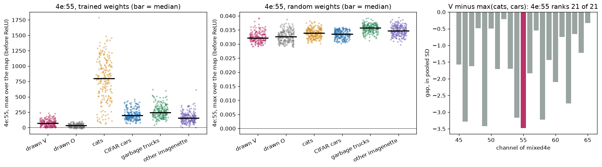
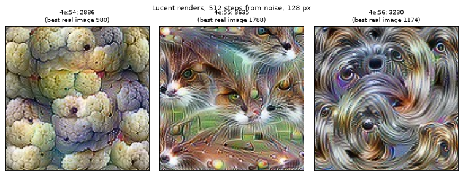
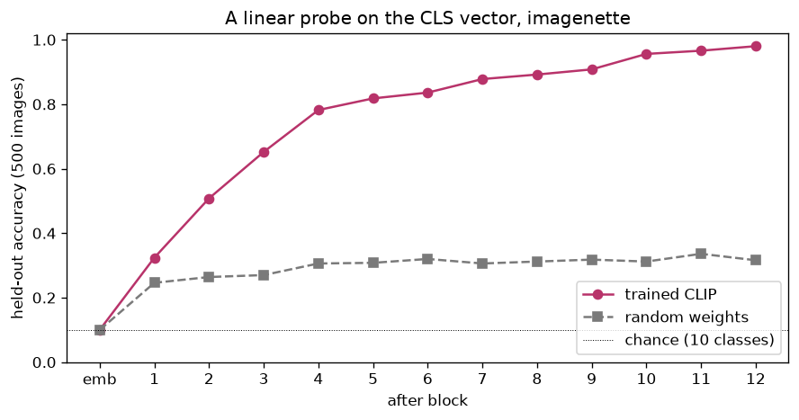
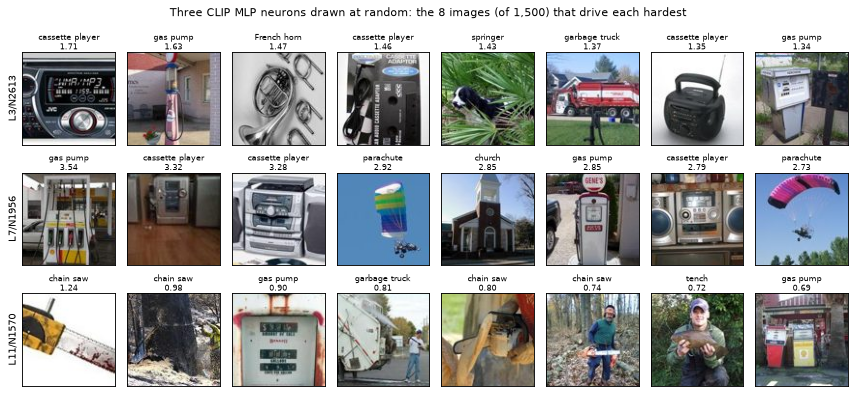
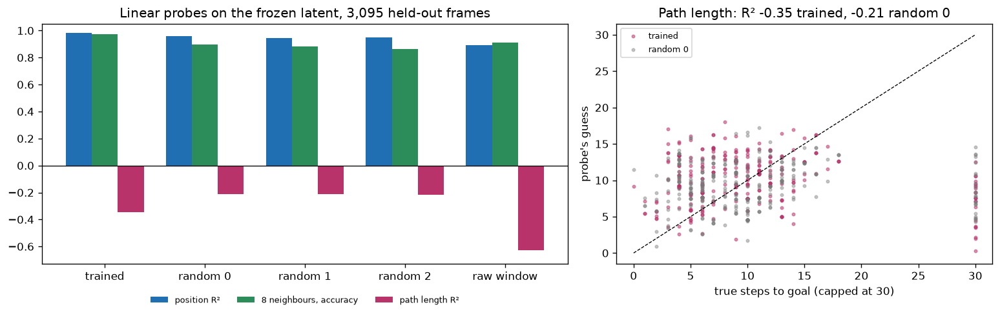

# Module 13: Inside vision and JEPA models

Modules 11 and 12 opened language models. This module opens vision models,
and one small world model. It covers four questions, each with a figure and
the numbers beside it:

1. **The V neuron**: does InceptionV1 channel 4e:55 respond to V shapes, as it is said to?
2. **Feature visualisation**: what image does a channel want, if we paint one for it?
3. **Inside CLIP**: at which block can a line read the class, and what do single neurons respond to?
4. **What a JEPA latent holds**: position, neighbours, and the length of the path to the goal.

Every number in this README comes from a JSON file in [`results/`](results/),
written by the script that measured it.

Sections 1 and 4 repeat two measurements that were planned, with their
expected results written down, before they ran. Both missed what was
expected. This module shows them as they came out; its scripts reproduce the
numbers to the last digit, and a test checks that.

This is the third module of track 4, **Looking inside**, after
[module 11](../11-inside-a-language-model/README.md) (hooks, probes,
patching, neuron poles) and [module 12](../12-features-and-dictionaries/README.md)
(superposition, sparse autoencoders, steering). It is the last module of the
track. Next, [module 14](../14-how-training-finds-a-solution/README.md) opens
track 5 and asks how training finds a solution at all.

**🕹 Interactive:** [Inside vision and JEPA models](../../explorables/13-inside-vision-and-jepa.html):
scrub channels 45 to 65 of layer 4e across six image sets, see the renders,
pick a CLIP neuron and see its top images, compare the JEPA probes.

**✅ Quiz:** [10 questions](../../quizzes/13.html): check yourself once you have run the four scripts.

## Goals

By the end you will be able to:

- read one channel of a convolutional network with a hook, on images you draw yourself;
- say why a claim about one unit needs a comparison set and a rank among its neighbours;
- render a feature visualisation, and say what it does and does not show;
- probe a vision transformer layer by layer against a random-weight control;
- read a neuron by its top images, and say why three neurons prove nothing;
- probe a JEPA encoder for what it keeps, and read a negative R².

## Setup

```bash
cd modules/13-inside-vision-and-jepa/python
```

```bash
uv sync
```

```bash
uv run python src/fetch_imagenette.py
```

| Need | Size | Where |
|---|---|---|
| InceptionV1 (Lucent's copy of the TensorFlow weights, `inception5h.pth`) | 27 MB | `~/.cache/torch/hub/checkpoints/`, fetched by Lucent on first use |
| CLIP ViT-B/32 (`openai/clip-vit-base-patch32`) | ~600 MB | Hugging Face cache; module 08 already fetched it |
| imagenette2-160 (fast.ai) | 99 MB download, 129 MB unpacked | `~/.cache/huggingface/mlcourse/imagenette/`, by `src/fetch_imagenette.py` (checks the SHA-256) |
| Cats (`Bingsu/Cat_and_Dog`) and cars (`uoft-cs/cifar10`) | 435 MB and 274 MB cached | Hugging Face cache; modules 05a and 08 already fetched them |
| gridjepa's encoder and 10,000 frames | 1.4 MB and 0.2 MB | committed: [`artifacts/`](artifacts/README.md) |

The Hugging Face copy of imagenette (`frgfm/imagenette`) is a loading script
that downloads the same fast.ai file, so the module fetches the file itself.
Its 160 px version keeps every image's shorter side at 160 pixels; the scripts
upscale to 224.

**The laptop guard.** Every script imports `src/common.py` before torch. It
sets `PYTORCH_MPS_HIGH_WATERMARK_RATIO=0.5` (the Apple GPU may take at most half
of the working set Metal recommends, 5.92 GB on this 16 GB Mac) and
`PYTORCH_MPS_LOW_WATERMARK_RATIO=0.4`. Each script logs its peak memory and
its time into its results file:

| Script | Minutes | Peak RSS | Peak MPS driver |
|---|---|---|---|
| `src/v_neuron.py` | 0.16 | 2.04 GB | 3.22 GB |
| `src/feature_vis.py` | 1.24 | 0.56 GB | 0 (runs on the CPU) |
| `src/clip_inside.py` | 0.38 | 2.21 GB | 1.36 GB |
| `src/jepa_probe.py` | 0.49 | 0.85 GB | 0 (runs on the CPU) |

Measured on an Apple M5 with 16 GB, torch 2.14.1. Two forward passes checked
on MPS against the CPU, both in `results/`:

- InceptionV1, 8 drawn Vs, channels 45 to 65 of 4e: max abs difference
  0.00098, on activations that span −15.1 to 1788.1;
- CLIP, 16 images, the final CLS vector: max abs difference 1.7 × 10⁻⁵, on
  values that span −1.82 to 1.65.

**Tools.** InceptionV1 and feature visualisation come from
[Lucent](https://github.com/greentfrapp/lucent) 0.1.8, the PyTorch port of
Lucid. It imports and runs on torch 2.14.1. It picks its device as "CUDA or
CPU", so its renders run on the CPU. CLIP comes from `transformers` 5.20; in
that version `CLIPVisionModel` holds the encoder directly (`model.encoder`),
not under `model.vision_model` as in 4.x.

## 1 · The V neuron

InceptionV1 (GoogLeNet) is the network most early interpretability work
studied, because its channels often look readable. Channel 55 of layer
`mixed4e` was long read as a mix of cats and cars. The Goodfire essay
[Neural networks are already clean](https://already-clean.goodfire.com/)
(Cammarata, 2026) reads it as one V-shape neuron: pointed things in photos
(snouts, pointed ears, car fronts, flames, a bullet train) drive it, and round
ones (a golf ball, a clock) push it negative. Here we test one narrow version
of that claim: drawn Vs against photos of cats and cars.

`src/v_neuron.py` draws 200 Vs and 200 Os (random opening, stroke width,
colours, position) and takes 200 cats, 200 CIFAR-10 cars (32 pixels, upscaled
7×), 200 garbage trucks and 200 other imagenette photos. For each image it
records, with a forward hook, the largest value of channels 45 to 65 anywhere
on the 14 × 14 map, read **before the ReLU** so it can go negative:

```python
h = model.mixed4e_1x1_pre_relu_conv.register_forward_hook(
    lambda mod, inp, out: seen.__setitem__("a", out))
model(x * 255 - 117)                          # Lucent's InceptionV1 input range
a = seen["a"][:, 45:66].amax(dim=(2, 3))      # (N, 21): spatial max per channel
```



| Set (200 each) | Median of 4e:55 | Middle half |
|---|---|---|
| drawn V | 68.0 | 32.2 to 108.7 |
| drawn O | 34.8 | 17.5 to 52.2 |
| cats | **798.2** | 519.5 to 1028.1 |
| CIFAR cars | 194.6 | 148.3 to 255.8 |
| garbage trucks | 247.2 | 194.5 to 320.4 |
| other imagenette | 153.1 | 108.5 to 205.3 |

Vs beat only the Os. Cats drive the channel more than ten times harder than
Vs.

**One unit needs neighbours.** A channel can rank Vs above cats for reasons
that have nothing to do with Vs, so the test asks whether 4e:55 does it *more
than its neighbours*. For each of channels 45 to 65, the **gap** is the median
on Vs minus the larger of the cat and car medians, divided by the pooled
spread of the three sets. If 4e:55 were the V channel, it would rank first of
21; a channel picked at random ranks first one time in 21.

| | Gap of 4e:55 | Rank of 21 |
|---|---|---|
| trained, cats and cars | **−3.48** | **21** |
| trained, cats and garbage trucks | −3.44 | 20 |
| random weights, cats and cars | −1.06 | 16 |

4e:55 has the most negative gap of the 21. Every one of the 21 gaps is below
zero (the largest, 4e:52, is −0.21): at this depth, photos drive all these
channels harder than flat drawings. The rank test is fair, but here it
compares 21 channels that hardly respond to drawings.

**The random-weight control.** The same network with random weights barely
moves at 4e:55 (medians 0.032 to 0.036 across the six sets), yet its gap is
−1.06, not near 0: photos sit slightly above drawings. Photos and flat
drawings differ in plain image statistics, and a network that learned nothing
picks that up. The planned bar for this control was a gap within ±0.5, so the
control failed too.

`figures/v_examples.png` shows each set's five highest and five lowest
images for 4e:55.

**This is a measurement with a miss.** The expectation, written before the
run, was "median on Vs at least the median on cats and on cars, Os lowest and
negative, 4e:55 first of 21". Vs came out below both, Os lowest but positive,
4e:55 last.

**What the miss does and does not show.** The unit is the right one: Lucent
loads the same TensorFlow weights Lucid used and joins the branches of
`mixed4e` in the same order, so its channel 55 is the essay's 4e:55. The
stimulus may not match the claim. The essay's V is a pointed shape in a
photo, and it counts cats and cars among the pointed things that drive the
unit, so a high cat median is what it expects too. It names no drawn line, and
nothing in it says Vs should beat cats. Flat line drawings hardly drive any
channel at this depth. So this run fails *this test* of the V reading; it does
not refute the reading. A fairer test would compare pointed against round
shapes within photos.

## 2 · Feature visualisation

A probe asks what a unit does on real images. Feature visualisation asks the
other way round: what image would drive it hardest? `src/feature_vis.py`
starts from noise and takes 512 gradient steps on the pixels to raise one
channel's mean value, with Lucent's defaults: the image lives in a Fourier
basis with decorrelated colours, and each step applies small random shifts,
scales and rotations, so the result cannot rely on one pixel pattern.

```python
from lucent.optvis import param, render
img = render.render_vis(model, "mixed4e:55",
                        param_f=lambda: param.image(128, fft=True, decorrelate=True),
                        thresholds=(512,), show_image=False)
```



| Channel | Render reaches | Best of the 1,200 real images | Ratio |
|---|---|---|---|
| 4e:54 | 2885.9 | 980.4 | 2.94 |
| 4e:55 | 3634.8 | 1788.1 | 2.03 |
| 4e:56 | 3229.5 | 1174.0 | 2.75 |

Read by eye: the 4e:55 render shows cat faces (eyes, fur, pink noses), 4e:56
dog faces, 4e:54 rounded clusters. That matches section 1, where cats led
4e:55 by far, but it is a picture of one image the optimiser found, not a
measurement of what the channel does. The essay that reads 4e:55 as a V
expects such a render too: it argues the optimiser finds the cat route into
the unit and brings the whiskers along. The renders reach two to three times
the best real image: they show what raises a channel in the limit, which real
images never reach.

## 3 · Inside CLIP

CLIP ViT-B/32 cuts an image into 7 × 7 patches of 32 pixels, adds one CLS
token, and runs 12 transformer blocks. `src/clip_inside.py` takes 1,000
imagenette training images (100 a class) and 500 held-out ones (50 a class)
and reads the image tower two ways.

**A class probe per block.** As in module 11, one logistic regression per
layer reads the class (10 classes) from the CLS vector, here after each block.
The control is the same architecture with random weights.



| | Held-out accuracy |
|---|---|
| chance (10 classes) | 10.0% |
| embeddings, trained or random | 10.0% |
| trained, after block 1 | 32.4% |
| trained, after block 4 | 78.2% |
| trained, after block 8 | 89.2% |
| **trained, after block 12** | **98.0%** |
| random weights, best block (11) | 33.6% |

Before block 1 the CLS token is the same learned vector for every image, so
no probe can beat chance there. The trained curve climbs at every block. The
random network stays between 24.6% and 33.6% after block 1: attention with
random weights still mixes patch content into CLS, enough for a line to read
a little.

**Three neurons drawn at random.** In each block's MLP, a neuron's value is
the 3,072-wide hidden layer after its activation (quick GELU). We draw one neuron in blocks 3, 7
and 11 with `numpy.random.default_rng(0)`, score each of the 1,500 images by
the neuron's largest value over the 49 patches, and show the top eight.



| Neuron | Top value (median over 1,500) | Classes in the top 8 | Read by eye |
|---|---|---|---|
| L3/N2613 | 1.708 (0.456) | cassette player 3, gas pump 2, French horn, springer, garbage truck | mixed; no one theme |
| L7/N1956 | 3.542 (0.209) | cassette player 3, gas pump 2, parachute 2, church | mostly boxy machines (pumps, stereos), plus two parachutes and a church |
| L11/N1570 | 1.238 (−0.036) | chain saw 4, gas pump 2, garbage truck, tench | chain saws, and people holding a tool or a fish |

**This is a demo, not a measurement.** Eight images per neuron and a reader's
eye prove nothing about the other 36,861 neurons. Imagenette has only ten
classes, so a neuron's top images come from those ten whatever it responds to.

## 4 · What a JEPA latent holds

A JEPA (joint-embedding predictive architecture) learns by predicting the
*latent* of the next observation, never its pixels. The encoder here comes
from **gridjepa, the author's earlier experiment** ([provenance](artifacts/README.md)):
a 0.36M-parameter CNN that maps a 15 × 15 window of a tile world (walls,
blocks, keys, doors, hazards, one goal; the agent at the centre) to 128
numbers. It was trained only to predict the next latent from the current one
and the action, with an EMA target encoder and stop-gradient; no label
entered training. [Module 16](../16-self-supervised-and-jepa/README.md)
builds JEPAs from scratch.

`src/jepa_probe.py` freezes the encoder, encodes 10,000 frames from 97
episodes (one arena each, arenas the model never trained on), splits by whole
episode (6,905 training frames, 3,095 held out), and asks three linear probes:

- **position**: the agent's (x, y) in the arena, ridge regression, R²;
- **neighbours**: the tile in each of the 8 cells around the agent, 10-way logistic regression, mean accuracy;
- **path length**: the fewest moves from the agent to the goal (breadth-first
  search on the arena; walls, blocks, doors and hazards block a move), capped
  at 30, unreachable as 30, ridge regression, R².

Controls: three encoders of the same shape with random weights (seeds 0, 1,
2), a probe on shuffled labels, and a probe on the raw window (2,250 one-hot
inputs).



| Encoder | Position R² | Neighbours, accuracy | Path length R² |
|---|---|---|---|
| **trained** | **0.983** | **97.4%** | **−0.347** |
| random, seed 0 | 0.960 | 89.8% | −0.214 |
| random, seed 1 | 0.944 | 88.2% | −0.210 |
| random, seed 2 | 0.950 | 86.6% | −0.218 |
| raw window | 0.894 | 91.4% | −0.629 |

Path length on shuffled labels: R² −0.034. gridjepa's own report gave 0.989
and 97.9% for position and neighbours on this encoder, with a per-frame split
and its own frames.

**Position and neighbours.** The trained latent holds both well. Random
encoders come close (position 0.944 to 0.960, neighbours 86.6% to 89.8%). A
guess this run does not test: a random CNN over a one-hot window keeps much
of where the walls are, and the walls give away the position.

**Path length.** Every R² is below zero: on held-out arenas, every probe does
worse than guessing the held-out mean. The trained encoder does worse than the
random ones. The raw window, which shows the goal whenever it is in view, does
worst of all. So this probe, on these frames, cannot read path length from
anything, the input included. 5.65% of labels sit at the cap, all of them
frames whose goal cannot be reached; in the scatter they form the column at
30.

Expected before the run: trained R² 0.5 to 0.75, at least 0.10 above the
best random encoder. Measured: −0.347, 0.138 *below* it.

**What went wrong, read after the fact.** 10,000 frames sound like many, but
they come from 97 arenas, and 85% of the label's variance lies between arenas.
The plan fixed the number of frames, not of arenas; 97 came from reusing
gridjepa's own collection settings, a choice made before the run.
A likely reason: the probe fits the 67 training arenas and does not carry over to the 30 new ones. A
second reading, made after the first and not planned, drew 10,000 frames
from 875 arenas instead. Every R² turned positive: trained 0.092, random 0.022
to 0.031, raw window 0.353; on reachable frames only, trained 0.234 against
0.066 to 0.083 random. That second run used gridjepa's world generator, which
this module does not ship, so its numbers are copied in
`results/measured.json`, not reproduced here. Even with many arenas, path
length stays far below position: in that reading the latent keeps *where*
much better than *how far*.

## Run it

Each script prints its numbers, writes `results/<name>.json`, and with
`--figures` redraws its figures. Run `v_neuron.py` before `feature_vis.py`,
which compares each render with section 1's best real image.

```bash
uv run python src/v_neuron.py --figures
```

```bash
uv run python src/feature_vis.py --figures
```

```bash
uv run python src/clip_inside.py --figures
```

```bash
uv run python src/jepa_probe.py --figures
```

Redraw every figure from the committed JSON, with no model loaded:

```bash
uv run python src/figures.py
```

Rewrite the explorable's data block from the JSON:

```bash
uv run python src/export_explorable.py
```

## Exercises

Skeletons with `# TODO(you):` live in [`exercises/`](exercises/); reference
solutions are in [`solutions/`](solutions/). Each asks you to predict before
you run.

- **(a) `exercise_a_channel_hook.py`**: write the hook that reads 4e:55's
  spatial max, then run it on eight new Vs and eight new Os. CPU, seconds.
- **(b) `exercise_b_gap_rank.py`**: compute the gap and the rank of section 1
  from the committed activations, then swap cars for garbage trucks. No model.
- **(c) `exercise_c_path_probe.py`**: write the breadth-first search and the
  closed-form ridge probe, and get section 4's path-length R² for the trained
  and one random encoder. CPU, seconds.

## Tests

```bash
uv run pytest
```

119 tests, about 10 seconds once the weights are cached. They check the
solutions against the scripts; the results against the laptop budget; every
number sections 1 and 4 share with the earlier measurements against the
module's frozen copy in `results/measured.json` (and against the
measurement's own files, when they sit next to the course); and the
explorable against the results.

## To go further

- [Feature Visualization](https://distill.pub/2017/feature-visualization/) (Olah, Mordvintsev and Schubert, Distill, 2017): how the renders work, and why the transforms matter.
- [The Building Blocks of Interpretability](https://distill.pub/2018/building-blocks/) (Distill, 2018) and the [Circuits thread](https://distill.pub/2020/circuits/) (Distill, 2020): InceptionV1 read channel by channel, curve detectors among them.
- [Multimodal Neurons in Artificial Neural Networks](https://distill.pub/2021/multimodal-neurons/) (Goh et al., Distill, 2021): single CLIP neurons that respond to a concept across photos, drawings and text.
- I-JEPA ([Assran et al., 2023](https://arxiv.org/abs/2301.08243)) and V-JEPA ([Bardes et al., 2024](https://arxiv.org/abs/2404.08471)): JEPAs on images and video.
- For the field as a whole, the course's research page [Interpretability](../../research/interp.html).

## Checkpoint: you should now be able to…

- hook one channel of a CNN and score images by its spatial max;
- explain why a unit's claim needs a rank among its neighbours and a random-weight control;
- say what a feature visualisation shows, and why it is not a measurement;
- read a probe-by-layer curve for a vision transformer against its random control;
- read a neuron by its top images, with the right hedges;
- probe a frozen encoder, and read a negative R² as "worse than the mean".

## Links

- [Lucent](https://github.com/greentfrapp/lucent), feature visualisation for PyTorch
- [CLIP ViT-B/32 model card](https://huggingface.co/openai/clip-vit-base-patch32)
- [Imagenette](https://github.com/fastai/imagenette) (fast.ai)
- Szegedy et al., [Going Deeper with Convolutions](https://arxiv.org/abs/1409.4842) (2014), InceptionV1
- Radford et al., [Learning Transferable Visual Models From Natural Language Supervision](https://arxiv.org/abs/2103.00020) (2021), CLIP
- LeCun, [A Path Towards Autonomous Machine Intelligence](https://openreview.net/forum?id=BZ5a1r-kVsf) (2022), the JEPA proposal
