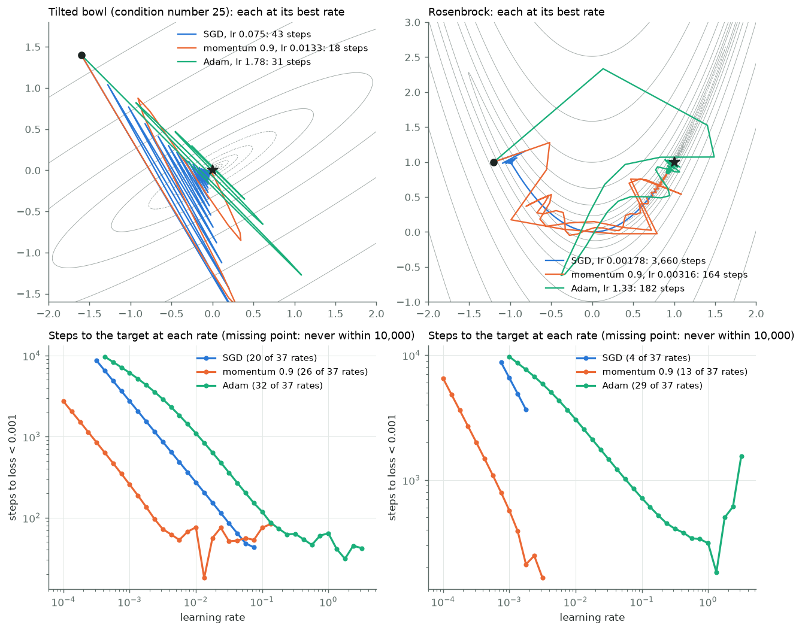
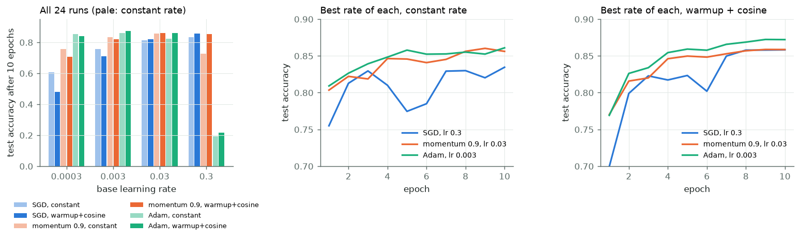
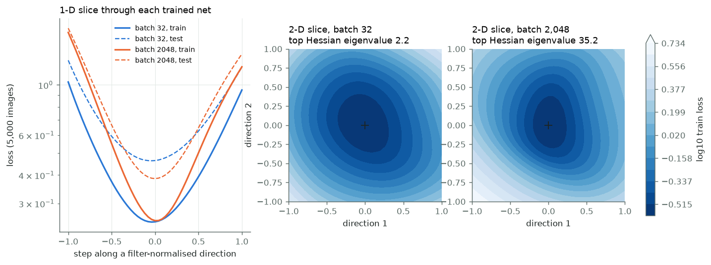
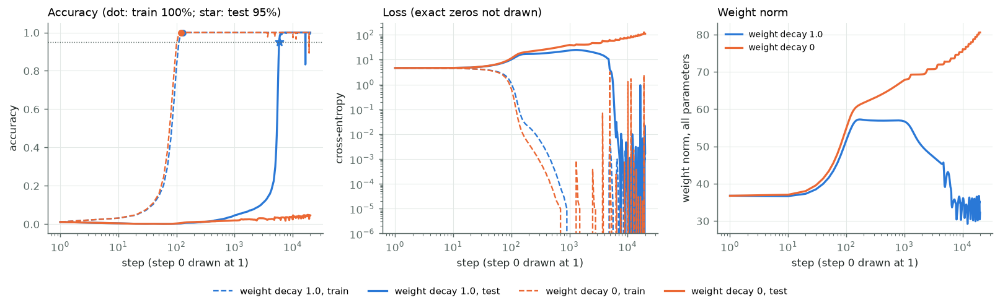

# Module 14: How training finds a solution

Module 02 wrote SGD and Adam by hand; later modules call an optimiser and
move on. This one watches what the optimiser does: how fast each kind gets down a loss, how the learning rate
and its schedule change the answer, what the loss looks like around the place
training stops, and one case where the answer arrives long after the training
loss says it is done. It has four sections, each with a figure and the numbers
beside it:

1. **Optimisers on toy losses**: SGD, momentum and Adam on two 2-D losses, steps to loss < 10⁻³.
2. **The same three on module 02's MLP**: four learning rates each, constant against warmup + cosine; then the Hugging Face way.
3. **The loss around a trained net**: 1-D and 2-D slices and the top Hessian eigenvalue, small batch against large.
4. **Grokking**: addition mod 97, weight decay 1.0 against 0.

Every number in this README comes from a JSON file in [`results/`](results/),
written by the script that measured it.

This is the first module of track 5, **How learning works**. Next,
[module 15](../15-geometry-of-representations/README.md) measures the shape a
trained network leaves: linear regions, intrinsic dimension and CKA.

**🕹 Interactive:** [How training finds a solution](../../explorables/14-how-training-finds-a-solution.html):
race the three optimisers on a 2-D loss from any start, at any rate; browse
the learning-rate grid; replay the grokking curves step by step.

**✅ Quiz:** [10 questions](../../quizzes/14.html): check yourself once you have run the five scripts.

## Goals

By the end you will be able to:

- write SGD, momentum and Adam as update rules, and say what each adds;
- say why the best learning rate depends on the optimiser, and read a learning-rate sweep;
- write linear warmup with cosine decay, and set it up in `transformers`;
- slice a loss surface along filter-normalised directions;
- compute the top Hessian eigenvalue from Hessian-vector products, and say what it does and does not tell you;
- run grokking and say what weight decay changed in this run.

## Setup

```bash
cd modules/14-how-training-finds-a-solution/python
```

```bash
uv sync
```

| Need | Size | Where |
|---|---|---|
| FashionMNIST (`zalando-datasets/fashion_mnist`) | 34 MB | Hugging Face cache; module 02 already fetched it |

No model is downloaded. Every network here is trained from scratch.

**The laptop guard.** Every script imports `src/common.py` before torch. It sets
`PYTORCH_MPS_HIGH_WATERMARK_RATIO=0.5` (the Apple GPU may take at most half of
the working set Metal recommends, 5.92 GB on this 16 GB Mac) and
`PYTORCH_MPS_LOW_WATERMARK_RATIO=0.4`. A run that grows past the cap stops
with an error instead of pushing the Mac into swap. Each script
logs its time and peak memory (process RSS from `getrusage`, and
`torch.mps.driver_allocated_memory()`) into its results file:

| Script | Minutes | Peak RSS | Peak MPS driver |
|---|---|---|---|
| `src/optim_toy.py` | 0.03 | 0.21 GB | 0 (NumPy, CPU) |
| `src/optim_mlp.py` | 0.49 | 1.10 GB | 0 (CPU) |
| `src/hf_way.py` | 0.11 | 1.15 GB | 0 (CPU) |
| `src/landscape.py` | 0.27 | 1.13 GB | 0 (CPU) |
| `src/grok.py --wd 1.0` | 2.31 | 0.62 GB | 1.05 GB |
| `src/grok.py --wd 0` | 2.29 | 0.50 GB | 1.05 GB |

Measured on an Apple M5 with 16 GB, torch 2.14.1. The MLP scripts run on the
CPU with four threads: a 784 → 256 → 10 net is too small for the GPU to pay.

**MPS against CPU.** At the end of each grokking run, the final model scores
all 9,409 pairs on MPS and then on the CPU. Weight decay 1.0: max abs
difference in logits 2.7 × 10⁻⁵ (logits span −115.2 to 11.5); weight decay 0:
8.5 × 10⁻⁴ (logits span −2,198 to −366). Same answer on every pair in both. In
`results/grok_wd1.json` and `grok_wd0.json`, `mps_vs_cpu`.

## 1 · Optimisers on toy losses

Three update rules, for a parameter vector p and its gradient g:

```
SGD        p ← p − lr·g
momentum   v ← 0.9·v + g;            p ← p − lr·v
Adam       m ← β₁·m + (1 − β₁)·g;    s ← β₂·s + (1 − β₂)·g²     # β₁ = 0.9, β₂ = 0.999
           p ← p − lr · m̂ / (√ŝ + 10⁻⁸)   # m̂ = m / (1 − β₁ᵗ), ŝ = s / (1 − β₂ᵗ), t = step count
```

Momentum keeps a running sum of past gradients, so steps that agree add up and
steps that flip sign cancel. Adam divides each coordinate's step by the size
of its recent gradients, so every coordinate moves at about the same pace.
(Kingma and Ba, [Adam](https://arxiv.org/abs/1412.6980), 2014.)

`src/optim_toy.py` writes the three in NumPy and runs them on two losses:

- **a tilted bowl**: a quadratic 25 times steeper across than along, turned
  30° so its axes match neither coordinate (an axis-aligned bowl would suit
  Adam's per-coordinate scaling); start (−1.6, 1.4);
- **Rosenbrock**: (1 − x)² + 100 (y − x²)², a curved valley with its minimum at
  (1, 1); start (−1.2, 1).

Each optimiser runs at 37 learning rates, from 10⁻⁴ to 10^0.5, a factor
10^0.125 apart, and we count the steps until the loss first drops below 10⁻³,
with a cap of 10,000. There are no batches, so "SGD" here is plain gradient
descent.



| | Bowl: best rate | Bowl: steps | Bowl: rates that reach | Rosenbrock: best rate | Rosenbrock: steps | Rosenbrock: rates that reach |
|---|---|---|---|---|---|---|
| SGD | 0.075 | 43 | 20 of 37 | 0.0018 | 3,660 | 4 of 37 |
| momentum | 0.013 | 18 | 26 of 37 | 0.0032 | 164 | 13 of 37 |
| Adam | 1.78 | 31 | 32 of 37 | 1.33 | 182 | 29 of 37 |

On Rosenbrock, momentum and Adam both need about 20 times fewer steps than
gradient descent at its best rate. On the bowl the three are within a factor
of 2.5. Read the bowl numbers with care: near its best rate, momentum's count
jumps from 76 to 18 to 56 over three neighbouring rates (the lower plot), so
18 is one lucky rate, not a trend. Two other facts hold across the whole
sweep. Gradient descent reaches the target at the fewest rates: from 0.1 up it
diverges on the bowl, as expected for a quadratic whose largest curvature is
25 (the limit is 2/25 = 0.08). Adam reaches the target at the most rates, 32
and 29 of 37, and diverges at none of the 37 on either loss: dividing by the
gradient's size keeps each coordinate's step near the rate (at most a few
times it), whatever the gradient.

What this shows, and what it does not: two losses with two dimensions, a
fixed start, and no noise. Real losses have millions of dimensions and noisy
gradients. Take it as a picture of what each rule does, not a ranking.

## 2 · The same three on module 02's MLP

Module 02 built a 784 → 256 → 10 MLP in NumPy. `src/common.py` rebuilds it in
torch, with the same He initialisation, and loads FashionMNIST the same way:
20,000 training images drawn with seed 0, the full 10,000 test images.

`src/optim_mlp.py` trains it with `torch.optim.SGD`, SGD with momentum 0.9,
and `torch.optim.Adam`, at four learning rates (3 × 10⁻⁴, 3 × 10⁻³, 0.03,
0.3), batch 128, 10 epochs (1,570 steps). Every run starts from the same
weights and sees the batches in the same order. Each runs twice: with a
constant rate, and with **warmup + cosine**: the rate rises from 0 to its
base value over the first 10% of steps (157), then falls to 0 along half a
cosine.

```python
def warmup_cosine(step, warmup, total):          # multiplier on the base rate
    if step < warmup:
        return step / warmup
    progress = (step - warmup) / (total - warmup)
    return 0.5 * (1 + math.cos(math.pi * progress))
```



Test accuracy after 10 epochs, seed 0:

| | lr 3 × 10⁻⁴ | lr 3 × 10⁻³ | lr 0.03 | lr 0.3 |
|---|---|---|---|---|
| SGD, constant | 60.7% | 75.6% | 81.3% | **83.5%** |
| SGD, warmup + cosine | 48.1% | 70.8% | 82.0% | **85.8%** |
| momentum, constant | 75.6% | 83.3% | **85.6%** | 72.8% |
| momentum, warmup + cosine | 70.8% | 82.0% | **85.9%** | 85.3% |
| Adam, constant | 85.4% | **86.1%** | 82.4% | 19.3% |
| Adam, warmup + cosine | 84.1% | **87.2%** | 86.1% | 21.8% |

Each optimiser has its own good range. The best rate is 0.3 for SGD (the top
of the grid, so a higher one might do better), 0.03 for momentum, and
3 × 10⁻³ for Adam. Momentum with v ← 0.9 v + g takes steps about 10 times
longer than SGD at the same rate, which fits the factor of 10 between their
best rates. At 0.3, Adam's per-coordinate steps are far too long and it ends at
19–22%, though no run returned NaN.

How much of a gap is noise? The best cell of each row, re-run with seeds 1
and 2 (new initial weights and batch order):

| Best cell | Seed 0 | Seed 1 | Seed 2 | Spread |
|---|---|---|---|---|
| SGD, constant, lr 0.3 | 83.5% | 84.4% | 81.2% | 3.1 points |
| SGD, warmup + cosine, lr 0.3 | 85.8% | 86.0% | 85.7% | 0.3 |
| momentum, constant, lr 0.03 | 85.6% | 86.3% | 85.8% | 0.7 |
| momentum, warmup + cosine, lr 0.03 | 85.9% | 85.9% | 85.8% | 0.1 |
| Adam, constant, lr 3 × 10⁻³ | 86.1% | 86.3% | 86.8% | 0.7 |
| Adam, warmup + cosine, lr 3 × 10⁻³ | 87.2% | 87.3% | 87.3% | 0.1 |

At the best rate, warmup + cosine beat the constant rate for SGD and Adam on
all three seeds: 85.7–86.0% against 81.2–84.4% for SGD, 87.2–87.3% against
86.1–86.8% for Adam. For momentum the two overlap. The schedule also shrank
the seed spread in all three, from 0.7–3.1 points to 0.1–0.3. A likely
reason, not tested here: the rate falls to 0 at the end, so the last steps
stop bouncing. At small rates the schedule hurts: with the rate below its
base for most of the run, the net simply moves less in 10 epochs.

This is three seeds, one net and one dataset: a demo, not a measurement.

**Since 2024.** Two newer choices a learner will meet in 2026. The
**warmup-stable-decay** schedule ([Wen et al.,
2024](https://arxiv.org/abs/2410.05192)) holds the rate constant and drops it
fast only at the end, so a run need not fix its length in advance; it is now
common in language-model pretraining. **Muon** updates each weight matrix
along an orthogonalised version of its momentum; Liu et al. ([2025](https://arxiv.org/abs/2502.16982)), who
scaled it up, report about twice AdamW's compute efficiency in their scaling
runs. This module tests neither.

### The Hugging Face way

`transformers` ships the same schedule and sets the optimiser by name.
`src/hf_way.py` checks one against the other, then trains the same MLP with
`Trainer`:

```python
from transformers import Trainer, TrainingArguments, get_cosine_schedule_with_warmup

sched = get_cosine_schedule_with_warmup(opt, num_warmup_steps=157, num_training_steps=1570)

args = TrainingArguments(
    optim="sgd", optim_args="momentum=0.9",      # or "sgd", or "adamw_torch"
    learning_rate=0.03, weight_decay=0.0,
    lr_scheduler_type="cosine", warmup_steps=0.1, # a float below 1 is a share of all steps
    num_train_epochs=10, per_device_train_batch_size=128, use_cpu=True,
)
```

`get_cosine_schedule_with_warmup` and our `warmup_cosine` give the same rate
at all 1,570 steps (max difference 0.0). Its first step has rate 0, so
the first update changes nothing. With weight decay 0, `"adamw_torch"` is
plain Adam.

| `optim=` | `optim_args=` | Rate | torch class | Test accuracy | Hand loop, seeds 0, 1, 2 |
|---|---|---|---|---|---|
| `"sgd"` | none | 0.3 | `SGD` | 85.65% | 85.82%, 85.96%, 85.70% |
| `"sgd"` | `"momentum=0.9"` | 0.03 | `SGD` | 85.54% | 85.86%, 85.92%, 85.81% |
| `"adamw_torch"` | none | 3 × 10⁻³ | `AdamW` | 87.26% | 87.21%, 87.33%, 87.32% |

`Trainer` shuffles its batches its own way, so compare against the seed
spread, not one run. Adam lands inside the hand loop's range; SGD lands 0.05
points below it, and momentum 0.3 points below it. Three seeds give a narrow range,
so a run that shuffles differently can fall just outside it; we did not run
`Trainer` with more seeds to check.

## 3 · The loss around a trained net

Where does training stop? A common picture: small batches find wide, flat
valleys and large batches find narrow, sharp ones, and the wide ones
generalise better (Keskar et al., [On Large-Batch Training for Deep
Learning](https://arxiv.org/abs/1609.04836), 2016). A newer result bears on
the same knob: Marek et al. ([2025](https://arxiv.org/abs/2507.07101)) trained
language models stably at batch sizes down to 1, once Adam's β₂ was scaled
with the batch size. `src/landscape.py` looks at one case.

Two copies of the MLP, same initial weights, SGD with momentum 0.9 at rate
0.05: one with batch 32, one with batch 2,048. Each trains until its loss on
the whole training set first drops to 0.25 or below, checked after every
epoch, so both stop at about the same training loss. Then, for each net:

- **a 1-D slice**: the loss at θ + a·d for a from −1 to 1, where d is a random
  direction rescaled filter by filter: each row of each weight matrix of d
  gets the norm of the same row of θ, and the bias entries of d are 0 (Li et
  al., [Visualizing the Loss Landscape of Neural
  Nets](https://arxiv.org/abs/1712.09913), 2018). Without the rescaling, a net
  with larger weights would look flatter for that reason alone;
- **a 2-D slice**: θ + a·d₁ + b·d₂, on a 31 × 31 grid;
- **the top eigenvalue of the Hessian** (the matrix of second derivatives of
  the loss): the curvature along the direction in which the loss bends most.
  Power iteration returns the eigenvalue of largest size; near a minimum that
  is the top one. The Hessian of 203,530 parameters has 4 × 10¹⁰ entries,
  too many to build. Power iteration needs only Hessian-vector products, and
  each costs about two gradient computations: one backward pass that keeps
  its graph, then a second through it. 100 iterations; the estimate changed by
  less than 10⁻⁵ over the last ten.

Losses are measured on the same 5,000 training and 5,000 test images for
both nets.



| | Batch 32 | Batch 2,048 |
|---|---|---|
| Epochs to train loss ≤ 0.25 | 21 | 83 |
| Steps | 13,125 | 830 |
| Train loss / accuracy | 0.249 / 90.7% | 0.247 / 91.6% |
| Test loss / accuracy | 0.465 / 84.8% | 0.384 / 86.2% |
| Top Hessian eigenvalue | 2.2 | 35.2 |
| Weight norm | 49.7 | 25.9 |
| Train loss at a = −1 / +1 (1-D slice) | 1.03 / 0.95 | 1.70 / 1.20 |

The first half of the picture holds here: the large-batch net sits where the
loss curves 16 times more sharply, and its slices rise faster on both sides.
The second half does not: the large-batch net has the *better* test
accuracy, 86.2% against 84.8%. One pair of runs cannot say which way the link
goes in general; it can say that sharpness alone did not predict test
accuracy here.

Two cautions. The small-batch net's weights are twice as large, and the top
eigenvalue is not scale-free: the same function written with rescaled
weights can have a very different Hessian (Dinh et al., [Sharp Minima Can
Generalize For Deep Nets](https://arxiv.org/abs/1703.04933), 2017). The
slices are filter-normalised; the eigenvalue is not. And both eigenvalues
sit below 2(1 + 0.9) / 0.05 = 76, the curvature above which gradient descent
with this rate and momentum is unstable on a quadratic. At init the top
eigenvalue was 23.7. The large-batch run, whose steps carry little noise,
ended at 35.2, about half that limit; the small-batch run ended far below it.
Cohen et al. ([Gradient Descent on Neural Networks Typically Occurs at the
Edge of Stability](https://arxiv.org/abs/2103.00065), 2021) found that
full-batch training drives sharpness up to the limit; we did not track it
during training.

One pair of runs, one pair of random directions: a demo, not a measurement.

## 4 · Grokking

Power et al. ([Grokking](https://arxiv.org/abs/2201.02177), 2022) trained
small transformers on tables like a + b mod p. The training accuracy reached
100% early; the test accuracy stayed near chance for a long time, then rose
to 100%. Weight decay made that happen sooner.

`src/grok.py` reproduces the setup at a size that fits in under 5 minutes.
The task is (a + b) mod 97 over all 9,409 pairs; a fixed 30% (2,823, split
seed 0) is the training set, and the other 6,586 are the test set. The model is
a one-layer transformer with no LayerNorm: d_model 128, 4 heads, MLP width
512, ReLU, learned positions; 222,208 parameters. It reads a and b as two
tokens and answers at the last position.

**Weight decay** shrinks every weight a little at each step, by
lr × wd × w, so weights the loss does not need fade away. AdamW applies this
shrink apart from Adam's gradient step (Loshchilov and Hutter, [Decoupled
Weight Decay Regularization](https://arxiv.org/abs/1711.05101), 2017); at
rate 10⁻³ and weight decay 1.0, each weight loses 0.1% per step.

Full-batch AdamW, rate 10⁻³, β₁ = 0.9 and β₂ = 0.98 (see section 1), the same split and initial weights in both runs. The only
difference: weight decay 1.0 or 0.

**The rule, written before the first run.** A run has *grokked* when test
accuracy (on the 6,586 pairs it never trains on) is at least 95% at an
evaluation step. Every run lasts 20,000 steps, with no early stop. We evaluate
every 10 steps up to step 500, then every 100 steps. For each run we report
the first evaluated step at which train accuracy is 100%, and the first at
which test accuracy is at least 95%, or "not within 20k". We set the 95% bar
and the 20,000-step cap in the course's plan before building this module. We
wrote the evaluation schedule and the two reported steps into `src/grok.py`
before its first run, but committed them together with the results, so the
history alone cannot show that they came first.



| | Weight decay 1.0 | Weight decay 0 |
|---|---|---|
| Train accuracy first 100% | step **130** | step **120** |
| Test accuracy first ≥ 95% | step **5,900** | **not within 20k** |
| Test accuracy at step 2,000 | 7.5% | 2.4% |
| Test accuracy at step 20,000 | 100% | 4.5% |
| Weight norm, start → peak → step 20,000 | 36.7 → 57.2 → 32.2 | 36.7 → 80.6 (still rising) |

With weight decay 1.0, the model fits its training set by step 130, and test
accuracy then crawls: 7.5% at step 2,000, 15.5% at 4,000, 30% at 5,000. It
crosses 50% at step 5,400 and 95% at step 5,900, and first reaches 100% at
step 6,600. It generalised about 45 times later than it memorised. On the way,
test loss rose to 24.6 at step 1,300, far above the 4.57 of a uniform guess
over 97 answers: the memorising model was confidently wrong on unseen pairs.
After the jump the run is not perfectly calm: at step 16,500 train and test
accuracy dropped together, to 83.8% and 83.3%, for one evaluation, then came
back to 100%; a smaller dip, to 99.9% train accuracy, came at step 19,600.
A likely cause, not tested here: Adam at a fixed rate keeps
taking steps of about the rate's size even near the bottom, and now and then
one overshoots. The run without weight decay does the same: six single
evaluations below 100% train accuracy, the lowest 89.3% at step 19,100.

With weight decay 0, the model fits its training set by step 120 and test
accuracy never leaves the floor: 4.5% at step 20,000, against 1.03% for
chance. Its weight norm rises at 188 of 245 evaluations, to 80.6 at the last
step. With weight decay 1.0 the norm
peaks at 57.2 and falls back to 32.2 as test accuracy climbs. This fits the
usual reading of grokking: many weight settings fit the training set, and
weight decay keeps pushing towards smaller ones, which here are the ones that
compute the sum. Two runs cannot prove that reading. They show that, in this
setup and within 20,000 steps, weight decay decided whether the model
generalised at all.

That reading is no longer the whole story. Prieto et al. ([Grokking at the
Edge of Numerical Stability](https://arxiv.org/abs/2501.04697), 2025) traced
the failure without weight decay to the logits: once the training set is
fitted, the cheapest way to lower the loss is to scale every logit up, until
float32 softmax rounds to exact 0s and 1s and the gradient stops carrying
information ("softmax collapse"). With a softmax that cannot collapse, or a
gradient with that scaling part removed, their models grokked with no weight
decay. This run fits the picture: at weight decay 0 the final logits span
−2,198 to −366, against −115.2 to 11.5 with weight decay 1.0. The logged
training loss cannot tell the two runs apart: it reads 0.0 to five decimals
at 157 of 246 evaluated steps without weight decay, and at 102 with it. We
did not test the fix.

One seed per run, and the GPU's arithmetic is not bit-identical from run to
run, so treat the step numbers as approximate. A second run of the weight
decay 1.0 case, same seeds and machine, drifted from this one by step 30:
train accuracy again first hit 100% at step 130, test accuracy crossed 95% at
step 6,000 rather than 5,900, and its dips in train accuracy fell at other
steps (the lowest 95.5%, at step 19,300). The dips are not a fixed feature of
the run. A demo, not a measurement.
Nanda et al. ([Progress measures for grokking via mechanistic
interpretability](https://arxiv.org/abs/2301.05217), 2023) open up the
model that groks and find it adds by rotating through a few frequencies; that
is the place to go next.

## Run it

Each script prints its numbers, writes `results/<name>.json`, and with
`--figures` redraws its figure.

```bash
uv run python src/optim_toy.py --figures
```

```bash
uv run python src/optim_mlp.py --figures
```

```bash
uv run python src/hf_way.py
```

```bash
uv run python src/landscape.py --figures
```

```bash
uv run python src/grok.py --wd 1.0 --figures
```

```bash
uv run python src/grok.py --wd 0 --figures
```

Redraw every figure from the committed JSON, with no training:

```bash
uv run python src/figures.py
```

Rewrite the explorable's data block from the JSON:

```bash
uv run python src/export_explorable.py
```

## Exercises

Skeletons with `# TODO(you):` live in [`exercises/`](exercises/); reference
solutions are in [`solutions/`](solutions/). Each asks you to predict before
you run.

- **(a) `exercise_a_optimisers.py`**: write the momentum and Adam steps in
  NumPy and race them on Rosenbrock. The test checks both against
  `src/optim_toy.py`, and Adam against `torch.optim.Adam`.
- **(b) `exercise_b_schedule.py`**: write warmup + cosine. The test checks it
  against `get_cosine_schedule_with_warmup` at all 1,570 steps.
- **(c) `exercise_c_sharpness.py`**: write a Hessian-vector product and power
  iteration. The test checks it on a quadratic with known eigenvalues, and
  against `src/landscape.py` on a small MLP.

## Tests

```bash
uv run pytest
```

Nineteen tests, in about 6 seconds, with no training. They check the
solutions against the scripts and `transformers`, the committed results
against the laptop budget, the grokking steps against the rule, and the
explorable against the results.

## Checkpoint: you should now be able to…

- write SGD, momentum and Adam, and say what momentum and Adam add;
- say why each optimiser has its own best learning rate;
- write warmup + cosine, and set it up with `TrainingArguments`;
- compare two runs against the seed spread before reading a gap;
- slice a loss along filter-normalised directions, and compute the top Hessian eigenvalue without the Hessian;
- say what the sharp-and-flat picture predicted here and what it missed;
- state a grokking rule before the run, and read the run against it.

## Links

- Kingma and Ba, [Adam: A Method for Stochastic Optimization](https://arxiv.org/abs/1412.6980) (2014)
- Loshchilov and Hutter, [Decoupled Weight Decay Regularization](https://arxiv.org/abs/1711.05101) (2017), AdamW
- Loshchilov and Hutter, [SGDR: Stochastic Gradient Descent with Warm Restarts](https://arxiv.org/abs/1608.03983) (2016), cosine schedules
- Keskar et al., [On Large-Batch Training for Deep Learning: Generalization Gap and Sharp Minima](https://arxiv.org/abs/1609.04836) (2016)
- Dinh et al., [Sharp Minima Can Generalize For Deep Nets](https://arxiv.org/abs/1703.04933) (2017)
- Li et al., [Visualizing the Loss Landscape of Neural Nets](https://arxiv.org/abs/1712.09913) (2018)
- Cohen et al., [Gradient Descent on Neural Networks Typically Occurs at the Edge of Stability](https://arxiv.org/abs/2103.00065) (2021)
- Power et al., [Grokking: Generalization Beyond Overfitting on Small Algorithmic Datasets](https://arxiv.org/abs/2201.02177) (2022)
- Nanda et al., [Progress measures for grokking via mechanistic interpretability](https://arxiv.org/abs/2301.05217) (2023)
- Wen et al., [Understanding Warmup-Stable-Decay Learning Rates](https://arxiv.org/abs/2410.05192) (2024)
- Liu et al., [Muon is Scalable for LLM Training](https://arxiv.org/abs/2502.16982) (2025)
- Prieto et al., [Grokking at the Edge of Numerical Stability](https://arxiv.org/abs/2501.04697) (2025)
- Marek et al., [Small Batch Size Training for Language Models](https://arxiv.org/abs/2507.07101) (2025)
- [`transformers` optimisers and schedules](https://huggingface.co/docs/transformers/main_classes/optimizer_schedules)
