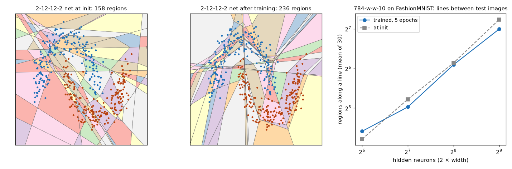
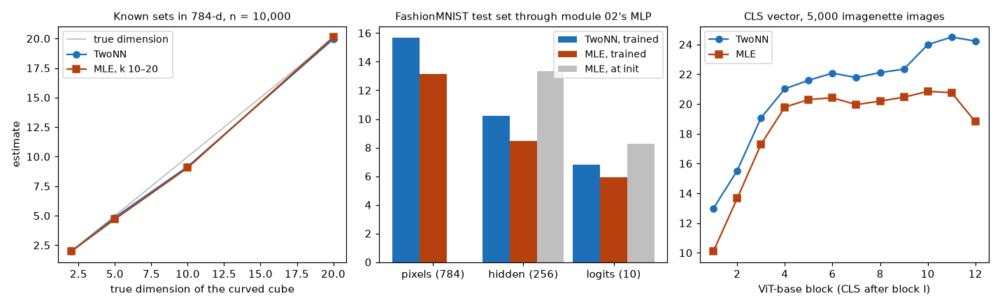
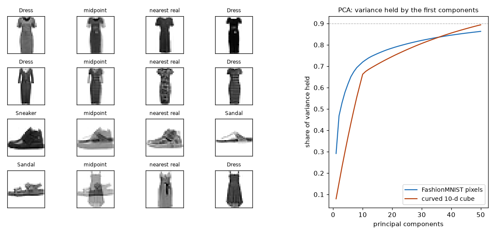
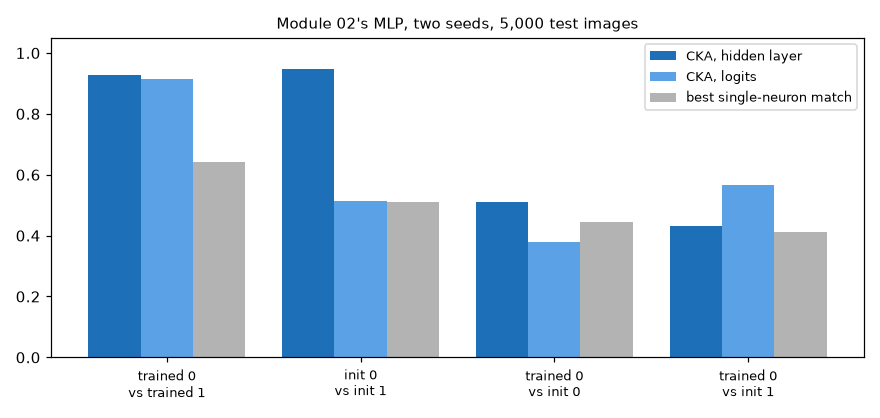

# Module 15: Geometry of representations

Module 02 built a small network and trained it. This module looks at the
shapes involved: how a ReLU network cuts its input space into pieces, how much
room the data really takes up, and whether two networks trained the same way
end up holding the same shape. It has four sections, each with a figure and
the numbers beside it:

1. **Linear regions**: the exact pieces of a 2-D ReLU network, and how many pieces a line between two images crosses as the network widens.
2. **Intrinsic dimension**: two estimators checked on sets of known dimension, then FashionMNIST through module 02's MLP, and ViT-base on photos.
3. **The manifold picture**: PCA against intrinsic dimension, and what lies halfway between two images.
4. **Linear CKA**: two seeds of module 02's MLP, trained and untrained.

Every number in this README comes from a JSON file in [`results/`](results/),
written by the script that measured it.

This is the second module of track 5, **How learning works**. Next,
[module 16](../16-self-supervised-and-jepa/README.md) trains one encoder
without labels, three ways, and shows what makes it collapse.

**🕹 Interactive:** [Geometry of representations](../../explorables/15-geometry-of-representations.html):
drag a segment across a 2-D network's regions, change the width, watch the
count; intrinsic dimension and CKA numbers alongside.

**✅ Quiz:** [10 questions](../../quizzes/15.html): check yourself once you have run the four scripts.

## Goals

By the end you will be able to:

- say what a linear region of a ReLU network is, and cut a small network's regions exactly;
- count the regions along a line exactly, and say how the count grows with width;
- write two intrinsic-dimension estimators, TwoNN and MLE, and check them on sets of known dimension;
- say why PCA needs far more components than the intrinsic dimension on curved data;
- write linear CKA, and say why a high score between two layers does not by itself show that they learned the same thing.

## Setup

```bash
cd modules/15-geometry-of-representations/python
```

```bash
uv sync
```

| Need | Size | Where |
|---|---|---|
| FashionMNIST (`zalando-datasets/fashion_mnist`) | 34 MB | Hugging Face cache; module 02 already fetched it |
| Module 02's MLP code | none | read from `../02-neural-networks/python/src/` |
| ViT-base (`google/vit-base-patch16-224`) | 330 MB | Hugging Face cache, on first run of `intrinsic_dim.py` |
| imagenette, 160-px release | 99 MB archive | `~/.cache/huggingface/mlcourse/`, downloaded and unpacked on first run of `intrinsic_dim.py` |

Imagenette is ten easy ImageNet classes (fish, dog, church, parachute…),
published by fast.ai. Sections 2 and 4 train module 02's MLP with module 02's
own NumPy code and recipe, so "module 02's MLP" here means the same network
and the same training, not a copy.

**The laptop guard.** Every script imports `src/common.py` before torch. It sets
`PYTORCH_MPS_HIGH_WATERMARK_RATIO=0.5` and `PYTORCH_MPS_LOW_WATERMARK_RATIO=0.4`:
the Apple GPU may take at most 5.92 GB on this 16 GB Mac, and a run that grows
past that stops with an error instead of pushing the Mac into swap. Each script
logs its time and peak memory (process RSS from `getrusage`, and
`torch.mps.driver_allocated_memory()`) into its results file:

| Script | Minutes | Peak RSS | Peak MPS driver |
|---|---|---|---|
| `src/regions.py` | 0.11 | 1.19 GB | 0 (runs on the CPU) |
| `src/intrinsic_dim.py` | 1.36 | 3.68 GB | 2.39 GB |
| `src/manifold.py` | 0.16 | 1.52 GB | 0 (runs on the CPU) |
| `src/cka.py` | 0.15 | 1.31 GB | 0 (runs on the CPU) |

Measured on an Apple M5 with 16 GB, torch 2.14.1. Most of `intrinsic_dim.py`'s
time is ViT-base reading 5,000 photos on the GPU (65 s).

**MPS against CPU.** ViT-base on eight imagenette photos, on MPS and then on
the CPU: max abs difference in the CLS vector 8.0 × 10⁻⁶ (its entries reach
4.24). In `results/intrinsic_dim.json`, `vit.mps_vs_cpu`.

## 1 · Linear regions

A ReLU neuron is either off (output 0) or on (output = its input). Fix which
neurons are on and the whole network is one linear map. A **linear region** is
the set of inputs that share one on/off pattern. Inside it the network is
linear; at its edges a neuron switches.

**Exact regions in 2-D.** For a network 2 → w → w → out, each first-layer
neuron switches along one straight line, so layer 1 cuts the plane into convex
pieces. Inside each piece layer 1 is a fixed linear map, so each second-layer
neuron switches along one more straight line there. `src/regions.py` cuts the
square [−2.5, 2.5]² that way, polygon by polygon, with no sampling. The net is
2 → 12 → 12 → 2 with PyTorch's default init, trained on 400 points of two
moons (2,000 Adam steps at 0.01).



| | Regions in the square |
|---|---|
| at init | 158 |
| after training (100% train accuracy) | 236 |

Training added regions and, by eye, moved boundaries towards the data: thin
slivers gather where the two moons meet. One net and one seed; the explorable
lets you draw others. Humayun, Balestriero and Baraniuk
([2024](https://arxiv.org/abs/2402.15555)) track this through long training:
after a phase change, regions leave the training points and gather at the
decision boundary, and late generalisation (grokking) follows. This module
counts only two snapshots, so it cannot show that change.

**Regions along a line, against width.** In 784 dimensions we cannot draw the
regions, but we can count those a straight line crosses. Along
x(t) = (1 − t)a + tb, every first-layer pre-activation is linear in t, so it
changes sign at most once, at a point we can solve for. Between two such points
the second layer's pre-activations are linear in t too. So the count is exact.
`src/regions.py` trains 784 → w → w → 10 nets on FashionMNIST (module 02's
init, SGD at 0.1 with momentum 0.9, 5 epochs on all 60,000 images) and counts
the regions along 30 lines, each between two test images:

| Width | Hidden neurons | Test accuracy | Regions per line, trained | At init | Cut by layer 1 alone, trained |
|---|---|---|---|---|---|
| 32 | 64 | 83.7% | 21.3 | 18.6 | 7.8 |
| 64 | 128 | 84.7% | 32.6 | 37.3 | 10.5 |
| 128 | 256 | 86.0% | 68.3 | 70.6 | 16.9 |
| 256 | 512 | 86.7% | 127.7 | 151.0 | 40.9 |

Doubling the width multiplies the count by 1.53, 2.09 and 1.87 on the trained
nets (2.01, 1.89, 2.14 at init): roughly in step with the neuron count. This is
what Hanin and Rolnick ([2019](https://arxiv.org/abs/1901.09021)) predict at
init and early in training for the density of regions along a line; their
companion paper ([2019](https://arxiv.org/abs/1906.00904)) makes the same point
for regions in the full input space. A region count that grew with the *product* of the layer widths, as
the most a network could hold, would multiply by about 4 per doubling here.
Training changes the count by about 15% or less at these widths (trained over
init: 1.15, 0.87, 0.97, 0.85). It does change who does the cutting: from width
64 up, trained nets cross about half as many first-layer boundaries as
untrained ones (40.9 against 76.8 at width 256), and the second layer adds more
cuts of its own.

**This is a demo, not a measurement.** One seed and 30 lines, and the
count varies a lot from line to line: from 6 to 40 at width 32, from 40 to 233
at width 256. A
measurement needs several seeds, many lines, and an expectation written down
before the run.

## 2 · Intrinsic dimension

FashionMNIST images have 784 pixels, but they do not fill 784 dimensions: no
random pixel noise looks like a shoe. The **intrinsic dimension** (ID) is the
number of coordinates the data would need if you could follow its curves. Two
estimators read it from distances to nearest neighbours alone:

- **TwoNN** (Facco et al., [2017](https://www.nature.com/articles/s41598-017-11873-y)):
  for each point, μ = (distance to 2nd neighbour) / (distance to 1st). On a
  d-dimensional set, P(μ > m) = m⁻ᵈ. Sort the μ, drop the largest 10%, and fit
  −log(1 − F(μ)) = d log μ through the origin.
- **MLE** (Levina and Bickel, [2004](https://papers.nips.cc/paper_files/paper/2004/hash/74934548253bcab8490ebd74afed7031-Abstract.html)):
  with T₁ ≤ … ≤ T_k the distances to the k nearest neighbours, 1/d is the mean
  of log(T_k / T_j) for j < k. We average that over all points, then average
  d over k = 10 to 20.

**First, sets of known dimension.** An estimator is only worth its numbers on
real data if it gets the answer right where we know it. `src/idest.py` makes a
**curved cube**: points uniform in [0, 1]ᵈ, bent into 784 dimensions by
x = sin(zW + b) with a random W. The set has dimension d by construction, but a
flat subspace needs far more: for d = 10, 87 of the 784 dimensions hold 95% of
its variance, and 216 hold 99% (section 3). 10,000 points each:

| True dimension | TwoNN | MLE |
|---|---|---|
| 2 | 1.98 | 1.98 |
| 5 | 4.86 | 4.71 |
| 10 | 9.15 | 9.06 |
| 20 | 19.96 | 20.12 |

Both land within 1 of the truth on these sets. The module's tests run the same
check on 4,000 points (d = 2, 5, 8, and a flat 4-d set), so a broken estimator
fails `pytest` before it can print a wrong number.



**FashionMNIST through module 02's MLP.** The 10,000 test images, then the same
images read at the MLP's hidden layer (256 ReLU outputs) and at its logits (10).
The MLP is module 02's 784 → 256 → 10, trained with module 02's recipe (86.5%
test accuracy). "At init" is the same network before training.

| Layer | TwoNN | MLE | TwoNN at init | MLE at init |
|---|---|---|---|---|
| pixels (784) | 15.69 | 13.14 | | |
| hidden layer (256) | 10.21 | 8.47 | 15.82 | 13.34 |
| logits (10) | 6.80 | 5.95 | 9.08 | 8.27 |

The pixels sit near a set of 13 to 16 dimensions. The trained MLP lowers that
at each layer. The untrained one keeps the pixel value at its hidden layer:
a random ReLU layer of 256 units roughly preserves the geometry of its input.
So the drop to 8.5–10.2 comes with training, in this one run. The two
estimators disagree by 1 to 2.5 at every layer, TwoNN always higher; read the
pair as a range.

**ViT-base on imagenette.** The CLS vector (768 numbers) of
`google/vit-base-patch16-224` after each of its 12 blocks, on 5,000 imagenette
training photos (numpy seed 0, all ten classes). Before block 1 the CLS token
is the same vector for every photo, so there is nothing to estimate there.
ViT-base was fine-tuned on ImageNet-1k, and imagenette's photos are drawn from
ImageNet: the model has seen these images in training.

| | TwoNN | MLE |
|---|---|---|
| pixels, resized to 64 × 64 (12,288 numbers) | 33.87 | 23.97 |
| CLS after block 1 | 12.98 | 10.10 |
| CLS after block 4 | 21.02 | 19.79 |
| CLS after block 11 | 24.50 | 20.77 |
| CLS after block 12, after the final norm | 24.67 | 19.64 |

Here the estimate climbs through the early blocks and levels off near 20 to
24. In the last block the MLE drops (20.77 to 18.81 before the final norm);
TwoNN barely moves (24.50 to 24.23). Ansuini et al.
([2019](https://arxiv.org/abs/1905.12784)) ran TwoNN on whole layers of
trained CNNs and found a rise over the first layers, then a steady fall
towards the output. This run cannot be set beside that: it reads one token,
not a whole layer; no block rises above the pixels' estimate; and with TwoNN,
their estimator, the last block shows no fall. The CLS token at block 1 has
seen little of the image yet, which may explain its low value; this run does
not test that. The closer comparison is transformers: Valeriani et al.
([2023](https://arxiv.org/abs/2302.00294)) find that the ID rises over the
first layers, falls sharply in the middle ones, then stays flat or forms a
second, smaller peak. This run shows the rise and the flat part, not the
middle fall. As for the MLE drop in block 12: before the final norm, a few
dimensions of a transformer's residual stream can be far larger than the rest
(Darcet et al., [2023](https://arxiv.org/abs/2309.16588); Sun et al.,
[2024](https://arxiv.org/abs/2402.17762)), and nearest-neighbour distances
then follow those few dimensions. This run does not check that either. One
model, one set of photos. Photos and FashionMNIST differ,
so do not compare the levels.

## 3 · The manifold picture

**PCA against intrinsic dimension.** PCA finds the flat subspace that holds the
most variance. On a curved set it needs far more directions than the set's
dimension:

| Data | ID (TwoNN, MLE) | PCA components for 50% | 90% | 95% | 99% |
|---|---|---|---|---|---|
| curved 10-d cube | 9.15, 9.06 | 8 | 52 | 87 | 216 |
| FashionMNIST test pixels | 15.69, 13.14 | 3 | 83 | 183 | 446 |

The curved cube's first 10 components hold 66% of its variance (the flat part
of the sine), then the curve spreads the rest thinly over hundreds. FashionMNIST
behaves the same way: 83 components for 90% of the variance, against an ID of
13 to 16. A flat fit pays for every bend.



**Straight lines can leave the data.** Take two test images a and b and their
pixel midpoint (a + b)/2, then find the nearest of the 60,000 training images.
If the midpoint lies on the data, that distance should look like a real test
image's distance to its nearest training image. 300 pairs of each kind:

| | Median distance to the nearest training image |
|---|---|
| a real test image (2,000 of them) | 3.43 |
| midpoint of two images of the same class | 3.54 |
| midpoint of two images of different classes | 4.58 |

Within a class, the midpoint stays about as close to real images as a real
image does. Across classes it sits a third farther away, and 29% of those
midpoints are farther from any training image than 90% of real test images
are (6% for same-class pairs). The figure shows why: a sandal-dress midpoint is
a ghost of both, and its nearest real image is a dress. Across classes, the
nearest training image still shares a class with one of the two ends 73% of
the time (79% within a class). **This is a demo, not
a measurement**: Euclidean distance in pixels is a crude ruler, and 300 pairs
of each kind is a small sample.

## 4 · Linear CKA: do two networks hold the same shape?

Train module 02's MLP twice, with seeds 0 and 1. Neuron 17 of one net has no
reason to match neuron 17 of the other. **Linear CKA** (Kornblith et al.,
[2019](https://arxiv.org/abs/1905.00414)) compares whole layers instead. Take
the activations X and Y of the two layers on the same n inputs, centre each
column, and

```
CKA(X, Y) = ‖Yᵀ X‖²_F / (‖Xᵀ X‖_F · ‖Yᵀ Y‖_F)
```

It is 1 when Y is a rotation and rescaling of X, whatever the order of the
neurons, and near 0 when they share no linear structure. `src/cka.py` checks
both: a rotated, scaled copy gives 1.000000, a permuted copy 1.000000, noise
0.01. Beside CKA, a narrower question: for each neuron of the first net, how
well does its best match among the second net's neurons correlate (median
|correlation|)?



On 5,000 test images (test accuracy 86.5% for seed 0, 86.2% for seed 1):

| Pair | CKA, hidden layer | CKA, logits | Best neuron match, hidden |
|---|---|---|---|
| trained seed 0 vs trained seed 1 | 0.93 | 0.91 | 0.64 |
| untrained seed 0 vs untrained seed 1 | 0.95 | 0.51 | 0.51 |
| trained seed 0 vs untrained seed 0 | 0.51 | 0.38 | 0.45 |
| trained seed 0 vs untrained seed 1 | 0.43 | 0.57 | 0.41 |

| | CKA with the pixels |
|---|---|
| hidden layer, trained | 0.54 |
| hidden layer, untrained | 0.97 |

The two trained nets agree closely as layers (0.93) while their single neurons
match far less well (0.64): the same shape, held by different neurons.

But the two *untrained* nets agree even more at the hidden layer (0.95). A
random ReLU layer keeps most of the input's geometry (0.97 with the pixels), so
any two of them look alike to CKA because both look like the pixels. Training
moves the hidden layer away from the pixels (0.54) and away from its own
starting point (0.51). Only at the logits, where the untrained pair scores
0.51, does the trained pair's 0.91 stand clearly above the baseline. **A high
CKA is a claim only next to the right baseline.** Linear CKA weighs
directions by their variance, so a few large shared directions can dominate
it, and Davari et al. ([2022](https://arxiv.org/abs/2210.16156)) show it can be
pushed up or down by changes that leave a network's behaviour alone. The
"near 0" for unrelated layers also needs care: when the number of inputs n is
small next to the width, the CKA written above gives high scores even to pairs
of random matrices, and a debiased version corrects that (Murphy et al.,
[2024](https://arxiv.org/abs/2405.01012)). At n = 5,000 and 256 units the bias
here is small: the noise check gives 0.01.

**Do different models hold the same shape?** Huh et al.
([2024](https://arxiv.org/abs/2405.07987)), the "Platonic Representation
Hypothesis", argue that as vision and language models grow, they measure
distances between the same data points in more and more alike ways. They
compare models with a mutual-nearest-neighbour score, not CKA, but the lesson of
this section carries over: a high alignment score means something only next to
the score of the right random or untrained baseline.

## Run it

Each script prints its numbers, writes `results/<name>.json`, and with
`--figures` redraws its figure.

```bash
uv run python src/regions.py --figures
```

```bash
uv run python src/intrinsic_dim.py --figures
```

```bash
uv run python src/manifold.py --figures
```

```bash
uv run python src/cka.py --figures
```

Redraw every figure from the committed JSON, with no network trained:

```bash
uv run python src/figures.py
```

Rewrite the explorable's data block from the JSON:

```bash
uv run python src/export_explorable.py
```

## Exercises

Skeletons with `# TODO(you):` live in [`exercises/`](exercises/); reference
solutions are in [`solutions/`](solutions/). Each asks you to predict before
you run. All three run on the CPU in seconds.

- **(a) `exercise_a_id.py`**: write TwoNN and MLE from the neighbour
  distances, and run them on curved cubes of dimension 2, 5 and 10. The test
  checks both against `src/idest.py`.
- **(b) `exercise_b_regions.py`**: count the regions a segment crosses in a
  network with two hidden layers, exactly. The test checks your count against
  `src/regions.py` and against 100,001 samples along the segment.
- **(c) `exercise_c_cka.py`**: write linear CKA, then predict which of four
  pairs (a rotation, a general linear map, noise, a ReLU) give 1. The test
  checks it against `src/cka.py` and its invariances.

## Tests

```bash
uv run pytest
```

Nineteen tests, about 12 seconds on an idle Mac, no GPU and no model download. They run the
estimator check on sets of known dimension, check the solutions against the
scripts, and check the committed results against the laptop budget and the
explorable.

## To go further

- Hanin and Rolnick, [Deep ReLU Networks Have Surprisingly Few Activation Patterns](https://arxiv.org/abs/1906.00904) (2019), and [Complexity of Linear Regions in Deep Networks](https://arxiv.org/abs/1901.09021) (2019): why the count grows with neuron count, not with its product.
- Ansuini et al., [Intrinsic dimension of data representations in deep neural networks](https://arxiv.org/abs/1905.12784) (2019): TwoNN across the layers of trained CNNs.
- Pope et al., [The Intrinsic Dimension of Images and Its Impact on Learning](https://arxiv.org/abs/2104.08894) (2021): MLE on ImageNet and others, and how ID relates to how many samples a network needs.
- Kornblith et al., [Similarity of Neural Network Representations Revisited](https://arxiv.org/abs/1905.00414) (2019): CKA and its baselines.
- Valeriani et al., [The geometry of hidden representations of large transformer models](https://arxiv.org/abs/2302.00294) (2023): ID across the layers of transformers.
- Humayun, Balestriero and Baraniuk, [Deep Networks Always Grok and Here is Why](https://arxiv.org/abs/2402.15555) (2024): how linear regions move during training. The exact tiler of section 1 can count regions near the data and near the boundary through a long run.
- Murphy, Zylberberg and Fyshe, [Correcting Biased Centered Kernel Alignment Measures](https://arxiv.org/abs/2405.01012) (2024): when CKA scores random matrices high.
- Huh et al., [The Platonic Representation Hypothesis](https://arxiv.org/abs/2405.07987) (2024): do models trained on different data and senses converge?

## Checkpoint: you should now be able to…

- say what a linear region is, and why a line through a ReLU network can be cut into its regions exactly;
- say how the count along a line grew with width here, and why one seed and 30 lines make it a demo;
- name two intrinsic-dimension estimators and the check they must pass first;
- explain why PCA needs 83 components where the ID is 13 to 16;
- say what is near the midpoint of two images of different classes;
- read a CKA score against the right baseline.

## Links

- Hanin and Rolnick, [Complexity of Linear Regions in Deep Networks](https://arxiv.org/abs/1901.09021) (2019)
- Hanin and Rolnick, [Deep ReLU Networks Have Surprisingly Few Activation Patterns](https://arxiv.org/abs/1906.00904) (2019)
- Facco et al., [Estimating the intrinsic dimension of datasets by a minimal neighborhood information](https://www.nature.com/articles/s41598-017-11873-y) (2017), TwoNN
- Levina and Bickel, [Maximum Likelihood Estimation of Intrinsic Dimension](https://papers.nips.cc/paper_files/paper/2004/hash/74934548253bcab8490ebd74afed7031-Abstract.html) (2004)
- Ansuini et al., [Intrinsic dimension of data representations in deep neural networks](https://arxiv.org/abs/1905.12784) (2019)
- Kornblith et al., [Similarity of Neural Network Representations Revisited](https://arxiv.org/abs/1905.00414) (2019)
- [ViT-base on the Hub](https://huggingface.co/google/vit-base-patch16-224) · [imagenette](https://github.com/fastai/imagenette) · [FashionMNIST](https://huggingface.co/datasets/zalando-datasets/fashion_mnist)
