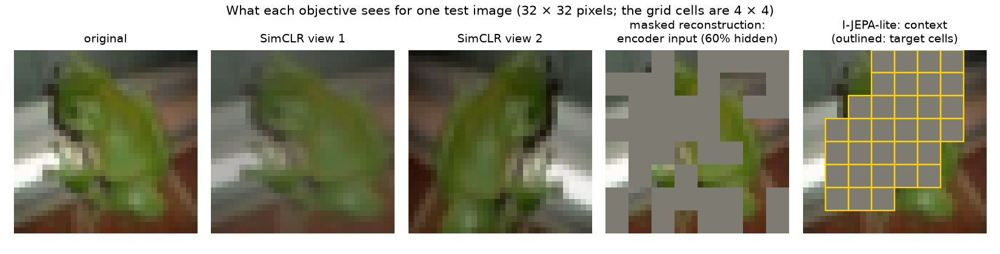
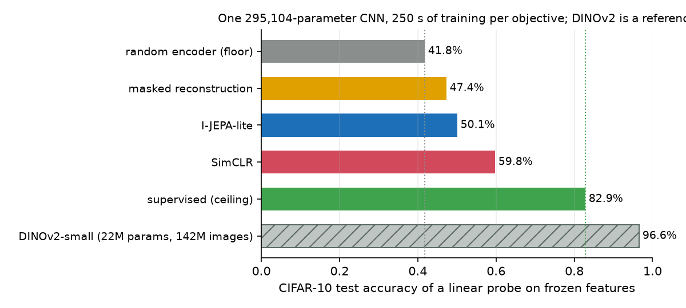
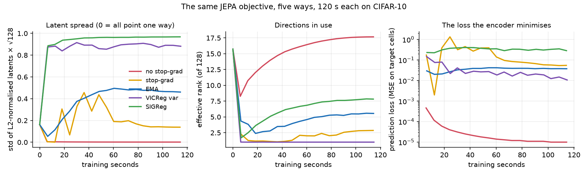
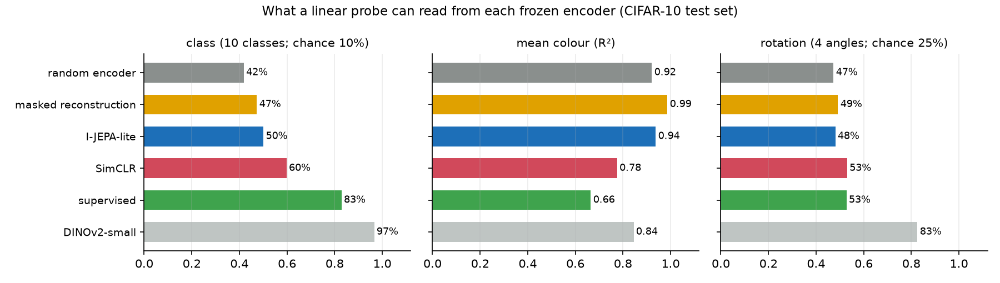

# Module 16: Self-supervised learning and JEPA

Every model so far learned from labels or from the next token. This module
trains an image encoder with no labels at all, three ways, and asks what each
way teaches it. It has four sections, each with a figure and the numbers
beside it:

1. **Three objectives, one encoder**: SimCLR, masked reconstruction and a small I-JEPA, against a random encoder and a supervised one.
2. **Collapse**: the cheap way out of a JEPA loss, shown and blocked four ways.
3. **What each encoder keeps**: probes for class, mean colour and rotation.
4. **The Hugging Face way**: a linear probe on DINOv2-small; LeJEPA, LeVJEPA and V-JEPA in a paragraph.

Every number in this README comes from a JSON file in [`results/`](results/),
written by the script that measured it.

This is the third module of track 5, **How learning works**. Next,
[module 29](../29-learning-new-keeping-old/README.md) asks what a model
forgets when it learns something new.

**🕹 Interactive:** [Self-supervised learning and JEPA](../../explorables/16-self-supervised-and-jepa.html):
train a two-dimensional JEPA in the browser, switch stop-grad, the EMA target
and the variance term on and off, and watch a latent-std meter; then replay
this module's collapse runs and probes.

**✅ Quiz:** [10 questions](../../quizzes/16.html): check yourself once you have run the scripts.

## Goals

By the end you will be able to:

- say what a self-supervised objective is, and write SimCLR's loss;
- train one small encoder three ways and compare them fairly, against a floor and a ceiling;
- say why a JEPA loss can collapse, and name four ways to block it;
- measure collapse two ways (the spread of the latents and their effective rank) and say what each misses;
- probe an encoder for what it keeps beyond the class;
- probe a pretrained DINOv2 from the Hugging Face Hub.

## Setup

```bash
cd modules/16-self-supervised-and-jepa/python
```

```bash
uv sync
```

| Need | Size | Where |
|---|---|---|
| CIFAR-10 (`uoft-cs/cifar10`, revision `0b27149`) | 144 MB of parquet; a 185 MB `.npz` of decoded images | Hugging Face cache; the `.npz` in `~/.cache/huggingface/mlcourse/`, on first run |
| DINOv2-small (`facebook/dinov2-small`, revision `ed25f3a`) | 88 MB (`model.safetensors` and `config.json`) | Hugging Face cache, on first run of `dinov2_probe.py` |

CIFAR-10 has 50,000 training and 10,000 test images of 32 × 32 pixels in ten
classes. No script reads a label while it trains an encoder, except the
supervised ceiling.

**The laptop guard.** Every script imports `src/common.py` before torch. It sets
`PYTORCH_MPS_HIGH_WATERMARK_RATIO=0.5` and `PYTORCH_MPS_LOW_WATERMARK_RATIO=0.4`:
the Apple GPU may take at most half of what Metal recommends, and a run that
grows past that stops with an error instead of pushing the Mac into swap. Each
script logs its time and peak memory (process RSS from `getrusage`, and
`torch.mps.driver_allocated_memory()`) into its results file:

| Script | Minutes | Peak RSS | Peak MPS driver |
|---|---|---|---|
| `src/pretrain.py --objective random` | 0.14 | 0.87 GB | 1.59 GB |
| `src/pretrain.py --objective supervised` | 4.34 | 0.64 GB | 1.61 GB |
| `src/pretrain.py --objective simclr` | 4.69 | 0.66 GB | 2.04 GB |
| `src/pretrain.py --objective mae` | 4.30 | 0.92 GB | 1.61 GB |
| `src/pretrain.py --objective jepa` | 4.30 | 0.91 GB | 1.61 GB |
| `src/collapse.py`, each of five variants | 2.04 to 2.06 | 0.64 to 0.70 GB | 1.04 to 2.04 GB |
| `src/dinov2_probe.py` | 3.15 | 0.76 GB | 2.16 GB |

Measured on an Apple M5 with 16 GB, torch 2.14.1, one script at a time. Each
objective trains for a fixed **wall-clock** budget, so another job on the GPU
would cut its steps; the steps each run reached are in its JSON.

**MPS against CPU.** One DINOv2-small forward pass on eight test images, on
the CPU and then on MPS: max abs difference in the 384-number CLS output
4.4 × 10⁻⁵ (outputs span up to 10.7), lowest cosine similarity 0.9999999. In
`results/dinov2.json`, `mps_vs_cpu`.

## 1 · Three objectives, one encoder

A **self-supervised** objective makes its own targets from the input. Three
families, one of each:

- **Contrastive: SimCLR** (Chen et al., 2020). Augment each image twice:
  random crop (20–100% of the area), flip, colour jitter, sometimes grey. The
  two views of one image must land close together, and far from every other
  view in the batch. The loss, NT-Xent, is a cross-entropy: each view must
  pick its partner out of the other 2B − 1 views, by cosine similarity over a
  temperature τ = 0.2. The comparison happens after a small projection head,
  which is thrown away after training.
- **Masked reconstruction** (in the spirit of MAE, He et al., 2021). Hide 60%
  of the 64 patches of 4 × 4 pixels, by setting them to the dataset mean; the
  encoder sees the rest, and a small decoder must redraw the hidden pixels.
  The loss is the squared error on hidden pixels only.
- **Predict latents: I-JEPA-lite** (after I-JEPA, Assran et al., 2023). Hide
  four rectangles of the 8 × 8 grid (each 15–20% of it). The encoder sees the
  rest; a predictor must guess, cell by cell, what a second encoder outputs
  for the hidden cells **of the full image**. The second encoder is a slow
  moving average of the first (EMA, momentum 0.996 rising to 1.0) and gets no
  gradient. The loss compares latents, not pixels.



**One encoder.** All five runs train the same CNN (`ssl_core.Encoder`, 295,104
parameters): five 3 × 3 convolutions with GroupNorm and ReLU, two of stride 2,
then a 1 × 1 convolution to 128 numbers per cell of an 8 × 8 map. The pooled
mean of that map, 128 numbers, is what the probes read. GroupNorm normalises
each image's channels in groups (here 8), using that image's numbers only. It
is used here, not BatchNorm: BatchNorm mixes statistics across the batch, and that alone can stop
a JEPA from collapsing, which would hide section 2. The heads differ (SimCLR's
projection 65,920 parameters, the decoder 198,723, the predictor 313,344) and
are thrown away.

**What each objective sees.** SimCLR gets its two strong views. The other
objectives, the supervised ceiling included, get one light view per image: a
random crop of 60–100% of the area, and a flip (`ssl_core.light_view`). No
colour jitter and no rotation, which matters for section 3.

**One budget.** Each objective trains for 250 seconds of wall time on MPS:
AdamW, learning rate 10⁻³ × batch / 256, weight decay 0.05, warmup over the
first 5% of the time, then cosine to zero. The brief asked for five minutes;
250 seconds keeps each script, data load and probes included, under the
5-minute laptop limit. The same seconds buy different amounts of training:

| Objective | Batch | Steps | Images seen |
|---|---|---|---|
| supervised | 256 | 7,029 | 1,799,424 |
| SimCLR | 512 (two views each) | 1,737 | 889,344 |
| masked reconstruction | 256 | 3,264 | 835,584 |
| I-JEPA-lite | 256 | 4,655 | 1,191,680 |

**The probe.** Freeze the encoder, take the pooled latents of the 50,000
training images, standardise each of the 128 numbers, and fit a linear
classifier (Adam, 100 epochs, on the CPU, so it gives the same answer every
time). Report its accuracy on the 10,000 test images. Two references frame it:
the **floor**, the same encoder at its random initial weights, and the
**ceiling**, the same encoder trained on the labels for the same 250 seconds.



| Encoder | Class probe, 50,000 training images | Class probe, 10,000 |
|---|---|---|
| random weights (floor) | 41.8% | 40.1% |
| masked reconstruction | 47.4% | 45.2% |
| I-JEPA-lite | 50.1% | 47.9% |
| SimCLR | 59.8% | 57.9% |
| supervised (ceiling) | 82.9% | 82.5% |

All three objectives beat the floor; none comes near the ceiling. A random CNN
is already a fair feature extractor on CIFAR-10 (41.8%, against 10% for
chance), so the floor matters: masked reconstruction adds 5.5 points to it,
I-JEPA-lite 8.3, SimCLR 18.0.

**What this shows, and what it does not.** It shows how far each objective
gets in four minutes on a laptop, with one seed and settings we did not tune.
It does not rank the methods. Published runs train for hundreds of epochs; ours
saw about 17 to 36 epochs' worth of images, and I-JEPA in particular is known to need
long training. The supervised run had the labels and four times SimCLR's
optimiser steps. Read the gaps to the floor, and hold them loosely.

One choice was made by looking at the probe. I-JEPA passes its target latents
through a layer norm; I-JEPA-lite does not. A few 60-second trial runs, scored
on this same test-set probe, favoured leaving it out. I-JEPA-lite's number thus
had one small round of tuning on the test that scores it; weigh its 2.7-point
lead over masked reconstruction with that in mind.

## 2 · Collapse

A JEPA loss compares two outputs of the same encoder. Map every image to one
point and the prediction is perfect: the loss is zero and the encoder has
learned nothing. That is **collapse**. A milder form, **dimensional collapse**,
keeps the latents apart but along a few directions only.

Two meters, on the pooled latents of 2,048 test images:

- **normalised std**: L2-normalise each latent, take the standard deviation of
  each of the 128 numbers over the images, average, multiply by √128. About 1
  when the latents spread over the sphere; 0 when they all point one way. It
  ignores size, so shrinking alone does not fool it.
- **effective rank**: the eigenvalues of the latents' covariance, normalised to
  sum to 1; then exp(entropy). 128 when all directions carry the same
  variance, 1 when one does. It ignores size too, but in a different way: a
  cloud shrunk to a dot still has a rank. RankMe (Garrido et al.,
  [2022](https://arxiv.org/abs/2210.02885)) is the same idea, taken from the
  singular values of the latents rather than the covariance's eigenvalues,
  and its authors use it to pick settings without labels: across runs of one
  method, a higher rank went with a better probe. The runs below show where
  that fails.

`src/collapse.py` trains the I-JEPA-lite objective of section 1 five ways,
120 seconds each, same encoder, predictor, masks, optimiser and seed:

| Variant | Target for the hidden cells | Extra term |
|---|---|---|
| no stop-grad | the encoder's own output on the full image; gradient flows into it | none |
| stop-grad | the same, detached | none |
| EMA | a moving average of the encoder (section 1's I-JEPA-lite) | none |
| VICReg var | as in no stop-grad | VICReg's variance hinge on the pooled latents: mean over dims of max(0, 1 − std) |
| SIGReg | as in no stop-grad | SIGReg on the pooled latents, weight λ = 0.1: loss = 0.9 × prediction + 0.1 × SIGReg |

**SIGReg** (Balestriero and LeCun, [LeJEPA](https://arxiv.org/abs/2511.08544),
2025) asks the latents to look like a standard Gaussian in every direction. It
projects them on 256 random unit directions and tests each projection against
N(0, 1) with the Epps-Pulley statistic: the gap between the projection's
empirical characteristic function and exp(−t²/2), weighted and integrated over
t. `ssl_core.sigreg` is about ten lines; exercise (c) writes it.



| Variant | Steps | Prediction loss at the end | Normalised std | Effective rank (of 128) | Class probe, 10,000 images |
|---|---|---|---|---|---|
| no stop-grad | 1,598 | 0.00001 | 0.0015 | 17.8 | 38.1% |
| stop-grad | 2,272 | 0.055 | 0.138 | 2.9 | 35.3% |
| EMA | 2,207 | 0.038 | 0.461 | 5.6 | 44.8% |
| VICReg var | 1,529 | 0.011 | 0.882 | 1.0 | 20.3% |
| SIGReg | 1,375 | 0.285 | 0.968 | 7.8 | 22.1% |
| random encoder, untrained | | | 0.162 | 16.0 | 40.1% |

What the runs show:

- **No stop-grad collapses.** Within six seconds the normalised std falls from
  0.16 to 0.005, and the prediction loss to 0.0005; after 120 seconds they are
  0.0015 and 10⁻⁵. Every latent points the same way. The effective rank, 17.8,
  does not see it: it measures the shape of the tiny spread that is left, and
  ignores its size. The probe still reads 38.1%, because it rescales each
  number before it classifies; the information left sits in the fifth digit.
- **Stop-grad alone** keeps some spread, but uses about three directions; its
  probe (35.3%) is below the floor.
- **EMA** spreads the latents less than the two terms, over about six
  directions, and is the only variant whose probe ends above the floor
  (44.8% against 40.1%).
- **The variance term alone** holds the std near 0.88 but puts every latent on
  one line: effective rank 1.0 from the first log, six seconds in. The hinge
  wants each number to vary; it does not care that all 128 vary together.
  VICReg adds a covariance term for that; this run leaves it out on purpose.
- **SIGReg** gives the widest spread (0.968) and, of the four guards, the most
  directions (7.8); its prediction loss is the highest. Its probe, 22.1%, is
  far below the floor: spread is not the same as useful. At the last logged
  step (1,300 of 1,375) the SIGReg term is about 5.7 times the prediction term
  in the loss (0.1 × SIGReg ≈ 1.46 against 0.9 × 0.285 ≈ 0.26), so this run
  mostly trains the pooled latents to look Gaussian. The loss multiplies the
  SIGReg statistic by the batch size (`ssl_core.sigreg`), so λ = 0.1 is a
  heavy weight here. A smaller λ may well probe higher; we did not sweep it.

**The meters cannot pick the run.** Choose by the meters alone and you would
pick wrong: the run with the highest effective rank (no stop-grad, 17.8) has
collapsed, and the run with the widest spread among the guards (SIGReg, 0.968)
probes at 22.1%. The one run above the floor, EMA, has neither. RankMe's
authors compare runs of one method, trained to the end, that differ in their
settings; two-minute runs with different guards are another setting. Here
only the labelled probe tells the runs apart.

**This is a demo, not a measurement.** One seed, 120 seconds, one weight per
term, and settings borrowed from ViT recipes, not tuned for this CNN. The
collapse of the unguarded run is clear-cut; the order of the four guards on
the probe could change with more time or other weights. LeJEPA reports that
SIGReg trains well at scale; two minutes here do not test that.

## 3 · What each encoder keeps

A class probe asks one question. Two more, on the same frozen latents:

- **mean colour**: ridge regression from the 128 numbers to the image's mean
  red, green and blue; R² on the test set (1 = exact);
- **rotation**: turn each image by 0°, 90°, 180° or 270°; a linear classifier
  must tell which (chance 25%). Trained on 10,000 training images at four
  angles, tested on the 10,000 test images at four angles.



| Encoder | Class | Mean colour R² | Rotation |
|---|---|---|---|
| random weights | 41.8% | 0.921 | 47.4% |
| masked reconstruction | 47.4% | 0.987 | 49.2% |
| I-JEPA-lite | 50.1% | 0.938 | 48.1% |
| SimCLR | 59.8% | 0.775 | 53.1% |
| supervised | 82.9% | 0.665 | 52.8% |
| DINOv2-small (section 4) | 96.6% | 0.845 | 82.6% |

- **Colour.** A random CNN keeps the mean colour well (0.921). Masked
  reconstruction, which must redraw pixels, keeps it best (0.987). Balestriero
  and LeCun ([2024](https://arxiv.org/abs/2402.11337)) explain why: a loss on
  pixels spends the model's capacity on the directions where pixels vary most,
  and the mean colour is among them; those directions help little to name the
  object. Littwin et al. ([2024](https://arxiv.org/abs/2407.03475)) show, in
  deep linear networks, that a JEPA instead favours the features that best
  predict the rest of the input. SimCLR,
  trained to give the same answer under colour jitter, keeps less (0.775), and
  the supervised encoder, which needs colour only as far as it helps name the
  class, keeps least (0.665). Each objective keeps what its task rewards.
- **Rotation.** No small encoder tells the angles apart much better than the
  random one: 47.4% to 53.1%. None of them saw a rotated image in training,
  and the pooled average of the map keeps little of where things are; that
  may be why. DINOv2 reaches 82.6%.

The colour reading fits what each loss asks for. With one seed per encoder we
cannot say how much of the 0.1 to 0.3 gaps would survive a rerun.

## 4 · The Hugging Face way

Self-supervised encoders trained at scale are on the Hub, ready to probe.
[DINOv2](https://arxiv.org/abs/2304.07193) (Oquab et al., 2023) trains a ViT
with two self-supervised losses, self-distillation from an EMA teacher (DINO)
and masked prediction in latent space (iBOT), on 142M curated images. The small
one has 22M parameters:

```python
from transformers import AutoModel

model = AutoModel.from_pretrained("facebook/dinov2-small").eval()
h = model(pixel_values=x)                     # x: (B, 3, 224, 224), ImageNet-normalised
feats = torch.cat([h.pooler_output, h.last_hidden_state[:, 1:].mean(1)], 1)   # (B, 768)
```

`src/dinov2_probe.py` resizes CIFAR-10 images from 32 to 224 pixels (bicubic),
takes the CLS token and the mean patch token (768 numbers), and fits section
1's probe. To keep the script under five minutes it uses the first 10,000
training images (compare section 1's 10,000-image column); the rotation probe
uses 2,000 training and 2,000 test images, each at four angles.

| | Value |
|---|---|
| Class probe, 10,000 training images | 96.6% |
| Mean-colour R² | 0.845 |
| Rotation probe | 82.6% |

96.6% against our supervised encoder's 82.5% on the same 10,000 images. The
two differ in every way that matters (75 times the parameters, 7 times the
image side, 142M training images), so this is a reference, not a contest. It shows what the same probe reads from a self-supervised encoder
trained at scale.

[DINOv3](https://arxiv.org/abs/2508.10104) (Siméoni et al., 2025) scales
DINOv2 up in data and model size and adds **Gram anchoring**, a loss that keeps
the per-patch features from degrading during long training. It is the version
a reader meets first in 2026. This module keeps DINOv2-small: it is small, and
its revision is pinned.

**LeJEPA, LeVJEPA and V-JEPA.** [V-JEPA](https://arxiv.org/abs/2404.08471)
(Bardes et al., 2024) and [V-JEPA 2](https://arxiv.org/abs/2506.09985) (Assran
et al., 2025) carry I-JEPA to video: hide blocks of a clip in space and time,
and predict their latents from the rest with an EMA target encoder, as in
section 1. [LeJEPA](https://arxiv.org/abs/2511.08544) (Balestriero and LeCun,
2025) drops the EMA, stop-grad and schedules, and blocks collapse with SIGReg
alone, as in section 2's last variant. [LeVJEPA](https://arxiv.org/abs/2608.27395)
(Kuhn et al., 2026) applies LeJEPA's objective to video, with one encoder,
a projector and SIGReg, and reports matching or beating V-JEPA 2 with 5.6 to
20.8 times less pretraining compute, at matched epochs on the same data. That last claim is the authors' own, from
a preprint. This module runs no video model: their weights are large, and an
API we have not tested would be untested code.

## Run it

Each script prints its numbers, writes `results/<name>.json`, and with
`--figures` redraws every figure once all results exist. Run them one at a
time.

```bash
uv run python src/pretrain.py --objective random
```

```bash
uv run python src/pretrain.py --objective supervised
```

```bash
uv run python src/pretrain.py --objective simclr
```

```bash
uv run python src/pretrain.py --objective mae
```

```bash
uv run python src/pretrain.py --objective jepa
```

```bash
uv run python src/collapse.py --variant no-stop-grad    # also stop-grad, ema, vicreg-var, sigreg
```

```bash
uv run python src/dinov2_probe.py --figures
```

For a quick look, `--budget 30 --no-write` trains for 30 seconds and writes
nothing.

Redraw every figure from the committed JSON, with no model loaded:

```bash
uv run python src/figures.py
```

Rewrite the explorable's data block from the JSON:

```bash
uv run python src/export_explorable.py
```

## Exercises

Skeletons with `# TODO(you):` live in [`exercises/`](exercises/); reference
solutions are in [`solutions/`](solutions/). Each asks you to predict before
you run. All three run on the CPU in a second.

- **(a) `exercise_a_nt_xent.py`**: write SimCLR's loss. Predict its value when
  every embedding is the same vector.
- **(b) `exercise_b_meters.py`**: write the normalised std, the effective rank
  and VICReg's variance hinge, and run them on three clouds: a Gaussian, a
  point with tiny noise, and a line. Predict which meter sees which collapse.
- **(c) `exercise_c_sigreg.py`**: write SIGReg's Epps-Pulley test. Predict the
  order of three clouds by score.

## Tests

```bash
uv run pytest
```

Twenty-four tests, under 5 seconds, no model loaded. They check the solutions
against `src/ssl_core.py`; the committed results against the laptop budget;
that every objective trained the same encoder for the same seconds and that
the random floor is there; and the explorable against the results.

## To go further

- Train longer. `--budget` takes any number of seconds; the probe gaps of
  section 1 may grow or shrink.
- Add VICReg's covariance term to the `VICReg var` variant, and watch the
  effective rank.
- Probe the 8 × 8 map instead of its mean, for rotation: the pooled average
  throws away layout. Per-patch features are what DINOv3's Gram anchoring
  protects.
- Sweep SIGReg's λ (0.005, 0.02, 0.05, 0.1), and see whether the effective
  rank picks the λ that the probe picks.
- Balestriero and LeCun, [Learning by Reconstruction Produces Uninformative Features for Perception](https://arxiv.org/abs/2402.11337) (2024), and Littwin et al., [How JEPA Avoids Noisy Features](https://arxiv.org/abs/2407.03475) (2024): why pixel and latent targets keep different things.
- [solo-learn](https://github.com/vturrisi/solo-learn) and
  [lightly](https://github.com/lightly-ai/lightly) implement many
  self-supervised methods; lightly's documentation has a LeJEPA example.

## Checkpoint: you should now be able to…

- write SimCLR's loss and say what the temperature does;
- say why a JEPA can collapse, and how stop-grad, an EMA target, a variance term and SIGReg each push back;
- read the normalised std and the effective rank, and give a case each one misses;
- explain why a random encoder is the right floor for a probe;
- say what masked reconstruction keeps that SimCLR drops, and why;
- probe DINOv2 from the Hub, and say why its number is a reference, not a rival.

## Links

- Chen et al., [A Simple Framework for Contrastive Learning of Visual Representations](https://arxiv.org/abs/2002.05709) (SimCLR, 2020)
- He et al., [Masked Autoencoders Are Scalable Vision Learners](https://arxiv.org/abs/2111.06377) (MAE, 2021)
- Assran et al., [Self-Supervised Learning from Images with a Joint-Embedding Predictive Architecture](https://arxiv.org/abs/2301.08243) (I-JEPA, 2023)
- Grill et al., [Bootstrap Your Own Latent](https://arxiv.org/abs/2006.07733) (BYOL, 2020), the EMA target
- Chen and He, [Exploring Simple Siamese Representation Learning](https://arxiv.org/abs/2011.10566) (SimSiam, 2020), stop-grad and the normalised-std meter
- Bardes et al., [VICReg](https://arxiv.org/abs/2105.04906) (2021)
- Balestriero and LeCun, [LeJEPA](https://arxiv.org/abs/2511.08544) (2025), SIGReg
- Garrido et al., [RankMe](https://arxiv.org/abs/2210.02885) (2022), the effective rank as a label-free score
- Oquab et al., [DINOv2](https://arxiv.org/abs/2304.07193) (2023); Siméoni et al., [DINOv3](https://arxiv.org/abs/2508.10104) (2025)
- Bardes et al., [V-JEPA](https://arxiv.org/abs/2404.08471) (2024); Assran et al., [V-JEPA 2](https://arxiv.org/abs/2506.09985) (2025)
- Kuhn et al., [LeVJEPA](https://arxiv.org/abs/2608.27395) (2026)
