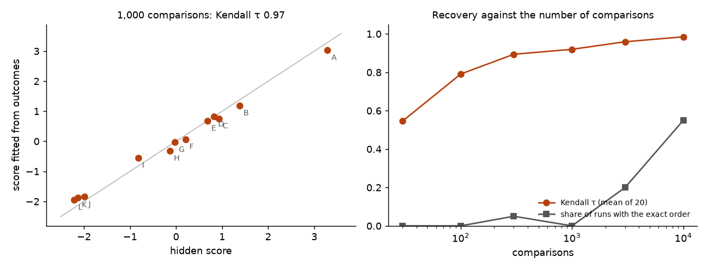
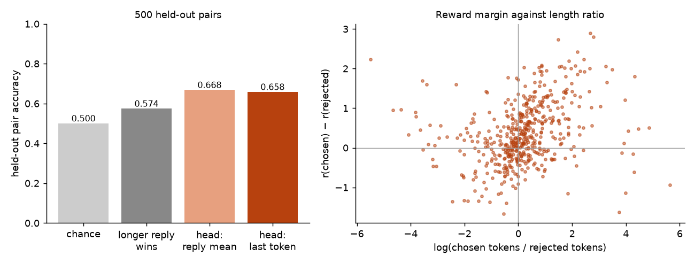
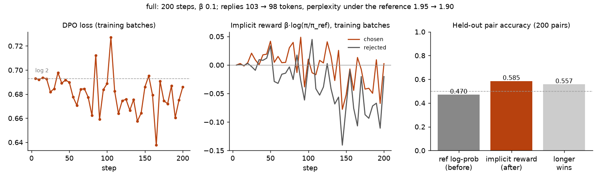
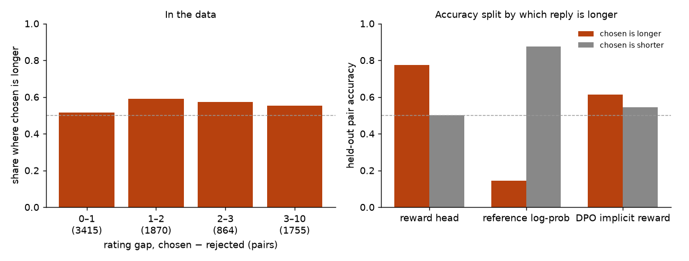

# Module 17: Learning from preferences

Modules 05 and 06 taught a model by showing it good replies. This module
teaches from choices instead: a judge sees two replies and says which is
better. It has four sections, each with a figure and the numbers beside it:

1. **Bradley-Terry**: scores from choices, first on made-up items, then as a reward head on a real model.
2. **DPO by hand**: the loss derived from Bradley-Terry and a KL penalty, checked against TRL.
3. **DPO the library way**: TRL + LoRA on SmolLM2-360M-Instruct, 200 steps.
4. **Length bias**: in the data, in the reward head, in DPO.

Every number in this README comes from a JSON file in [`results/`](results/),
written by the script that measured it.

This is the first module of track 6, **Other recipes**. Next,
[module 18](../18-beyond-attention/README.md) swaps attention for a state
carried from token to token.

**🕹 Interactive:** [Learning from preferences](../../explorables/17-learning-from-preferences.html):
drag item scores and watch the pair probabilities, move β and watch one pair's
DPO loss, read replies before and after training.

**✅ Quiz:** [10 questions](../../quizzes/17.html): check yourself once you have run the scripts.

## Goals

By the end you will be able to:

- fit Bradley-Terry scores from pairwise choices, and say how many choices a ranking needs;
- train a linear reward head on a frozen model and measure it on held-out pairs;
- derive the DPO loss from Bradley-Terry plus a KL penalty, and compute it by hand;
- run DPO with TRL and LoRA, and read its implicit reward, its logs and its replies;
- say why a reply's length can pass for its quality, and check for it.

## Setup

```bash
cd modules/17-learning-from-preferences/python
```

```bash
uv sync
```

| Need | Size | Where |
|---|---|---|
| SmolLM2-360M-Instruct | ~700 MB | Hugging Face cache; module 05 already fetched it |
| `trl-lib/ultrafeedback_binarized`, 8 train row groups and the 1-row-group test file | 18.8 MB read from 133 MB of Parquet | `~/.cache/huggingface/mlcourse/`, on first run of `src/data.py` |

**The data.** [`trl-lib/ultrafeedback_binarized`](https://huggingface.co/datasets/trl-lib/ultrafeedback_binarized)
(revision `47124cb`, no licence click) is TRL's reformatted
[`HuggingFaceH4/ultrafeedback_binarized`](https://huggingface.co/datasets/HuggingFaceH4/ultrafeedback_binarized),
which is MIT-licensed and built from [UltraFeedback](https://huggingface.co/datasets/openbmb/UltraFeedback)
(MIT). The TRL card names neither a licence nor a source; the name, the
columns and the counts (62,135 + 1,000 pairs against H4's 61,135 + 2,000)
point to H4. The scripts download the pairs to your cache; the module ships
none of them, apart from the 32 prompts quoted in `results/` and the
explorable. Each row holds a
prompt, a chosen and a rejected reply, and the GPT-4 rating of each.
`src/data.py` opens the Parquet files over HTTP and reads only the row groups
it needs, as module 11 does with wikitext. A row group here holds 1,000 pairs,
so 2,000 training pairs need more than one: the script reads 8 train groups
and the test file, 18.8 MB in all.

It keeps single-turn pairs whose two replies differ, whose two ratings differ
(1,096 of 9,000 pairs are ties, where "chosen" is arbitrary), and whose prompt
and reply fit in 640 tokens of SmolLM2's chat template. That leaves 4,717
train pairs and 594 test pairs. The splits:

| Split | Pairs | From | Used by |
|---|---|---|---|
| reward train | 2,000 | train | section 1's reward head; exercise (c) |
| DPO train | 2,717 (1,459 under 384 tokens) | train, the rest | section 3 |
| held-out | 500 | test | sections 1 to 4 |

**The laptop guard.** Every script imports `src/common.py` before torch. It sets
`PYTORCH_MPS_HIGH_WATERMARK_RATIO=0.5` and `PYTORCH_MPS_LOW_WATERMARK_RATIO=0.4`:
the Apple GPU may take at most 5.92 GB on this 16 GB Mac, and a run that grows
past that stops with an error instead of pushing the Mac into swap. Each script
logs its time and peak memory (process RSS from `getrusage`, and
`torch.mps.driver_allocated_memory()`) into its results file:

| Script | Minutes | Peak RSS | Peak MPS driver |
|---|---|---|---|
| `src/bt_synthetic.py` | 0.17 | 0.22 GB | 0 (runs on the CPU) |
| `src/reward_head.py` | 3.93 | 2.68 GB | 3.45 GB |
| `src/dpo_by_hand.py` | 0.25 | 2.49 GB | 3.72 GB |
| `src/dpo_train.py --config preview` | 3.27 | 2.58 GB | 4.92 GB |
| `src/dpo_train.py --config full` | 13.58 | 4.57 GB | 5.09 GB |
| `src/length_bias.py` | 0.00 | 0.62 GB | 0 (no model) |

Measured on an Apple M5 with 16 GB, torch 2.14.1. The full DPO config is the
one script here allowed past 5 minutes; the preview config is its 5-minute
stand-in, with every setting the same but the budget.

**Tools.** The module's uv project pins TRL 1.14.2 and PEFT 0.21.2, beside
transformers 5.20.1. TRL 1.15.0 failed on this Mac: its DPO trainer calls a
fused log-prob kernel that needs Triton, which PyTorch ships on Linux only.
1.14.2 has a plain-PyTorch path.

**MPS against CPU.** One SmolLM2 forward pass over a held-out prompt and reply
(503 tokens), on MPS and then on the CPU: max abs difference in logits
1.05 × 10⁻⁴ (logits span −29.8 to 32.8), same top-1 token at every position.
The layer-18 residual differs by at most 0.0078, on values up to 22,883 in
size. In `results/reward_head.json`, `mps_vs_cpu`.

## 1 · Bradley-Terry: scores from choices

A judge prefers item i to item j with probability

```
P(i beats j) = σ(sᵢ − sⱼ) = 1 / (1 + exp(−(sᵢ − sⱼ)))
```

where s is a hidden score per item. This is the **Bradley-Terry** model
(1952). Only differences of scores matter: add the same number to every score
and no probability changes. Given a list of (winner, loser) pairs, the scores
that make the choices most likely minimise

```
loss(s) = mean over pairs of −log σ(s_winner − s_loser)
```

For one pair, the gradient is −(1 − σ(s_w − s_l)) on the winner's score and
the opposite on the loser's: a choice the scores already predict well pushes
little.

### 1a · By hand, on made-up items

`src/bt_synthetic.py` gives 12 items hidden scores, simulates a judge that
follows the formula on random pairs, then fits the scores from the outcomes
alone by gradient descent (written out, numpy only), fixing the mean at zero.



From 1,000 comparisons, the fit ranks the items with Kendall τ 0.970 against
the hidden order (1 is the same order), with a largest score error of 0.28.
The fitted scores explain the choices slightly better than the hidden ones
(loss 0.4412 against 0.4448; all-zero scores give log 2 = 0.6931): with
finite data, the fit also fits the noise.

Over 20 simulated judges per size:

| Comparisons | Kendall τ (mean) | τ (worst of 20) | RMSE of scores | Exact order |
|---|---|---|---|---|
| 30 | 0.545 | 0.212 | 3.146 | 0 of 20 |
| 100 | 0.791 | 0.606 | 1.019 | 0 of 20 |
| 300 | 0.894 | 0.788 | 0.416 | 1 of 20 |
| 1,000 | 0.920 | 0.849 | 0.221 | 0 of 20 |
| 3,000 | 0.959 | 0.909 | 0.112 | 4 of 20 |
| 10,000 | 0.985 | 0.939 | 0.065 | 11 of 20 |

The ranking comes back roughly from a few hundred choices, but the exact
order needs many more. Two of the twelve hidden scores sit 0.075 apart, and a
judge that picks the better of those two only 52% of the time needs thousands
of comparisons before the order of that pair settles. An item that never
loses has no finite best score; the small L2 term in the fit keeps it finite,
and at 30 comparisons such scores still run far off (RMSE 3.1).

### 1b · A reward head on a real model

Now the items are replies and the judge is UltraFeedback's GPT-4 rating. A
**reward model** gives each reply a score r, and Bradley-Terry trains it on
pairs: loss = −log σ(r(chosen) − r(rejected)).

`src/reward_head.py` keeps SmolLM2-360M-Instruct frozen. Each (prompt,
reply), in the chat template, runs through the first 18 of the model's 32
blocks; the residual stream there at the reply's last token is a vector h of
960 numbers. The reward is linear, r = w · h (after each of the 960 numbers is
standardised). Only w is trained: L-BFGS on the Bradley-Terry loss with an L2
penalty, whose weight 5-fold cross-validation on the training pairs picked
from 10⁻³ to 10³ (it chose 1.0). The first run used a narrower grid and
picked its edge, so we widened the grid once and ran again: a choice made
after seeing results, though on the training folds, never the held-out pairs. We chose the last token as the main feature
before the run; the mean over the reply's tokens is reported beside it.



| Reward | Held-out accuracy (500 pairs) | Train accuracy |
|---|---|---|
| chance | 0.500 | |
| the longer reply wins (no model) | 0.574 | |
| head on the last token's residual (main) | 0.658 | 0.717 |
| head on the mean residual over the reply | 0.668 | 0.754 |

A linear readout of a frozen 360M model's middle layer, trained on 2,000
pairs, picks GPT-4's choice on about two pairs in three. It beats "the longer
reply wins" by 8 points; with 500 held-out pairs, one standard error is about
2 points. Its scores also track length: across the 1,000 held-out replies,
the reward correlates 0.30 with the log of the reply's length, and on the
pairs where the two replies differ in length, the head agrees with "the
longer one wins" 66% of the time. Section 4 splits this further.

The early stop is exact: the hook's residual at block 18 equals a full
forward pass's `hidden_states[18]` to the last digit on a test reply.

## 2 · DPO, derived and computed by hand

RLHF (Ouyang et al., 2022) trains a reward model as in section 1, then trains
the language model π to get high reward without drifting far from a frozen
reference π_ref, usually the model before this step:

```
maximise over π:   E_{y ~ π(·|x)} [ r(x, y) ]  −  β · KL( π(·|x) ‖ π_ref(·|x) )
```

β sets how far π may move. This objective has an exact best answer (Rafailov
et al., 2023):

```
π*(y|x) = π_ref(y|x) · exp(r(x, y) / β) / Z(x)
```

Z(x) sums over every possible reply, so nobody can compute it. Take the log
and solve for the reward:

```
r(x, y) = β · log( π*(y|x) / π_ref(y|x) ) + β · log Z(x)
```

Put this into Bradley-Terry. Only the difference of two rewards for the same
prompt enters, so β log Z(x) cancels:

```
P(y_w beats y_l) = σ( β log π(y_w|x)/π_ref(y_w|x)  −  β log π(y_l|x)/π_ref(y_l|x) )

loss_DPO = −log σ( β [ (log π(y_w|x) − log π_ref(y_w|x)) − (log π(y_l|x) − log π_ref(y_l|x)) ] )
```

This is **DPO**: Bradley-Terry where a reply's score, the **implicit
reward**, is β times its log-ratio, and the model being trained is the reward
model. No separate reward model, no sampling during training. log π(y|x) is
the sum of the log-probabilities of the reply's tokens. When π equals π_ref,
every log-ratio is 0 and every loss is log 2.

`src/dpo_by_hand.py` builds TRL's `DPOTrainer` on SmolLM2-360M-Instruct with a
LoRA adapter, as section 3 does. TRL's reference is the same model with the
adapter switched off. A new adapter changes nothing (its B matrices start at
zero), so the script fills B with small random numbers. Both of the
adapter's matrices are seeded (0), so a re-run gives the same numbers. Then it
computes the loss on eight held-out pairs twice: by hand, from the model's
logits in a dozen lines of torch, and with TRL's `compute_loss`.

| Eight held-out pairs, β 0.1 | By hand | TRL 1.14.2 |
|---|---|---|
| loss | 0.725244 | 0.725241 |
| mean implicit reward, chosen | −0.07829 | −0.07829 |
| mean implicit reward, rejected | −0.02228 | −0.02228 |
| reward accuracy | 0.25 | 0.25 |
| mean log π(chosen) | −281.01366 | −281.01360 |

The two agree to 2 × 10⁻⁶ on the loss. The random adapter happens to prefer
the rejected reply on six of eight pairs, so the loss sits above log 2; that
does not matter for the check. With the adapter off, every pair's loss is
0.693147, log 2. TRL counts the reply's tokens as everything after the
prompt's template, so `<|im_end|>` and the newline after it are part of the
reply; the hand version does the same. TRL ran the eight pairs as four batches
of two: eight at once needed 2 GB per copy of the logits, past the MPS cap.

## 3 · DPO with TRL and LoRA

`src/dpo_train.py` trains SmolLM2-360M-Instruct with TRL's `DPOTrainer` and a
LoRA adapter of rank 16 on every attention and MLP projection, as module 06
does for SFT: 8,683,520 trainable parameters, 2.3% of the 370,504,640 in the
wrapped model. β 0.1, learning rate 5 × 10⁻⁵, cosine schedule, 10 warmup steps,
one pair per batch and 4 batches per step, fp32 on MPS.

Two configs share every setting but the budget:

| Config | Steps | Pairs seen | Held-out pairs | Held-out prompts | Minutes |
|---|---|---|---|---|---|
| preview | 40 | 160 | 100 | 16 | 3.27 |
| full | 200 | 800 | 200 | 32 | 13.58 |

Training uses only DPO pairs whose prompt and reply fit in 384 tokens (1,459
of 2,717): with longer ones, one pair at a time still ran past the 5.92 GB MPS
cap, and each step took too long for the 15-minute budget. The held-out
pairs keep the 640-token limit. The cut changes what DPO learns from: in the
1,459 short pairs the chosen reply is the longer one only 50.7% of the time
(median 75 tokens against 76), where the held-out pairs show 57% (148 against
122.5). The training pairs carry almost no "longer wins" signal, and DPO
trains on short replies but is tested on longer ones. Both configs read the first held-out pairs;
the generation prompts come from the end of the held-out list, so they do not
overlap.



Before training, the policy is the reference, so every implicit reward is 0
and accuracy is undefined: TRL's metric counts a tie as wrong and reports 0.
The useful baseline is the reference model's own preference, log π_ref(chosen)
against log π_ref(rejected).

| Held-out pairs | preview (100) | full (200) |
|---|---|---|
| reference log-prob prefers chosen (before) | 0.47 | 0.47 |
| same, per token | 0.55 | 0.53 |
| implicit reward prefers chosen (after) | 0.56 | 0.585 |
| the longer reply wins | 0.55 | 0.558 |
| mean change of log π, chosen replies | +0.23 nats | −0.05 nats |
| mean change of log π, rejected replies | +0.22 nats | −0.48 nats |

After 200 steps the implicit reward picks the chosen reply on 58.5% of 200
held-out pairs; with 200 pairs one standard error is about 3.5 points, so this
is above chance but not by much, and the 40-step preview (56%) cannot be told
apart from chance. The training loss, logged every 5 steps, sat below log 2 at
34 of 40 points, between 0.638 and 0.727, and averaged 0.677 over the last
100 steps. In the full run, the model got there mostly by
making rejected replies less likely: their log-probability fell by 0.48 nats
on average, the chosen ones' by 0.05. Both falling is often reported for DPO;
the loss only asks that the gap grow.

**The replies.** On 32 held-out prompts, greedy, at most 160 new tokens,
before and after the full run:

| Replies, 32 prompts | Before | After |
|---|---|---|
| mean tokens | 103.1 | 98.0 |
| median tokens | 118 | 135.5 |
| cut off at 160 tokens | 15 | 15 |
| perplexity under the reference (median) | 1.946 | 1.899 |
| perplexity under the reference (mean) | 1.949 | 1.980 |
| section 1's reward head prefers this one | 39% of prompts (ties half) | |

Seven replies are identical before and after; three got longer and nine
shorter. Perplexity under the reference says how likely the old model finds
the new replies, not how fluent they are; a reply can drift from the
reference and read just as well. It barely moved: the median fell a little,
the mean rose a little. Section 1's reward
head preferred the old reply more often than the new one. That head is a
weak judge (0.658 on held-out pairs) and partly a length judge, so this says
little about quality either way.

Two replies that changed (full text in `results/dpo_full.json`):

| Prompt (cut) | Before | After |
|---|---|---|
| a coreference task ("identify the shortest continuous text span…") | 108 tokens explaining coreference resolution | `The question should be "What should be unnecessary?"` (10 tokens) |
| an email to "Michael" about HexaChem price offers | 76 tokens, a short reply asking for his needs | 120 tokens, the same opening plus a paragraph about refining the product |

**This is a demo, not a measurement.** One run per config, one seed, one
learning rate chosen before the run and never tuned, 200 held-out pairs, 32
prompts read by eye, and a judge (the reward head) that is weak and leans on
length. It shows what DPO's numbers are and how to read them, not how well
DPO works. A measured comparison needs several seeds, a learning-rate sweep,
many more prompts, a judge stronger than the model, and an expectation
written down before the run.

## 4 · Length bias

In UltraFeedback, the chosen reply tends to be the longer one. A model that
learns "longer is better" scores well without learning anything about
quality. `src/length_bias.py` looks for this in three places; it loads no
model.



**In the data.** Over all 7,904 untied single-turn pairs read (before the
640-token filter), the chosen reply has more words in 54.7% of pairs (median
151 words against 122). The skew is smallest when GPT-4's two ratings are
close:

| Rating gap | Pairs | Chosen is longer | Median length ratio |
|---|---|---|---|
| up to 1 | 3,415 | 51.4% | 1.03 |
| 1 to 2 | 1,870 | 59.1% | 1.16 |
| 2 to 3 | 864 | 57.2% | 1.20 |
| over 3 | 1,755 | 55.4% | 1.22 |

**A reward that sees only length.** Train r = w · log(tokens) with the same
loss on the same 2,000 pairs: w comes out positive (0.149) and the held-out
accuracy is 0.574, the same as "the longer reply wins". The 960-feature head
adds 8 points to that (exercise (c)).

**Accuracy split by which reply is longer**, on held-out pairs whose two
replies differ in length:

| Held-out pairs | Chosen is longer | Chosen is shorter |
|---|---|---|
| reward head (500 pairs: 285 and 211) | 0.775 | 0.502 |
| reference log-prob, before DPO (200 pairs: 111 and 88) | 0.144 | 0.875 |
| DPO implicit reward, after the full run (same 200) | 0.613 | 0.545 |

The reward head is right three times in four when the chosen reply is the
longer one, and at chance when it is the shorter one. Much of what it learned
may be length, or things that come with length.

The reference model's log-probability leans the other way, hard: a sum of
log-probabilities falls with every token, so the shorter reply nearly always
gets the higher one. That is why its overall accuracy (0.47) sits near chance.
DPO compares log-ratios, so this pull cancels between π and π_ref. After
training, the implicit reward does better on pairs where the chosen reply is
longer (0.613 against 0.545), but with 111 and 88 pairs the gap is within the
noise. Section 3's cut to pairs under 384 tokens also matters here: in those
training pairs the chosen reply is longer only 50.7% of the time, so this run
had little length signal to learn.

**In the replies.** Over 32 prompts the full run's replies did not get
longer: mean 103.1 → 98.0 tokens, median 118 → 135.5, and 15 of 32 hit the
160-token limit both before and after, which hides any growth past it. Short,
length-balanced training pairs are one reason not to expect growth here. In
published runs, length often grows over longer DPO training; 200 small steps
at this learning rate did not show it. Park et al. (2024) add a length term
to the DPO loss for this reason; TRL's `ld_alpha` option (LD-DPO) is another
fix.

## Run it

Each script prints its numbers, writes `results/<name>.json`, and with
`--figures` redraws its figure. Fetch the pairs first (no model, 18.8 MB):

```bash
uv run python src/data.py
```

```bash
uv run python src/bt_synthetic.py --figures
```

```bash
uv run python src/reward_head.py --figures
```

```bash
uv run python src/dpo_by_hand.py
```

```bash
uv run python src/dpo_train.py --config preview --figures
```

The full config takes about 14 minutes:

```bash
uv run python src/dpo_train.py --config full --figures
```

`length_bias.py` reads the results of the scripts above:

```bash
uv run python src/length_bias.py --figures
```

Redraw every figure from the committed JSON, with no model loaded:

```bash
uv run python src/figures.py
```

Rewrite the explorable's data block from the JSON:

```bash
uv run python src/export_explorable.py
```

## Exercises

Skeletons with `# TODO(you):` live in [`exercises/`](exercises/); reference
solutions are in [`solutions/`](solutions/). Each asks you to predict before
you run.

- **(a) `exercise_a_bt.py`**: write the Bradley-Terry gradient and the fit;
  recover twelve hidden scores from 30 and from 1,000 simulated choices. Runs
  on the CPU in a second.
- **(b) `exercise_b_dpo_loss.py`**: write the reply's log-probability from
  logits, and the DPO loss from four sums; run it on the batch section 2
  stored and compare with TRL's number.
- **(c) `exercise_c_length_reward.py`**: a reward with one feature, the log of
  the reply's length; train it on the 2,000 pairs and score the 500 held-out
  ones. Needs the cached pairs, no model.

## Tests

```bash
uv run pytest
```

Seventeen tests, under 5 seconds. They check the solutions against the
scripts and the stored TRL batch, the committed results against the laptop
budget, and the explorable against the results. No test loads a model.

## To go further

- **Reward models at scale.** [RewardBench](https://huggingface.co/spaces/allenai/reward-bench)
  ranks published reward models; TRL's `RewardTrainer` trains one on a whole
  model, not a frozen head.
- **Other losses.** TRL's `DPOConfig(loss_type=…)` holds IPO, which caps how
  far the margin is pushed, and others; [KTO](https://arxiv.org/abs/2402.01306)
  needs only "good" or "bad" per reply, not pairs;
  [ORPO](https://arxiv.org/abs/2403.07691) and [SimPO](https://arxiv.org/abs/2405.14734)
  drop the reference model.
- **Online methods.** PPO, as in RLHF, and GRPO sample replies during training
  and score them; TRL has `GRPOTrainer`. Module 06 points at both.

## Checkpoint: you should now be able to…

- fit Bradley-Terry scores and say why only differences are identified;
- say how many choices a ranking needs, and why close items need more;
- train and measure a reward head, and compare it with a length baseline;
- derive the DPO loss from the KL-regularised objective, and say why Z(x) drops out;
- compute the DPO loss by hand and match a library's number;
- read DPO's implicit-reward accuracy, and say why it is undefined at step 0;
- check a preference result for length bias.

## Links

- Bradley and Terry, *Rank analysis of incomplete block designs* (Biometrika, 1952)
- Ouyang et al., [Training language models to follow instructions with human feedback](https://arxiv.org/abs/2203.02155) (2022), RLHF
- Rafailov et al., [Direct Preference Optimization](https://arxiv.org/abs/2305.18290) (2023)
- Cui et al., [UltraFeedback](https://arxiv.org/abs/2310.01377) (2023)
- Park et al., [Disentangling Length from Quality in Direct Preference Optimization](https://arxiv.org/abs/2403.19159) (2024)
- [TRL DPOTrainer](https://huggingface.co/docs/trl/dpo_trainer) · [PEFT](https://huggingface.co/docs/peft)
