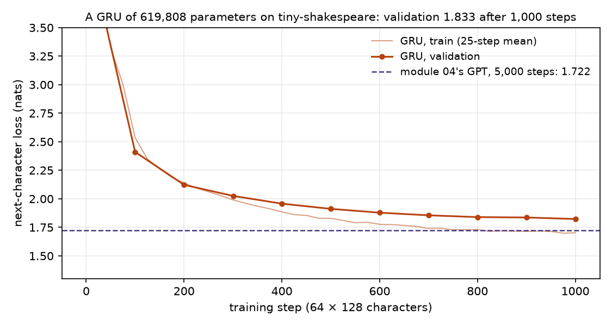
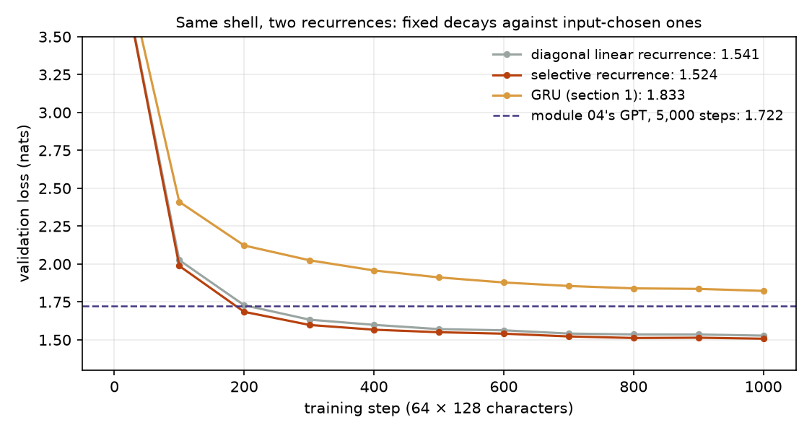
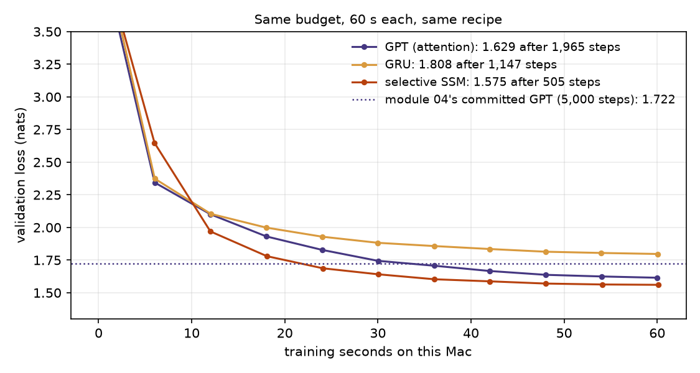
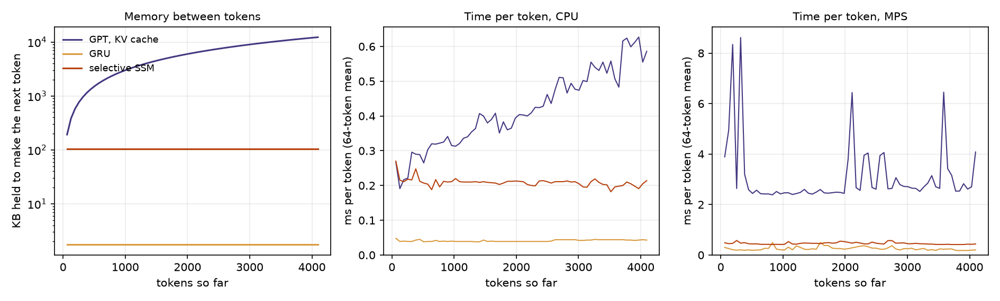
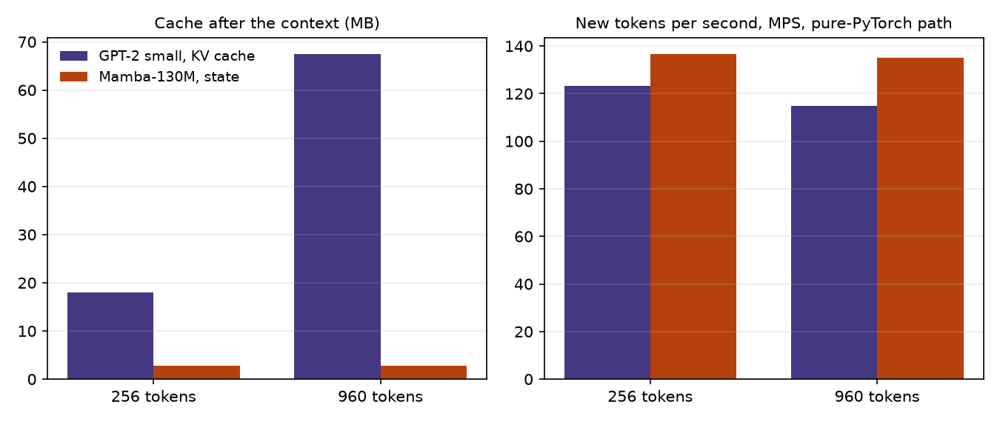

# Module 18: Beyond attention

Module 04 built a GPT, and module 07 gave it a KV cache. To write each new
token, that GPT reads a key and a value for every token before it, so its
memory grows with the context. This module builds models that carry a
fixed-size **state** from one token to the next instead, and sets them against
the tiny GPT on the same data. It has four sections, each with a figure and the
numbers beside it:

1. **A GRU**, a gated recurrent network, at the tiny GPT's size.
2. **A diagonal linear recurrence, then a selective one** (Mamba-style), in plain PyTorch.
3. **GPT, GRU and SSM at equal budget**: validation loss after the same training time, then memory and speed per generated token up to 4,096 tokens.
4. **The library way**: Mamba-130M against GPT-2 small through transformers, and a paragraph on RWKV, Hyena and hybrids.

Every number in this README comes from a JSON file in [`results/`](results/),
written by the script that measured it.

This is the second module of track 6, **Other recipes**. Next,
[module 19](../19-scaling-laws/README.md) opens track 7 and asks how the loss
falls as a model and its data grow.

**🕹 Interactive:** [Beyond attention](../../explorables/18-beyond-attention.html):
step a KV cache and two recurrent states token by token, and drive a recurrence
with two states by its decays and its gate.

**✅ Quiz:** [10 questions](../../quizzes/18.html): check yourself once you have run the five scripts.

## Goals

By the end you will be able to:

- write a GRU step by hand and say what its update gate does;
- write a diagonal linear recurrence and show that it is a convolution;
- say what makes a recurrence selective, and why that rules out the convolution;
- train a recurrence in parallel and run it one token at a time, and check that both give the same output;
- count what a GPT and a recurrent model keep between tokens, and measure it;
- run Mamba with transformers without its CUDA kernels, and say which of its numbers still mean something.

## Setup

```bash
cd modules/18-beyond-attention/python
```

```bash
uv sync
```

| Need | Size | Where |
|---|---|---|
| Module 04's corpus and trained GPT | 1.1 MB text, 2.5 MB weights | committed: `../04-attention-transformer/corpus/` and `artifacts/` |
| GPT-2 small (`gpt2`) | 548 MB | Hugging Face cache; module 12 already fetched it |
| Mamba-130M (`state-spaces/mamba-130m-hf`, revision `1e76775f`) | 517 MB weights, 2.1 MB tokenizer | Hugging Face cache, on first run of `hf_compare.py` |

The `mamba-130m-hf` card names no licence. The original checkpoint,
[`state-spaces/mamba-130m`](https://huggingface.co/state-spaces/mamba-130m),
and the [Mamba code](https://github.com/state-spaces/mamba) are Apache-2.0.

**The laptop guard.** Every script imports `src/common.py` before torch. It sets
`PYTORCH_MPS_HIGH_WATERMARK_RATIO=0.5` and `PYTORCH_MPS_LOW_WATERMARK_RATIO=0.4`,
so a run that grows past half of the Mac's GPU memory stops with an error
instead of pushing the Mac into swap. Each script logs its time and peak memory
(process RSS from `getrusage`, and `torch.mps.driver_allocated_memory()`) into
its results file:

| Script | Minutes | Peak RSS | Peak MPS driver |
|---|---|---|---|
| `src/gru.py` | 1.13 | 0.51 GB | 1.16 GB |
| `src/ssm.py` | 4.08 | 0.52 GB | 1.14 GB |
| `src/compare.py` | 3.34 | 0.57 GB | 1.16 GB |
| `src/decode.py` | 0.31 | 0.63 GB | 1.09 GB |
| `src/hf_compare.py` | 0.13 | 1.13 GB | 1.10 GB |

Measured on an Apple M5 with 16 GB, torch 2.14.1, transformers 5.20.1, while
other jobs shared the Mac. Times carry that noise; memory counts do not.

**MPS against CPU.** One forward pass on "The old castle on the hill was a
place where", on MPS and then on the CPU. GPT-2: max abs difference in logits
3.4 × 10⁻⁴ (logits span −138.9 to −31.9). Mamba-130M: 3.7 × 10⁻⁴ (−82.4 to
56.3). Both give the same top-1 token at every position. In
`results/hf_compare.json`, `mps_vs_cpu`.

**One recipe.** Every model in sections 1 to 3 trains the same way
(`src/train.py`): AdamW at peak learning rate 10⁻³, 100 warm-up steps, cosine
decay to 10%, weight decay 0.1, batches of 64 windows of 128 characters, no
dropout. The recipe is not tuned per model. Every validation loss is the mean
over the same 100 batches of module 04's validation split.

## 1 · A GRU at the tiny GPT's size

A recurrent network reads one character at a time and keeps a vector h. The
GRU (Cho et al., 2014) adds two gates, each a sigmoid of the input and h:

```
r = σ(W_ir x + W_hr h + b_r)          reset: how much of h the candidate may read
z = σ(W_iz x + W_hz h + b_z)          update: how much of h to keep
n = tanh(W_in x + r ⊙ (W_hn h + b_hn)) candidate
h ← (1 − z) ⊙ n + z ⊙ h
```

When z is near 1 for a channel, that channel keeps its value from step to
step. Exercise (a) writes this by hand and checks it against `nn.GRU`.

`src/gru.py` builds two GRU layers of width 224, an embedding and a head tied
to it: 619,808 parameters, against the tiny GPT's 619,776. Between tokens it
keeps 2 × 224 = 448 floats.



| | Parameters | Training | Validation loss (nats) |
|---|---|---|---|
| GRU | 619,808 | 1,000 steps, 59.9 s | 1.833 |
| Module 04's committed GPT | 619,776 | 5,000 steps, peak rate 3 × 10⁻⁴, dropout 0.1 | 1.722 |

The GPT trained five times longer under another recipe, so this is a
yardstick, not a match. Section 3 is the match. After 1,000 steps the GRU
writes speaker names, line breaks and English-looking words:

```
ROMEO:
Threar this wiselt it Hand expace,
And gelst than of to giventy here hath thin being some one myself for
```

## 2 · A diagonal linear recurrence, then a selective one

Both models in this section are five blocks of the same shell, in the style of
Mamba (Gu and Dao, 2023): a projection into two streams of width E, a short
causal convolution, **the recurrence**, a gate, a projection back. Only the
recurrence differs.

**Diagonal and fixed.** Each of the E channels keeps N = 16 numbers, each
with its own decay:

```
h_t = exp(Δ·A) ⊙ h_{t−1} + Δ·B·x_t      A < 0, so every decay is in (0, 1)
y_t = Σ_n C ⊙ h_t
```

Δ, A, B and C are learned, but they are the same at every step. Unroll the
loop and y is a fixed weighted sum of past inputs: y_t = Σ_k K[k]·x_{t−k} with
K[k] = Σ_n C·B·Δ·exp(k·Δ·A). That is a convolution, so training computes it
as one, in parallel over the 128 positions; generation runs the loop, one
token at a time. This is the S4D family (Gu et al., 2022). Exercise (c)
derives the kernel and checks both forms.

**Selective.** Now compute Δ, B and C from each input. The decay at step t
depends on x_t, so the layer can decide, token by token, whether to write the
input into its state or to hold what it has. No single kernel describes it any
more, and the convolution is gone. Mamba-1 gives every channel and state its
own decay; in plain PyTorch that needs a loop over t, far too slow to train
here. We use Mamba-2's form
instead (Dao and Gu, 2024): one decay per head and step, with E channels in 8
heads. Unrolled, the output is a (T × T) matrix applied to the inputs,
causal and decaying:

```
y_t = Σ_{s ≤ t} (C_t · B_s) · exp(Σ_{r=s+1..t} log a_r) · Δ_s x_s
```

Training computes that matrix; generation runs the loop with a (P × N) state
per head. Exercise (b) writes the loop and checks it against the matrix.

`src/ssm.py` trains both models for 1,000 steps, as the GRU. For each, the
one-token loop gives the same logits as the parallel form, to 7.3 × 10⁻⁶
(fixed) and 7.9 × 10⁻⁶ (selective).



| | Parameters | Width d, channels E | State between tokens | ms per step | Validation loss |
|---|---|---|---|---|---|
| Diagonal linear recurrence | 605,484 | 132, 264 | 25,080 floats | 97.5 | 1.541 |
| Selective recurrence | 635,260 | 140, 280 | 26,600 floats | 121.5 | 1.524 |
| GRU (section 1) | 619,808 | | 448 floats | 59.9 | 1.833 |

The widths differ so that each model lands within 3% of the GPT's 619,776
parameters. Both recurrences end well below the GRU after the same 1,000
steps, and below module 04's GPT after its 5,000. That is one seed and a
short run; at the character level, recurrent and state-space models often
learn faster per step early on, and this run cannot say whether the lead
lasts. Selectivity gains 0.017 nats here. That is one run of each; we did not train other seeds, so we cannot
say how much of that gap is noise. Character-level text may also need
selection less than tasks built to need it, such as recalling a token from far
back. Section 2 of the explorable builds one such task with two states.

## 3 · GPT, GRU and SSM at equal budget

**Training for the same time.** `src/compare.py --budget 60` trains each
model from scratch for 60 seconds of training time on this Mac, evaluation not
counted. The cosine schedule follows elapsed time, so each model gets a full
schedule. The GPT is module 04's architecture, **retrained here** under the
same budget and recipe; module 04's committed weights are scored on the same
batches only as a reference.



| | Steps in 60 s | ms per step | Training tokens per s | Validation loss |
|---|---|---|---|---|
| GPT | 1,965 | 30.5 | 268,201 | 1.629 |
| GRU | 1,147 | 52.3 | 156,525 | 1.808 |
| Selective SSM | 505 | 119.0 | 68,848 | 1.575 |
| Module 04's committed GPT | 5,000 | | | 1.722 |

The GPT runs four times as many steps as the SSM, and the SSM still ends
lower: in this run it learns more per step on this data. A lower loss than a
GPT's can also mean a model sees the characters it must predict, so we
checked: in training mode, changing the characters from position t on leaves
every logit before t unchanged, in all four models, and the targets are the
inputs shifted by one (`tests/test_solutions.py`). The SSM's samples read like
its loss. The retrained GPT also ends below module 04's own, in two fifths of
the steps; the higher learning rate or the missing dropout may explain it, but
we tested neither.

**What equal wall time measures.** Which model learns most on this machine in
this time. It rewards whatever runs fast here, and that depends on the kernels
PyTorch has for Apple's GPU, not only on the idea. Our SSM spends its time on a
(T × T) matrix per head and on small element-wise steps; the GPT's attention
runs as a few large matrix products. One budget, one seed, one recipe: **this
is a demo, not a measurement.** A measurement would sweep the budget and the
learning rate per model and repeat each run over several seeds.

**What each model keeps between tokens.** `src/decode.py` steps each model
through 4,096 tokens, batch 1, and counts the floats it holds after each one,
from the tensors themselves. The models are untrained (weights change neither
memory nor time), and the GPT gets 4,096 learned positions instead of 128 so
it can run that far.



| Held after… | 256 tokens | 1,024 tokens | 4,096 tokens |
|---|---|---|---|
| GPT, KV cache: 2 × 3 layers × 128 floats per token | 786,432 B | 3,145,728 B | 12,582,912 B |
| GRU state | 1,792 B | 1,792 B | 1,792 B |
| Selective SSM state | 106,400 B | 106,400 B | 106,400 B |

The GPT adds 768 floats (3,072 B) per token and passes the SSM's fixed state
after 35 tokens. On MPS, the allocated memory grew by 786,944, 3,146,240 and
12,583,424 bytes for the GPT, a few hundred bytes above the count, and by
113,152 bytes for the SSM, the same at all three points: the allocator
rounds each tensor up.

| New tokens per second | 256 tokens | 1,024 tokens | 4,096 tokens |
|---|---|---|---|
| GPT, CPU | 4,525 | 3,195 | 1,707 |
| GRU, CPU | 25,641 | 25,641 | 23,256 |
| Selective SSM, CPU | 4,587 | 4,546 | 4,673 |
| GPT, MPS | 379 | 406 | 245 |
| GRU, MPS | 5,181 | 5,076 | 5,000 |
| Selective SSM, MPS | 1,739 | 2,370 | 2,283 |

Each figure is the mean over the 64 tokens before that point. On the CPU, the
GPT slows as its cache grows, since each token reads all of it; the two
recurrences stay flat. Batch 1 with models this small leaves Apple's GPU
waiting on launch overhead, so every model is slower on MPS than on the CPU,
and the MPS times jump around (figure, right). Read the trend from the CPU.
Other jobs shared the Mac during these runs, so every speed here is rough;
the byte counts are exact.

## 4 · The library way: Mamba-130M against GPT-2 small

[`state-spaces/mamba-130m-hf`](https://huggingface.co/state-spaces/mamba-130m-hf)
(129,135,360 parameters, 24 layers) and GPT-2 small (124,439,808 parameters,
12 layers) load with the same two lines:

```python
model = AutoModelForCausalLM.from_pretrained("state-spaces/mamba-130m-hf", dtype=torch.float32)
out = model.generate(ids, max_new_tokens=48, do_sample=False)
```

Mamba's fast path needs two CUDA packages, `mamba-ssm` and `causal-conv1d`.
Without them, transformers says so and falls back to plain PyTorch: the
selective scan becomes a Python loop over tokens. That is the path here.
**The Mamba path ran on MPS** (Apple M5 GPU), at 135.1 new tokens per second
after a 960-token context. **These speed numbers measure the fallback loop on
this Mac, not Mamba as it runs on a CUDA GPU with its kernels.** Other jobs
shared the Mac, so they are rough even for this path. The memory numbers do
not depend on the kernels, and they hold.



| | After 256 tokens | After 960 tokens |
|---|---|---|
| GPT-2 cache | 18,874,368 B | 70,778,880 B |
| Mamba cache | 2,949,120 B | 2,949,120 B |
| GPT-2, new tokens per s (MPS) | 123.3 | 114.7 |
| Mamba, new tokens per s (MPS, fallback loop) | 136.7 | 135.1 |
| GPT-2, time to read the context | 0.03 s | 0.09 s |
| Mamba, time to read the context (fallback loop) | 0.20 s | 0.71 s |

GPT-2 keeps 2 × 12 layers × 768 floats = 73,728 B per token. Mamba keeps 24
layers × 1,536 channels × (16 states + 4 convolution inputs) floats, 2.9 MB,
whatever the context. The context is 960, not 1,024, because GPT-2 has only
1,024 positions and the script generates 33 more tokens. GPT-2's cache passes
Mamba's state after 40 tokens. Reading the context shows the fallback's cost:
GPT-2 reads 960 tokens in one parallel pass, the loop reads them one by one.

The two greedy replies to "The old castle on the hill was" (48 tokens, cut):

| Model | Reply |
|---|---|
| GPT-2 | a great place to live. It was a place where the people lived, where the people worked, where the people were educated, where the people were educated. … |
| Mamba-130M | a great place to visit. It was a very old building, with a great hall and a great staircase. The old castle was built in the thirteenth century, and was destroyed by the Romans in the reign of Augustus. … |

Both are fluent at this size; GPT-2 repeats itself, and Mamba states a false
date with confidence. Two replies show nothing about which model is better.

**RWKV, Hyena and hybrids.** Other designs reach the same trade by other
routes. [RWKV](https://arxiv.org/abs/2305.13048) (Peng et al., 2023) rewrites
attention as a weighted running sum with a learned decay per channel, so it
trains in parallel like a transformer and generates like an RNN with a fixed
state. [Hyena](https://arxiv.org/abs/2302.10866) (Poli et al., 2023) replaces
attention with long convolutions, whose filters a small network generates,
interleaved with gates; it computes them with FFTs. Hybrids mix the two kinds
of layer: [Griffin](https://arxiv.org/abs/2402.19427) (De et al., 2024)
alternates a gated linear recurrence with attention over a local window, and
[Jamba](https://arxiv.org/abs/2403.19887) (Lieber et al., 2024) puts one
attention layer among every few Mamba layers. The reason is the last line of
the explorable's "What to notice": a fixed state is a summary, and a few
attention layers give back the exact look-up that copying or recall needs.
Mamba-2's paper makes the link formal: a selective recurrence with one decay
per head is a form of masked attention, the matrix of section 2.

## Run it

Each script prints its numbers, writes `results/<name>.json`, and with
`--figures` redraws its figure. Run `gru.py` before `ssm.py`, whose figure
reads the GRU's results.

```bash
uv run python src/gru.py --figures
```

```bash
uv run python src/ssm.py --figures
```

```bash
uv run python src/compare.py --budget 60 --figures
```

```bash
uv run python src/decode.py --figures
```

```bash
uv run python src/hf_compare.py --figures
```

Try `--budget 30` or `--budget 120` on `compare.py`: the order of the three
may change with the budget. Each model trains for the budget, so the script
takes a little over three budgets.

Redraw every figure from the committed JSON, with no model loaded:

```bash
uv run python src/figures.py
```

Rewrite the explorable's data block from the JSON:

```bash
uv run python src/export_explorable.py
```

## Exercises

Skeletons with `# TODO(you):` live in [`exercises/`](exercises/); reference
solutions are in [`solutions/`](solutions/). Each asks you to predict before
you run. All three run on the CPU in a second or two.

- **(a) `exercise_a_gru_cell.py`**: one GRU step by hand, from `nn.GRU`'s
  packed weights; the test checks it against `nn.GRU` and against the GRU of
  section 1.
- **(b) `exercise_b_scan.py`**: the selective recurrence as a loop over t; the
  test checks it against the matrix form in `src/models.py`.
- **(c) `exercise_c_lti_kernel.py`**: the kernel of a fixed diagonal
  recurrence and its causal convolution; the test checks both against the
  recurrence. Then give the decays a new value at every step and see that no
  kernel fits.

## Tests

```bash
uv run pytest
```

Twenty-five tests, under 5 seconds, no download. They check the solutions against
the module's code, that every model's one-token loop matches its parallel
form, that no model's parallel form sees a later token, the parameter
counts and state sizes, the committed results against the
laptop budget, and the explorable against the results.

## Checkpoint: you should now be able to…

- write a GRU step and say what z near 1 does;
- show that a fixed linear recurrence is a convolution, and say why a selective one is not;
- train a recurrence in parallel and generate with it as a loop;
- count the KV cache of a GPT and the state of a recurrent model, for any context;
- say what equal wall time measures, and what it favours;
- run Mamba without its kernels, and say which numbers still hold.

## Links

- Cho et al., [Learning Phrase Representations using RNN Encoder-Decoder](https://arxiv.org/abs/1406.1078) (2014), the GRU
- Gu et al., [On the Parameterization and Initialization of Diagonal State Space Models](https://arxiv.org/abs/2206.11893) (2022), S4D
- Gu and Dao, [Mamba: Linear-Time Sequence Modeling with Selective State Spaces](https://arxiv.org/abs/2312.00752) (2023)
- Dao and Gu, [Transformers are SSMs](https://arxiv.org/abs/2405.21060) (2024), Mamba-2
- Peng et al., [RWKV: Reinventing RNNs for the Transformer Era](https://arxiv.org/abs/2305.13048) (2023)
- Poli et al., [Hyena Hierarchy](https://arxiv.org/abs/2302.10866) (2023)
- De et al., [Griffin](https://arxiv.org/abs/2402.19427) (2024)
- Lieber et al., [Jamba](https://arxiv.org/abs/2403.19887) (2024)
- [`state-spaces/mamba-130m-hf`](https://huggingface.co/state-spaces/mamba-130m-hf) · [transformers' Mamba docs](https://huggingface.co/docs/transformers/model_doc/mamba)
