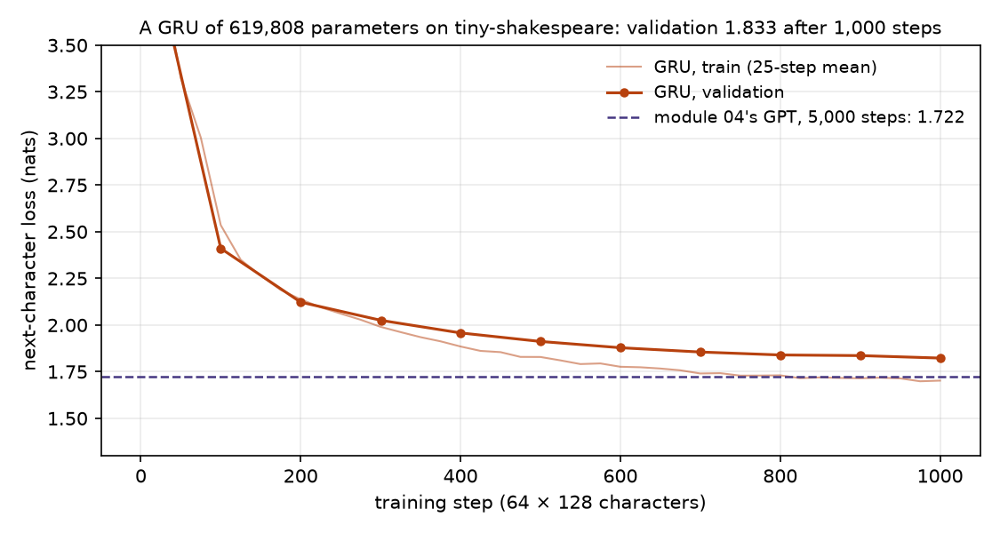
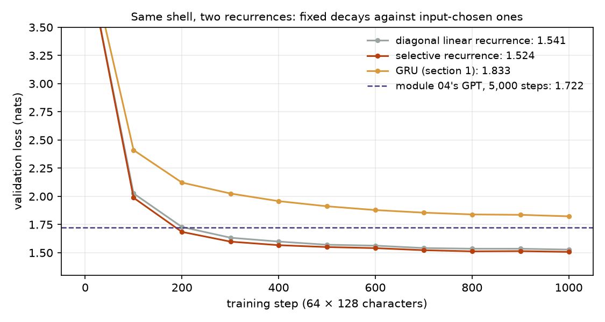
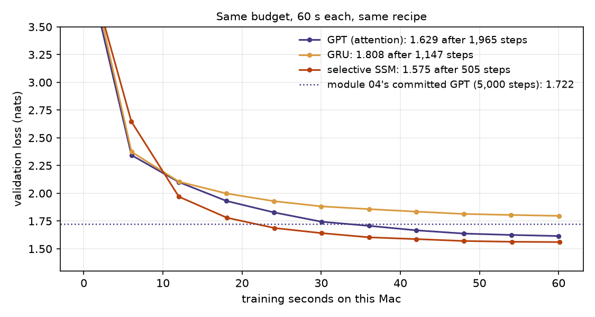
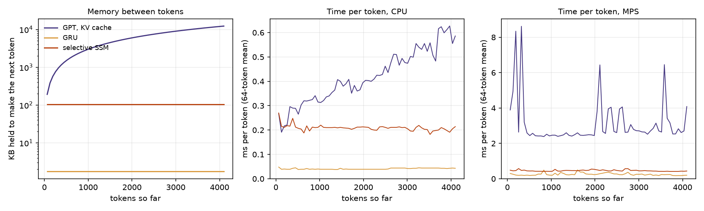
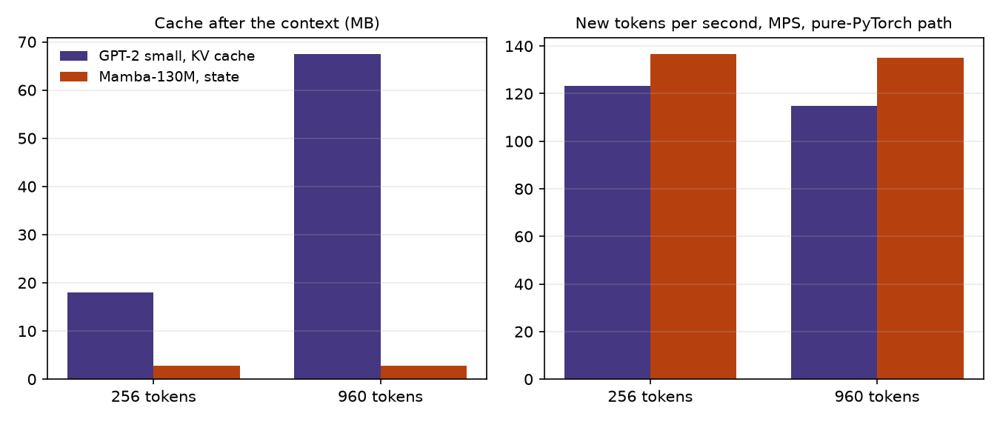
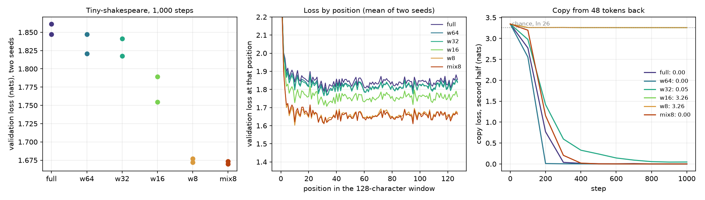
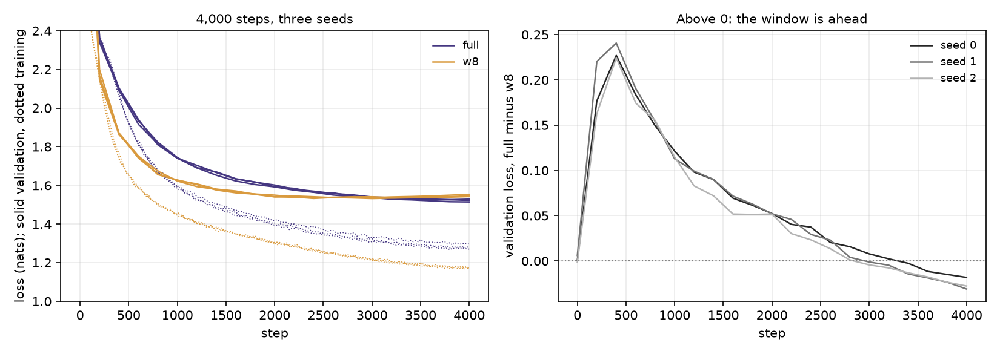
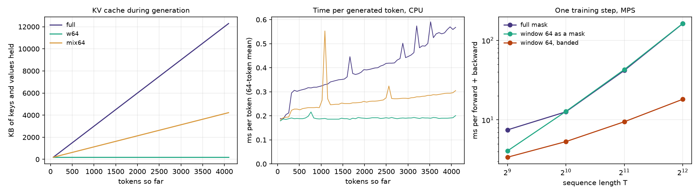

# Module 18: Beyond attention

Module 04 built a GPT, and module 07 gave it a KV cache. To write each new
token, that GPT reads a key and a value for every token before it, so its
memory grows with the context. This module builds models that carry a
fixed-size **state** from one token to the next instead, and sets them against
the tiny GPT on the same data. It has five sections, each with a figure and the
numbers beside it:

1. **A GRU**, a gated recurrent network, at the tiny GPT's size.
2. **A diagonal linear recurrence, then a selective one**, in plain PyTorch. Both are state-space models (SSMs) in the style of Mamba: a layer that carries a fixed-size state and updates it by a linear rule at each token.
3. **GPT, GRU and SSM at equal budget**: validation loss after the same training time, then memory and speed per generated token up to 4,096 tokens.
4. **The library way**: Mamba-130M against GPT-2 small through transformers, and a paragraph on RWKV, Hyena and hybrids.
5. **Sliding windows**: attention that keeps only the last w tokens, local and global layers, what a stack can still reach, and what the window saves.

Every number in this README comes from a JSON file in [`results/`](results/),
written by the script that measured it.

This is the second module of track 6, **Other recipes**. Next,
[module 27](../27-memory-as-a-matrix/README.md) asks how much a fixed-size
state can recall, and why the field moved from decay to the delta rule.

**🕹 Interactive:** [Beyond attention](../../explorables/18-beyond-attention.html):
step a KV cache and two recurrent states token by token, and drive a recurrence
with two states by its decays and its gate.

**✅ Quiz:** [10 questions](../../quizzes/18.html): check yourself once you have run the five scripts.

## Goals

By the end you will be able to:

- write a GRU step by hand and say what its update gate does;
- write a diagonal linear recurrence and show that it is a convolution;
- say what makes a recurrence selective, and why that rules out the convolution;
- train a recurrence in parallel and run it one token at a time, and check that both give the same output;
- count what a GPT and a recurrent model keep between tokens, and measure it;
- run Mamba with transformers without its CUDA kernels, and say which of its numbers still mean something;
- build a sliding-window mask, work out how far a stack of windows reaches, and count the KV cache a local/global mix keeps.

## Setup

```bash
cd modules/18-beyond-attention/python
```

```bash
uv sync
```

| Need | Size | Where |
|---|---|---|
| Module 04's corpus and trained GPT | 1.1 MB text, 2.5 MB weights | committed: `../04-attention-transformer/corpus/` and `artifacts/` |
| GPT-2 small (`gpt2`) | 548 MB | Hugging Face cache; module 12 already fetched it |
| Mamba-130M (`state-spaces/mamba-130m-hf`, revision `1e76775f`) | 517 MB weights, 2.1 MB tokenizer | Hugging Face cache, on first run of `hf_compare.py` |

The `mamba-130m-hf` card names no licence. The original checkpoint,
[`state-spaces/mamba-130m`](https://huggingface.co/state-spaces/mamba-130m),
and the [Mamba code](https://github.com/state-spaces/mamba) are Apache-2.0.

**The laptop guard.** Every script imports `src/common.py` before torch. It sets
`PYTORCH_MPS_HIGH_WATERMARK_RATIO=0.5` and `PYTORCH_MPS_LOW_WATERMARK_RATIO=0.4`,
so the Apple GPU may take at most half of Metal's recommended working set,
5.92 GB on this 16 GB Mac, and a run that grows past that stops with an error
instead of pushing the Mac into swap. Each script logs its time and peak memory
(process RSS from `getrusage`, and `torch.mps.driver_allocated_memory()`) into
its results file:

| Script | Minutes | Peak RSS | Peak MPS driver |
|---|---|---|---|
| `src/gru.py` | 1.13 | 0.51 GB | 1.16 GB |
| `src/ssm.py` | 4.08 | 0.52 GB | 1.14 GB |
| `src/compare.py` | 3.34 | 0.57 GB | 1.16 GB |
| `src/decode.py` | 0.31 | 0.63 GB | 1.09 GB |
| `src/hf_compare.py` | 0.13 | 1.13 GB | 1.10 GB |
| `src/window.py` | 8.95 | 0.45 GB | 1.06 GB |
| `src/window.py --long` | 4.34 | 0.49 GB | 1.06 GB |
| `src/window_cost.py` | 0.13 | 0.73 GB | 1.07 GB |
| `src/window.py --checks` (review) | 18.03 | 0.48 GB | 1.07 GB |

Measured on an Apple M5 with 16 GB, torch 2.14.1, transformers 5.20.1, while
other jobs shared the Mac. Times carry that noise; memory counts do not.

**MPS against CPU.** One forward pass on "The old castle on the hill was a
place where", on MPS and then on the CPU. GPT-2: max abs difference in logits
3.4 × 10⁻⁴ (logits span −138.9 to −31.9). Mamba-130M: 3.7 × 10⁻⁴ (−82.4 to
56.3). Both give the same top-1 token at every position. In
`results/hf_compare.json`, `mps_vs_cpu`.

**One recipe.** Every model in sections 1 to 3 trains the same way
(`src/train.py`): AdamW at peak learning rate 10⁻³, 100 warm-up steps, cosine
decay to 10%, weight decay 0.1, batches of 64 windows of 128 characters, no
dropout. The recipe is not tuned per model. Every validation loss is the mean
over the same 100 batches of module 04's validation split.

## 1 · A GRU at the tiny GPT's size

A recurrent network reads one character at a time and keeps a vector h. The
GRU (Cho et al., 2014) adds two gates, each a sigmoid of the input and h:

```
r = σ(W_ir x + W_hr h + b_r)          reset: how much of h the candidate may read
z = σ(W_iz x + W_hz h + b_z)          update: how much of h to keep
n = tanh(W_in x + r ⊙ (W_hn h + b_hn)) candidate
h ← (1 − z) ⊙ n + z ⊙ h
```

When z is near 1 for a channel, that channel keeps its value from step to
step. Exercise (a) writes this by hand and checks it against `nn.GRU`.

`src/gru.py` builds two GRU layers of width 224, an embedding and a head tied
to it: 619,808 parameters, against the tiny GPT's 619,776. Between tokens it
keeps 2 × 224 = 448 floats.



| | Parameters | Training | Validation loss (nats) |
|---|---|---|---|
| GRU | 619,808 | 1,000 steps, 59.9 s | 1.833 |
| Module 04's committed GPT | 619,776 | 5,000 steps, peak rate 3 × 10⁻⁴, dropout 0.1 | 1.722 |

The GPT trained five times longer under another recipe, so this is a
yardstick, not a match. Section 3 is the match. After 1,000 steps the GRU
writes speaker names, line breaks and English-looking words:

```
ROMEO:
Threar this wiselt it Hand expace,
And gelst than of to giventy here hath thin being some one myself for
```

## 2 · A diagonal linear recurrence, then a selective one

Both models in this section are five blocks of the same shell, in the style of
Mamba (Gu and Dao, 2023): a projection into two streams of width E, a short
causal convolution, **the recurrence**, a gate, a projection back. Only the
recurrence differs.

**Diagonal and fixed.** Each of the E channels keeps N = 16 numbers, each
with its own decay:

```
h_t = exp(Δ·A) ⊙ h_{t−1} + Δ·B·x_t      A < 0, so every decay is in (0, 1)
y_t = Σ_n C ⊙ h_t
```

Δ > 0 is a learned step size: a large Δ forgets fast and writes much of the
input, a small Δ holds. The input term Δ·B·x is Mamba's simple choice; S4D
itself uses a slightly different one (zero-order hold).

Δ, A, B and C are learned, but they are the same at every step. Unroll the
loop and y is a fixed weighted sum of past inputs: y_t = Σ_k K[k]·x_{t−k} with
K[k] = Σ_n C·B·Δ·exp(k·Δ·A). That is a convolution, so training computes it
as one, in parallel over the 128 positions; generation runs the loop, one
token at a time. This is the S4D family (Gu et al., 2022). Exercise (c)
derives the kernel and checks both forms.

**Selective.** Now compute Δ, B and C from each input. The decay at step t
depends on x_t, so the layer can decide, token by token, whether to write the
input into its state or to hold what it has. No single kernel describes it any
more, and the convolution is gone. Mamba-1 gives every channel and state its
own decay. Its matrix form then needs one (T × T) matrix per channel and
state, 4,480 of them here, and the fast alternative, a parallel scan, needs a
custom kernel; in plain PyTorch a loop over t is all that is left, far too
slow to train here. We use Mamba-2's form instead (Dao and Gu, 2024): one
decay per head and step, with E channels in 8 heads. Unrolled, the output is
a (T × T) matrix applied to the inputs, causal and decaying:

```
y_t = Σ_{s ≤ t} (C_t · B_s) · exp(Σ_{r=s+1..t} log a_r) · Δ_s x_s
```

Training computes that matrix; generation runs the loop with a (P × N) state
per head, where P = E / 8 = 35 channels per head. Exercise (b) writes the
loop and checks it against the matrix.

`src/ssm.py` trains both models for 1,000 steps, as the GRU. For each, the
one-token loop gives the same logits as the parallel form, to 7.3 × 10⁻⁶
(fixed) and 7.9 × 10⁻⁶ (selective).



| | Parameters | Width d, channels E | State between tokens | ms per step | Validation loss |
|---|---|---|---|---|---|
| Diagonal linear recurrence | 605,484 | 132, 264 | 25,080 floats | 97.5 | 1.541 |
| Selective recurrence | 635,260 | 140, 280 | 26,600 floats | 121.5 | 1.524 |
| GRU (section 1) | 619,808 | | 448 floats | 59.9 | 1.833 |

The widths differ so that each model lands within 3% of the GPT's 619,776
parameters. Both recurrences end well below the GRU after the same 1,000
steps, and below module 04's GPT after its 5,000. That is one seed and a
short run; at the character level, recurrent and state-space models often
learn faster per step early on, and this run cannot say whether the lead
lasts. Selectivity gains 0.017 nats here. That is one run of each; we did not train other seeds, so we cannot
say how much of that gap is noise. Character-level text may also need
selection less than tasks built to need it, such as recalling a token from far
back. Section 2 of the explorable builds one such task with two states.

## 3 · GPT, GRU and SSM at equal budget

**Training for the same time.** `src/compare.py --budget 60` trains each
model from scratch for 60 seconds of training time on this Mac, evaluation not
counted. The cosine schedule follows elapsed time, so each model gets a full
schedule. The GPT is module 04's architecture, **retrained here** under the
same budget and recipe; module 04's committed weights are scored on the same
batches only as a reference.



| | Steps in 60 s | ms per step | Training tokens per s | Validation loss |
|---|---|---|---|---|
| GPT | 1,965 | 30.5 | 268,201 | 1.629 |
| GRU | 1,147 | 52.3 | 156,525 | 1.808 |
| Selective SSM | 505 | 119.0 | 68,848 | 1.575 |
| Module 04's committed GPT | 5,000 | | | 1.722 |

The GPT runs four times as many steps as the SSM, and the SSM still ends
lower: in this run it learns more per step on this data. A lower loss than a
GPT's can also mean a model sees the characters it must predict, so we
checked: in training mode, changing the characters from position t on leaves
every logit before t unchanged, in all four models, and the targets are the
inputs shifted by one (`tests/test_solutions.py`). The SSM's samples read like
its loss. The retrained GPT also ends below module 04's own, in two fifths of
the steps; the higher learning rate or the missing dropout may explain it, but
we tested neither.

**What equal wall time measures.** Which model learns most on this machine in
this time. It rewards whatever runs fast here, and that depends on the kernels
PyTorch has for Apple's GPU, not only on the idea. Our SSM spends its time on a
(T × T) matrix per head and on small element-wise steps; the GPT's attention
runs as a few large matrix products. One budget, one seed, one recipe: **this
is a demo, not a measurement.** A measurement would sweep the budget and the
learning rate per model and repeat each run over several seeds.

**What each model keeps between tokens.** `src/decode.py` steps each model
through 4,096 tokens, batch 1, and counts the floats it holds after each one,
from the tensors themselves. The models are untrained (weights change neither
memory nor time), and the GPT gets 4,096 learned positions instead of 128 so
it can run that far.



| Held after… | 256 tokens | 1,024 tokens | 4,096 tokens |
|---|---|---|---|
| GPT, KV cache: 2 × 3 layers × 128 floats per token | 786,432 B | 3,145,728 B | 12,582,912 B |
| GRU state | 1,792 B | 1,792 B | 1,792 B |
| Selective SSM state | 106,400 B | 106,400 B | 106,400 B |

The GPT adds 768 floats (3,072 B) per token and passes the SSM's fixed state
after 35 tokens. On MPS, the allocated memory grew by 786,944, 3,146,240 and
12,583,424 bytes for the GPT, a few hundred bytes above the count, and by
113,152 bytes for the SSM, the same at all three points: the allocator
rounds each tensor up.

| New tokens per second | 256 tokens | 1,024 tokens | 4,096 tokens |
|---|---|---|---|
| GPT, CPU | 4,525 | 3,195 | 1,707 |
| GRU, CPU | 25,641 | 25,641 | 23,256 |
| Selective SSM, CPU | 4,587 | 4,546 | 4,673 |
| GPT, MPS | 379 | 406 | 245 |
| GRU, MPS | 5,181 | 5,076 | 5,000 |
| Selective SSM, MPS | 1,739 | 2,370 | 2,283 |

Each figure is the mean over the 64 tokens before that point. On the CPU, the
GPT slows as its cache grows, since each token reads all of it; the two
recurrences stay flat. Batch 1 with models this small leaves Apple's GPU
waiting on launch overhead, so every model is slower on MPS than on the CPU,
and the MPS times jump around (figure, right). Read the trend from the CPU.
Other jobs shared the Mac during these runs, so every speed here is rough;
the byte counts are exact.

## 4 · The library way: Mamba-130M against GPT-2 small

[`state-spaces/mamba-130m-hf`](https://huggingface.co/state-spaces/mamba-130m-hf)
(129,135,360 parameters, 24 layers) and GPT-2 small (124,439,808 parameters,
12 layers) load with the same two lines:

```python
model = AutoModelForCausalLM.from_pretrained("state-spaces/mamba-130m-hf", dtype=torch.float32)
out = model.generate(ids, max_new_tokens=48, do_sample=False)
```

Mamba's fast path needs two CUDA packages, `mamba-ssm` and `causal-conv1d`.
Without them, transformers says so and falls back to plain PyTorch: the
selective scan becomes a Python loop over tokens. That is the path here.
**The Mamba path ran on MPS** (Apple M5 GPU), at 135.1 new tokens per second
after a 960-token context. **These speed numbers measure the fallback loop on
this Mac, not Mamba as it runs on a CUDA GPU with its kernels.** Other jobs
shared the Mac, so they are rough even for this path. The memory numbers do
not depend on the kernels, and they hold.



| | After 256 tokens | After 960 tokens |
|---|---|---|
| GPT-2 cache | 18,874,368 B | 70,778,880 B |
| Mamba cache | 2,949,120 B | 2,949,120 B |
| GPT-2, new tokens per s (MPS) | 123.3 | 114.7 |
| Mamba, new tokens per s (MPS, fallback loop) | 136.7 | 135.1 |
| GPT-2, time to read the context | 0.03 s | 0.09 s |
| Mamba, time to read the context (fallback loop) | 0.20 s | 0.71 s |

GPT-2 keeps 2 × 12 layers × 768 floats = 73,728 B per token. Mamba keeps 24
layers × 1,536 channels × (16 states + 4 convolution inputs) floats, 2.9 MB,
whatever the context (transformers keeps the whole convolution window of 4;
our blocks keep only the 3 earlier inputs). The context is 960, not 1,024,
because GPT-2 has only 1,024 positions and the script generates 33 more
tokens. GPT-2's cache equals Mamba's state at 40 tokens and passes it at 41.
Reading the context shows the fallback's cost:
GPT-2 reads 960 tokens in one parallel pass, the loop reads them one by one.

The two greedy replies to "The old castle on the hill was" (48 tokens, cut):

| Model | Reply |
|---|---|
| GPT-2 | a great place to live. It was a place where the people lived, where the people worked, where the people were educated, where the people were educated. … |
| Mamba-130M | a great place to visit. It was a very old building, with a great hall and a great staircase. The old castle was built in the thirteenth century, and was destroyed by the Romans in the reign of Augustus. … |

Both are fluent at this size; GPT-2 repeats itself, and Mamba states a false
date with confidence. Two replies show nothing about which model is better.

**RWKV, Hyena and hybrids.** Other designs reach the same trade by other
routes. [RWKV](https://arxiv.org/abs/2305.13048) (Peng et al., 2023; this is
RWKV-4) rewrites attention as a weighted running sum with a learned decay per channel, so it
trains in parallel like a transformer and generates like an RNN with a fixed
state. [Hyena](https://arxiv.org/abs/2302.10866) (Poli et al., 2023) replaces
attention with long convolutions, whose filters a small network generates,
interleaved with gates; it computes them with FFTs. Hybrids mix the two kinds
of layer: [Griffin](https://arxiv.org/abs/2402.19427) (De et al., 2024)
alternates a gated linear recurrence with attention over a local window, and
[Jamba](https://arxiv.org/abs/2403.19887) (Lieber et al., 2024) puts one
attention layer among every few Mamba layers. The reason is the last line of
the explorable's "What to notice": a fixed state is a summary, and a few
attention layers give back the exact look-up that copying or recall needs.
Jelassi et al. prove it for copying ([Repeat After
Me](https://arxiv.org/abs/2402.01032), 2024): a two-layer transformer can copy
strings of exponential length, a model with a fixed state cannot. Mamba-2's
paper makes the link formal: a selective recurrence with one decay per head
is a form of masked attention, the matrix of section 2.

**State tracking** is the other side: following a count, or a sequence of
swaps, through the text; parity is the simplest case. A recurrence looks made
for it, yet Merrill et al. ([The Illusion of
State](https://arxiv.org/abs/2404.08819), 2024) show that SSMs like Mamba,
like transformers, cannot compose permutations, and Grazzi et al. ([Negative
Eigenvalues](https://arxiv.org/abs/2411.12537), 2024) that a linear recurrence
whose decays all lie in (0, 1), as ours do, cannot solve parity; allowing
negative values fixes it.

**Since 2024: the delta rule.** Mamba-2's state decays everything it holds at
once. Gated DeltaNet (Yang, Kautz and Hatamizadeh,
[arXiv 2412.06464](https://arxiv.org/abs/2412.06464), 2024) treats the state
as a memory from keys to values and adds a targeted edit: before it writes
value v under key k, it subtracts what the state already returns for k. RWKV-7
"Goose" (Peng et al., [arXiv 2503.14456](https://arxiv.org/abs/2503.14456),
2025) generalises the same rule with gates per channel and learned write
rates; its authors show it can track state and recognise all regular
languages, which a transformer of fixed depth is not believed to do. Mamba-3
(Lahoti et al., [arXiv 2603.15569](https://arxiv.org/abs/2603.15569), 2026)
stays with decays but makes the state complex-valued, for state tracking, and
reports Mamba-2's perplexity with half its state.

**Hybrids in production.** In 2025 the hybrid became a production design.
Nemotron-H ([arXiv 2504.03624](https://arxiv.org/abs/2504.03624)) replaces
most attention layers with Mamba layers and reports up to 3× faster inference
than transformers of similar size. Falcon-H1
([arXiv 2507.22448](https://arxiv.org/abs/2507.22448)) runs attention and an
SSM side by side in each layer. Kimi Linear
([arXiv 2510.26692](https://arxiv.org/abs/2510.26692)) mixes Kimi Delta
Attention, a gated delta rule, with attention and reports up to 75% less KV
cache and up to 6× the decoding speed at a context of 1M tokens. LFM2
([arXiv 2511.23404](https://arxiv.org/abs/2511.23404)) pairs short gated
convolutions with a few attention layers for phones and laptops, and reports
up to 2× faster prefill and decode on CPUs than models of similar size.

## 5 · Sliding windows: attention with a capped cache

Sections 1 to 4 replaced attention. This section keeps it and limits how far
back it looks. Full causal attention scores every token against every
earlier one: a sequence of T tokens costs about T²/2 scores per layer and
head, and the KV cache grows by one key and one value per token in every
layer. A **sliding window** of w lets each token read only itself and the
w − 1 tokens before it. The scores then cost about T·w, and the cache stops
growing at w tokens per layer: Mistral 7B keeps it in a rolling buffer, slot
i mod w.

**What a stack can still reach.** One window layer sees w − 1 tokens back.
The next layer reads outputs that each already saw w − 1 back, so a stack of
L window layers reaches L·(w − 1). Mistral 7B's record gives 32 layers with
a window of 4,096, a reach of about 131K tokens. Reach is an upper bound: a
token far back must be passed on, layer by layer, through the tokens in
between, and each hop shares its vector with everything else that token
carries.

**Local and global layers.** Most recent models mix window layers ("local")
with a few full ones ("global"). The full layers keep exact look-up at any
distance; the local ones keep the cost down. From the architecture
explorer's records:

| Model | Local : global | Window | Source |
|---|---|---|---|
| [Mistral 7B](../../explorables/05b-architecture-explorer.html#m=mistral-7b) | all 32 local | 4,096 | [paper](https://arxiv.org/abs/2310.06825), Table 1 |
| [Gemma 2 9B](../../explorables/05b-architecture-explorer.html#m=gemma-2-9b) | 1 : 1 (21 + 21) | 4,096 | config |
| [Gemma 3 27B](../../explorables/05b-architecture-explorer.html#m=gemma-3-27b) | 5 : 1 (52 + 10) | 1,024 | [paper](https://arxiv.org/abs/2503.19786), §1–2 |
| [gpt-oss-120b](../../explorables/05b-architecture-explorer.html#m=gpt-oss-120b) | 1 : 1 (18 + 18) | 128 | [card](https://arxiv.org/abs/2508.10925), §2.2 |
| [Inkling 2 Small](../../explorables/05b-architecture-explorer.html#m=inkling-2-small) | 5 : 1 (40 + 8) | 1,024 | [config](https://huggingface.co/thinkingmachines/Inkling-2-Small/blob/main/config.json) |
| [Llama 4 Maverick](../../explorables/05b-architecture-explorer.html#m=llama-4-maverick) | 3 : 1 (36 + 12) | chunks of 8,192 | [config](https://huggingface.co/unsloth/Llama-4-Maverick-17B-128E-Instruct/blob/main/config.json) |

Llama 4's local layers are **chunked**, not sliding: the sequence is cut into
fixed blocks of 8,192 and a token reads only its own block, so the first
token of a block sees nothing before it, and the last sees 8,191 tokens. Its
12 global layers also drop the rotary positions (NoPE).

The Gemma 3 report (section 5.2) gives the reason for its mix. In its
ablations, moving from Gemma 2's 1 : 1 to 5 : 1 had "minimal impact on
perplexity". In its memory comparison, a model with only global layers
spends 60% extra memory on its KV cache; with the mix it labels "1:3" and
windows of 1,024 that falls below 15%. Exercise (d) counts the cache from the records: at
131,072 tokens Gemma 3 keeps 16.8% of what an all-global stack would keep,
and Inkling 2 Small 17.3%.

**The experiment.** `src/window.py` builds module 04's GPT through
`models.make_gpt`, as section 3 does, and overwrites the causal mask of each
block with its window. Nothing else changes: every arm has 619,776
parameters, and every arm keeps module 04's learned absolute positions, one
vector for each of the 128 places. The window hides keys; it does not
change how a token knows where it is. Six arms, each trained with this module's recipe for 1,000
steps (the length of sections 1 and 2), two seeds:

| Arm | Windows, layers 1–3 | Reach of the stack |
|---|---|---|
| full | all, all, all | the whole context |
| w64 | 64, 64, 64 | 189 |
| w32 | 32, 32, 32 | 93 |
| w16 | 16, 16, 16 | 45 |
| w8 | 8, 8, 8 | 21 |
| mix8 | 8, 8, all | the whole context |

Three measurements. Validation loss on the same 100 batches as sections 1
to 3. The loss at each of the 128 positions of a window: a character at
position t has t earlier characters to use, so the curve shows how much
context each arm uses. And a **copy task**, trained from scratch for each
arm: 48 random letters, a bar, then the same 48 letters. Each letter of the
second half is the one 48 positions back, so a model must reach 48 tokens;
only the second half is scored, and chance is ln 26 = 3.26 nats.

`src/window_cost.py` then measures what the window saves, on untrained
copies with 4,096 positions: the KV cache and the time per token while
generating 4,096 tokens on the CPU, with a window of 64 kept as a rolling
buffer; and one training step on sequences of 512 to 4,096 tokens on the
Apple GPU, with the window computed two ways. As a mask on the full T × T
score matrix, as `window.py` trains, it costs what full attention costs.
The **banded** form cuts the sequence into blocks of w and lets each block
read only itself and the block before: 2w keys per query instead of T. It
gives the same output as the mask (a test checks it).

**Prediction**, written before the run:

1. Validation loss: full, w64 and w32 within 0.02 of each other; w16 worse by 0.02–0.05; w8 worse by 0.05–0.15; mix8 within 0.02 of full.
2. Loss by position: full keeps falling to position 127; the windowed arms flatten past their reach.
3. Copy at 48 back: full, w64 and mix8 below 0.1 nats. w8 and w16, whose stacks reach 21 and 45, at chance. w32, which reaches 93 only by passing each letter through a token in between, fails: above 2 nats after 1,000 steps.
4. Cost: the windowed cache stops at 2 × 3 × 128 × 64 floats; mix64's grows at a third of full's rate. Time per generated token stays flat with the window and rises with full attention. At 4,096 tokens the masked window costs a training step what full attention costs, and the banded form is at least 5 times faster and smaller.



| Arm | Seed 0 | Seed 1 | Mean | Copy loss | Copy right |
|---|---|---|---|---|---|
| full | 1.847 | 1.861 | 1.854 | 0.001 | 100% |
| w64 | 1.821 | 1.847 | 1.834 | 0.000 | 100% |
| w32 | 1.817 | 1.841 | 1.829 | 0.047 | 99.2% |
| w16 | 1.789 | 1.755 | 1.772 | 3.258 | 3.8% |
| w8 | 1.672 | 1.677 | 1.675 | 3.258 | 3.8% |
| mix8 | 1.674 | 1.670 | 1.672 | 0.001 | 100% |

Validation loss in nats on tiny-shakespeare after 1,000 steps; copy loss in
nats on the second half, and the share of its letters the model gets right.
Every arm took 30–32 ms per step: the mask costs the same whatever w is.
Two more seeds of full, w8 and mix8, added in review
(`window.py --checks`, `results/window_checks.json`), gave 1.857 and 1.835
for full, 1.676 and 1.672 for w8, 1.691 and 1.677 for mix8: over four
seeds w8 is 0.16 to 0.18 below full.

The smaller the window, the lower the loss after 1,000 steps: w8 ends 0.18
nats below full. Every arm's loss by position flattens by about position
30, full attention's too, so in this run no arm uses context much beyond
30 characters. In the copy task w8 and w16 never leave chance (3.8% is 1 in
26), as their reach says they cannot; w32 learns it through the extra hop,
slower than the others (figure, right).

**A head start, not a lasting lead.** Because the result went against the
prediction, we added one check after the main run (`window.py --long`):
full against w8 for 4,000 steps, seed 0, on the same recipe stretched to
the longer run. The review repeated it at seeds 0, 1 and 2 and kept the
training loss too (`window.py --checks`):



| 4,000 steps | Validation, seeds 0 / 1 / 2 | Training, at the end | Positions 32–63 | 96–127 |
|---|---|---|---|---|
| full | 1.544 / 1.539 / 1.531 | 1.27–1.30 | 1.50–1.52 | 1.52 |
| w8 | 1.567 / 1.571 / 1.561 | 1.17 | 1.54–1.55 | 1.55–1.56 |

At every seed w8 leads on validation by 0.22–0.24 nats at step 400 and by
0.11–0.12 at step 1,000; the curves cross between steps 2,800 and 3,400,
and at 4,000 full attention is 0.023–0.032 lower. (The first `--long` run
gave 1.538 and 1.567 at seed 0; reruns on the Apple GPU differ by up to
0.006.)

The training loss tells a different story from the validation loss. w8's
stays lower to the end, by about 0.1 nats; its validation loss bottoms out
between steps 2,400 and 3,200 and then rises, while full attention's keeps
falling. Tiny-shakespeare has about 1M characters of training text, and
4,000 steps of 64 × 128 read it more than 30 times. So full attention ends
ahead because w8 overfits sooner, not because full attention learned to use
more context: its loss by position stays flat past about position 30.

Our reading, not tested here: with learned absolute positions, full
attention starts with no notion of "near", and must learn from data that
the last few characters carry most of the signal. A window builds that in.
Positions that encode distance (rotary, ALiBi) give full attention some of
that bias from the start, so the head start may be smaller there.



| Generation, CPU | 256 tokens | 1,024 tokens | 4,096 tokens |
|---|---|---|---|
| full: floats held | 196,608 | 786,432 | 3,145,728 |
| w64: floats held | 49,152 | 49,152 | 49,152 |
| mix64: floats held | 98,304 | 294,912 | 1,081,344 |
| full: tokens per s | 4,717 | 3,077 | 1,761 |
| w64: tokens per s | 5,319 | 5,319 | 4,975 |
| mix64: tokens per s | 5,128 | 3,774 | 3,279 |

| One training step, MPS | 512 | 1,024 | 2,048 | 4,096 |
|---|---|---|---|---|
| full: ms | 7.5 | 12.6 | 41.8 | 162.2 |
| window 64 as a mask: ms | 4.1 | 12.8 | 42.9 | 162.6 |
| window 64, banded: ms | 3.4 | 5.3 | 9.5 | 18.2 |
| full: MB allocated by the forward pass | 26.6 | 80.0 | 267.0 | 962.3 |
| banded: MB allocated by the forward pass | 18.2 | 36.4 | 72.8 | 145.5 |

The memory is what the GPU allocator gained between the start and the end
of the forward pass: the activations the backward pass will read. The
masked window allocates exactly what full attention does. Times are the
median of five passes while other programs shared the Mac. The 7.5 ms of
full attention at 512 is not the work (the masked window, the same work, took
4.1): full attention is measured first, and a rerun in review gave 9.4
against 4.0 again, so it is likely a warm-up cost the first timed pass
does not absorb. The rerun matched every other time within 3% and every
byte count exactly; the byte and float counts are exact.

**Grades.**

1. **Wrong.** At 1,000 steps the order is the reverse of the prediction: the smaller the window, the lower the loss, and mix8 matches w8, not full; four seeds agree. By 4,000 steps full attention is 0.023–0.032 lower on validation at three seeds, but w8 is still lower on training loss, so that late lead comes from w8 overfitting the small corpus sooner.
2. **Wrong for full attention.** Its loss by position flattens by about position 30, like the others; it does not keep falling, at 1,000 steps or at 4,000.
3. **Right but for w32.** full, w64 and mix8 copy perfectly; w8 and w16 sit at chance. w32 learns to copy through two hops, to 99.2%. Its reach backs this up: one window of 32 sees 31 back, two see 62. In the review's rerun (99.4%), switching off the attention of layer 1 or of layer 2 drops it to 4.7% and 3.3%, chance level; switching off layer 3 leaves 59%. (Full attention also uses its first two layers for the copy, so the ablation alone does not prove the hop; the reach does.)
4. **Right.** The w64 cache stops at 49,152 floats; mix64's ends at 34% of full's; generation slows from 4,717 to 1,761 tokens per second with full attention and stays near 5,000 with the window. At 4,096 tokens the mask costs what full attention costs, and the banded form is 8.9 times faster and allocates 6.6 times less.

**What this does and does not say.** On character-level Shakespeare, most
of what a 3-layer model learns in a few thousand steps sits in the last few
dozen characters. A small window is a head start there; on a corpus this
small, a longer run ends with full attention ahead on held-out text, by
0.023–0.032 nats, while the window still fits the training text better.
Real text at real scale has dependencies thousands of tokens long, which is
why every recent model in the table but Mistral 7B keeps some global
layers, as mix8 does; the copy task shows what that one global layer buys.
A 3-layer character model is not Gemma 3. Our runs agree in direction with
the labs' choice of local layers mixed with a few global ones, but they
neither confirm nor refute their ratios or windows.

## Run it

Each script prints its numbers, writes `results/<name>.json`, and with
`--figures` redraws its figure. Run `gru.py` before `ssm.py`, whose figure
reads the GRU's results.

```bash
uv run python src/gru.py --figures
```

```bash
uv run python src/ssm.py --figures
```

```bash
uv run python src/compare.py --budget 60 --figures
```

```bash
uv run python src/decode.py --figures
```

```bash
uv run python src/hf_compare.py --figures
```

```bash
uv run python src/window.py --figures
```

```bash
uv run python src/window.py --long --figures
```

```bash
uv run python src/window_cost.py --figures
```

```bash
uv run python src/window.py --checks
```

`window.py` takes about 9 minutes, `--long` about 4 more and `--checks`
(the review's seeds, 4,000-step pairs and copy ablation) about 18, on the Apple
GPU; take the shared GPU lock first if other jobs use the Mac.

Try `--budget 30` or `--budget 120` on `compare.py`: the order of the three
may change with the budget. Each model trains for the budget, so the script
takes a little over three budgets.

Redraw every figure from the committed JSON, with no model loaded:

```bash
uv run python src/figures.py
```

Rewrite the explorable's data block from the JSON:

```bash
uv run python src/export_explorable.py
```

## Exercises

Skeletons with `# TODO(you):` live in [`exercises/`](exercises/); reference
solutions are in [`solutions/`](solutions/). Each asks you to predict before
you run. All four run on the CPU in a second or two.

- **(a) `exercise_a_gru_cell.py`**: one GRU step by hand, from `nn.GRU`'s
  packed weights; the test checks it against `nn.GRU` and against the GRU of
  section 1.
- **(b) `exercise_b_scan.py`**: the selective recurrence as a loop over t; the
  test checks it against the matrix form in `src/models.py`.
- **(c) `exercise_c_lti_kernel.py`**: the kernel of a fixed diagonal
  recurrence and its causal convolution; the test checks both against the
  recurrence. Then give the decays a new value at every step: the fixed
  kernel misses, and even the best kernel that the two sequences share,
  fitted by least squares, misses by far more than the fixed case's rounding
  error. (One sequence alone always has a kernel that fits it exactly; it is
  sharing one kernel across inputs that fails.)
- **(d) `exercise_d_window.py`**: the sliding-window mask, the reach of a stack of windows, and the share of the KV cache Gemma 3 27B and Inkling 2 Small keep at 131,072 tokens, counted from their records. The test checks them against `src/window.py` and the records.

## Tests

```bash
uv run pytest
```

Thirty-five tests, under 10 seconds, no download. They check the solutions against
the module's code, that every model's one-token loop matches its parallel
form, that no model's parallel form sees a later token, the parameter
counts and state sizes, the committed results against the
laptop budget, and the explorable against the results; for section 5, that
no arm sees a later token, a window of w reaches w − 1 tokens back and no
further, a stack hides exactly the tokens beyond its reach, that the banded form and
the rolling cache match the mask, and the committed window results.

## Checkpoint: you should now be able to…

- write a GRU step and say what z near 1 does;
- show that a fixed linear recurrence is a convolution, and say why a selective one is not;
- train a recurrence in parallel and generate with it as a loop;
- count the KV cache of a GPT and the state of a recurrent model, for any context;
- say what equal wall time measures, and what it favours;
- run Mamba without its kernels, and say which numbers still hold;
- say what a window saves, what a stack of windows can still reach, and why models keep a few global layers.

## Links

- Cho et al., [Learning Phrase Representations using RNN Encoder-Decoder](https://arxiv.org/abs/1406.1078) (2014), the GRU
- Gu et al., [On the Parameterization and Initialization of Diagonal State Space Models](https://arxiv.org/abs/2206.11893) (2022), S4D
- Gu and Dao, [Mamba: Linear-Time Sequence Modeling with Selective State Spaces](https://arxiv.org/abs/2312.00752) (2023)
- Dao and Gu, [Transformers are SSMs](https://arxiv.org/abs/2405.21060) (2024), Mamba-2
- Peng et al., [RWKV: Reinventing RNNs for the Transformer Era](https://arxiv.org/abs/2305.13048) (2023)
- Poli et al., [Hyena Hierarchy](https://arxiv.org/abs/2302.10866) (2023)
- De et al., [Griffin](https://arxiv.org/abs/2402.19427) (2024)
- Lieber et al., [Jamba](https://arxiv.org/abs/2403.19887) (2024)
- Jelassi et al., [Repeat After Me: Transformers are Better than State Space Models at Copying](https://arxiv.org/abs/2402.01032) (2024)
- Merrill et al., [The Illusion of State in State-Space Models](https://arxiv.org/abs/2404.08819) (2024)
- Grazzi et al., [Unlocking State-Tracking in Linear RNNs Through Negative Eigenvalues](https://arxiv.org/abs/2411.12537) (2024)
- Yang, Kautz and Hatamizadeh, [Gated Delta Networks](https://arxiv.org/abs/2412.06464) (2024)
- Peng et al., [RWKV-7 "Goose"](https://arxiv.org/abs/2503.14456) (2025)
- Lahoti et al., [Mamba-3](https://arxiv.org/abs/2603.15569) (2026)
- NVIDIA, [Nemotron-H](https://arxiv.org/abs/2504.03624) (2025) · Zuo et al., [Falcon-H1](https://arxiv.org/abs/2507.22448) (2025) · Kimi Team, [Kimi Linear](https://arxiv.org/abs/2510.26692) (2025) · Amini et al., [LFM2](https://arxiv.org/abs/2511.23404) (2025)
- Beltagy, Peters and Cohan, [Longformer: The Long-Document Transformer](https://arxiv.org/abs/2004.05150) (2020)
- Jiang et al., [Mistral 7B](https://arxiv.org/abs/2310.06825) (2023), sliding window and rolling cache
- Gemma Team, [Gemma 3 Technical Report](https://arxiv.org/abs/2503.19786) (2025), section 5.2 on the local:global ratio
- [LLM architecture explorer](../../explorables/05b-architecture-explorer.html#m=gemma-3-27b): each model's local and global layers, drawn from its config
- [`state-spaces/mamba-130m-hf`](https://huggingface.co/state-spaces/mamba-130m-hf) · [transformers' Mamba docs](https://huggingface.co/docs/transformers/model_doc/mamba)
