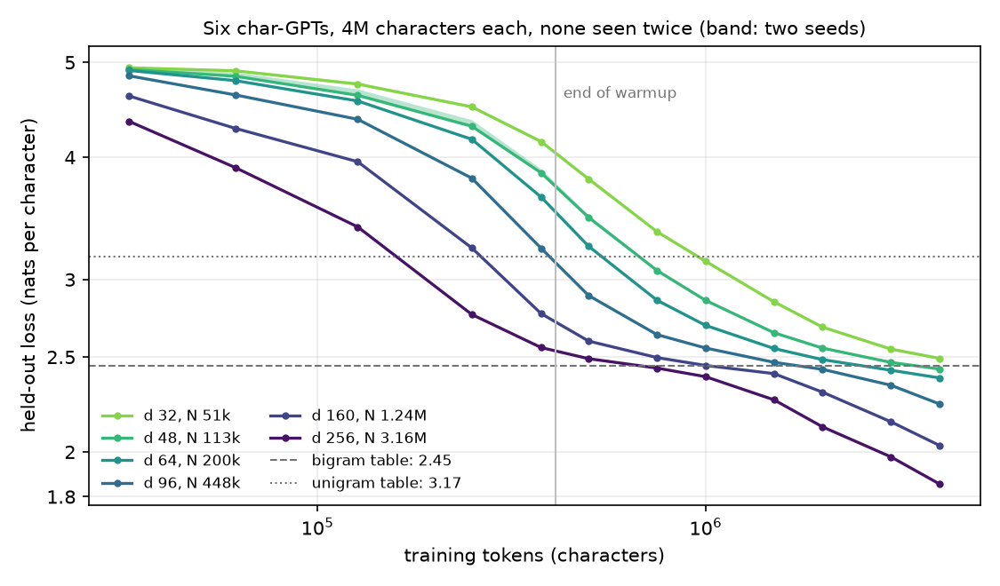
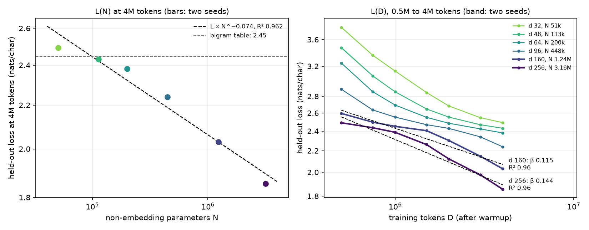
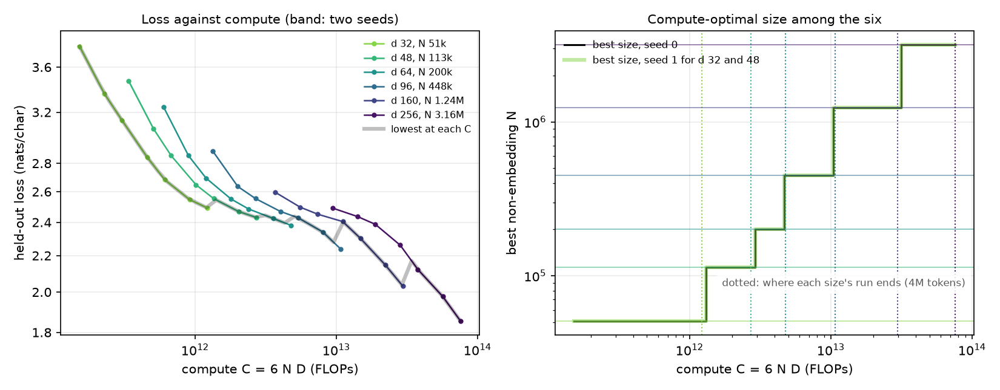
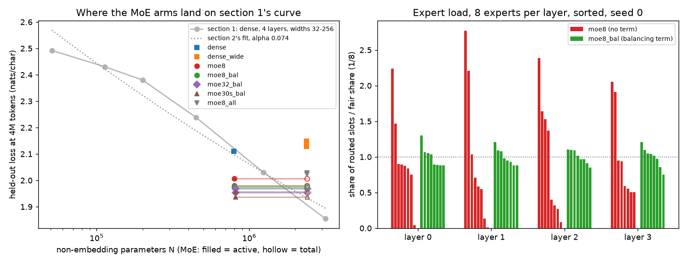

# Module 19: Scaling laws

Big language models are planned with **scaling laws**: curves that say how the
loss falls as you add parameters, data or compute. This module draws such
curves from scratch, on six small models you train on this Mac, and asks how
far they can be trusted. It has five sections, each with a figure and the
numbers beside it:

1. **Six char-GPTs**: module 04's model at six widths, from 51k to 3.2M parameters, on the same 4M characters.
2. **Fit the laws**: the exponent of L(N) at 4M tokens, L(D) for the two largest, and a check of the fitter first.
3. **Compute-optimal size**: at each compute budget C = 6ND, which size gives the lowest loss?
4. **Kaplan and Chinchilla**: what the published laws say, and what a toy fit cannot.
5. **Mixture of experts**: module 04's GPT with its MLP split into experts; total against active parameters, and how a router spreads tokens.

Every number in this README comes from a JSON file in [`results/`](results/),
written by the script that measured it.

This is the first module of track 7, **Why they work**. Next,
[module 20](../20-in-context-learning/README.md) asks how a transformer can
learn from the examples in its prompt.

**🕹 Interactive:** [Scaling laws](../../explorables/19-scaling-laws.html):
browse the six real curves, drag N and D on a fitted surface and read the loss
and the cost, see which size wins at each budget.

**✅ Quiz:** [10 questions](../../quizzes/19.html): check yourself once you have run the scripts.

## Goals

By the end you will be able to:

- count a GPT's non-embedding parameters N by hand, and its training compute C = 6ND;
- train a family of models with one recipe and read their loss curves on held-out text;
- fit a power law in log-log space, after checking the fitter on data with a known answer;
- say what a noise band from two seeds lets you claim, and what it does not;
- find the lowest loss at each compute budget, and say why a toy grid can fake an optimum;
- state what Kaplan et al. and Chinchilla found, and why they disagreed;
- say what a mixture of experts is, count its total and active parameters, and write its router and balancing loss.

## Setup

```bash
cd modules/19-scaling-laws/python
```

```bash
uv sync
```

| Need | Size | Where |
|---|---|---|
| Module 04's char-GPT code | 7 KB | copied into `src/char_gpt.py`; no weights needed, every model trains from scratch. Section 5's `src/moe.py` imports module 04's own `model.py` instead |
| wikitext-103, first 5,000,000 characters | about 12 MB read from a 157 MB file | `~/.cache/huggingface/mlcourse/`, on first run of `train.py`; reused if modules 11 or 12 already cached a longer slice |

`src/corpus.py` reads wikitext the way modules 11 and 12 do: it opens the
Parquet file over HTTP and reads row groups until it has the characters it
needs. Wikitext is CC BY-SA 3.0. A token here is one character. The vocabulary
is every character seen at least 10 times in the training part (141), plus one
id for all the rarer ones.

**The laptop guard.** Every script imports `src/common.py` before torch. It sets
`PYTORCH_MPS_HIGH_WATERMARK_RATIO=0.5` and `PYTORCH_MPS_LOW_WATERMARK_RATIO=0.4`:
the Apple GPU may take at most 5.92 GB on this 16 GB Mac, and a run that grows
past that stops with an error instead of pushing the Mac into swap. Each script
logs its time and peak memory (process RSS from `getrusage`, and
`torch.mps.driver_allocated_memory()`, read at each held-out evaluation and
the largest value kept) into its results file:

| Script | Minutes | Peak RSS | Peak MPS driver |
|---|---|---|---|
| `src/train.py --d 32` (two seeds) | 0.40 | 0.61 GB | 1.13 GB |
| `src/train.py --d 48` (two seeds) | 0.47 | 0.59 GB | 1.18 GB |
| `src/train.py --d 64` | 0.27 | 0.61 GB | 1.19 GB |
| `src/train.py --d 96` | 0.33 | 0.62 GB | 1.22 GB |
| `src/train.py --d 160` | 0.50 | 0.63 GB | 1.10 GB |
| `src/train.py --d 256` | 0.87 | 0.65 GB | 1.14 GB |
| `src/fit.py` | 0.01 | 0.32 GB | 0 (CPU only) |
| `src/frontier.py` | 0.00 | 0.21 GB | 0 (CPU only) |
| `src/moe.py` (six arms, two seeds) | 11.31 | 0.59 GB | 2.27 GB |
| `src/moe.py --arms moe8_all` | 2.15 | 0.61 GB | 1.13 GB |
| `src/moe.py --controls` (35 runs, review) | 30.57 | 0.53 GB | 2.28 GB |

Measured on an Apple M5 with 16 GB, torch 2.14.1. All six sizes train in 2.8
minutes. An earlier run of the same recipe, from a separate copy of the code on
torch 2.14.0, gave held-out losses within 0.001 of these at every size.

**MPS against CPU.** After training, each script runs one forward pass on 8
held-out windows on MPS, then on the CPU. For d 256: max abs difference in
logits 1.5 × 10⁻⁵ (logits span −8.2 to 11.3), the same loss to the last digit
printed, the same top-1 character at every position. In
`results/train_d256.json`, `mps_vs_cpu`; the other sizes are within 2.1 × 10⁻⁵.

## 1 · Six char-GPTs

The model is module 04's GPT, unchanged: pre-norm blocks, causal attention
written by hand, an MLP four times as wide, learned positions, and an output
layer tied to the token table. We fix 4 layers, 4 heads and a context of 128
characters, and change only the width d:

| d | N, non-embedding | All parameters |
|---|---|---|
| 32 | 50,880 | 59,520 |
| 48 | 113,184 | 126,144 |
| 64 | 200,064 | 217,344 |
| 96 | 447,552 | 473,472 |
| 160 | 1,237,440 | 1,280,640 |
| 256 | 3,159,552 | 3,228,672 |

**N** counts every parameter except the token and position tables, as Kaplan
et al. (2020) do; it is about 12 · layers · d². Exercise (a) derives it.

**One recipe for all six.** AdamW (betas 0.9, 0.99, weight decay 0.1, module
04's), gradient clip 1.0, dropout 0. The learning rate warms up over 100 steps
to 3 × 10⁻⁴ and then **stays constant**. Each step is 32 windows of 128
characters, 4,096 tokens; 977 steps make 4,001,792 tokens: 31,264 windows of
129 characters (128 inputs and the next character), drawn without replacement
from the 38,372 windows in the first 4,950,000 characters. A run sees 81% of
the training part, and no window twice. The last 50,000
characters are held out; the held-out loss is the mean cross-entropy over 390
windows of 128, in nats per character.

Why constant: with no decay, the model after D tokens is exactly what a run
stopped at D tokens would give. So one run gives the loss at every D, and
section 3 can use every checkpoint. A schedule that decays toward the end
would give lower final losses, and would tie each checkpoint to the planned
length.

Hägele et al. ([arXiv 2405.18392](https://arxiv.org/abs/2405.18392), 2024)
keep both. Train at a constant rate, and for each length you want, branch off
and decay the rate to zero over a short final stretch, a "cooldown". They find
that this scales as reliably as a cosine schedule of that length, so one long
run and a few cheap branches stand for many runs. This warmup-stable-decay
schedule is now common for that reason. We skip the cooldowns: every number
here is a loss at a constant rate.

**Two seeds for the two smallest.** d 32 and d 48 also run seed 1 (another
init, and another 81% of the windows in another order). The gap between their
two seeds is the only measure of noise we have, and it mixes the two sources:
the starting weights and the text each run saw. Every figure shows it as a
band.



| d | 0.25M tokens | 0.5M | 1M | 2M | 4M | 4M, seed 1 |
|---|---|---|---|---|---|---|
| 32 | 4.503 | 3.799 | 3.132 | 2.683 | 2.492 | 2.486 |
| 48 | 4.302 | 3.471 | 2.857 | 2.553 | 2.430 | 2.432 |
| 64 | 4.172 | 3.244 | 2.693 | 2.485 | 2.380 | |
| 96 | 3.807 | 2.889 | 2.554 | 2.429 | 2.239 | |
| 160 | 3.231 | 2.595 | 2.451 | 2.302 | 2.031 | |
| 256 | 2.763 | 2.490 | 2.387 | 2.122 | 1.855 | |

Two baselines, counted on the training part (add-one smoothing) and scored on
the held-out text: a table of single-character frequencies gives 3.169 nats,
a table of character pairs 2.446.

What the curves show:

- At every token count, a wider model has a lower loss.
- The three smallest end near the bigram table (2.49, 2.43 and 2.38 against
  2.45): after 4M characters they have learned little beyond pairs of letters.
- The larger ones fall toward the bigram level fast, flatten near it, then fall
  again (d 256 from 2.39 at 1M tokens to 1.86 at 4M). None has stopped falling.
- The two seeds agree closely at 4M tokens (gaps 0.006 and 0.002), less so
  early (0.066 for d 48 at 0.25M).

Text from d 256 at 4M tokens, 160 characters after "The " at temperature 1:
`The of staw ted d0 , Binde , Heng , prifuse mading of the Astariels , gen deat Zhay Fady wadden od tos her bages`.
Word lengths and spaces are right, most words are not; the explorable has a
sample from every size.

## 2 · Fit the laws

A **power law** L = c · N^(−α) is a straight line in log-log space:
log L = log c − α log N. So the fit is a least-squares line through
(log N, log L), and α is minus its slope.

**Check the fitter first.** Before any real loss goes in, `src/fit.py` feeds the
fitter losses made from α = 0.1 at the six real N, with noise of SD 0.01 on
log L. Seed 0 gives back α = 0.1003; over 1,000 draws, mean 0.1000, SD 0.0029,
range 0.090 to 0.111. A fitter that failed this would make every number below
meaningless. Exercise (b) writes it.



**L(N) at 4M tokens.** The six seed-0 losses give **α = 0.074**, with
R² = 0.962 in log space. Using seed 1 for the two smallest instead: α 0.073,
R² 0.960. Each step up in size lowers the loss by 0.050 to 0.208 nats, between
9 and 37 times the larger seed gap (0.0056).

Three reasons to hold this number loosely:

- **The points bend.** The residuals from the line, smallest first, are
  −0.030, +0.004, +0.025, +0.023, 0.000, −0.021 (in log L): the loss falls
  slowly from d 32 to 64 (0.11 nats) and fast from 64 to 256 (0.53). One line
  is a rough summary of six points.
- **α moves with the budget.** The same fit at earlier checkpoints gives:

  | Tokens | 0.25M | 0.5M | 1M | 2M | 4M |
  |---|---|---|---|---|---|
  | α | 0.121 | 0.107 | 0.064 | 0.053 | 0.074 |
  | R² | 0.957 | 0.980 | 0.928 | 0.976 | 0.962 |

  Since no model has finished learning at 4M tokens, this α says how fast
  each size learns in 977 steps at one learning rate, as much as what each
  size could reach.
- **Noise is measured at two sizes only.** The larger sizes ran one seed each.

**L(D) for the two largest.** Fitting log L on log D over the checkpoints at
0.5, 1, 2 and 4M tokens gives β = 0.115 (R² 0.960) for d 160 and β = 0.144
(R² 0.956) for d 256. Four points on curves that flatten and fall again: a
power law is a loose fit here too.

**A joint fit, for the explorable.** One formula for the whole grid, the form
Chinchilla used:

```
L(N, D) = E + A / N^α + B / D^β
```

Fitted to all 42 seed-0 checkpoints after warmup (grid search over α and β,
least squares on L for E, A and B; Chinchilla instead minimised a Huber loss
on log L, which weighs outliers less, so the two fits are not the same): E = 0.842, A = 10.2, B = 2,375, α = 0.18,
β = 0.58. It misses the real points by 0.109 nats RMS and by up to 0.331 (d 32
at 0.5M tokens), because the real curves flatten near the bigram level and
this form cannot. E, the floor the formula reaches with infinite N and D, is
whatever makes the curve fit this window; it is not a measured limit of
English text.

## 3 · Compute-optimal size

Training costs about **C = 6ND** floating-point operations: 2N per token for
the forward pass, about 4N for the backward pass. Given C, should you train a
large model on few tokens or a small one on many?

With a constant learning rate, each checkpoint stands for a run of that
length, so each size gives a curve of loss against C. `src/frontier.py` takes
the checkpoints after warmup, interpolates each size's curve in log-log, and,
at 40 budgets spaced evenly in log C from 1.5 × 10¹¹ to 7.6 × 10¹³, keeps the
size with the lowest loss. Exercise (c) writes it.



| Best size | At budgets from | to | Its run ends at |
|---|---|---|---|
| d 32 | 1.5 × 10¹¹ | 1.2 × 10¹² | 1.2 × 10¹² |
| d 48 | 1.4 × 10¹² | 2.7 × 10¹² | 2.7 × 10¹² |
| d 64 | 3.1 × 10¹² | 4.3 × 10¹² | 4.8 × 10¹² |
| d 96 | 5.1 × 10¹² | 9.6 × 10¹² | 1.1 × 10¹³ |
| d 160 | 1.1 × 10¹³ | 2.9 × 10¹³ | 3.0 × 10¹³ |
| d 256 | 3.4 × 10¹³ | 7.6 × 10¹³ | 7.6 × 10¹³ |

At all 40 budgets, the winner is the **smallest size whose run still reaches
that budget**: wherever two sizes overlap, the smaller one, trained on more
tokens, has the lower loss. Each size wins until its run stops at 4M tokens,
then hands over to the next. With seed 1 for d 32 and 48, the winner is the
same at all 40 budgets.

So this staircase does not locate an optimum between sizes. It follows where
our runs end. The frontier's loss even rises at each hand-over (2.494 at
1.2 × 10¹² with d 32, 2.544 at 1.4 × 10¹² with d 48), which a true optimum
never does: with more compute you can always do at least as well. What the
grid does say is that, at these budgets, more tokens beat more parameters, and
we ran out of tokens before finding where that turns.

**Tokens per parameter** (D / N) at 4M tokens run from 78.7 (d 32) to 1.27
(d 256); d 64 lands at 20.0, Chinchilla's rule of thumb (section 4). By that
rule d 96 and above are short of data at every budget here, which fits the
smaller model winning every overlap.

A line through the steps (N of the winner against C, leaving out the budgets
where d 256 wins, since nothing larger was there to beat it) has slope 0.76.
The joint fit of section 2 implies N_opt ∝ C^0.763 (β / (α + β)). The two
agree, and both are close to Kaplan's 0.73, but the first measures a staircase
and the second extends a formula that misses the data by up to 0.33 nats. Do
not read either as a law.

**This is a demo, not a measurement.** To find a real compute-optimal size,
each size needs runs long enough to pass its best point, a learning rate tuned
per size, several seeds, and an expectation written down before the run.

**6ND undercounts small models.** Attention scores cost about
2 · layers · context · d more operations per token in the forward pass, which
6ND leaves out. (This counts the whole 128 × 128 score matrix, because our
attention computes it all and then masks the future; a causal kernel would do
about half.) That is 24% of the forward pass at d 32 and 4% at d 256
(`results/frontier.json`, `flops_note`). Counting it would shift the small
models' curves right.

## 4 · Kaplan and Chinchilla

Kaplan et al., [Scaling Laws for Neural Language
Models](https://arxiv.org/abs/2001.08361) (OpenAI, 2020), trained transformers
from 768 to 1.5 billion non-embedding parameters on web text, in sub-word tokens.
Loss followed power laws in N, D and compute over many orders of magnitude,
with α_N ≈ 0.076 and α_D ≈ 0.095, and depended little on the shape of the model
at fixed N. For a fixed compute budget they found N_opt ∝ C^0.73: spend most of
a larger budget on size, and stop training well before convergence.

Hoffmann et al., [Training Compute-Optimal Large Language
Models](https://arxiv.org/abs/2203.15556) (DeepMind, 2022), "Chinchilla",
trained over 400 models from 70M to 16B parameters and found N_opt and D_opt
both growing about as C^0.5: about 20 tokens per parameter. Chinchilla, 70B
parameters on 1.4T tokens, beat Gopher, 280B parameters on 300B tokens, at the
same compute. Their fitted form is the one in section 2, with E = 1.69,
α = 0.34, β = 0.28 (from their third method, which fits that formula to all
runs at once). They traced much of the gap with Kaplan to the learning-rate
schedule: Kaplan's intermediate checkpoints came from runs whose schedule was
set for a longer length, the trap section 1's constant rate avoids. Later work found more causes: counting N without
embeddings at small scale (Pearce and Song, [Reconciling Kaplan and Chinchilla
Scaling Laws](https://arxiv.org/abs/2406.12907), 2024), and the cost of the
output layer, warmup and optimiser tuning (Porian et al., [Resolving Discrepancies in Compute-Optimal
Scaling of Language Models](https://arxiv.org/abs/2406.19146), 2024). A
replication of that third method found its fitted numbers hard to reproduce
(Besiroglu et al., [Chinchilla Scaling: A replication
attempt](https://arxiv.org/abs/2404.10102), 2024); their refit gives
α ≈ 0.35 and β ≈ 0.37, still near 20 tokens per parameter. Schaeffer et al.
([arXiv 2509.23963](https://arxiv.org/abs/2509.23963), 2025) find the
prescription robust to how the models' parameters are counted and to
sizable errors in those counts, though most sensitive to errors that push
them all one way.

**Since Chinchilla: train smaller, longer.** Chinchilla minimises training
compute only. A model that will answer many queries also costs compute at
every answer, and counting that, Sardana et al.
([arXiv 2401.00448](https://arxiv.org/abs/2401.00448), 2023) find it should be
smaller and trained longer; their models kept improving up to 10,000 tokens
per parameter. Gadre et al. ([arXiv 2403.08540](https://arxiv.org/abs/2403.08540),
2024) show such "over-trained" runs stay predictable: from 104 models they
predict a run 32 times past Chinchilla's ratio. The Llama 3 report
(Grattafiori et al., [arXiv 2407.21783](https://arxiv.org/abs/2407.21783),
2024) sizes its 405B model to be about compute-optimal on a corpus of about
15T tokens, and trains its smaller models "much longer than is
compute-optimal", so they serve better for the same inference cost.

**How to fit on a small budget.** Choshen, Zhang and Andreas ([A Hitchhiker's
Guide to Scaling Law Estimation](https://arxiv.org/abs/2410.11840), 2024)
estimate over 1,000 laws from 485 published models. They find that fitting to
intermediate checkpoints, not only final losses, makes a law much more
accurate, and that seeds vary so much that several small models are sometimes
worth more than one large one. This module follows the first advice, since its
fits use every checkpoint after warmup, and heeds the second in part: two seeds
of the smallest models measure the noise, though no fit averages over them. Gemstones (McLeish et al.,
[arXiv 2502.06857](https://arxiv.org/abs/2502.06857), 2025), over 4,000
checkpoints, finds that the prescriptions shift with the model shapes and the
checkpoints chosen for the fit: another reason to hold ours loosely.

Our α = 0.074 sits close to Kaplan's 0.076, and our N_opt exponent 0.76 close to
their 0.73. Read nothing into either match: characters instead of sub-words, six
small sizes over a narrow range, and runs that stop before any model has
finished learning. They neither confirm nor test either paper.

**What a toy fit cannot say:**

- **The floor.** E needs runs long enough to flatten; ours never do.
- **The exponent outside the range.** Six sizes over a factor 62 in N, with
  visible bend, say little about a factor 1,000 beyond.
- **The compute-optimal ratio.** Section 3 shows that runs that stop at one
  token count fake a staircase; the ratio needs runs that go past each size's
  best point.
- **The effect of the recipe.** We used one learning rate for every size. The
  best rate usually changes with size, so tuning it per size could change α.
  The usual remedy is μP (Yang et al., [Tensor Programs
  V](https://arxiv.org/abs/2203.03466), 2022): a way to scale the
  initialisation and the learning rate of each layer with width so that the
  best rate stays put as the model grows.

## 5 · Mixture of experts: total against active parameters

Sections 1 to 4 count one N per model: every parameter works on every token.
A **mixture of experts** (MoE) breaks that. It replaces the MLP of a block
with E smaller MLPs, the **experts**, and a **router**: a linear map that
scores the E experts for each token. Only the k best-scored experts run on
that token, and their outputs are added, weighted by the router. So the
model has many parameters in **total**, but each token uses only the
**active** ones: attention, the router, and k experts. Training compute
follows the active count, C ≈ 6 · N_active · D, while what the model can
store grows with the total.

Mixtral 8x7B, from its record: 8 experts per layer, 2 per token, 46.7B
parameters in total and 12.9B active
([Jiang et al., 2401.04088](https://arxiv.org/abs/2401.04088), section 2.1).
It uses 25% of its experts but 27.6% of its parameters, since attention and
the embeddings are shared (exercise d).

**The parts, as real models use them.** Every number below is read from the
model's record in the architecture explorer; each link opens it there.

| Part | What it does | In the records |
|---|---|---|
| top-k routing | softmax over the experts' scores, keep the k largest, renormalise their weights | [Mixtral 8x7B](../../explorables/05b-architecture-explorer.html#m=mixtral-8x7b): top-2 of 8. [Llama 4 Maverick](../../explorables/05b-architecture-explorer.html#m=llama-4-maverick): top-1 of 128, plus one shared expert, on every other layer; 400B total, 17B active |
| fine-grained experts | many narrow experts instead of a few wide ones, so a token picks a finer mix | [DeepSeekMoE 16B](../../explorables/05b-architecture-explorer.html#m=deepseek-moe-16b): 64 experts of width 1,408, each a quarter of a standard MLP, top-6. [Qwen3 235B-A22B](../../explorables/05b-architecture-explorer.html#m=qwen3-235b-a22b): 128 experts of width 1,536, top-8, 235.1B total, 22.2B active. [Inkling 2 Small](../../explorables/05b-architecture-explorer.html#m=inkling-2-small): 384 experts, 8 routed, 594B total, 17B active |
| shared experts | one or two experts every token runs, for what all tokens need; the routed ones can then specialise | DeepSeekMoE 16B: 2 shared. [DeepSeek-V3](../../explorables/05b-architecture-explorer.html#m=deepseek-v3): 256 routed and 1 shared, top-8, 671B total, 37B active |
| a balancing loss | a term added to the loss that is lowest when tokens spread evenly over the experts | Switch Transformer's (below). Qwen3 235B-A22B: a load-balancing loss computed over the global batch |
| a balancing bias | no loss term: a bias per expert, added to its score only to choose the top k, nudged up when the expert is idle and down when it is busy | DeepSeek-V3 ([Wang et al., 2408.15664](https://arxiv.org/abs/2408.15664)). Inkling 2 Small: "a learned bias only steers the top-8 choice" |
| dense first layers | the first blocks keep a plain MLP | DeepSeek-V3: first 3 of 61. DeepSeekMoE 16B: first 1 of 28; its paper says load balance converges slower in the first layer |

The sources are each record's own: the Mixtral, DeepSeekMoE
([2401.06066](https://arxiv.org/abs/2401.06066)), DeepSeek-V3
([2412.19437](https://arxiv.org/abs/2412.19437)) and Qwen3
([2505.09388](https://arxiv.org/abs/2505.09388)) papers, Meta's Llama 4 post
and config, and Inkling 2 Small's model card and config.

**Why balance at all.** A router that sends most tokens to one expert wastes
the rest, and on many chips the busiest expert sets the pace. Worse, it feeds
itself: the expert that gets more tokens learns faster, scores higher, and
gets more. Shazeer et al. ([1701.06538](https://arxiv.org/abs/1701.06538),
2017), who brought the sparsely gated layer to language models, added
balancing losses from the start. Switch Transformer (Fedus, Zoph and
Shazeer, [2101.03961](https://arxiv.org/abs/2101.03961), 2021) sends each
token to one expert and uses one term, E · Σ_e f_e · P_e, where f_e is the
share of tokens routed to expert e and P_e its mean router probability. It
is 1 when both are even, and grows as both pile onto the same experts.
Exercise (d) writes it.

**The experiment.** `src/moe.py` imports module 04's `model.py` (by path, as
module 18 does), builds it at width 128 with 4 layers and 4 heads, the shape
of section 1's family, and swaps the MLP of every block. Same data, same
recipe as section 1: 977 steps of 32 × 128 characters, a constant rate of
3 × 10⁻⁴, two seeds per arm. N counts non-embedding parameters as in
section 1; "active" leaves out the experts a token does not use.

| Arm | Feed-forward part of each block |
|---|---|
| dense | module 04's MLP, 128 → 512 → 128 |
| dense_wide | one MLP 128 → 2,048 → 128: the MoE arms' total size |
| moe8 | 8 experts of width 256, top-2: dense's active size, dense_wide's total |
| moe8_bal | the same, plus Switch's balancing loss at weight 0.01 |
| moe32_bal | 32 experts of width 64, top-8, balancing loss: fine-grained |
| moe30s_bal | 1 shared expert of width 128 and 30 routed of width 64, top-6, balancing loss |
| moe8_all | 8 experts of width 256, all 8 run, mixed by the router's weights: no sparsity |

The last arm is a control we added after the first six had run, to ask
where their gain came from; it was not in the prediction.

For speed on the Apple GPU, the script runs every expert on every token and
multiplies the unchosen ones by zero. A dispatch that runs each expert only
on its own tokens gives the same outputs and gradients (the tests check
it), but ran several times slower in our trials. So the wall times below are
not what a real MoE kernel saves; the parameter counts are what counts.

**Prediction**, written before the run:

1. Held-out loss: dense_wide below every MoE arm, every MoE arm below dense, at both seeds. The MoE arms close 30–60% of the gap between them.
2. Fine-grained (moe32_bal) and shared (moe30s_bal) within 0.02 of moe8_bal, slightly lower if anything.
3. Without the balancing term, in at least one layer the busiest of the 8 experts takes more than twice its fair share (over 25% of the slots). With it, every expert stays between 0.5 and 1.5 times its fair share.
4. The balancing term costs at most 0.01 nats.
5. Some expert in the first layer takes mostly spaces or punctuation, at more than twice their share of the text.

We would read a gap as real above 0.02 nats, from section 1's seed gaps at
4M tokens (0.002 to 0.006).



| Arm | Active | Total | Seed 0 | Seed 1 | Seed 2 | Mean |
|---|---|---|---|---|---|---|
| dense | 0.79M | 0.79M | 2.111 | 2.110 | 2.085 | 2.102 |
| dense_wide | 2.37M | 2.37M | 2.128 | 2.149 | 2.173 | 2.150 |
| moe8 | 0.80M | 2.38M | 2.007 | 1.980 | 1.982 | 1.990 |
| moe8_bal | 0.80M | 2.38M | 1.977 | 1.972 | 1.963 | 1.971 |
| moe32_bal | 0.81M | 2.40M | 1.954 | 1.968 | 1.973 | 1.965 |
| moe30s_bal | 0.81M | 2.40M | 1.936 | 1.957 | 1.959 | 1.951 |
| moe8_all | 2.38M | 2.38M | 2.028 | 2.024 | 2.011 | 2.021 |

Active and total count non-embedding parameters, N. Held-out loss is in
nats per character after 4M tokens. Seeds 0 and 1 are in
`results/moe.json`; seed 2 was added in review (`moe.py --controls`,
`results/moe_controls.json`). The spread of the three seeds reaches 0.045
(dense_wide) and is 0.014 to 0.027 for the others. A step took 21.5 ms for
dense, 53.1 for dense_wide and 58–68 for the MoE arms, which all run every
expert.

The dense arm lands on
section 1's curve: its 2.110 at 0.79M sits between d 96 (0.45M, 2.239) and
d 160 (1.24M, 2.031), and within 0.05 of section 2's line in log L (a test
checks it). The MoE arms, at the same 0.8M active, reach 1.95–1.99, a loss
section 1 only reaches between d 160 and d 256 (3.16M, 1.855).

**Checks added in review.** Two results above looked too good to take on
trust: every MoE arm beat a dense model three times dense's size, and that
wider dense model did worse than dense. The review asked whether the
comparison was fair, with two controls, all in `results/moe_controls.json`:

- **dense_gated**: 8 experts of width 64, all 8 run, mixed by the router's weights. That is dense's size (0.80M) with the router's gate: each expert's output is multiplied by a weight that depends on the token, a product the plain MLP does not have.
- **The learning rate.** Section 1's rate, 3 × 10⁻⁴, was never tuned. We ran every arm again at 10⁻³ (seeds 0 and 1), and dense, dense_wide and moe8_bal at four more rates (seed 0).

| Arm | 3 × 10⁻⁴, 3 seeds | 10⁻³, 2 seeds |
|---|---|---|
| dense | 2.102 | 1.926 |
| dense_wide | 2.150 | 1.929 |
| dense_gated | 2.079 | 1.845 |
| moe8 | 1.990 | 1.842 |
| moe8_bal | 1.971 | 1.818 |
| moe32_bal | 1.965 | 1.777 |
| moe30s_bal | 1.951 | 1.775 |
| moe8_all | 2.021 | 1.840 |

| Seed 0 | 10⁻⁴ | 3 × 10⁻⁴ | 6 × 10⁻⁴ | 10⁻³ | 2 × 10⁻³ |
|---|---|---|---|---|---|
| dense | 2.368 | 2.111 | 1.976 | 1.922 | 1.876 |
| dense_wide | 2.349 | 2.128 | 2.018 | 1.927 | 1.828 |
| moe8_bal | 2.310 | 1.977 | 1.864 | 1.822 | 1.778 |

Three things follow. First, the recipe's rate is far too low for this
length: every arm is 0.15–0.23 nats lower at 10⁻³, and the best rate lies at
2 × 10⁻³ or above for all three swept arms. Second, dense_wide's poor
showing was the rate: at 2 × 10⁻³ it is 0.048 below dense. Third, the gate
explains most of the MoE gain at equal active size: at 10⁻³ dense_gated is
0.081 below dense, and moe8_bal only 0.027 below dense_gated. MoE still
beats both dense arms at every rate we tried, but its lead over dense_wide
shrinks as the rate grows: 0.18 nats at 3 × 10⁻⁴, 0.11 at 10⁻³ (means),
0.05 at 2 × 10⁻³ (seed 0 only).

**How evenly the router spreads tokens.** Share of the routed slots each
expert takes over every held-out token, against the fair share 1/E; the
busiest and the least-used expert over the four layers and both seeds:

| Arm | Busiest expert | Least-used expert |
|---|---|---|
| moe8, no term | 2.77 × fair (layer 1, seed 0) | 0.01 × fair |
| moe8_bal | 1.30 × | 0.73 × |
| moe32_bal | 1.46 × | 0.59 × |
| moe30s_bal | 1.63 × | 0.60 × |

No expert went fully unused, even without the term, but in layer 1 of seed
0 one expert took 35% of the slots and another 0.1%.

**What experts take.** For each expert, the input characters of the tokens
routed to it, against the text as a whole (19.4% spaces, 27.7% lower-case
vowels, 43.5% lower-case consonants, 3.1% punctuation), seed 0:

| Arm, layer, expert | Share of slots | Its tokens | Most common |
|---|---|---|---|
| moe8_bal, layer 0, expert 4 | 11.2% | 86.9% spaces | space, g, 0 |
| moe8_bal, layer 0, expert 3 | 16.3% | 71.8% vowels | e, a, i |
| moe8_bal, layer 0, expert 2 | 13.1% | 97.6% consonants | t, n, r |
| moe30s_bal, layer 0, expert 9 | 3.2% | 98.9% spaces | space, p, u |
| moe30s_bal, layer 0, expert 19 | 3.7% | 99.6% vowels | e, a, o |
| moe8 (no term), layer 1, expert 6 | 1.7% | 75.2% punctuation | , . = |

The space experts' tokens sit on average 4 characters into their word: the
space that ends a word. In layer 0 this is the easy split: the router there
reads the character's embedding after a single attention layer, so the
character itself is most of what it sees. Deeper layers mix more;
`results/moe.json` lists every expert. A retrained copy of moe8_bal, seed 0,
split layer 0 the same way, with the same expert numbers.

**Grades.**

1. **Wrong.** Every MoE arm beat both dense arms, at all three seeds and at both rates. dense_wide did not beat dense at 3 × 10⁻⁴ (2.150 against 2.102), but the review showed that was the rate: at 2 × 10⁻³ it is 0.048 lower. Most of the MoE gain at equal active size comes from the router's gate, not from the extra experts: dense_gated, at dense's size, takes 0.081 of moe8_bal's 0.108 lead at 10⁻³ (0.022 of 0.131 at 3 × 10⁻⁴, inside the seed spread). The control moe8_all, added after the first run, points the same way: it runs all 8 experts and still beats dense_wide.
2. **Not shown at the recipe's rate, right at 10⁻³.** At 3 × 10⁻⁴, with three seeds, moe32_bal is 0.006 below moe8_bal and moe30s_bal 0.020 below, both inside the seed spread. At 10⁻³ both are about 0.04 below moe8_bal, twice the spread of two seeds.
3. **Right.** Without the term the busiest expert reached 2.77 × its fair share; with it, all 8 stayed between 0.73 and 1.30 ×.
4. **Right, and better than predicted:** the term lowered the loss, by 0.019 at 3 × 10⁻⁴ and 0.024 at 10⁻³ (means). At the first rate that is less than the seed spread; at the second, the two seeds of each arm do not overlap.
5. **Right.** Expert 4 of layer 0 takes 86.9% spaces, 4.5 times their share.

The seed gaps were larger than section 1's, up to 0.045 over three seeds,
so the 0.02 bar we set was too fine for this run.

**What this does and does not say.** A 4-layer character model on 4M
characters is not a 600B model on trillions of tokens. Here an MoE beats a
dense model of the same active size at every rate we tried, as the labs
report at scale. But most of that lead is the router's gate, which a
dense model of the same size can have too; the experts beyond it added
0.027 nats at 10⁻³. Against a dense model of the same total size, the lead
fell from 0.18 to 0.05 nats as the rate rose to 2 × 10⁻³, and we did not
find the best rate for any arm, so how the two compare at their best this
run cannot say. Large dense models already have a gate in every MLP
(SwiGLU, module 04's table of later changes); a GELU MLP like ours does
not, which may make the router's gate worth more here than there. One
length, three seeds: this neither confirms nor refutes the labs' choices.

## Run it

Each `train.py` call trains one size, prints its loss and writes
`results/train_d<d>.json`; `--figures` redraws the curves.

```bash
for d in 32 48 64 96 160 256; do uv run python src/train.py --d $d; done
```

```bash
uv run python src/fit.py --figures
```

```bash
uv run python src/frontier.py --figures
```

```bash
uv run python src/moe.py
```

`moe.py` trains all seven arms of section 5, two seeds each, in about 13
minutes on the Apple GPU; `--arms moe8_all` reruns one arm and merges it in.
`--controls` runs the review's checks (a third seed, dense_gated, five
learning rates) in about 31 minutes; take the shared GPU lock first.

Redraw every figure from the committed JSON, with no model trained:

```bash
uv run python src/figures.py
```

Rewrite the explorable's data block from the JSON:

```bash
uv run python src/export_explorable.py
```

## Exercises

Skeletons with `# TODO(you):` live in [`exercises/`](exercises/); reference
solutions are in [`solutions/`](solutions/). Each asks you to predict before
you run. All four run on the CPU in a second.

- **(a) `exercise_a_count.py`**: count N for module 04's block by hand, and the
  compute C = 6ND. The test checks your count against the model for all six
  widths.
- **(b) `exercise_b_fit.py`**: write the log-log fitter and the synthetic
  losses, and see how far the fitted α strays at three noise levels. The test
  checks it against `src/fit.py` and the known answer.
- **(c) `exercise_c_frontier.py`**: interpolate each size's loss at a budget
  and pick the best size. The test checks all 40 budgets against
  `results/frontier.json`.
- **(d) `exercise_d_router.py`**: the top-k router, Switch's balancing loss, and Mixtral 8x7B's active parameters counted from its record. The test checks them against `src/moe.py` and the record.

## Tests

```bash
uv run pytest
```

Twenty-eight tests, under 10 seconds, no training. They check the solutions
against the scripts, the committed results against the laptop budget, the
seed band and the frontier, the explorable against the results, and, for
section 5, that the zero-gated experts give the same outputs and gradients
as a true dispatch, the arms' sizes, and that the dense arm sits on section
2's line.

## Checkpoint: you should now be able to…

- count N for a GPT and say why the embeddings are left out;
- say why a constant learning rate lets one run stand for many run lengths;
- fit a power law and say what the check on synthetic data rules out;
- say why α = 0.074 here moves with the token budget;
- explain why every budget's winner here is the smallest size that reaches it;
- state Kaplan's and Chinchilla's compute-optimal answers and one reason they differ;
- say why an MoE's training compute follows its active parameters, and what top-k routing, shared and fine-grained experts and a balancing term each do.

## Links

- Kaplan et al., [Scaling Laws for Neural Language Models](https://arxiv.org/abs/2001.08361) (2020)
- Hoffmann et al., [Training Compute-Optimal Large Language Models](https://arxiv.org/abs/2203.15556) (2022), Chinchilla
- Pearce and Song, [Reconciling Kaplan and Chinchilla Scaling Laws](https://arxiv.org/abs/2406.12907) (2024)
- Porian et al., [Resolving Discrepancies in Compute-Optimal Scaling of Language Models](https://arxiv.org/abs/2406.19146) (2024)
- Besiroglu et al., [Chinchilla Scaling: A replication attempt](https://arxiv.org/abs/2404.10102) (2024)
- Schaeffer et al., [Evaluating the Robustness of Chinchilla Compute-Optimal Scaling](https://arxiv.org/abs/2509.23963) (2025)
- Hägele et al., [Scaling Laws and Compute-Optimal Training Beyond Fixed Training Durations](https://arxiv.org/abs/2405.18392) (2024), warmup-stable-decay
- Sardana et al., [Beyond Chinchilla-Optimal: Accounting for Inference in Language Model Scaling Laws](https://arxiv.org/abs/2401.00448) (2023)
- Gadre et al., [Language models scale reliably with over-training and on downstream tasks](https://arxiv.org/abs/2403.08540) (2024)
- Grattafiori et al., [The Llama 3 Herd of Models](https://arxiv.org/abs/2407.21783) (2024)
- Choshen, Zhang and Andreas, [A Hitchhiker's Guide to Scaling Law Estimation](https://arxiv.org/abs/2410.11840) (2024)
- McLeish et al., [Gemstones: A Model Suite for Multi-Faceted Scaling Laws](https://arxiv.org/abs/2502.06857) (2025)
- Yang et al., [Tensor Programs V](https://arxiv.org/abs/2203.03466) (2022), μP
- Shazeer et al., [Outrageously Large Neural Networks: The Sparsely-Gated Mixture-of-Experts Layer](https://arxiv.org/abs/1701.06538) (2017)
- Fedus, Zoph and Shazeer, [Switch Transformers](https://arxiv.org/abs/2101.03961) (2021)
- Dai et al., [DeepSeekMoE](https://arxiv.org/abs/2401.06066) (2024)
- Jiang et al., [Mixtral of Experts](https://arxiv.org/abs/2401.04088) (2024)
- Wang et al., [Auxiliary-Loss-Free Load Balancing Strategy for Mixture-of-Experts](https://arxiv.org/abs/2408.15664) (2024)
- [LLM architecture explorer](../../explorables/05b-architecture-explorer.html#m=deepseek-v3): every MoE model in the course's database, its experts drawn from its config
- Merity et al., [Pointer Sentinel Mixture Models](https://arxiv.org/abs/1609.07843) (2016), which introduced wikitext-103
