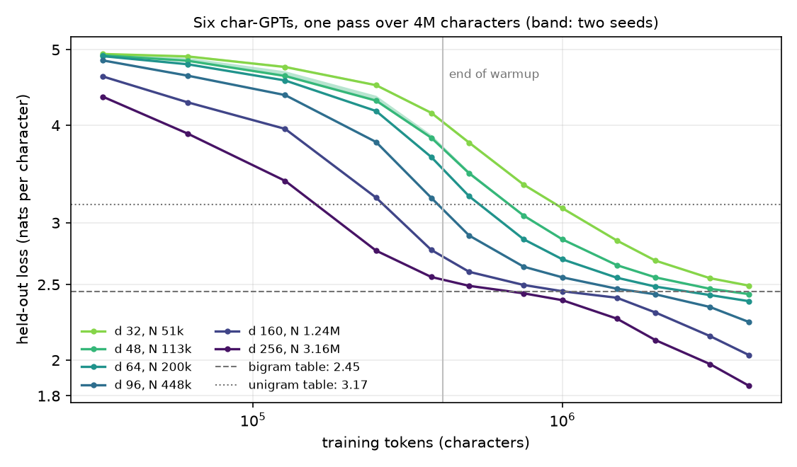
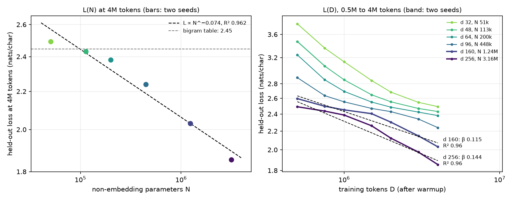
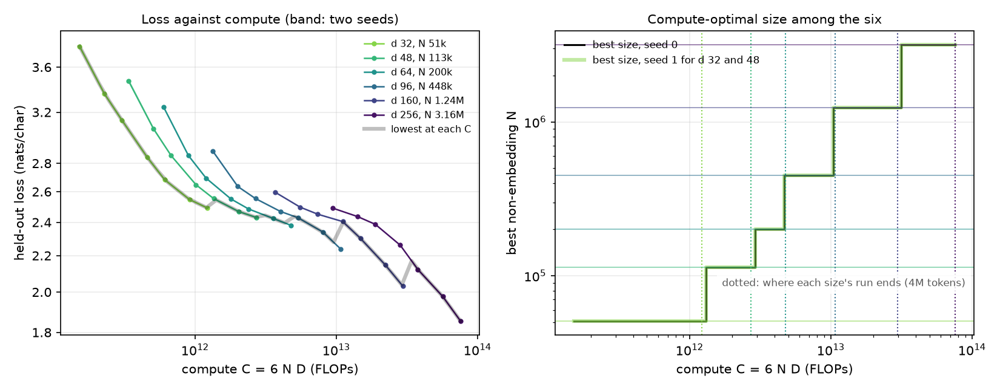

# Module 19: Scaling laws

Big language models are planned with **scaling laws**: curves that say how the
loss falls as you add parameters, data or compute. This module draws such
curves from scratch, on six small models you train on this Mac, and asks how
far they can be trusted. It has four sections, each with a figure and the
numbers beside it:

1. **Six char-GPTs**: module 04's model at six widths, from 51k to 3.2M parameters, on the same 4M characters.
2. **Fit the laws**: the exponent of L(N) at 4M tokens, L(D) for the two largest, and a check of the fitter first.
3. **Compute-optimal size**: at each compute budget C = 6ND, which size gives the lowest loss?
4. **Kaplan and Chinchilla**: what the published laws say, and what a toy fit cannot.

Every number in this README comes from a JSON file in [`results/`](results/),
written by the script that measured it.

This is the first module of track 7, **Why they work**. Next,
[module 20](../20-in-context-learning/README.md) asks how a transformer can
learn from the examples in its prompt.

**🕹 Interactive:** [Scaling laws](../../explorables/19-scaling-laws.html):
browse the six real curves, drag N and D on a fitted surface and read the loss
and the cost, see which size wins at each budget.

**✅ Quiz:** [10 questions](../../quizzes/19.html): check yourself once you have run the scripts.

## Goals

By the end you will be able to:

- count a GPT's non-embedding parameters N by hand, and its training compute C = 6ND;
- train a family of models with one recipe and read their loss curves on held-out text;
- fit a power law in log-log space, after checking the fitter on data with a known answer;
- say what a noise band from two seeds lets you claim, and what it does not;
- find the lowest loss at each compute budget, and say why a toy grid can fake an optimum;
- state what Kaplan et al. and Chinchilla found, and why they disagreed.

## Setup

```bash
cd modules/19-scaling-laws/python
```

```bash
uv sync
```

| Need | Size | Where |
|---|---|---|
| Module 04's char-GPT code | 7 KB | copied into `src/char_gpt.py`; no weights needed, every model trains from scratch |
| wikitext-103, first 5,000,000 characters | about 12 MB read from a 157 MB file | `~/.cache/huggingface/mlcourse/`, on first run of `train.py`; reused if modules 11 or 12 already cached a longer slice |

`src/corpus.py` reads wikitext the way modules 11 and 12 do: it opens the
Parquet file over HTTP and reads row groups until it has the characters it
needs. Wikitext is CC BY-SA 3.0. A token here is one character. The vocabulary
is every character seen at least 10 times in the training part (141), plus one
id for all the rarer ones.

**The laptop guard.** Every script imports `src/common.py` before torch. It sets
`PYTORCH_MPS_HIGH_WATERMARK_RATIO=0.5` and `PYTORCH_MPS_LOW_WATERMARK_RATIO=0.4`:
the Apple GPU may take at most 5.92 GB on this 16 GB Mac, and a run that grows
past that stops with an error instead of pushing the Mac into swap. Each script
logs its time and peak memory (process RSS from `getrusage`, and
`torch.mps.driver_allocated_memory()`, read at each held-out evaluation and
the largest value kept) into its results file:

| Script | Minutes | Peak RSS | Peak MPS driver |
|---|---|---|---|
| `src/train.py --d 32` (two seeds) | 0.40 | 0.61 GB | 1.13 GB |
| `src/train.py --d 48` (two seeds) | 0.47 | 0.59 GB | 1.18 GB |
| `src/train.py --d 64` | 0.27 | 0.61 GB | 1.19 GB |
| `src/train.py --d 96` | 0.33 | 0.62 GB | 1.22 GB |
| `src/train.py --d 160` | 0.50 | 0.63 GB | 1.10 GB |
| `src/train.py --d 256` | 0.87 | 0.65 GB | 1.14 GB |
| `src/fit.py` | 0.01 | 0.32 GB | 0 (CPU only) |
| `src/frontier.py` | 0.00 | 0.21 GB | 0 (CPU only) |

Measured on an Apple M5 with 16 GB, torch 2.14.1. All six sizes train in 2.8
minutes. An earlier run of the same recipe, from a separate copy of the code on
torch 2.14.0, gave held-out losses within 0.001 of these at every size.

**MPS against CPU.** After training, each script runs one forward pass on 8
held-out windows on MPS, then on the CPU. For d 256: max abs difference in
logits 1.5 × 10⁻⁵ (logits span −8.2 to 11.3), the same loss to the last digit
printed, the same top-1 character at every position. In
`results/train_d256.json`, `mps_vs_cpu`; the other sizes are within 2.1 × 10⁻⁵.

## 1 · Six char-GPTs

The model is module 04's GPT, unchanged: pre-norm blocks, causal attention
written by hand, an MLP four times as wide, learned positions, and an output
layer tied to the token table. We fix 4 layers, 4 heads and a context of 128
characters, and change only the width d:

| d | N, non-embedding | All parameters |
|---|---|---|
| 32 | 50,880 | 59,520 |
| 48 | 113,184 | 126,144 |
| 64 | 200,064 | 217,344 |
| 96 | 447,552 | 473,472 |
| 160 | 1,237,440 | 1,280,640 |
| 256 | 3,159,552 | 3,228,672 |

**N** counts every parameter except the token and position tables, as Kaplan
et al. (2020) do; it is about 12 · layers · d². Exercise (a) derives it.

**One recipe for all six.** AdamW (betas 0.9, 0.99, weight decay 0.1, module
04's), gradient clip 1.0, dropout 0. The learning rate warms up over 100 steps
to 3 × 10⁻⁴ and then **stays constant**. Each step is 32 windows of 128
characters, 4,096 tokens; 977 steps make 4,001,792 tokens, one pass over the
first 4,950,000 characters with no window seen twice. The last 50,000
characters are held out; the held-out loss is the mean cross-entropy over 390
windows of 128, in nats per character.

Why constant: with no decay, the model after D tokens is exactly what a run
stopped at D tokens would give. So one run gives the loss at every D, and
section 3 can use every checkpoint. A schedule that decays toward the end
would give lower final losses, and would tie each checkpoint to the planned
length.

**Two seeds for the two smallest.** d 32 and d 48 also run seed 1 (another
init and another data order). The gap between their two seeds is the only
measure of noise we have; every figure shows it as a band.



| d | 0.25M tokens | 0.5M | 1M | 2M | 4M | 4M, seed 1 |
|---|---|---|---|---|---|---|
| 32 | 4.503 | 3.799 | 3.132 | 2.683 | 2.492 | 2.486 |
| 48 | 4.302 | 3.471 | 2.857 | 2.553 | 2.430 | 2.432 |
| 64 | 4.172 | 3.244 | 2.693 | 2.485 | 2.380 | |
| 96 | 3.807 | 2.889 | 2.554 | 2.429 | 2.239 | |
| 160 | 3.231 | 2.595 | 2.451 | 2.302 | 2.031 | |
| 256 | 2.763 | 2.490 | 2.387 | 2.122 | 1.855 | |

Two baselines, counted on the training part (add-one smoothing) and scored on
the held-out text: a table of single-character frequencies gives 3.169 nats,
a table of character pairs 2.446.

What the curves show:

- At every token count, a wider model has a lower loss.
- The three smallest end near the bigram table (2.49, 2.43 and 2.38 against
  2.45): after 4M characters they have learned little beyond pairs of letters.
- The larger ones fall toward the bigram level fast, flatten near it, then fall
  again (d 256 from 2.39 at 1M tokens to 1.86 at 4M). None has stopped falling.
- The two seeds agree closely at 4M tokens (gaps 0.006 and 0.002), less so
  early (0.066 for d 48 at 0.25M).

Text from d 256 at 4M tokens, 160 characters after "The " at temperature 1:
`The of staw ted d0 , Binde , Heng , prifuse mading of the Astariels , gen deat Zhay Fady wadden od tos her bages`.
Word lengths and spaces are right, most words are not; the explorable has a
sample from every size.

## 2 · Fit the laws

A **power law** L = c · N^(−α) is a straight line in log-log space:
log L = log c − α log N. So the fit is a least-squares line through
(log N, log L), and α is minus its slope.

**Check the fitter first.** Before any real loss goes in, `src/fit.py` feeds the
fitter losses made from α = 0.1 at the six real N, with noise of SD 0.01 on
log L. Seed 0 gives back α = 0.1003; over 1,000 draws, mean 0.1000, SD 0.0029,
range 0.090 to 0.111. A fitter that failed this would make every number below
meaningless. Exercise (b) writes it.



**L(N) at 4M tokens.** The six seed-0 losses give **α = 0.074**, with
R² = 0.962 in log space. Using seed 1 for the two smallest instead: α 0.073,
R² 0.960. Each step up in size lowers the loss by 0.050 to 0.208 nats, between
9 and 37 times the larger seed gap (0.0056).

Three reasons to hold this number loosely:

- **The points bend.** The residuals from the line, smallest first, are
  −0.030, +0.004, +0.025, +0.023, 0.000, −0.021 (in log L): the loss falls
  slowly from d 32 to 64 (0.11 nats) and fast from 64 to 256 (0.53). One line
  is a rough summary of six points.
- **α moves with the budget.** The same fit at earlier checkpoints gives:

  | Tokens | 0.25M | 0.5M | 1M | 2M | 4M |
  |---|---|---|---|---|---|
  | α | 0.121 | 0.107 | 0.064 | 0.053 | 0.074 |
  | R² | 0.957 | 0.980 | 0.928 | 0.976 | 0.962 |

  Since no model has finished learning at 4M tokens, this α says how fast
  each size learns in 977 steps at one learning rate, as much as what each
  size could reach.
- **Noise is measured at two sizes only.** The larger sizes ran one seed each.

**L(D) for the two largest.** Fitting log L on log D over the checkpoints at
0.5, 1, 2 and 4M tokens gives β = 0.115 (R² 0.960) for d 160 and β = 0.144
(R² 0.956) for d 256. Four points on curves that flatten and fall again: a
power law is a loose fit here too.

**A joint fit, for the explorable.** One formula for the whole grid, the form
Chinchilla used:

```
L(N, D) = E + A / N^α + B / D^β
```

Fitted to all 42 seed-0 checkpoints after warmup (grid search over α and β,
least squares for E, A and B): E = 0.842, A = 10.2, B = 2,375, α = 0.18,
β = 0.58. It misses the real points by 0.109 nats RMS and by up to 0.331 (d 32
at 0.5M tokens), because the real curves flatten near the bigram level and
this form cannot. E, the floor the formula reaches with infinite N and D, is
whatever makes the curve fit this window; it is not a measured limit of
English text.

## 3 · Compute-optimal size

Training costs about **C = 6ND** floating-point operations: 2N per token for
the forward pass, about 4N for the backward pass. Given C, should you train a
large model on few tokens or a small one on many?

With a constant learning rate, each checkpoint stands for a run of that
length, so each size gives a curve of loss against C. `src/frontier.py` takes
the checkpoints after warmup, interpolates each size's curve in log-log, and,
at 40 budgets spaced evenly in log C from 1.5 × 10¹¹ to 7.6 × 10¹³, keeps the
size with the lowest loss. Exercise (c) writes it.



| Best size | At budgets from | to | Its run ends at |
|---|---|---|---|
| d 32 | 1.5 × 10¹¹ | 1.2 × 10¹² | 1.2 × 10¹² |
| d 48 | 1.4 × 10¹² | 2.7 × 10¹² | 2.7 × 10¹² |
| d 64 | 3.1 × 10¹² | 4.3 × 10¹² | 4.8 × 10¹² |
| d 96 | 5.1 × 10¹² | 9.6 × 10¹² | 1.1 × 10¹³ |
| d 160 | 1.1 × 10¹³ | 2.9 × 10¹³ | 3.0 × 10¹³ |
| d 256 | 3.4 × 10¹³ | 7.6 × 10¹³ | 7.6 × 10¹³ |

At all 40 budgets, the winner is the **smallest size whose run still reaches
that budget**: wherever two sizes overlap, the smaller one, trained on more
tokens, has the lower loss. Each size wins until its run stops at 4M tokens,
then hands over to the next. With seed 1 for d 32 and 48, the winner is the
same at all 40 budgets.

So this staircase does not locate an optimum between sizes. It follows where
our runs end. The frontier's loss even rises at each hand-over (2.494 at
1.2 × 10¹² with d 32, 2.544 at 1.4 × 10¹² with d 48), which a true optimum
never does: with more compute you can always do at least as well. What the
grid does say is that, at these budgets, more tokens beat more parameters, and
we ran out of tokens before finding where that turns.

A line through the steps (N of the winner against C, leaving out the budgets
where d 256 wins, since nothing larger was there to beat it) has slope 0.76.
The joint fit of section 2 implies N_opt ∝ C^0.763 (β / (α + β)). The two
agree, and both are close to Kaplan's 0.73, but the first measures a staircase
and the second extends a formula that misses the data by up to 0.33 nats. Do
not read either as a law.

**This is a demo, not a measurement.** To find a real compute-optimal size,
each size needs runs long enough to pass its best point, a learning rate tuned
per size, several seeds, and an expectation written down before the run.

**6ND undercounts small models.** Attention scores cost about
2 · layers · context · d more operations per token in the forward pass, which
6ND leaves out. That is 24% of the forward pass at d 32 and 4% at d 256
(`results/frontier.json`, `flops_note`). Counting it would shift the small
models' curves right.

## 4 · Kaplan and Chinchilla

Kaplan et al., [Scaling Laws for Neural Language
Models](https://arxiv.org/abs/2001.08361) (OpenAI, 2020), trained transformers
from 768 to 1.5 billion non-embedding parameters on web text, in sub-word tokens.
Loss followed power laws in N, D and compute over many orders of magnitude,
with α_N ≈ 0.076 and α_D ≈ 0.095, and depended little on the shape of the model
at fixed N. For a fixed compute budget they found N_opt ∝ C^0.73: spend most of
a larger budget on size, and stop training well before convergence.

Hoffmann et al., [Training Compute-Optimal Large Language
Models](https://arxiv.org/abs/2203.15556) (DeepMind, 2022), "Chinchilla",
trained over 400 models from 70M to 16B parameters and found N_opt and D_opt
both growing about as C^0.5: about 20 tokens per parameter. Chinchilla, 70B
parameters on 1.4T tokens, beat Gopher, 280B parameters on 300B tokens, at the
same compute. Their fitted form is the one in section 2, with E = 1.69,
α = 0.34, β = 0.28. They traced much of the gap with Kaplan to the learning-rate
schedule: Kaplan's intermediate checkpoints came from runs whose schedule was
set for a longer length. Later work found more causes: counting N without
embeddings at small scale (Pearce and Song, [Reconciling Kaplan and Chinchilla
Scaling Laws](https://arxiv.org/abs/2406.12907), 2024), and the cost of the
output layer, warmup and optimiser tuning (Porian et al., [Resolving Discrepancies in Compute-Optimal
Scaling of Language Models](https://arxiv.org/abs/2406.19146), 2024). A
replication of Chinchilla's third method found its fitted numbers hard to
reproduce (Besiroglu et al., [Chinchilla Scaling: A replication
attempt](https://arxiv.org/abs/2404.10102), 2024).

Our α = 0.074 sits close to Kaplan's 0.076, and our N_opt exponent 0.76 close to
their 0.73. Read nothing into either match: characters instead of sub-words, six
small sizes over a narrow range, and runs that stop before any model has
finished learning. They neither confirm nor test either paper.

**What a toy fit cannot say:**

- **The floor.** E needs runs long enough to flatten; ours never do.
- **The exponent outside the range.** Six sizes over a factor 62 in N, with
  visible bend, say little about a factor 1,000 beyond.
- **The compute-optimal ratio.** Section 3 shows that runs that stop at one
  token count fake a staircase; the ratio needs runs that go past each size's
  best point.
- **The effect of the recipe.** We used one learning rate for every size. The
  best rate usually changes with size, so tuning it per size could change α.

## Run it

Each `train.py` call trains one size, prints its loss and writes
`results/train_d<d>.json`; `--figures` redraws the curves.

```bash
for d in 32 48 64 96 160 256; do uv run python src/train.py --d $d; done
```

```bash
uv run python src/fit.py --figures
```

```bash
uv run python src/frontier.py --figures
```

Redraw every figure from the committed JSON, with no model trained:

```bash
uv run python src/figures.py
```

Rewrite the explorable's data block from the JSON:

```bash
uv run python src/export_explorable.py
```

## Exercises

Skeletons with `# TODO(you):` live in [`exercises/`](exercises/); reference
solutions are in [`solutions/`](solutions/). Each asks you to predict before
you run. All three run on the CPU in a second.

- **(a) `exercise_a_count.py`**: count N for module 04's block by hand, and the
  compute C = 6ND. The test checks your count against the model for all six
  widths.
- **(b) `exercise_b_fit.py`**: write the log-log fitter and the synthetic
  losses, and see how far the fitted α strays at three noise levels. The test
  checks it against `src/fit.py` and the known answer.
- **(c) `exercise_c_frontier.py`**: interpolate each size's loss at a budget
  and pick the best size. The test checks all 40 budgets against
  `results/frontier.json`.

## Tests

```bash
uv run pytest
```

Twenty-two tests, under 5 seconds, no training. They check the solutions
against the scripts, the committed results against the laptop budget, the
seed band and the frontier, and the explorable against the results.

## Checkpoint: you should now be able to…

- count N for a GPT and say why the embeddings are left out;
- say why a constant learning rate lets one run stand for many run lengths;
- fit a power law and say what the check on synthetic data rules out;
- say why α = 0.074 here moves with the token budget;
- explain why every budget's winner here is the smallest size that reaches it;
- state Kaplan's and Chinchilla's compute-optimal answers and one reason they differ.

## Links

- Kaplan et al., [Scaling Laws for Neural Language Models](https://arxiv.org/abs/2001.08361) (2020)
- Hoffmann et al., [Training Compute-Optimal Large Language Models](https://arxiv.org/abs/2203.15556) (2022), Chinchilla
- Pearce and Song, [Reconciling Kaplan and Chinchilla Scaling Laws](https://arxiv.org/abs/2406.12907) (2024)
- Porian et al., [Resolving Discrepancies in Compute-Optimal Scaling of Language Models](https://arxiv.org/abs/2406.19146) (2024)
- Besiroglu et al., [Chinchilla Scaling: A replication attempt](https://arxiv.org/abs/2404.10102) (2024)
- Merity et al., [Pointer Sentinel Mixture Models](https://arxiv.org/abs/1609.07843) (2016), which introduced wikitext-103
