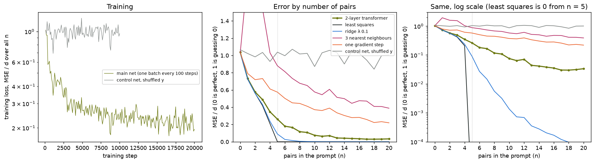
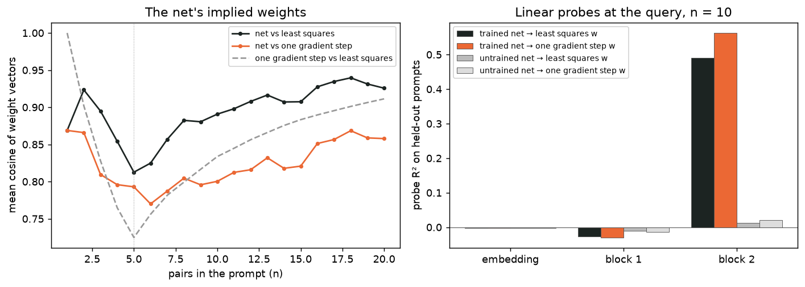
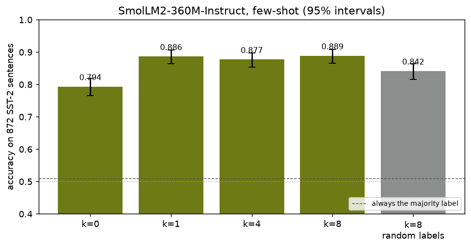

# Module 20: In-context learning

A language model can pick up a task from a few examples in its prompt, with no
change to its weights. This is **in-context learning**. This module builds the
cleanest case by hand: a small transformer that learns to fit a line (in five
dimensions) to the (x, y) pairs in its prompt. It then asks how close it gets to
the textbook answer, what its insides look like, and what the same idea gives on
a real language model. Four sections, each with a figure and the numbers beside
it:

1. **A transformer that regresses in context**: 2 blocks, trained on prompts of up to 20 pairs, x in 5 dimensions.
2. **Its error against four classic rules**: least squares, ridge, 3 nearest neighbours, one gradient step; with a control.
3. **Does a layer look like a gradient step?** Two read-outs of the net's insides: a demo, not a measurement.
4. **The library way**: few-shot sentiment with SmolLM2-360M-Instruct on SST-2, at 0, 1, 4 and 8 examples.

Every number in this README comes from a JSON file in [`results/`](results/),
written by the script that measured it.

This is the second module of track 7, **Why they work**. The suggested next
module is [module 22](../22-reasoning-at-test-time/README.md), reasoning at test
time, then module 21.

**🕹 Interactive:** [In-context learning](../../explorables/20-in-context-learning.html):
place points and watch a trained net's guess and the least-squares line move
together (the net runs in the page); browse the error curves, the gradient-step
demo and the few-shot prompts.

**✅ Quiz:** [10 questions](../../quizzes/20.html): check yourself once you have run the scripts.

## Goals

By the end you will be able to:

- set up in-context regression: the prompt layout, the causal mask, a loss at every position;
- compute least squares, ridge, k-nearest neighbours and one gradient step for a prompt, and say which is best and when;
- design a control that can only fail through a bug, and read it;
- read a trained net's "implied weights" and probe its layers, and say what that can and cannot show;
- score a few-shot prompt on a causal language model from two next-token logits, with an interval.

## Setup

```bash
cd modules/20-in-context-learning/python
```

```bash
uv sync
```

| Need | Size | Where |
|---|---|---|
| SmolLM2-360M-Instruct | ~700 MB | Hugging Face cache; module 05 already fetched it |
| SST-2 (`stanfordnlp/sst2`), train and validation Parquet files | 3.1 MB | Hugging Face cache, on first run of `fewshot.py`; module 11 already fetched it |

Sections 1 to 3 download nothing: the task is made up on the fly. The trained
nets are committed in [`artifacts/`](artifacts/) (1.6 MB each for the 5-d net
and its control, 0.1 MB for the explorable's line net).

**The laptop guard.** Every script imports `src/common.py` before torch. It sets
`PYTORCH_MPS_HIGH_WATERMARK_RATIO=0.5` and `PYTORCH_MPS_LOW_WATERMARK_RATIO=0.4`:
the Apple GPU may take at most 5.92 GB on this 16 GB Mac, and a run that grows
past that stops with an error instead of pushing the Mac into swap. Each script
logs its time and peak memory (process RSS from `getrusage`, and
`torch.mps.driver_allocated_memory()`, sampled at the end of each stage) into
its results file:

| Script | Minutes | Peak RSS | Peak MPS driver |
|---|---|---|---|
| `src/train_icl.py` | 3.23 | 0.54 GB | 0.12 GB |
| `src/gd_demo.py` | 0.03 | 2.10 GB | 0 (runs on the CPU) |
| `src/fewshot.py` | 3.23 | 2.49 GB | 3.19 GB |
| `src/line_net.py` | 0.95 | 0.34 GB | 0 (runs on the CPU) |

Measured on an Apple M5 with 16 GB, torch 2.14.1. `fewshot.py` frees the model
on MPS before it loads the CPU copy for the check below.

**MPS against CPU.** The 5-d net from section 1 on 250 held-out prompts, on MPS
and then on the CPU: max abs difference in predictions 8.6 × 10⁻⁶ (predictions
span −8.6 to 9.2). SmolLM2 on the first 8-shot prompt: max abs difference in
the last position's logits 2.6 × 10⁻⁵ (logits span −10.8 to 24.6), same
answer. In `results/icl.json` and `results/fewshot.json`, `mps_vs_cpu`.

## 1 · A transformer that regresses in context

Each prompt is one task. Draw w from N(0, I₅), then 21 points x from N(0, I₅),
and set y = w · x, with no noise. Feed the points as a sequence:

```
x₁, y₁, x₂, y₂, …, x₂₁, y₂₁                 # 42 tokens
x token = (x, 0)      y token = (0, 0, 0, 0, 0, y)
```

At each x token the net predicts the y that follows. A causal mask means the
guess for y₍ₙ₊₁₎ sees only the n pairs before it and the new x, so one prompt
trains and scores every n from 0 to 20. A fresh w every prompt means the net
cannot memorise any task: it must read the rule from the pairs each time.

`src/icl.py` holds the net: a linear map from 6 numbers to 128, a learned
position embedding, two pre-LayerNorm transformer blocks
(`torch.nn.TransformerEncoderLayer`, 4 heads, MLP 512), a final LayerNorm and a
linear read-out, 403,201 weights in all. `src/train_icl.py` trains it for
20,000 steps of 64 fresh prompts: AdamW at 3 × 10⁻⁴ after 500 warm-up steps,
cosine down to 3 × 10⁻⁵, gradients clipped at 1.0, loss the mean of
(guess − y)² / d over all 21 positions.

The error is **MSE / d**. Since Var(y) = E|w|² = d, guessing 0 scores 1 and a
perfect guess scores 0.



The training loss (one batch every 100 steps, all n mixed) falls fast for 3,000
steps and then slowly; the last values still drift down. The next section
reads the curves on the right.

## 2 · Its error against four classic rules

Four rules see the same n pairs (X, n × 5, and y) and guess y for the new x:

| Rule | Its weight vector | Notes |
|---|---|---|
| least squares | the minimum-norm w with Xw closest to y | exact from n = 5, since the task has no noise |
| ridge, λ 0.1 | (XᵀX + 0.1 I)⁻¹ Xᵀ y | shrinks w a little |
| 3 nearest neighbours | none: the mean y of the 3 closest x | ignores that the rule is linear |
| one gradient step | Xᵀy / (n + d + 1) | one step from w = 0 on ½ Σ (w · xᵢ − yᵢ)², with the step that is best on average for Gaussian x |

**Three bars, written before the run.** The net's MSE/d at 10 pairs (2d) at
most 0.05; at 5 pairs (d) at most 1.5 × ridge's; at 20 pairs at most 0.02.
Two checks were also fixed beforehand:

- **A known answer.** Least squares on the 1,000 held-out prompts must score
  below 10⁻⁶ at every n ≥ 5. It scores 5.7 × 10⁻²⁸ at worst: the scorer and the
  rule are right.
- **A control that can only fail through a bug.** A second net, same code and
  recipe but 10,000 steps, trains on prompts whose y values come from another
  prompt. Then nothing in a prompt predicts its y, and the best a net can do is
  guess 0, which scores 1. Its mean MSE/d over n = 0…20 must lie in 0.8 to
  1.2; below that, the net would be seeing the y it must guess, through a leak.
  It scores 0.997.

MSE/d on 1,000 held-out prompts:

| n | net | least squares | ridge λ 0.1 | 3-NN | one gradient step | control net, shuffled y |
|---|---|---|---|---|---|---|
| 0 | 1.037 | 1.033 | 1.033 | 1.033 | 1.033 | 1.066 |
| 1 | 0.732 | 0.724 | 0.725 | 1.936 | 0.791 | 1.022 |
| 2 | 0.577 | 0.562 | 0.562 | 1.585 | 0.719 | 0.984 |
| 3 | 0.488 | 0.417 | 0.431 | 1.538 | 0.732 | 1.035 |
| 4 | 0.347 | 0.209 | 0.237 | 1.030 | 0.612 | 0.930 |
| **5** | **0.262** | 0.000 | **0.090** | 0.880 | 0.575 | 1.038 |
| 8 | 0.117 | 0.000 | 0.0056 | 0.678 | 0.444 | 1.017 |
| **10** | **0.075** | 0.000 | 0.0014 | 0.577 | 0.372 | 0.872 |
| 15 | 0.038 | 0.000 | 0.0002 | 0.446 | 0.280 | 1.048 |
| **20** | **0.034** | 0.000 | 0.0001 | 0.389 | 0.220 | 1.005 |

Every n is in `results/icl.json`.

**This is a measurement with three misses.** The known answer and the control
pass. All three bars fail: 0.075 at 10 pairs (bar 0.05), 2.9 × ridge at 5 pairs
(bar 1.5 ×), 0.034 at 20 pairs (bar 0.02). The two outcomes written down as
"would change our mind", an error that does not fall from 5 to 10 pairs or one
above 0.2 at 10, did not happen.

**What the run shows.** The net learns a rule from its prompt: its error falls
with every few pairs, from 1.04 with none to 0.075 with 10. It beats one
gradient step (0.372 at 10) by about five times, and 3 nearest neighbours by
more. Below 5 pairs, where no rule can pin w down, it sits close to least
squares at 1 and 2 pairs (0.732 against 0.724 at n = 1) and falls behind by 4
(0.347 against 0.209). From n = 5 on, least squares is exact
and the net is not: it levels off near 0.03 from n = 15. **What it does not
show** is why. The training loss was still falling at 20,000 steps, so more
steps might close part of the gap; so might more layers. One run of one size
cannot tell a limit of 2 blocks from a short training. Garg et al. (2022),
who first ran this test, trained a 12-layer GPT-2 of 9.5M weights for 500,000
steps, with a curriculum that grew d and n, on d = 20; they did not vary depth
alone.

**Two more checks, not registered.** The trained net on the shuffled prompts
scores 1.83 on average over n = 1…20, worse than guessing 0: it fits a rule to
pairs that hold none. And reordering the 20 pairs of each prompt moves its
error at n = 20 from 0.034 to 0.037, but moves each guess by about as much as
its error (mean squared change / d 0.033): least squares ignores the order; the
net does not quite. `tests/test_permutation.py` checks the control net, the
shuffled prompts, the pair order and the causal mask on the committed nets.

## 3 · Does a layer look like a gradient step? (a demo)

Von Oswald et al. (2023) showed that one layer of *linear* attention can carry
out exactly one gradient step on the prompt's pairs, and found trained linear
nets that do. Akyürek et al. (2023) probed trained nets for the weights of
known rules. Our net uses softmax attention and an MLP, so neither result
applies to it as stated. `src/gd_demo.py` asks two plain questions of it, on
the CPU:

1. **Implied weights.** Nudge the query x and watch the guess move: the
   gradient of the guess with respect to x is the weight vector the net acts as
   if it had fitted. For 500 prompts at each n, compare it by cosine with least
   squares' w and with one gradient step's w.
2. **Probes.** At n = 10, fit a ridge map from the net's inner state at the
   query token (after the embedding, after block 1, after block 2) to least
   squares' w and to one gradient step's w; train on 4,000 prompts, score R²
   on 1,000 others. The untrained net is the control.



| n | cos(net, least squares) | cos(net, one step) | cos(one step, least squares) |
|---|---|---|---|
| 2 | 0.923 | 0.866 | 0.902 |
| 5 | 0.813 | 0.793 | 0.725 |
| 10 | 0.891 | 0.800 | 0.834 |
| 20 | 0.926 | 0.858 | 0.911 |

| Probe R², n = 10 | embedding | block 1 | block 2 |
|---|---|---|---|
| trained, least squares' w | −0.003 | −0.026 | 0.491 |
| trained, one step's w | −0.003 | −0.030 | 0.563 |
| untrained, least squares' w | −0.003 | −0.010 | 0.012 |
| untrained, one step's w | −0.003 | −0.014 | 0.021 |

What we read, hedged:

- From n = 2 on, the net's implied weights point closer to least squares' w
  than to one step's. From n = 9 on they are further from one step's w than
  least squares' own w is (0.800 against 0.834 at n = 10). By this measure the
  net does not act like one gradient step; it acts more like a rough least
  squares.
- After block 1, no linear probe reads either weight vector at the query
  (R² near 0). After block 2 both read at about half (0.49 and 0.56). At
  n = 10 the two vectors point fairly alike (cosine 0.834), so the probes
  cannot tell them apart well; a little more R² for one step's w is not a sign
  that block 2 computes it.
- The untrained net gives R² near 0 everywhere: a probe on random features of
  this size does not find w by itself.

**This is a demo, not a measurement.** One net, one seed, one n for the probes,
no bar written before, and a cosine averaged over prompts. A linear probe that
fails does not prove the vector is absent; it may be stored in a form a linear
map cannot read. To test the gradient-step reading properly you would need the
linear-attention nets of von Oswald et al., where the claim is exact, several
seeds and depths, and an expectation fixed before the run.

## 4 · The library way: few-shot SST-2

The same idea on a real model. `src/fewshot.py` gives SmolLM2-360M-Instruct
plain-text prompts (no chat template) like this one, with k solved examples:

```
Classify the sentiment of each movie review as positive or negative.

Review: retains an extraordinary faith in the ability of images to communicate the truth of the world around him
Sentiment: positive

Review: it 's a charming and often affecting journey .
Sentiment:
```

The model writes nothing. We read the next-token logits of " positive" and
" negative" (one token each, with the leading space) and take the larger. The
prompt format and this scoring were fixed in the script before its first run,
but committed with the results.

- Test set: all 872 labelled SST-2 validation sentences (444 positive, 428
  negative; always saying "positive" scores 50.9%).
- Examples: from training sentences of 6 to 40 words. For each test sentence,
  numpy seed 0 draws 4 positive and 4 negative ones in random order; the k-shot
  prompt takes the first k, so the 1-, 4- and 8-shot prompts share examples.
- Control: the same 8 examples, each with a coin-flip label (numpy seed 1).



| Prompt | Accuracy | 95% interval | Says "positive" | Tokens a prompt |
|---|---|---|---|---|
| 0 examples | 79.4% | 76.5–81.9% | 33% | 44 |
| 1 example | 88.6% | 86.4–90.6% | 56% | 70 |
| 4 examples | 87.7% | 85.4–89.7% | 52% | 146 |
| 8 examples | 88.9% | 86.6–90.8% | 51% | 250 |
| 8 examples, coin-flip labels | 84.2% | 81.6–86.4% | 50% | 250 |

The intervals are Wilson intervals on 872 sentences; they ignore that the five
rows share sentences. Counting the sentences one prompt gets right and the
other wrong: 8-shot against 0-shot, 137 against 54; 8-shot against 4-shot, 48
against 38; 8-shot against coin-flip labels, 82 against 41.

What the numbers show:

- One example lifts accuracy by 9 points, from 79.4% to 88.6%; four and eight
  add nothing we can tell from one (88.6%, 87.7%, 88.9%, intervals overlapping;
  48 against 38 for 8 over 4).
- With no example the model says "negative" two times in three, on a set that
  is half positive. With examples, its answers split about evenly. Part of what
  one example gives may be this: the format and the label words, not the task.
- Coin-flip labels on the same 8 examples cost 4.7 points (84.2% against
  88.9%), yet still beat no examples by 4.8: about half the 8-shot gain
  survives wrong labels. Min et al. (2022), on 12 larger models up to GPT-3,
  found that random labels barely hurt; here they cost more. Part of the half
  that survives may be the end of the "negative" lean seen at 0 examples, not
  sentiment. Our run covers one model, one prompt format and one draw of
  examples.

**The link to section 1.** In section 1 the net had to read the rule from the
pairs, since every prompt held a new w; the control net, given pairs with no
rule, learned to guess 0. One reading of section 4, which the numbers allow
but do not prove: SmolLM2 already knows what sentiment is, so the examples
tell it the format and the label words as much as the task, and wrong labels
hurt less than they would if it learned the rule from them. Few-shot
prompting on a large model would then sit somewhere between these two cases.

## Run it

Each script prints its numbers, writes `results/<name>.json`, and with
`--figures` redraws its figure.

```bash
uv run python src/train_icl.py --figures
```

```bash
uv run python src/gd_demo.py --figures
```

```bash
uv run python src/fewshot.py --figures
```

```bash
uv run python src/line_net.py --figures
```

`gd_demo.py` reads the net `train_icl.py` saved. `line_net.py` trains the
small net on lines that the explorable runs: x = (u, 1), y = a·u + b, width 32,
4 heads, 2 blocks, 26,977 weights, 10,000 steps on the CPU. Its MSE/d on 1,000
held-out lines is 0.085 at 2 points, 0.0098 at 5 and 0.0042 at 20, where least
squares is exact from 2 points
([figure](figures/line.png)).

Redraw every figure from the committed JSON, with no model loaded:

```bash
uv run python src/figures.py
```

Rewrite the explorable's data block (and the line net's weights in it):

```bash
uv run python src/export_explorable.py
```

`train_icl.py` gave the same numbers to the last digit on two runs on this Mac;
another chip or torch version may not.

## Exercises

Skeletons with `# TODO(you):` live in [`exercises/`](exercises/); reference
solutions are in [`solutions/`](solutions/). Each asks you to predict before
you run.

- **(a) `exercise_a_rules.py`**: write least squares, ridge and one gradient
  step for one prompt, then their error at n = 3, 5, 10, 20. Runs in a second.
- **(b) `exercise_b_shuffled.py`**: shuffle y against x and score the two
  committed nets: the main net and the control. Runs on the CPU in seconds.
- **(c) `exercise_c_label_words.py`**: build the few-shot prompt and read the
  answer from two logits of SmolLM2-360M-Instruct. The test checks your prompt
  and your score against `src/fewshot.py`.

## Tests

```bash
uv run pytest
```

Nineteen tests, about 7 seconds once SmolLM2 is cached. They check the
solutions against the scripts, the committed results
against the laptop budget, the explorable against the results, and the
explorable's own JavaScript forward pass against PyTorch (in Node, skipped
without it). `tests/test_permutation.py` is the prompt-permutation test: on
fresh shuffled prompts the control net scores between 0.8 and 1.2 and the main
net no better than guessing 0; reordering the pairs barely moves the main
net's error; changing the y being guessed does not change the guess.

## To go further

- Read Garg et al. for the same test on larger nets, and on sparse, decision-tree and
  two-layer-network tasks.
- Raventós et al. (2023) vary the number of distinct tasks in training: with
  few, the net memorises them; past a threshold, it learns ridge regression.
  Exercise: train the module's net with w drawn from a fixed pool of 16 tasks.
- Induction heads (Olsson et al., 2022) are the mechanism usually named for
  in-context copying in language models; module 11's tools can look for them.

## Checkpoint: you should now be able to…

- lay out an in-context regression prompt, and say why a fresh w per prompt matters;
- compute least squares, ridge, 3-NN and one gradient step, and say which wins below and above n = d;
- say what the shuffled-y control tests, and why it can only fail through a bug;
- say what implied weights and a layer probe can and cannot show;
- score a few-shot prompt from two logits, and read a gain against its interval.

## Links

- Brown et al., [Language Models are Few-Shot Learners](https://arxiv.org/abs/2005.14165) (2020)
- Garg et al., [What Can Transformers Learn In-Context? A Case Study of Simple Function Classes](https://arxiv.org/abs/2208.01066) (2022)
- Akyürek et al., [What learning algorithm is in-context learning? Investigations with linear models](https://arxiv.org/abs/2211.15661) (2023)
- von Oswald et al., [Transformers learn in-context by gradient descent](https://arxiv.org/abs/2212.07677) (2023)
- Raventós et al., [Pretraining task diversity and the emergence of non-Bayesian in-context learning for regression](https://arxiv.org/abs/2306.15063) (2023)
- Min et al., [Rethinking the Role of Demonstrations: What Makes In-Context Learning Work?](https://arxiv.org/abs/2202.12837) (2022)
- Olsson et al., [In-context Learning and Induction Heads](https://transformer-circuits.pub/2022/in-context-learning-and-induction-heads/index.html) (2022)
- Socher et al., [SST](https://nlp.stanford.edu/sentiment/) (2013); [`stanfordnlp/sst2`](https://huggingface.co/datasets/stanfordnlp/sst2)
