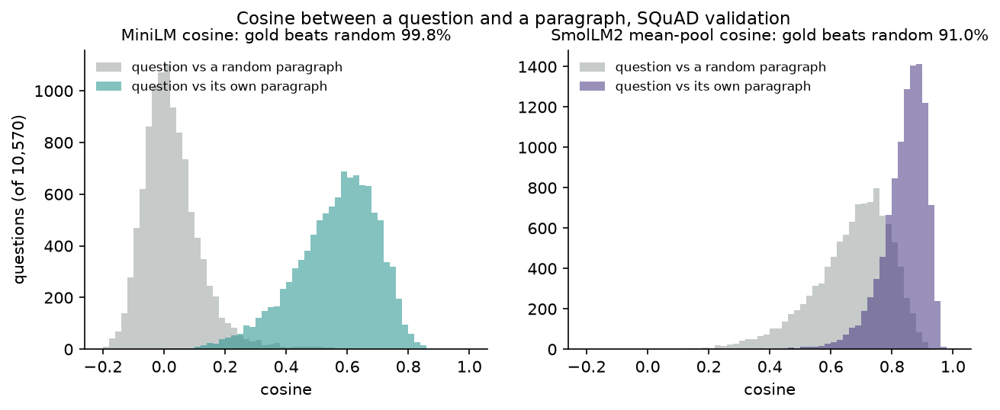
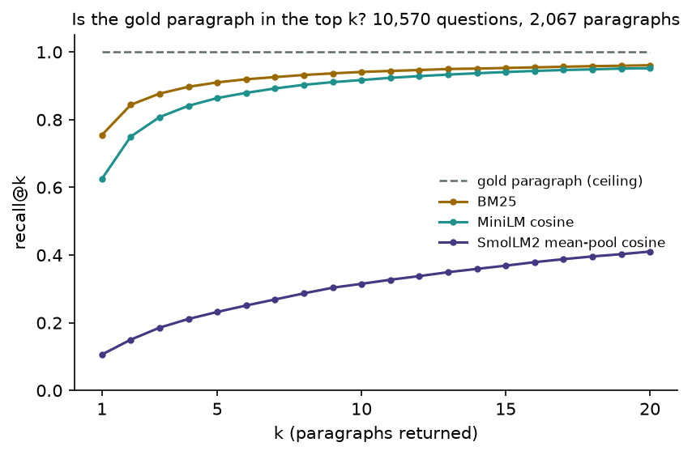
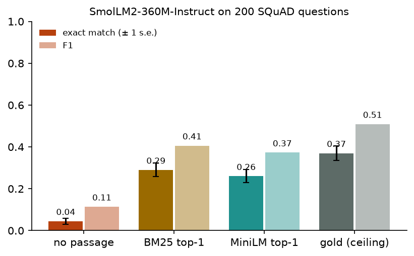

# Module 21: Retrieval and memory

A language model knows what its weights hold and what its prompt shows it.
**Retrieval** adds to the prompt: search a store of text for the passages
that best match the question, paste them in, then let the model answer. This
module builds each piece by hand and measures it on SQuAD, a set of questions
whose answers sit in known Wikipedia paragraphs. It has four sections:

1. **Embeddings**: one vector per text, from a small model trained for it (MiniLM) and from one that was not (SmolLM2, mean-pooled).
2. **BM25 and an inverted index, by hand**: how often each retriever finds a question's own paragraph.
3. **A RAG loop**: SmolLM2-360M-Instruct answers 200 questions with no passage, the top retrieved passage, or the right one.
4. **Memory in agents**: where an agent can keep what it learned, in one table.

Every number in this README comes from a JSON file in [`results/`](results/),
written by the script that measured it. In every table, the row with the
**gold paragraph** (the one the question was written on) is the ceiling: the
best any retriever could hand this reader.

This module belongs to track 8, **Using models well**. Read it after
[module 22](../22-reasoning-at-test-time/README.md); next,
[module 23](../23-compression/README.md) makes a model smaller.

**🕹 Interactive:** [Retrieval and memory](../../explorables/21-retrieval-and-memory.html):
type a question and see BM25 and cosine rank 200 paragraphs side by side, read
how each word adds to BM25's score, and see what SmolLM2 answered.

**✅ Quiz:** [10 questions](../../quizzes/21.html): check yourself once you have run the scripts.

## Goals

By the end you will be able to:

- turn a text into a unit vector with a BERT-style model and mean pooling, and search by cosine;
- say why a language model's mean-pooled states make a poor search vector;
- build an inverted index and score BM25 over it, and say what idf, tf saturation and length do;
- measure a retriever with recall@k against a known right answer;
- wire retrieval into generation, and score answers with SQuAD's exact match and F1;
- tell how much of a RAG system's error comes from the retriever and how much from the reader;
- name the places an agent can keep memory, and what each costs.

## Setup

```bash
cd modules/21-retrieval-and-memory/python
```

```bash
uv sync
```

| Need | Size | Where |
|---|---|---|
| SQuAD v1.1 validation (`rajpurkar/squad`, revision `7b6d24c`) | 1.8 MB | Hugging Face cache, on first run of any script |
| all-MiniLM-L6-v2 (`sentence-transformers/all-MiniLM-L6-v2`, revision `1110a24`) | 91 MB (six files of the repo) | Hugging Face cache, on first run of `embed.py` |
| SmolLM2-360M-Instruct | ~700 MB | Hugging Face cache; module 05 already fetched it |
| Paragraph and question vectors | 40 MB | `~/.cache/huggingface/mlcourse/squad-7b6d24c/`, written by `embed.py` |

**Licences.** SQuAD (Rajpurkar et al., [SQuAD: 100,000+ Questions for
Machine Comprehension of Text](https://arxiv.org/abs/1606.05250), 2016) is
licensed [CC BY-SA 4.0](https://creativecommons.org/licenses/by-sa/4.0/); its
paragraphs come from Wikipedia. `results/` and the explorable quote SQuAD
questions, answers and paragraphs (the explorable ships 200 paragraphs
unchanged); those quotes stay under CC BY-SA 4.0. MiniLM and SmolLM2 are
Apache-2.0.

We load MiniLM with plain `transformers` (`AutoModel`), not the
sentence-transformers package, and write its pooling ourselves: the repo's
`modules.json` says mean pooling then L2 normalisation, and
`snapshot_download` fetches only the six files `AutoModel` and
`AutoTokenizer` read, not the repo's ONNX, OpenVINO and TensorFlow copies.

**The laptop guard.** Every script imports `src/common.py` before torch. It
sets `PYTORCH_MPS_HIGH_WATERMARK_RATIO=0.5` and
`PYTORCH_MPS_LOW_WATERMARK_RATIO=0.4`, so a run that grows too large on the
Apple GPU stops with an error instead of pushing the Mac into swap. Each
script logs its time and peak memory into its results file:

| Script | Minutes | Peak RSS | Peak MPS driver |
|---|---|---|---|
| `src/embed.py` | 2.76 | 2.65 GB | 2.99 GB |
| `src/retrieval.py` | 0.14 | 1.20 GB | 0 (runs on the CPU) |
| `src/rag.py` | 1.82 | 2.46 GB | 3.79 GB |

Measured on an Apple M5 with 16 GB, torch 2.14.1. `embed.py` loads MiniLM,
frees it, then loads SmolLM2.

**MPS against CPU.** MiniLM on eight paragraphs, on MPS and then on the CPU:
max abs difference 1.6 × 10⁻⁷ between the unit vectors (in
`results/embed.json`, `mps_vs_cpu`). SmolLM2 on one 326-token RAG prompt: max
abs difference in logits 1.3 × 10⁻⁴ (logits span −29.8 to 34.5), same top-1
token at every position (in `results/rag.json`, `mps_vs_cpu`).

## The data

SQuAD's validation split holds 10,570 questions. Crowd workers wrote them
while reading a Wikipedia paragraph, and marked the answer as a span of that
paragraph; most questions carry two or three such spans from different
workers. Several questions share a paragraph, so the corpus the retrievers
search is the 2,067 distinct paragraphs, from 48 articles, 111 words long at
the median. A question's **gold paragraph** is the one its writer read.

## 1 · Embeddings

An **embedding** model maps a text to one vector, so that texts with close
meanings get close vectors. Search then means: embed the question, embed
every paragraph once, and rank paragraphs by **cosine**, the dot product of
the two unit vectors.

```python
h = model(input_ids, attention_mask).last_hidden_state     # (batch, tokens, d)
m = attention_mask[..., None]
v = (h * m).sum(1) / m.sum(1)                               # mean over real tokens, not padding
v = v / v.norm(dim=-1, keepdim=True)                        # unit length: cosine = dot product
```

`src/embed.py` runs this recipe with two models over all 2,067 paragraphs and
10,570 questions:

| | MiniLM | SmolLM2 mean-pool |
|---|---|---|
| Model | all-MiniLM-L6-v2, 6-layer BERT | SmolLM2-360M-Instruct, 32-layer decoder |
| Parameters | 22.7M | 362M |
| Vector size | 384 | 960 |
| Trained to embed? | yes: on about a billion pairs of related texts, questions and answers among them, to put each pair close (the model card) | no: to predict the next token, then to chat |
| Input cut at | 256 tokens (its own limit): 168 paragraphs cut | 512 tokens: 9 paragraphs cut |
| Median cosine, question and its gold paragraph | 0.58 | 0.86 |
| Median cosine, question and a random paragraph | 0.01 | 0.69 |
| Gold paragraph beats the random one | 99.8% of questions | 91.0% |
| A paragraph's nearest paragraph is from the same article | 95.9% | 89.2% |
| Gold paragraph (ceiling) | 100% | 100% |

By chance, a paragraph's nearest neighbour would share its article 2.4% of
the time (48 articles of unequal size).



Both models put a question closer to its own paragraph than to a random one
most of the time, and both place paragraphs of the same article side by side.
The difference is the spread. MiniLM's cosines for unrelated pairs sit near
zero, and the gold pairs stand well clear. SmolLM2's cosines crowd between
0.4 and 0.95: every pair looks fairly similar, and the gold pairs sit only a
little higher. Section 2 shows what that costs when the right paragraph must
beat 2,066 others, not one random one.

The nearest paragraphs for five paragraphs chosen by a seeded shuffle are in
`results/embed.json`, `neighbours`. By eye, MiniLM's top three are from the
same article in all five; SmolLM2's are in four, and for a paragraph on the
French and Indian War its second neighbour is a paragraph on the Huguenots.

## 2 · BM25 and an inverted index, by hand

**BM25** scores a paragraph by the words it shares with the query, with three
corrections. A word found in most paragraphs, such as "the", counts for
almost nothing; a rare word counts for a lot (**idf**). A word's tenth repeat
adds less than its first (**tf saturation**, set by k1). And a long paragraph
needs more matches for the same score (**length normalisation**, set by b):

```
idf(t)  = ln(1 + (N − df(t) + 0.5) / (df(t) + 0.5))           # df: paragraphs holding t
score   = Σ over t in query  idf(t) · tf·(k1 + 1) / (tf + k1·(1 − b + b·len/avglen))
```

with k1 = 1.5 and b = 0.75, the usual defaults, not tuned here. The tokeniser
is plain: drop accents, lowercase, keep runs of letters and digits. No
stemming, so "cat" and "cats" are different words, and no stop-word list.

An **inverted index** stores, for each word, the list of paragraphs that hold
it and how often. A query reads only its own words' lists, instead of every
paragraph. `src/bm25.py` builds one in 0.11 s:

| | Value |
|---|---|
| Distinct words | 22,918 |
| (word, paragraph) entries | 167,454 |
| Mean paragraph length | 125.7 tokens |
| Lowest idf | "the" 0.010, "of" 0.047, "and" 0.051 |
| Entries read per query, mean | 5,404 |
| Time per query, with the index | 0.63 ms |
| Time per query, scanning every paragraph | 2.6 ms (500 questions) |
| Largest score difference, index against scan | 3.1 × 10⁻⁶ |

Over 2,067 paragraphs the index is only four times faster, because words such
as "the" and "of" have lists almost as long as the corpus; with millions of
documents the gap can grow, and search engines can also skip the lists of the commonest words. The scores do not change.

**Recall@k** is the share of questions whose gold paragraph comes back in the
first k. A paragraph that ties the gold one on score counts as ranked above
it. Ties happen for 29 questions with BM25 and 4 with SmolLM2, never in the
top 20, so they change no recall below. `src/retrieval.py` measures it for all 10,570 questions:



| Retriever | @1 | @5 | @20 | Mean reciprocal rank |
|---|---|---|---|---|
| BM25 | 75.5% | 91.0% | 96.1% | 0.824 |
| MiniLM cosine | 62.5% | 86.4% | 95.2% | 0.731 |
| SmolLM2 mean-pool cosine | 10.6% | 23.2% | 41.0% | 0.175 |
| Gold paragraph (ceiling) | 100% | 100% | 100% | 1 |

At rank 1 the two leaders often disagree: BM25 alone is right on 2,351
questions, MiniLM alone on 981; both on 5,626, neither on 1,612.

**Reading it, hedged.** BM25 beats MiniLM here, and that runs against the
common story that dense vectors beat word counts. Three facts may explain
part of it; this run tests none of them. SQuAD's writers read the paragraph
before writing the question, so their questions may share more words with it
than a stranger's would; Karpukhin et al. (2020) also found BM25 ahead of
their dense retriever on SQuAD and gave this reason. MiniLM cuts 168 paragraphs at 256 tokens and never
sees the rest. And the question "which paragraph" is narrower than "which
text answers this", the task MiniLM was trained on. Recall against the gold
paragraph also undercounts: a second paragraph may hold the answer, and
section 3 finds a few such cases.

SmolLM2's vectors are a weak search key. Section 1 showed that its gold
paragraph beats one random paragraph 91% of the time, yet here it comes first
among 2,067 only 10.6% of the time. A language model's hidden states are
built to predict the next token, not to measure meaning by angle; an
embedding model is a language model trained further, on pairs, for that job.

## 3 · A RAG loop

**RAG** (retrieval-augmented generation) puts the retrieved passage into the
prompt. `src/rag.py` asks SmolLM2-360M-Instruct 200 questions, each on a
different paragraph (a seeded shuffle of the paragraphs, then one question
from each), four ways:

- **no passage**: the question alone;
- **BM25 top-1**: the question and BM25's first paragraph from all 2,067;
- **MiniLM top-1**: the same with MiniLM's first paragraph;
- **gold paragraph**: the question and the paragraph it was written on.

The prompt asks for "a short phrase copied from the passage", and one worked
example, about a made-up town, comes first as an earlier chat turn. Without
it, the model answered in whole sentences. We chose the example on six
questions outside the 200 and did not change it after. Greedy decoding, at
most 32 new tokens; the answer is the reply's first line. Every reply is
written to `results/rag_generations.json` first; the score reads only that
file, and `tests/` recompute it from there.

**Exact match** (EM) and **F1** are SQuAD's own scores: lowercase, drop
punctuation and the words a, an, the, then compare. EM needs the whole
string to agree; F1 counts shared words, so "Time and space" against "time or
space" gets 0.67. Each reply is scored against every gold answer, keeping the
best.



| Passage given | EM | F1 | Gold paragraph given | EM when it was | EM when it was not | Answer string in the passage |
|---|---|---|---|---|---|---|
| none | 4.5% | 11.4% | | | | |
| BM25 top-1 | 29.0% | 40.6% | 149 of 200 | 36.9% | 5.9% | 156 of 200 |
| MiniLM top-1 | 26.0% | 37.3% | 129 of 200 | 38.0% | 4.2% | 138 of 200 |
| **gold paragraph (ceiling)** | **37.0%** | **50.9%** | 200 of 200 | 37.0% | | 200 of 200 |

One standard error on 200 questions is about 3.3 points of EM. BM25 against
MiniLM is 29.0% against 26.0%: they differ on 20 questions, 13 for BM25 and
7 for MiniLM, too few to rank them. On these 200 questions BM25's top paragraph
was the gold one 149 times (74.5%), close to its 75.5% on all 10,570.

What the table shows:

- **The reader caps the system.** Handed the right paragraph every time,
  SmolLM2-360M gets 37% exact match. A perfect retriever would add 8 points over BM25 (29% to 37%); the other 63 points are lost by the reader.
- **A wrong passage is worth about as little as none.** When the top-1
  paragraph was not the gold one, EM fell to 4–6%, near the 4.5% with no
  passage. Seven of BM25's 51 misses still held an answer string.
- **Without a passage the model guesses.** For "Where is the Apache Point
  Observatory located?" it said "New Mexico" with no passage (F1 0.8 against
  "Sunspot, New Mexico") and "Woods Hole, Mass" with the gold paragraph. A
  passage helps on average, not on every question.
- EM is strict: 32 of the 200 replies with the gold paragraph run longer than
  eight words, and lose EM even when they hold the answer. F1 gives them part
  credit.

Six replies across the four conditions, picked by seeded shuffle, are in
`results/rag.json`, `examples`; all 800 are in the explorable.

## 4 · Memory in agents

An agent that runs for many steps, or many days, needs to keep what it
learned. It has four places to put it, and this module measured only one of
them: an external store searched by the question, which is RAG. The prompt
itself is the shortest-lived memory; [module 18](../18-beyond-attention/README.md)
counts what keeping it costs (the KV cache). A running summary, written by
the model and fed back in, trades detail for room; module 10's exercise (c)
builds one. Writing to the weights, by fine-tuning (module 06), keeps the
most but is slow, cannot be undone item by item, and cannot cite a source.

| Memory | Where it lives | Written by | Read by | Lasts | Main failure |
|---|---|---|---|---|---|
| Context window | the prompt, held as a KV cache | the conversation | attention, every token | one session, up to the context length | runs out of room; cost grows with length |
| Running summary | text in the prompt | the model, every few turns | attention | as long as it is carried | detail lost in each rewrite |
| Retrieval store | a database of passages and their vectors or index | the agent or a pipeline | a retriever, per query (this module) | until deleted | the wrong passage, and the reader trusts it |
| Weights | the model's parameters | fine-tuning | every forward pass | until retrained | slow, no source to cite, hard to remove one fact |

## Run it

Each script prints its numbers, writes `results/<name>.json`, and with
`--figures` redraws its figure. Run them in order: `retrieval.py` and `rag.py`
read the vectors `embed.py` caches.

```bash
uv run python src/embed.py --figures
```

```bash
uv run python src/retrieval.py --figures
```

```bash
uv run python src/rag.py --figures
```

`rag.py` reuses `results/rag_generations.json` when it exists and only
rescores; add `--regenerate` to run the model again.

Redraw every figure from the committed JSON, with no model loaded:

```bash
uv run python src/figures.py
```

Rewrite the explorable's data block from the JSON:

```bash
uv run python src/export_explorable.py
```

## Exercises

Skeletons with `# TODO(you):` live in [`exercises/`](exercises/); reference
solutions are in [`solutions/`](solutions/). Each asks you to predict before
you run.

- **(a) `exercise_a_bm25.py`**: build the inverted index and BM25 on four toy
  documents. The test checks your scores against `src/bm25.py` and against a
  scan with no index.
- **(b) `exercise_b_squad_f1.py`**: write SQuAD's normalisation, exact match
  and F1. The test checks them on ten hand-worked cases.
- **(c) `exercise_c_embed_search.py`**: mean pooling, unit vectors and a
  cosine search with MiniLM through plain `transformers`. The test checks your
  vectors against the ones `embed.py` stored.

## Tests

```bash
uv run pytest
```

Twenty-five tests, under 10 seconds once MiniLM and SQuAD are cached. They check the
solutions against the scripts and hand-worked values, the cached replies
against the RAG table, the committed results against the laptop budget, and
the explorable against the results.

## To go further

- Rerank: let a cross-encoder read the question and each of the top 20
  paragraphs together, and reorder them; recall@20 above 95% leaves room.
- Hybrid search: add BM25 and cosine scores, each scaled to [0, 1]; the two
  are right on different questions (2,351 and 981 above).
- A fairer test of dense retrieval uses questions written without the
  paragraph in view, such as Natural Questions; see Karpukhin et al. below.

## Checkpoint: you should now be able to…

- embed a text with mean pooling and search by cosine;
- say why a language model's mean-pooled states search poorly;
- build an inverted index, score BM25, and name what idf, k1 and b do;
- read recall@k, and say why recall against one gold paragraph undercounts;
- split a RAG system's error between retriever and reader with a gold-passage row;
- name four places an agent keeps memory and how each fails.

## Links

- Rajpurkar et al., [SQuAD: 100,000+ Questions for Machine Comprehension of Text](https://arxiv.org/abs/1606.05250) (2016)
- Robertson and Zaragoza, [The Probabilistic Relevance Framework: BM25 and Beyond](https://doi.org/10.1561/1500000019) (2009)
- Reimers and Gurevych, [Sentence-BERT](https://arxiv.org/abs/1908.10084) (2019)
- Wang et al., [MiniLM](https://arxiv.org/abs/2002.10957) (2020); [all-MiniLM-L6-v2 model card](https://huggingface.co/sentence-transformers/all-MiniLM-L6-v2)
- Lewis et al., [Retrieval-Augmented Generation for Knowledge-Intensive NLP Tasks](https://arxiv.org/abs/2005.11401) (2020)
- Karpukhin et al., [Dense Passage Retrieval for Open-Domain Question Answering](https://arxiv.org/abs/2004.04906) (2020)
