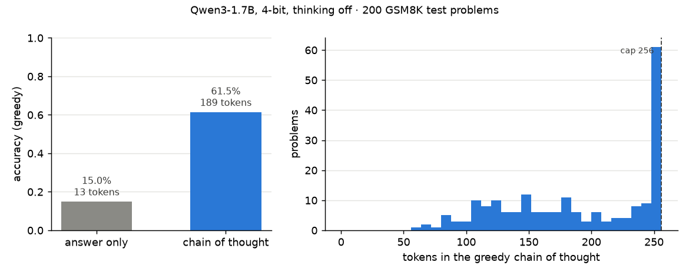
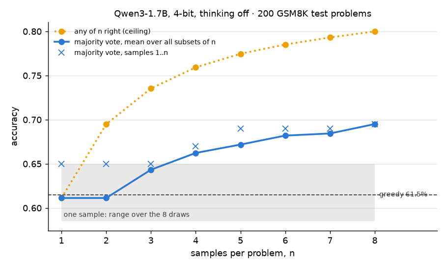
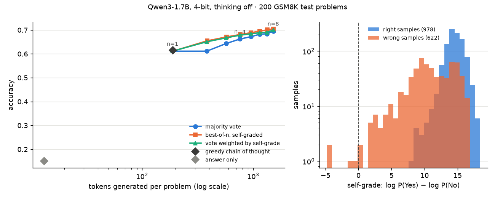

# Module 22: Reasoning at test time

A trained model can still buy accuracy after training, by spending more
tokens on each question. This module measures three ways to spend them, on
the same 200 grade-school maths problems and the same small model:

1. **Chain of thought**: let the model write its steps before the answer, against answer only.
2. **Self-consistency**: sample n answers and keep the most common, for n = 1 to 8.
3. **Best-of-n**: let the model grade its own samples and keep the best one; accuracy against tokens spent.
4. **What o1-style training adds**: one paragraph, no code.

Every number in this README comes from a JSON file in [`results/`](results/),
and every accuracy from a cached generation file in
[`results/generations/`](results/generations/). The analysis never runs the
model; it reads those files.

**Which numbers come from the 4-bit model: all of them.** Every reply, vote
and grade here comes from `mlx-community/Qwen3-1.7B-4bit`: Qwen3-1.7B with its
weights rounded to 4 bits, run on MLX, with thinking mode off. Full-precision
weights, a larger model or thinking mode on would give other numbers. Read
each figure as "what this 4-bit 1.7B model did", not "what Qwen3 does".

This is the first module of track 8, **Using models well**, in reading order.
Read it after [module 20](../20-in-context-learning/README.md); next,
[module 34](../34-prompts-as-parameters/README.md) tunes the prompt of a
frozen model as if it were a weight.

**🕹 Interactive:** [Reasoning at test time](../../explorables/22-reasoning-at-test-time.html):
browse the real replies, eight samples per problem, slide n and watch the
vote and the accuracy curves move.

**✅ Quiz:** [10 questions](../../quizzes/22.html): check yourself once you have read the four sections.

## Goals

By the end you will be able to:

- prompt a chat model with worked examples and read a number out of its reply;
- say what chain of thought buys on a maths benchmark, and what it costs in tokens;
- run self-consistency and read its curve, and say why "any of n right" is its ceiling;
- use a model as its own grader, and say what its grades are worth;
- compare methods at equal tokens rather than at equal n;
- say what reinforcement-learned reasoning adds that sampling at test time cannot.

## Setup

```bash
cd modules/22-reasoning-at-test-time/python
```

```bash
uv sync
```

| Need | Size | Where |
|---|---|---|
| `mlx-community/Qwen3-1.7B-4bit`, revision `3b1b1768` | 923 MB | Hugging Face cache, on the first run of `generate.py` |
| `openai/gsm8k`, config `main`, revision `740312ad`: test and train parquet | 0.4 MB + 2.3 MB | Hugging Face cache, on the first run of `generate.py` |
| The cached generations | 1.4 MB | committed: `results/generations/` |

GSM8K (Cobbe et al., 2021, MIT licence) holds grade-school word problems,
each with a worked solution ending in `#### <number>`. We use the first 200
test problems in file order, and the first 8 training problems as worked
examples. Qwen3-1.7B is Apache-2.0. MLX is Apple's array library; `mlx-lm`
runs language models on it. This module needs an Apple-silicon Mac to
regenerate; the analysis, figures, exercises and tests need no model.

**The laptop guard.** MLX has no memory cap like torch's MPS watermark, so
the scripts only measure: wall time, peak process RSS, and MLX's own peak
Metal memory (`mx.get_peak_memory`). Generation runs in chunks of at most
five minutes, each picking up where its file stops:

| Script | Minutes | Peak RSS | Peak Metal |
|---|---|---|---|
| `src/generate.py`, all four stages, 11 chunks | 31.9 in all, longest chunk 4.6 | 1.70 GB | 3.95 GB (sampling, 8 replies at once) |
| `src/analyse.py` | under 0.1 | 0.03 GB | 0 |
| `src/device_check.py` | 3.87 | 1.71 GB | 1.21 GB |

From `results/analysis.json` (`generation_log`) and
`results/device_check.json`. The chunk count includes one answer-only run we
threw away (section 1 says why). Measured on an Apple M5 with 16 GB, MLX
0.32.4, mlx-lm 0.32.2.

**GPU against CPU.** One forward pass of the first 32 tokens of the first
test problem, the same tokens on MLX's GPU and on its CPU. As the module runs
the model, with bfloat16 activations, the logits differ by up to 9.3 (mean
1.08; they span −20 to 36.8), and the top-1 token agrees at 17 of 32
positions. Cast to float32, with the same 4-bit weights, the two devices
agree to 0.06 and at all 32 positions. The GPU's bfloat16 run stays within
0.85 of its float32 run, again at all 32 positions; the CPU's bfloat16 run
is the one that drifts (9.3 from its own float32 run). The cause is MLX's
CPU kernel for the 4-bit matrix product: on one layer its error in bfloat16
equals, to five decimals, that of a numpy product that rounds each step of
the running sum to bfloat16 (0.352, against 0.043 for the GPU kernel). That
kernel is also slow: the CPU pass in bfloat16 takes almost four minutes for
32 tokens. Every number in this module comes from the GPU path. In
`results/device_check.json`.

**Reproducing.** `generate.py` is deterministic for greedy decoding: we
deleted the last 5 answer-only and the last 3 greedy replies, ran it again,
and got the same bytes. Samples repeat given the same MLX version, since each
problem's batch of 8 has its own seed.

## The prompt

Every condition shows the model the same 8 worked examples, as chat turns:

```
user:      Question: Natalia sold clips to 48 of her friends in April, and then she sold half as many clips in May. ...
assistant: Natalia sold 48/2 = 24 clips in May.
           Natalia sold 48+24 = 72 clips altogether in April and May.
           The answer is 72.
...        (7 more)
user:      Question: <the test problem>
assistant: <think>

           </think>

```

Qwen3 can write a reasoning block, which chat apps fold away, between
`<think>` and `</think>` before it answers. We turn that off: `apply_chat_template(...,
enable_thinking=False)` closes the block empty, so all reasoning in this
module is in plain sight. The examples run through the model once; every
problem reuses their keys and values (module 07's KV cache).

**Reading the answer.** `gsm8k.extract` takes the number after the last
"the answer is"; if there is none, the last number in the reply. We wrote
50 replies by hand, with the answer each must give, before any generation
ran; all 50 pass (`tests/test_extract.py`). The model mostly ignores the
examples' format: only 8 of 200 greedy replies put a number after "answer
is", so the scores rest on the last-number branch. The rest
end in markdown, "**Answer:** $18" or "\boxed{4}", which the last-number
branch reads. A looser check we wrote after reading the replies (the first
number after the last word "answer") disagrees with the rule on 1 finished
greedy reply, where both readings are wrong; over the 1,600 samples it would
turn 3 wrong into right and 1 right into wrong.

## 1 · Chain of thought

Two greedy conditions (always the most likely token):

- **answer only**: the examples end in "The answer is 72." with no steps;
- **chain of thought**: the examples show their steps; the reply may run to 256 tokens.

The answer-only examples were not enough: in a first run all 200 replies
began to reason anyway ("Let's break down the problem…") and ran out of
their 16 tokens. So the answer-only reply now starts with "The answer is",
written by us, and the model only fills in the number.



| Condition | Accuracy | Tokens written per problem |
|---|---|---|
| Answer only, reply starts "The answer is" | 15.0% | 13 |
| Chain of thought, greedy | **61.5%** | 189 |

Chain of thought is right on 99 problems where answer only is wrong, and
wrong on 6 where answer only is right. The steps are where a model this size
does its arithmetic: forced to name a number first, it has nowhere to work.

**The cap.** The model writes long markdown (headers, bold, LaTeX), so 57 of
the 200 greedy replies hit the 256-token cap mid-solution (the spike in the
right panel). Finished replies are right 116 times out of 143 (81%); cut ones
7 out of 57, when the last number written happens to be the answer. We fixed
the cap before the run and kept it; a larger cap would likely raise every
accuracy in this module.

## 2 · Self-consistency

Wang et al. (2022), [Self-Consistency Improves Chain of Thought
Reasoning](https://arxiv.org/abs/2203.11171): sample several chains at a
temperature above 0, read each one's answer, keep the most common. Different
wrong chains tend to end at different wrong numbers, while right chains
agree.

Each problem got 8 samples at temperature 0.7, with the same prompt. A reply
with no number does not vote; a tie goes to the answer that appeared first.
Which n samples you vote over changes the result, so the curve averages over
all C(8, n) ways to pick them.



| n | 1 | 2 | 3 | 4 | 5 | 6 | 7 | 8 |
|---|---|---|---|---|---|---|---|---|
| Majority vote, mean over subsets | 61.1% | 61.1% | 64.3% | 66.2% | 67.2% | 68.2% | 68.4% | 69.5% |
| Any of the n right (ceiling) | 61.1% | 69.5% | 73.5% | 75.9% | 77.5% | 78.5% | 79.3% | 80.0% |

Greedy scores 61.5%. One sample at temperature 0.7 scores 61.1% on average,
with the 8 draws ranging from 58.5% to 65.0%: sampling alone costs little
here. Two samples vote no better than one, because a 1–1 tie goes to the
first. From three on the gains shrink, though not evenly: +3.2 points from 2
to 3, +1.9 from 3 to 4, then about one point or less per sample (+0.2 from 6
to 7, +1.1 from 7 to 8).

**A test fixed before the run.** We wrote down, before any generation, that a
vote over the first 5 samples should beat greedy by 3 to 10 points. It scores
69.0% against 61.5%: +7.5 points. Of the 27 problems where they differ, the
vote wins 21 and loses 6 (exact sign test, p = 0.006). That is one model,
200 problems and one seed per problem, and the 256-token cap cuts 57 greedy
replies and 465 of the 1,600 samples mid-solution, which likely holds both
numbers down; it says the gain is real for this setup, not how large it is
elsewhere.

**The ceiling.** A vote can only pick an answer some sample gave. On 80% of
problems at least one of the 8 samples is right; the vote finds 69.5%. The
gap, 10.5 points, is right answers that lost the vote. On the other 20%, no
amount of voting helps. Brown et al. (2024) call this ceiling **coverage**:
over four orders of magnitude of samples it kept growing, while majority
votes and reward models levelled off.

**Agreement as confidence.** The share of samples behind the winning answer
says how far to trust it:

| Largest group among the 8 | Problems | Vote right |
|---|---|---|
| all 8 agree | 83 | 81 |
| 6 or 7 | 34 | 26 |
| 4 or 5 | 33 | 19 |
| 3 or fewer | 50 | 13 |

## 3 · Best-of-n with the model as its own grader

A **verifier** scores each sample, and best-of-n keeps the top one. Strong
results use a separate trained verifier (Cobbe et al., 2021) or a reward
model that grades each step (Lightman et al., 2023). We use a cheap kind:
the same model, asked in a fresh chat whether a sample is correct. A cheaper
signal needs no second prompt at all: the model's own token probabilities
while it writes the sample (Kang et al., 2025; Fu et al., 2025). Our cached
samples do not store them, so this module cannot test it.

```
Here is a math word problem and a proposed solution.
Problem: ...
Proposed solution: <the sample>
Is the proposed solution correct, including its final answer? Reply with only Yes or No.
```

We read no reply; we read the next-token probabilities of "Yes" and "No" and
take the **log-odds**, log P(Yes) − log P(No): how many times likelier Yes
is than No, on a log scale. (P(Yes) / (P(Yes) + P(No)) gives
the same order, but rounds to 1.0 for 602 of the 1,600 samples.)

The grader says Yes to almost everything: "Yes" is its top token for 1,587
samples, "No" for 4. As a judge it is useless. As a ranking it holds some
signal: right samples get a median log-odds of 14.6, wrong ones 10.9, and a
random right sample outranks a random wrong one 82% of the time. That share is
the **AUC** (area under the ROC curve): 0.5 is chance, 1 a perfect ranking;
here 0.82.



| n | 1 | 2 | 4 | 8 |
|---|---|---|---|---|
| Majority vote | 61.1% | 61.1% | 66.2% | 69.5% |
| Best-of-n, self-graded | 61.1% | 65.4% | 68.1% | 70.5% |
| Vote weighted by P(Yes) / (P(Yes) + P(No)) | 61.1% | 65.1% | 67.8% | 70.0% |
| Tokens written per problem, samples 1 to n | 188 | 382 | 762 | 1,517 |

All three accuracies averaged over every subset of n. Best-of-n leads the plain vote at
every n from 2, by 4.3 points at n = 2 and 1.0 at n = 8. At n = 2 it breaks
the vote's ties with the grade. The weighted vote sits between the two.

**Counting tokens.** The left panel puts every method on one axis: tokens the
model writes per problem. Chain of thought costs about 14 times answer only
and adds 46.5 points. The next ×8 in tokens, from one chain to eight, adds
about 8. Best-of-n also makes the model read each sample once more to grade
it, about 298 tokens per sample; reading is cheaper than writing, since the
model processes a prompt in one pass, but it is not free, and the left panel
leaves it out.

**What this shows, and what it does not.** On this model and these 200
problems, more tokens at test time bought accuracy, with returns that fall as
n grows. It does not show the ordering of the three methods holds elsewhere:
the gaps between vote, weighted vote and best-of-n at n = 8 are 0.5 to 1
point, 1 to 2 problems of 200. A self-grader whose top token is "Yes" for
1,587 of 1,600 samples (and which puts Yes above No for 1,596) would mislead
anyone who read its answer instead of its probabilities.

## 4 · What o1-style training adds

Everything above leaves the weights alone: the model reasons the way
pre-training and instruction tuning left it, and we sample around that.
Reasoning models train the reasoning itself. DeepSeek-R1 (2025) publishes its
recipe: the model writes long chains, a rule checks the final answer (right or
wrong, as our regex does) and that the reasoning sits between think tags, and
reinforcement learning makes chains that end right more likely (module 24
builds reinforcement learning from scratch; module 17 covers learning from
preferences). In R1-Zero, the version trained by reinforcement learning alone,
the chains grow longer during training and start to revisit earlier steps,
though no reward or prompt asks for either. R1 itself adds a few thousand
written examples before that training. It then fine-tunes the base model
afresh on about 800,000 examples, three in four of them chains its trained
model wrote and kept because they ended right, and adds preference rewards in
a last round of reinforcement learning. OpenAI describes o1 (2024) as trained
with large-scale reinforcement learning, and gives few details.

How much such training adds is debated. Yue et al. (2025) find that a model
trained this way solves more problems in one try, yet its untrained base
solves more when allowed many tries: pass@k at large k, the "any of n right"
ceiling of section 2. On that reading the training mostly makes the base
model's good chains more likely rather than teaching new ones. Liu et al.
(2025) find the self-checking already present in the base model before
training, and longer chains partly an artefact of the training rule. Shao et
al. (2025) lift a Qwen2.5 math model by 21.4 points on MATH-500 with random
rewards, against 29.1 with true ones; other model families did not gain this
way, and this module uses a Qwen model. Nor is a written chain always what
drove the answer (Chen et al., 2025). Qwen3's thinking mode, which we turned
off, comes from such training in its larger models; its report says the small
ones, 1.7B among them, learned it by distillation from the large. The two
combine: a model trained to reason can still gain from votes and verifiers.

## Run it

Rebuild every number and figure from the cached generations, with no model:

```bash
uv run python src/analyse.py --figures
```

Redraw the figures, or rewrite the explorable's data block:

```bash
uv run python src/figures.py
```

```bash
uv run python src/export_explorable.py
```

Regenerate the replies (about 32 minutes of generation in chunks; delete a
stage's file first to start it over, and run each stage until it prints
`"remaining": 0`):

```bash
uv run python src/generate.py direct
```

```bash
uv run python src/generate.py greedy
```

```bash
uv run python src/generate.py sample
```

```bash
uv run python src/generate.py verify
```

The GPU-against-CPU check:

```bash
uv run python src/device_check.py
```

## Exercises

Skeletons with `# TODO(you):` live in [`exercises/`](exercises/); reference
solutions are in [`solutions/`](solutions/). Each asks you to predict before
you run, and none needs the model: they read the committed results.

- **(a) `exercise_a_extract.py`**: write the answer reader. The test runs it
  on the 50 hand-written replies and on all 1,800 cached replies, against
  `src/gsm8k.py`.
- **(b) `exercise_b_vote.py`**: write the vote with its tie rule, and its
  accuracy averaged over every subset of n samples. The test checks your
  curve against `results/analysis.json`.
- **(c) `exercise_c_best_of_n.py`**: write best-of-n and the weighted vote
  from the cached grades. Predict first which one beats the plain vote at
  n = 8.

## Tests

```bash
uv run pytest
```

64 tests, under a second, no model. They check the answer reader on the 50
known replies, the solutions against `src/`, `results/analysis.json` against
a fresh pass over the cached generations, the laptop budget, and the
explorable against the results.

## To go further

- Turn thinking mode on (`enable_thinking=True`) and raise the cap: the
  replies get much longer, and the accuracy should move. Keep each chunk
  under five minutes.
- Swap the grader for a separate model, or ask it to grade step by step.
- Budget forcing (s1, Muennighoff et al., 2025): with thinking on, cut the
  block off at a fixed length, or append "Wait" when the model tries to stop,
  and watch accuracy against tokens.
- Run the same pipeline on `mlx-community/Qwen3-4B-Instruct-2507-4bit`, to
  see whether the vote gains less on a stronger model.

## Checkpoint: you should now be able to…

- say why answer-only accuracy is so low for a small model, and what chain of thought costs;
- read a self-consistency curve and its ceiling, and say why n = 2 adds nothing under our tie rule;
- say why a grader that answers Yes to everything can still rank samples;
- compare test-time methods at equal tokens;
- say what a fixed token cap does to a chatty model's score;
- say what reinforcement-learned reasoning changes that sampling cannot, and why how much it adds is debated.

## Links

- Cobbe et al., [Training Verifiers to Solve Math Word Problems](https://arxiv.org/abs/2110.14168) (2021), GSM8K and best-of-n with a trained verifier
- Wei et al., [Chain-of-Thought Prompting Elicits Reasoning in Large Language Models](https://arxiv.org/abs/2201.11903) (2022)
- Wang et al., [Self-Consistency Improves Chain of Thought Reasoning in Language Models](https://arxiv.org/abs/2203.11171) (2022)
- Lightman et al., [Let's Verify Step by Step](https://arxiv.org/abs/2305.20050) (2023)
- Snell et al., [Scaling LLM Test-Time Compute Optimally can be More Effective than Scaling Model Parameters](https://arxiv.org/abs/2408.03314) (2024)
- OpenAI, [Learning to Reason with LLMs](https://openai.com/index/learning-to-reason-with-llms/) (2024)
- DeepSeek-AI, [DeepSeek-R1](https://arxiv.org/abs/2501.12948) (2025)
- Brown et al., [Large Language Monkeys: Scaling Inference Compute with Repeated Sampling](https://arxiv.org/abs/2407.21787) (2024)
- Kang et al., [Scalable Best-of-N Selection for Large Language Models via Self-Certainty](https://arxiv.org/abs/2502.18581) (2025)
- Fu et al., [Deep Think with Confidence](https://arxiv.org/abs/2508.15260) (2025)
- Muennighoff et al., [s1: Simple test-time scaling](https://arxiv.org/abs/2501.19393) (2025)
- Yue et al., [Does Reinforcement Learning Really Incentivize Reasoning Capacity in LLMs Beyond the Base Model?](https://arxiv.org/abs/2504.13837) (2025)
- Liu et al., [Understanding R1-Zero-Like Training: A Critical Perspective](https://arxiv.org/abs/2503.20783) (2025)
- Shao et al., [Spurious Rewards: Rethinking Training Signals in RLVR](https://arxiv.org/abs/2506.10947) (2025)
- Chen et al., [Reasoning Models Don't Always Say What They Think](https://arxiv.org/abs/2505.05410) (2025)
- Qwen Team, [Qwen3 Technical Report](https://arxiv.org/abs/2505.09388) (2025)
- [openai/gsm8k](https://huggingface.co/datasets/openai/gsm8k) · [mlx-community/Qwen3-1.7B-4bit](https://huggingface.co/mlx-community/Qwen3-1.7B-4bit) · [mlx-lm](https://github.com/ml-explore/mlx-lm)
