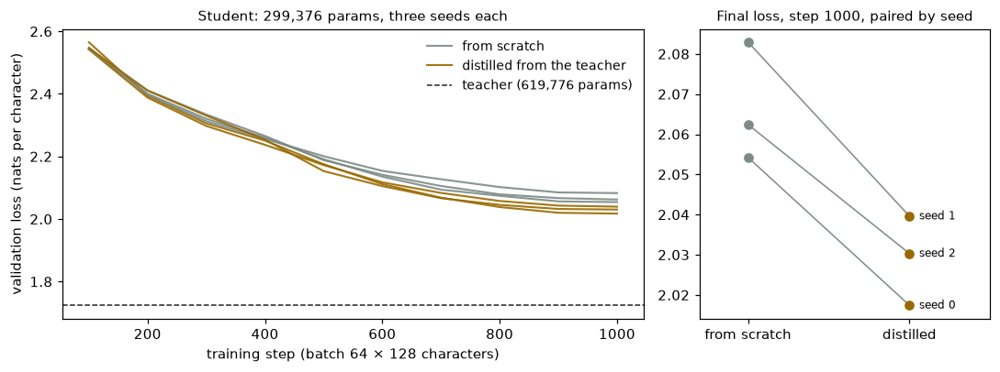
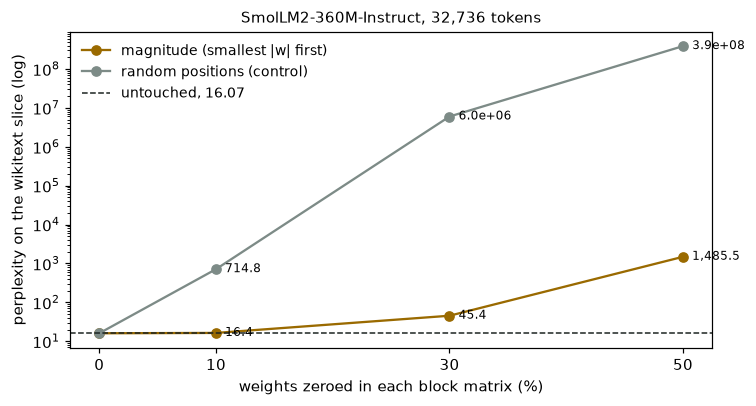
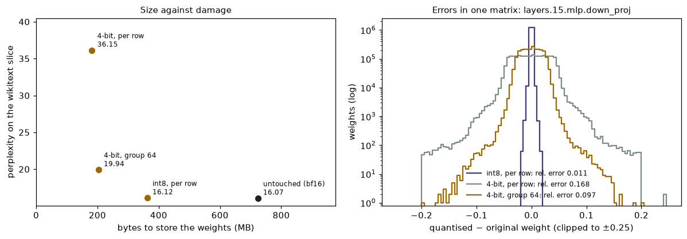
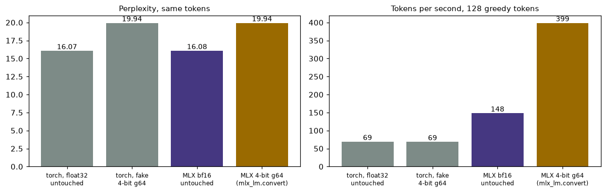

# Module 23: Compression

A trained model is a pile of numbers. This module makes the pile smaller in
three ways and measures what each costs. It has four sections, each with a
figure and the numbers beside it:

1. **Distillation**: train a half-size copy of module 04's char-GPT, once from scratch and once from the teacher's outputs.
2. **Magnitude pruning**: zero 10, 30 and 50% of SmolLM2-360M-Instruct's weights, smallest first.
3. **Quantisation by hand**: store the same model's weights in 8 and 4 bits.
4. **The library way**: MLX's own 4-bit copy of the model, its perplexity and speed beside the hand version.

Every number in this README comes from a JSON file in [`results/`](results/),
written by the script that measured it. In every table, row one is the
untouched model.

This is the third module of track 8, **Using models well**. Next,
[module 28](../28-fewer-bits-trained-in/README.md) trains the bits in instead
of rounding afterwards, and rounds the KV cache.

**🕹 Interactive:** [Compression](../../explorables/23-compression.html):
quantise a block of SmolLM2's real weights at the bits and group size you
pick and watch the error histogram; see which weights pruning removes; replay
the distillation curves.

**✅ Quiz:** [10 questions](../../quizzes/23.html): check yourself once you have run the four scripts.

## Goals

By the end you will be able to:

- write the distillation loss and say what the temperature does;
- prune a model by magnitude, and say why a random control belongs beside it;
- quantise a weight matrix to int8 per row and to 4 bits per group, and count the bytes;
- say what "fake" quantisation measures and what it cannot;
- quantise a model with `mlx_lm.convert` and check its weights against your own rule;
- measure perplexity the same way across two frameworks.

## Setup

```bash
cd modules/23-compression/python
```

```bash
uv sync
```

| Need | Size | Where |
|---|---|---|
| Module 04's trained char-GPT | 2.5 MB | committed: `../04-attention-transformer/artifacts/` |
| SmolLM2-360M-Instruct | ~700 MB | Hugging Face cache; module 05 already fetched it |
| `mlx-community/SmolLM2-360M-Instruct` (bf16, MLX layout) | 724 MB | Hugging Face cache, on first run of `mlx_way.py` |
| wikitext-103, first 2 row groups | 0.37 MB read from a 157 MB file | `~/.cache/huggingface/mlcourse/`; modules 11 and 12 already fetched it |
| The 4-bit copy | 204 MB | written by `mlx_way.py` into `~/.cache/huggingface/mlcourse/` |

The cached MLX copy is **not** quantised: it holds the same bf16 weights as
the Hugging Face checkpoint, tensor for tensor (we checked all 290), and its
tokenizer gives the same 144,610 ids on our text (`results/mlx_way.json`,
`mlx_copy_vs_hf`). So `mlx_way.py` makes the
4-bit copy itself, with mlx-lm's own `convert`, once. That step tries to copy
the repo's model card, which the cache does not hold; the script skips the
card so the conversion runs offline.

**The laptop guard.** Every script imports `src/common.py` before torch. It sets
`PYTORCH_MPS_HIGH_WATERMARK_RATIO=0.5` and `PYTORCH_MPS_LOW_WATERMARK_RATIO=0.4`:
the Apple GPU may take at most 5.92 GB on this 16 GB Mac, and a run that grows
past that stops with an error instead of pushing the Mac into swap. Each script
logs its time and peak memory into its results file:

| Script | Minutes | Peak RSS | Peak MPS driver |
|---|---|---|---|
| `src/distil.py` | 3.19 | 0.50 GB | 1.03 GB |
| `src/prune.py` | 1.34 | 2.44 GB | 3.53 GB |
| `src/quant.py` | 1.01 | 2.44 GB | 4.61 GB |
| `src/mlx_way.py` | 0.20 | 2.66 GB | 0 (MLX's own peak: 2.03 GB) |

Measured on an Apple M5 with 16 GB, torch 2.14.1, MLX 0.32.4, mlx-lm 0.32.2,
while other jobs shared the machine. `mlx_way.py`'s time leaves out the
conversion, which ran in an earlier run.

**Seeds.** Every script calls `seed_all(0)` (Python, NumPy, torch). Section 1
seeds each student's initial weights and its batches; section 2's random
control draws from `torch.Generator().manual_seed(0)`. Generation is greedy
everywhere.

**MPS against CPU.** One SmolLM2 forward pass on the first 256 tokens of the
wikitext slice, on the CPU and then on MPS: max abs difference in logits
1.2 × 10⁻⁴ (logits span −28.0 to 26.9), same top-1 token at every position.
In `results/prune.json`, `mps_vs_cpu`.

**One measure for sections 2 to 4.** Perplexity is exp of the mean
next-token loss. Our text: the wikitext slice, tokenized once with the
Hugging Face tokenizer, cut into 32 windows of 1,024 tokens that do not
overlap. Each window predicts 1,023 tokens, so every perplexity below counts
the same 32,736 tokens. MLX gets the same token ids. SmolLM2 was trained on
web text that may include Wikipedia, so read these as numbers to compare with
each other, not as a test of the model.

## 1 · Distillation

A big model's output carries more than its top answer. After `window b`, module
04's model gives `e` 0.48, `y` 0.12, `u` 0.11 (exercise (a) prints these). A
one-hot label says only "`e`".
**Distillation** (Hinton et al., [Distilling the Knowledge in a Neural
Network](https://arxiv.org/abs/1503.02531), 2015) trains a small student to
match the teacher's whole distribution:

```
p_T  = softmax(logits / T)                       # T > 1 flattens the distribution
loss = (1 − α) · CE(student, next char)  +  α · T² · KL(teacher_T ‖ student_T)
```

The T² keeps the soft term's gradient on the same scale as the CE term's. We
use T = 2 and α = 0.5.

The teacher is module 04's char-GPT (3 layers, width 128, 619,776
parameters, validation loss 1.724). The student is the same design at width
88: 299,376 parameters, 48% of the teacher. `src/distil.py` trains two
students per seed. Both start from the same weights and see the same 1,000
batches of 64 × 128 characters, with the same AdamW and cosine schedule; only
the loss differs. Three seeds. Every loss below is plain next-character
cross-entropy on module 04's validation split (111,539 characters), which
neither the teacher nor the students trained on.



| Model | Parameters | Seed 0 | Seed 1 | Seed 2 | Mean |
|---|---|---|---|---|---|
| Teacher (module 04, 5,000 steps) | 619,776 | | | | 1.724 |
| Student, from scratch | 299,376 | 2.054 | 2.083 | 2.062 | 2.066 |
| Student, distilled | 299,376 | 2.017 | 2.040 | 2.030 | 2.029 |
| Gap, scratch − distilled | | 0.037 | 0.043 | 0.032 | 0.037 |

On each of the three seeds the distilled student ends lower, by 0.032 to
0.043 nats. The spread between seeds for one kind of student is about as
large (0.029 from scratch), so the gap is only clear because the runs are
paired: same start, same batches. Both students stay far above the teacher;
1,000 steps at half the width do not get close.

**What this shows, and what it does not.** One teacher, one student size, one
T and α, 1,000 steps. We did not tune T or α, nor try longer training, where
the gap may grow or shrink. It is a demo of the method, not a measurement of
how much distillation helps.

## 2 · Magnitude pruning

**Pruning** sets weights to zero. The plainest rule: the weights with the
smallest |w| matter least, so drop them first. `src/prune.py` applies it to
SmolLM2-360M-Instruct, in float32 on MPS. In each of the 224 attention and MLP
matrices of the 32 blocks (q, k, v, o, gate, up, down), it zeroes the given
share of weights with the smallest |w|. Each matrix loses the same share; the
embedding (which is also the output layer) and the norms stay. A control
zeroes the same number of weights per matrix at random positions.



| Weights zeroed per matrix | Share of all parameters | Perplexity, smallest \|w\| first | Perplexity, random |
|---|---|---|---|
| 0% (untouched) | 0% | 16.07 | 16.07 |
| 10% | 8.7% | 16.41 | 714.8 |
| 30% | 26.1% | 45.40 | 6.0 × 10⁶ |
| 50% | 43.5% | 1,485.5 | 3.9 × 10⁸ |

Each setting also answered "Explain in two sentences why the sky is blue."
(40 greedy tokens):

| Setting | Reply (cut) |
|---|---|
| untouched | The sky is blue because of a phenomenon known as Rayleigh scattering, which occurs when sunlight enters Earth's atmosphere … |
| 10%, by magnitude | the same 40 tokens as untouched |
| 30%, by magnitude | The sky is blue because of a phenomenon called Rayleigh scattering, which occurs when sunlight passes through Earth's atmosphere. As sunlight travels from the blue and violet parts of the visible spectrum, it is bent |
| 50%, by magnitude | `i` / `of.--------in-in-` / `ing` … |
| 10%, at random | Up! Up! Up! Up!Up! Up! Up is the up! … |

At 10%, magnitude pruning costs 0.34 in perplexity and leaves the reply
unchanged, word for word; random pruning at 10% breaks the model. At 30% the perplexity has
nearly tripled, yet the reply still reads well, though by eye its second
sentence drifts ("it is bent"). At 50% the model writes noise.

Zeroed weights save nothing on their own: the matrices keep their shape and
their bytes. A gain needs a sparse format or hardware that skips zeros, such
as the 2:4 pattern (two zeros in every four weights) that recent NVIDIA GPUs
run fast. Published methods that prune large models to 50% with little loss,
such as [SparseGPT](https://arxiv.org/abs/2301.00774) (2023) and
[Wanda](https://arxiv.org/abs/2306.11695) (2023), also look at the inputs a
weight sees, not just its size; and most pruning recipes train after
pruning. This section does neither.

## 3 · Quantisation by hand

**Quantisation** stores each weight in fewer bits. Module 07 did int8 on the
tiny GPT, in Zig. Here, three rules from `src/compress.py`, applied to every
2-D weight of SmolLM2-360M-Instruct: the 224 block matrices and the
embedding (361,758,720 weights; the 62,400 norm weights stay in bf16):

```
int8, per row      s = max|w| / 127 per row;          q = round(w / s) in −127..127;  w' = q · s
4-bit, affine      per group: s, b from the group's range; q = round((w − b) / s) in 0..15;  w' = q · s + b
```

A **group** is a run of neighbouring weights in one row that share one scale
s (and, for affine, one bias b). "Per row" means one group per row: 960 or
2,560 weights. "Group 64" means a scale and a bias for every 64 weights, each
stored in 16 bits, so 4 + 32/64 = 4.5 bits per weight. The affine rule is
MLX's: it anchors the grid on whichever end of the range has the larger |w|
and nudges s so that zero falls exactly on a level. Two details of MLX's
kernel matter for an exact copy: its running maximum starts at 0, and it
rounds halves away from zero (`torch.round` sends them to the even neighbour).
On SmolLM2 only the rounding changes any weight: no group of 64 is all
negative, so the first detail never fires here. Putting zero exactly on a
level costs a little: on the tiny GPT's `blocks[1].mlp.fc.weight` in
exercise (c), at 4 bits with groups of 64, plain min/max errs 0.0905 and
MLX's rule 0.0921.

`src/quant.py` puts the rebuilt weights w' back into the float32 model and
measures it. This is **fake quantisation**: it measures the damage rounding
does, not speed or memory. The bytes are what storing the integers, scales
and biases would take.



| Scheme | Perplexity | Bytes | Bits per weight | Mean relative error per matrix |
|---|---|---|---|---|
| untouched (bf16 checkpoint, run in float32) | 16.07 | 723.6 MB | 16 | 0 |
| int8, per row | 16.12 | 362.5 MB | 8.01 | 0.0093 |
| 4-bit, per row | 36.15 | 182.3 MB | 4.03 | 0.1419 |
| 4-bit, group 64 | 19.94 | 203.6 MB | 4.5 | 0.0948 |

Relative error is ‖w' − w‖ / ‖w‖ for one matrix, averaged over the 225.

- int8 halves the bytes and moves the perplexity by 0.04.
- 4-bit per row more than doubles the perplexity. One scale must cover a
  whole row; the right panel shows one matrix (layer 15's `down_proj`, rows of
  2,560 weights) whose largest weight is 3.98, against a spread (standard
  deviation) of 0.18. That stretches the 16 levels and leaves few for the
  weights near zero.
- Groups of 64 cost 21 MB more and bring the perplexity back to 19.94. It is
  still 24% above the untouched 16.07. Small models trained on many tokens
  for their size, like this one, lose more at low bits than large or lightly
  trained ones (Ouyang et al.,
  [arXiv:2411.17691](https://arxiv.org/abs/2411.17691), 2024).

This section rounds weights only. The KV cache and the activations can be
rounded too, and for long contexts on a laptop they matter as much; module
07 measured what the cache costs.

## 4 · The library way: MLX

[MLX](https://github.com/ml-explore/mlx) is Apple's array framework, and
[mlx-lm](https://github.com/ml-explore/mlx-lm) runs language models with it.
One command quantises a model:

```python
from mlx_lm import convert, load
convert("mlx-community/SmolLM2-360M-Instruct", mlx_path=out, quantize=True, q_group_size=64, q_bits=4)
model, tokenizer = load(out)
```

Unlike our fake version, MLX keeps the 4-bit integers in memory and
multiplies with them directly (`mx.quantized_matmul`). `src/mlx_way.py`
measures the bf16 MLX copy and the 4-bit one the same way as sections 2 and 3:
the same 32,736 tokens and loss for perplexity; for speed, the same chat
prompt ids, 128 greedy tokens with the end-of-text token blocked, a warm-up,
then the median of three runs. Section 3 timed the torch model with the same
prompt.



| Setting | Perplexity | Tokens per second |
|---|---|---|
| torch, float32, untouched | 16.07 | 69.3 |
| torch, 4-bit group 64 by hand (fake) | 19.94 | 68.7 |
| MLX, bf16, untouched | 16.08 | 148.3 |
| MLX, 4-bit group 64 (`mlx_lm.convert`) | 19.94 | 398.9 |

**Known-answer check.** For each of the 225 quantised matrices, we
dequantised MLX's stored weights and compared them with our rule run on the
Hugging Face checkpoint, both in bf16: all 225 are bit-identical. The two
4-bit perplexities differ by 0.007 (19.936 by hand, 19.943 in MLX), and the
untouched rows by 0.012 (16.071 against 16.083). MLX computes its activations
in bf16, our hand version in float32, which would explain gaps this small. The
4-bit file is 203.7 MB; our count for the same integers, scales, biases and
norms is 203.6 MB, 81,682 bytes less: the file's headers and names.

**Speed.** The hand version runs no faster than the untouched model, since it
puts float32 weights back. MLX's 4-bit model generates 2.7 times as fast as
its bf16 one. Producing one token reads every weight once; at a batch of one,
reading weights from memory is usually what limits the speed, which would
explain the gain. We did not time the parts separately.
The torch rows run float32 through a different framework, so the factor
between torch and MLX says little about quantisation. All speeds come from one
laptop shared with other jobs; read them as rough.

## Run it

Each script prints its numbers, writes `results/<name>.json`, and with
`--figures` redraws its figure. `mlx_way.py` reads `results/quant.json`, so
run `quant.py` first.

```bash
uv run python src/distil.py --figures
```

```bash
uv run python src/prune.py --figures
```

```bash
uv run python src/quant.py --figures
```

```bash
uv run python src/mlx_way.py --figures
```

Redraw every figure from the committed JSON, with no model loaded:

```bash
uv run python src/figures.py
```

Rewrite the explorable's data block from the JSON:

```bash
uv run python src/export_explorable.py
```

## Exercises

Skeletons with `# TODO(you):` live in [`exercises/`](exercises/); reference
solutions are in [`solutions/`](solutions/). Each asks you to predict before
you run, and each runs on the CPU in seconds.

- **(a) `exercise_a_distil_loss.py`**: write the softened distribution and the
  distillation loss; see what T does to the teacher's guess after `window b`.
  The test checks your loss against `src/distil.py`.
- **(b) `exercise_b_prune_tiny.py`**: write the magnitude mask, then prune
  module 04's char-GPT from 0 to 90%, by magnitude and at random. The test
  checks your mask against `src/compress.py`.
- **(c) `exercise_c_group_quant.py`**: write plain min/max group quantisation
  and count bits per weight; compare group sizes 16 to 128 at 3 and 4 bits.
  The test checks the error bound and the level count.

## Tests

```bash
uv run pytest
```

Fourteen tests, under 5 seconds. They check the solutions against the
scripts, the hand 4-bit rule against `mx.quantize` bit for bit, the committed
results against the laptop budget, and the explorable against the results.

## To go further

- [GPTQ](https://arxiv.org/abs/2210.17323) (2022) and
  [AWQ](https://arxiv.org/abs/2306.00978) (2023) quantise to 4 bits with less
  loss than rounding each weight on its own: GPTQ corrects the error as it
  goes, column by column; AWQ protects the weights that meet large inputs.
- [LLM.int8()](https://arxiv.org/abs/2208.07339) (2022) keeps a few outlier
  features in 16 bits so that int8 works on large models.
- [QLoRA](https://arxiv.org/abs/2305.14314) (2023) fine-tunes adapters on top
  of a 4-bit model; module 06 trained LoRA adapters.
- [DistilBERT](https://arxiv.org/abs/1910.01108) (2019) distilled BERT into a
  model 40% smaller; module 05's sentiment model is a fine-tuned DistilBERT.
- [QuaRot](https://arxiv.org/abs/2404.00456) (2024) and
  [SpinQuant](https://arxiv.org/abs/2405.16406) (2024) rotate the weights
  and activations before rounding, so that no single value, like section 3's 3.98 against a
  spread of 0.18, stretches the levels.
- Microscaling formats ([arXiv:2310.10537](https://arxiv.org/abs/2310.10537),
  2023) give each group of 32 values one shared power-of-two scale, in
  hardware: section 3's groups as a shipped format. gpt-oss stores its
  mixture-of-experts weights in one of them, MXFP4
  ([model card](https://arxiv.org/abs/2508.10925), 2025).
- [BitNet b1.58 2B4T](https://arxiv.org/abs/2504.12285) (2025) takes the
  other road: a 2B model trained from the start with weights of −1, 0 or 1,
  on 4 trillion tokens, not rounded after training.
- [Minitron](https://arxiv.org/abs/2407.14679) (2024) prunes whole widths and
  layers, then distils from the large model. Unlike section 2's zeros, this
  shrinks the matrices, so it saves bytes; it joins sections 1 and 2.
- Section 1 uses the forward KL on fixed training text. LLM practice also
  distils on the student's own samples, often with the reverse KL:
  [GKD](https://arxiv.org/abs/2306.13649) (2023) and
  [MiniLLM](https://arxiv.org/abs/2306.08543) (2023).
- The [Hugging Face quantization docs](https://huggingface.co/docs/transformers/quantization)
  list the formats transformers can load.

## Checkpoint: you should now be able to…

- write the distillation loss and say why it carries T²;
- say why a random-pruning control belongs beside magnitude pruning;
- count the bytes of int8 per row and of 4-bit with groups of 64;
- say why groups help 4-bit, and what they cost;
- say what fake quantisation measures and what it cannot;
- check a library's quantised weights against your own rule.

## Links

- Hinton, Vinyals, Dean, [Distilling the Knowledge in a Neural Network](https://arxiv.org/abs/1503.02531) (2015)
- Han et al., [Learning both Weights and Connections for Efficient Neural Networks](https://arxiv.org/abs/1506.02626) (2015), magnitude pruning
- Frantar and Alistarh, [SparseGPT](https://arxiv.org/abs/2301.00774) (2023) · Sun et al., [Wanda](https://arxiv.org/abs/2306.11695) (2023)
- Frantar et al., [GPTQ](https://arxiv.org/abs/2210.17323) (2022) · Lin et al., [AWQ](https://arxiv.org/abs/2306.00978) (2023)
- Dettmers et al., [LLM.int8()](https://arxiv.org/abs/2208.07339) (2022) · [QLoRA](https://arxiv.org/abs/2305.14314) (2023)
- Ouyang et al., [Low-Bit Quantization Favors Undertrained LLMs](https://arxiv.org/abs/2411.17691) (2024)
- Ashkboos et al., [QuaRot](https://arxiv.org/abs/2404.00456) (2024) · Liu et al., [SpinQuant](https://arxiv.org/abs/2405.16406) (2024)
- Rouhani et al., [Microscaling Data Formats for Deep Learning](https://arxiv.org/abs/2310.10537) (2023) · OpenAI, [gpt-oss-120b & gpt-oss-20b Model Card](https://arxiv.org/abs/2508.10925) (2025)
- Ma et al., [BitNet b1.58 2B4T Technical Report](https://arxiv.org/abs/2504.12285) (2025)
- Muralidharan et al., [Compact Language Models via Pruning and Knowledge Distillation](https://arxiv.org/abs/2407.14679) (2024)
- Agarwal et al., [On-Policy Distillation of Language Models](https://arxiv.org/abs/2306.13649) (2023) · Gu et al., [MiniLLM](https://arxiv.org/abs/2306.08543) (2023)
- [MLX](https://github.com/ml-explore/mlx) · [mlx-lm](https://github.com/ml-explore/mlx-lm) · [SmolLM2-360M-Instruct](https://huggingface.co/HuggingFaceTB/SmolLM2-360M-Instruct)
