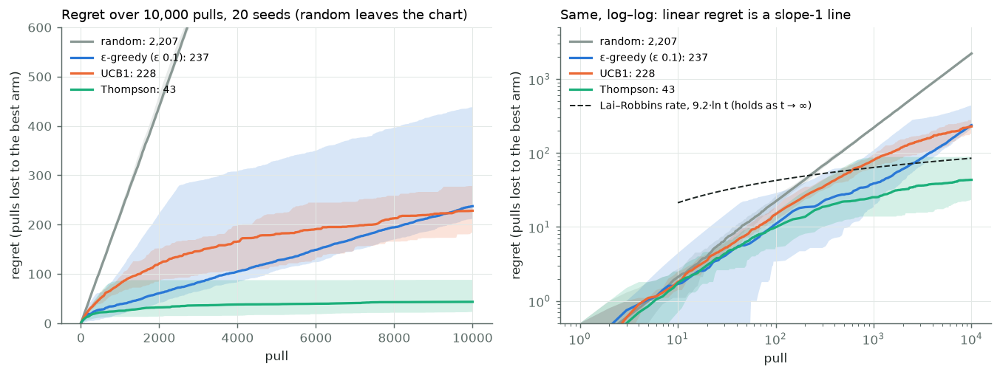
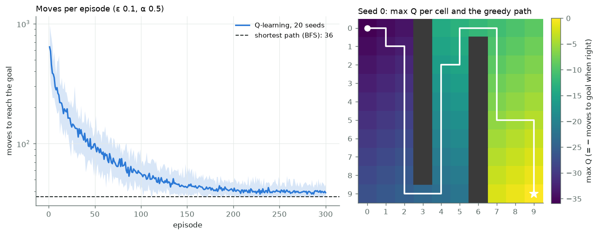
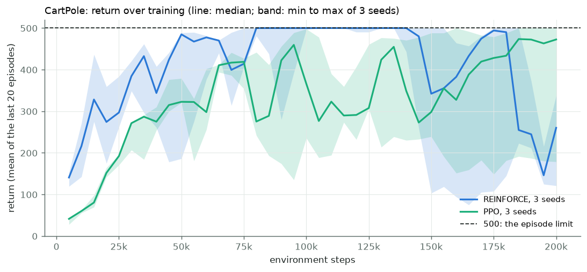
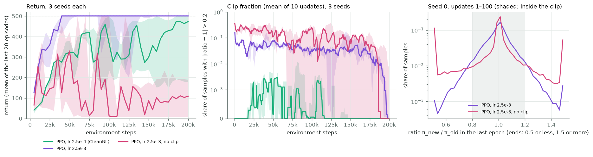

# Module 24: Reinforcement learning

Every module so far learned from examples someone had labelled. Here the
learner acts, and the world answers with a number, the reward. Nobody says
which action was right; the learner must try things and keep what pays. This
module builds four learners from scratch, each a step up from the last, all
on the CPU with no RL library:

1. **Bandits**: one choice, repeated: ε-greedy, UCB1 and Thompson sampling, regret over 10,000 pulls, 20 seeds.
2. **Tabular Q-learning**: a 10 × 10 grid with walls, moves to the goal over 300 episodes, 20 seeds.
3. **REINFORCE** on CartPole, written by hand from its equations of motion, 3 seeds.
4. **PPO** on the same CartPole, 3 seeds, with its clip shown at work.

Every number in this README comes from a JSON file in [`results/`](results/),
written by the script that measured it.

This is the first module of track 9, **Acting and planning**. Next,
[module 25](../25-world-models-and-planning/README.md) gives the agent a model
of its world and plans in it.

**🕹 Interactive:** [Reinforcement learning](../../explorables/24-reinforcement-learning.html):
play the bandit by hand against the three rules; replay a trained CartPole
episode; browse the training curves and the clip.

**✅ Quiz:** [10 questions](../../quizzes/24.html): check yourself once you have run the scripts.

## Goals

By the end you will be able to:

- say what regret measures, and why exploring forever makes it grow in a straight line;
- write ε-greedy, UCB1 and Thompson sampling for a Bernoulli bandit;
- write the Q-learning update and check a learned value against breadth-first search;
- write CartPole's equations of motion and check one step against a value worked out by hand;
- write REINFORCE: the log-probability of each action, weighted by the return that followed;
- write PPO's clipped objective, and say when the clip removes the gradient;
- read three seeds as a range, not one run as a result.

## Setup

```bash
cd modules/24-reinforcement-learning/python
```

```bash
uv sync
```

Nothing is downloaded. Every learner and every environment is written here;
`torch` holds the two small policy networks.

**The laptop guard.** Every script imports `src/common.py` before torch. It sets
`PYTORCH_MPS_HIGH_WATERMARK_RATIO=0.5` and `PYTORCH_MPS_LOW_WATERMARK_RATIO=0.4`,
so a run that grows too large stops with an error instead of pushing the Mac
into swap. Nothing here touches the GPU: the networks have under 5,000
weights each, and a CPU step costs less than moving the data would. Each
script logs its time and peak memory into its results file:

| Script | Minutes | Peak RSS |
|---|---|---|
| `src/bandits.py` | 0.01 | 0.22 GB |
| `src/qlearning.py` | 0.03 | 0.20 GB |
| `src/reinforce.py` | 0.75 | 0.31 GB |
| `src/ppo.py` | 0.37 | 0.30 GB |
| `src/ppo.py --lr 2.5e-3 --name ppo_fast` | 0.38 | 0.30 GB |
| `src/ppo.py --lr 2.5e-3 --no-clip --name ppo_fast_noclip` | 0.36 | 0.30 GB |

Peak MPS driver memory is 0 in every run.

Measured on an Apple M5 with 16 GB, torch 2.14.1, one CPU thread for torch.

## 1 · Bandits

A bandit is a row of slot machines. Pull an arm, and it pays 1 with that
arm's own probability, or 0. The five arms here pay with probabilities 0.2,
0.4, 0.5, 0.6 and 0.7; the player does not know which arm is which. Each
pull, it must choose between the arm that has paid best so far (exploit) and
an arm it knows less about (explore).

**Regret** scores the choice. After t pulls it is the sum, over the pulls, of
(best arm's probability − pulled arm's probability): the expected wins lost
against a player who knew the best arm from the start. (We sum probabilities,
not the coins' actual outcomes, so luck does not enter the score.) Pulling at
random loses 0.7 − 0.48 = 0.22 per pull, so 2,200 over 10,000 pulls.

`src/bandits.py` writes three rules:

```
ε-greedy   with probability 0.1 a random arm; else the best average so far
UCB1       each arm once; then argmax of  mean + sqrt(2 ln t / n)
Thompson   draw p̃ ~ Beta(1 + wins, 1 + losses) for each arm; pull the largest p̃
```

UCB1 (Auer, Cesa-Bianchi and Fischer, 2002) adds a bonus that is large for
an arm pulled n times out of many and shrinks as n grows. Thompson sampling
(Thompson, 1933) keeps a belief about each arm's probability and acts on one
draw from it, so an arm it is unsure about wins the draw now and then.

Each of 20 seeds shuffles the arms and draws its own coins. All four players
(the three rules and a random one) see the same coins: arm a at pull t pays
if u[t, a] < p[a], with one shared table u per seed.



| Rule | Regret after 10,000 pulls, median (range over 20 seeds) | Regret at 1,000 pulls, median | Best arm, last 1,000 pulls, median | Pulls of the 0.6 arm, median |
|---|---|---|---|---|
| random | 2,207 (2,181–2,231) | 219 | 20.3% | 1,993 |
| ε-greedy, ε 0.1 | 237 (213–439) | 39 | 92.2% | 291 |
| UCB1 | 228 (185–279) | 80 | 95.4% | 957 |
| Thompson | 43 (24–89) | 25 | 99.6% | 160 |

What the numbers say:

- **ε-greedy never stops exploring.** Once it knows the best arm, it still
  pulls a random one 10% of the time, which costs 0.1 × 0.22 = 0.022 per
  pull. Over the last 5,000 pulls its regret rose 110, as that rate predicts
  (5,000 × 0.022 = 110).
- **UCB1 explores less and less**: over the last 5,000 pulls its regret rose
  47. Yet it spends a lot early. Its largest cost is the 0.6 arm, only 0.1
  behind the best: 957 pulls, about 96 of its 228. After the first 8 pulls,
  its median over 20 seeds passes ε-greedy's only at pull 9,350 (we stored
  every 25th pull), and at 10,000 the two ranges overlap. From
  the slopes, UCB1 should pull further ahead; we did not run longer to check.
- **Thompson** has the lowest median regret at every count we stored from
  pull 75 on, and its 20-seed range, 24–89, sits below the other two's.
- ε-greedy's range is the widest, 213–439; we did not look into its worst
  seed.

How low can regret go? Lai and Robbins (1985) proved that any rule that
works on every such bandit must, as t grows without limit, lose at least
about C · ln t, with C the sum over the losing arms of (gap) / KL(p, p_best),
where KL is the Kullback–Leibler divergence between two coins. For these
arms C = 9.2, so C ln 10,000 = 85. Thompson's median, 43, sits
below that line. That breaks nothing: the bound speaks of the long run, and
says little about 10,000 pulls.

One set of five arms and one ε: a demo, not a measurement.

## 2 · Tabular Q-learning

The bandit had one state. A grid has many, and an action changes which state
comes next. `src/qlearning.py` builds a 10 × 10 grid: start top-left, goal
bottom-right, two walls with one gap each, so the short way snakes through
both gaps. Four moves; a move into a wall or off the grid leaves the agent
where it is. Each move costs 1 (reward −1), with no discount, so the value
of a cell under the best policy is minus its number of moves to the goal.
Breadth-first search (BFS) gives that number exactly; the shortest path from
the start takes 36 moves. Value iteration on the same grid gives the
same values for every cell, a check on the grid code.

Q-learning (Watkins, 1989) keeps a table Q(cell, move) and, after each move,
nudges one entry towards what it just saw:

```
Q(s, a) ← Q(s, a) + α · (r + max over a' of Q(s', a') − Q(s, a))       α = 0.5
```

It picks moves ε-greedily (ε 0.1) and starts with Q = 0 everywhere. Since
every move costs 1, a move never tried looks better than any move tried:
starting at 0 makes the agent seek out what it has not tried.



| | Median over 20 seeds | Range |
|---|---|---|
| Moves in episode 1 | 640.5 | 438–978 |
| Mean moves, last 50 episodes | 40.0 | 39.6–40.7 |
| Greedy path length | 36 in 20 of 20 seeds | |
| Cells where the greedy move is a best move | 100% | 100% in every seed |

The training curve levels off near 40 moves, above the 36 of the
shortest path: the 10% random moves still cost a few detours an episode.
Following the table greedily, with no random moves, takes the shortest path
in 20 of 20 seeds, and the greedy move is a best move in every free cell
in every seed. Along the greedy path, max Q is within 0.083 of minus the BFS
distance: with α 0.5 the table keeps a small error.

One grid and one ε: a demo, not a measurement.

## 3 · CartPole, by hand, and REINFORCE

### The environment

A pole stands on a cart that runs along a track. Each step (0.02 s) the
agent pushes the cart left or right with 10 N. The reward is 1 per step;
the episode ends when the pole leans past 12°, the cart leaves the track
(|x| > 2.4 m), or after 500 steps. A policy that never fails scores 500.

`src/cartpole.py` writes it from the equations of Barto, Sutton and Anderson
([Neuronlike adaptive elements that can solve difficult learning control
problems](https://doi.org/10.1109/TSMC.1983.6313077), 1983), with their two
friction terms set to 0. For a state (x, ẋ, θ, θ̇), with θ the pole's angle
from upright and F = ±10 N:

```
temp = (F + m·l·θ̇²·sin θ) / (M + m)
θ̈    = (g·sin θ − cos θ · temp) / (l · (4/3 − m·cos²θ / (M + m)))
ẍ    = temp − m·l·θ̈·cos θ / (M + m)

x ← x + τ·ẋ,   ẋ ← ẋ + τ·ẍ,   θ ← θ + τ·θ̇,   θ̇ ← θ̇ + τ·θ̈        (Euler, τ = 0.02 s)
```

| Constant | Value |
|---|---|
| g | 9.8 m/s² |
| M, cart mass | 1.0 kg |
| m, pole mass | 0.1 kg |
| l, half the pole's length | 0.5 m |
| F | ±10 N |
| τ | 0.02 s |
| limits | 12° (0.2094 rad), 2.4 m, 500 steps |
| start | each of the four numbers uniform in [−0.05, 0.05] |

The constants, limits, Euler order and start state are those of the classic
gym implementation (`gym/envs/classic_control/cartpole.py`, CartPole-v1),
which took the dynamics from Sutton's C code of the 1983 paper. Florian
([Correct equations for the dynamics of the cart-pole
system](https://coneural.org/florian/papers/05_cart_pole.pdf), 2007) points
out an error in the paper's friction term; with friction 0, as here, it does
not matter.

Three tests in `tests/test_cartpole.py` check the code:

- **One step from rest, by hand.** Push right from (0, 0, 0, 0): temp =
  100/11, θ̈ = −600/41, ẍ = 400/41, so after one step ẋ = 8/41 = 0.19512 m/s
  and θ̇ = −12/41 = −0.29268 rad/s, with x and θ still 0. The code gives
  these to 10⁻¹⁵. Pushing the cart right tips the pole left. The fractions
  follow from the equations alone; we did not run gym to compare, since the
  module uses no RL library.
- **An independent derivation.** The two Euler–Lagrange equations of a cart
  with a uniform rod, solved as a 2 × 2 linear system at 200 random states,
  match the closed form above to 10⁻¹⁰.
- The limits end an episode where they should, and the vectorised copy that
  PPO uses steps exactly like the single one.

### REINFORCE

The policy is a network, 4 → 64 → 2 with tanh, that gives the probability of
each push. REINFORCE (Williams, 1992) plays one episode with it, then makes
each action taken more likely in proportion to the return that followed it:

```
G_t  = r_t + γ·r_{t+1} + γ²·r_{t+2} + …                  γ = 0.99
loss = − Σ_t log π(a_t | s_t) · (G_t − mean G) / std G
```

Subtracting the episode's mean return and dividing by its spread is a common
trick: actions after which the episode ran on longer than average get
pushed up, the rest down. `src/reinforce.py` uses Adam at rate 0.01 and runs
200,000 environment steps per seed. We picked the rate from common practice
and did not tune it.



| Seed | Episodes | First 500-step episode at step | Last 20 episodes, mean return | Greedy policy, mean of 20 test episodes |
|---|---|---|---|---|
| 0 | 568 | 9,781 | 121.0 | 121.2 |
| 1 | 595 | 7,804 | 260.2 | 500.0 |
| 2 | 824 | 13,684 | 337.6 | 500.0 |

All three seeds reached a 500-step episode within 13,684 steps, and two
ended with a greedy policy that holds the pole for all 500 steps in each of
20 test episodes. Seed 0 did not: after long stretches at 500, its returns
fell, and its final greedy policy lasts about 121 steps. Seed 2's
20-episode mean too dropped, to 75 at one point, then partly came back. REINFORCE's step
follows one episode's noisy returns, and nothing stops one bad step from
undoing a good policy. That is the problem PPO's clip is meant to fix.

The greedy test (always the likelier push, 20 episodes per seed) measures
the final policy; the training curve measures the sampling policy as it
learns. They can differ.

## 4 · PPO

PPO (Schulman et al., [Proximal Policy Optimization
Algorithms](https://arxiv.org/abs/1707.06347), 2017) adds three things to
REINFORCE. A second network, the critic, learns the value of each state, so
an action is judged by how much better it did than expected (the advantage
A, from GAE with λ 0.95). Each batch of experience is used for several
gradient steps, not one. And to keep those steps from moving the policy too
far, it clips the ratio of new to old probability:

```
ρ = π_new(a | s) / π_old(a | s)
L = mean( min( ρ·A,  clip(ρ, 1 − 0.2, 1 + 0.2)·A ) )
```

When A > 0, raising ρ past 1.2 gains nothing, so the gradient stops pushing
it up; when A < 0, lowering ρ below 0.8 gains nothing. A sample that moved
the wrong way keeps its gradient. The **clip fraction** is the share of
samples whose ratio left [0.8, 1.2] during an update.

`src/ppo.py` follows the defaults of CleanRL's `ppo.py` for CartPole
(Huang et al., [CleanRL](https://github.com/vwxyzjn/cleanrl), 2022): 4
environments × 128 steps per batch, 4 epochs of 4 minibatches, Adam at 2.5 ×
10⁻⁴ falling linearly to 0, entropy bonus 0.01, value loss weight 0.5,
gradient norm cut at 0.5, two 64-unit tanh layers for actor and critic. Two
changes: the budget is 200,000 steps, the same as REINFORCE's, not CleanRL's
500,000; and the critic's loss is not clipped.

| Setting | Seed | First 500-step episode at step | Last 20 episodes, mean | Greedy, mean of 20 test episodes | Clip fraction, mean over the run |
|---|---|---|---|---|---|
| lr 2.5 × 10⁻⁴ (CleanRL) | 0 | 23,332 | 500.0 | 500.0 | 0.04% |
| | 1 | 23,292 | 178.7 | 190.2 | 0.05% |
| | 2 | 18,640 | 472.6 | 500.0 | 0.08% |
| lr 2.5 × 10⁻³ | 0 | 8,864 | 500.0 | 500.0 | 4.6% |
| | 1 | 4,852 | 500.0 | 500.0 | 4.0% |
| | 2 | 7,720 | 500.0 | 500.0 | 3.6% |
| lr 2.5 × 10⁻³, no clip | 0 | 6,136 | 9.1 | 9.7 | 5.7% |
| | 1 | 7,984 | 190.1 | 189.4 | 15.2% |
| | 2 | 10,496 | 108.9 | 110.8 | 13.9% |

At CleanRL's rate, PPO learned more slowly than REINFORCE here: within
200,000 steps only seed 0's 20-episode mean reached 500 (at 160,000 steps),
and seed 1 ended with a greedy policy that lasts about 190 steps. Its clip
almost never acted: on average 0.04–0.08% of samples left [0.8, 1.2]. With
so small a rate, four epochs barely move the policy, and the clip has
nothing to stop. CleanRL runs 500,000 steps; we did not.

So we added two runs, after seeing that one: the same PPO at ten times the
rate, with and without the clip. We tried this one rate only. With the clip,
all three seeds' 20-episode means reached 500 by 40,000–60,000 steps, ended
there, and the greedy policy held the pole for 500 steps in all 60 test
episodes. About 4% of samples left the band in an average update. Without
the clip, each seed
also reached a 500-step episode early, and then fell apart: the 20-episode
means end at 9, 190 and 109, and seed 0's greedy policy lasts about 10 steps,
close to the untrained network, which pushes right at every one of the 8
steps of its replay.



The right-hand plot shows why. In the first 100 updates of seed 0, without
the clip, about 11% of samples ended an update with a ratio below 0.525 and
about 5% above 1.475: single updates moved some action probabilities by
about half or more. With the clip, under 0.5% of samples got that
far. The clip fraction drops to 0 near the end of every run because the
rate falls to 0 there. (Without the clip, the "clip fraction" counts the
samples that would have been clipped.)

At the higher rate, the clip was the only difference between the two
settings: with it, all three seeds ended at 500; without it, all three
collapsed. One rate and three seeds: that fits the reason PPO was built,
but does not prove it in general.

Three seeds and one budget per setting, and REINFORCE's rate not tuned:
this section shows what each method does on one task, not which is better. A
demo, not a measurement.

## Run it

Each script prints its numbers, writes `results/<name>.json`, and with
`--figures` redraws its figure.

```bash
uv run python src/bandits.py --figures
```

```bash
uv run python src/qlearning.py --figures
```

```bash
uv run python src/reinforce.py --figures
```

```bash
uv run python src/ppo.py
uv run python src/ppo.py --lr 2.5e-3 --name ppo_fast
uv run python src/ppo.py --lr 2.5e-3 --no-clip --name ppo_fast_noclip --figures
```

Redraw every figure from the committed JSON, with no training:

```bash
uv run python src/figures.py
```

Rewrite the explorable's data block from the JSON:

```bash
uv run python src/export_explorable.py
```

Every run is seeded (numpy generators and `torch.manual_seed`), and the
networks run on one CPU thread. A second run of `bandits.py`,
`qlearning.py` and `ppo.py` (default rate) gave the same numbers.

## Exercises

Skeletons with `# TODO(you):` live in [`exercises/`](exercises/); reference
solutions are in [`solutions/`](solutions/). Each asks you to predict before
you run.

- **(a) `exercise_a_bandit_rules.py`**: write UCB1 and Thompson sampling for
  20 bandits at once, and race them over 2,000 pulls. The test checks both
  against `src/bandits.py`, choice for choice.
- **(b) `exercise_b_cartpole_step.py`**: write one CartPole step from the
  equations. The test checks it against the exact fractions 8/41 and −12/41
  and against `src/cartpole.py` at 100 random states.
- **(c) `exercise_c_ppo_clip.py`**: write PPO's clipped objective and the
  clip fraction. The test checks a case worked out by hand, where the
  gradient must vanish, and agreement with `src/ppo.py`.

## Tests

```bash
uv run pytest
```

Thirty-one tests, in about 3 seconds, with no training. They check
CartPole against the hand-worked step and the Euler–Lagrange equations, the
solutions against the scripts, the committed results against the laptop
budget and known answers (random regret, the Lai–Robbins constant, BFS, each
replayed state following from the one before), and the explorable against
the results.

## Checkpoint: you should now be able to…

- define regret and read a regret curve on linear and log scales;
- say why ε-greedy's regret grows in a straight line and UCB1's bends;
- write the Q-learning update, and say why Q = 0 at the start makes the agent explore when every move costs 1;
- derive one CartPole step by hand;
- write REINFORCE, and say why one bad episode can undo it;
- write PPO's clipped objective, and say for which samples the clip removes the gradient;
- read a result over three seeds as a range.

## Links

- Sutton and Barto, [Reinforcement Learning: An Introduction](http://incompleteideas.net/book/the-book-2nd.html), 2nd edition (2018): bandits (ch. 2), Q-learning (ch. 6), REINFORCE (ch. 13)
- Thompson, On the likelihood that one unknown probability exceeds another in view of the evidence of two samples, Biometrika (1933)
- Lai and Robbins, Asymptotically efficient adaptive allocation rules, Advances in Applied Mathematics (1985)
- Auer, Cesa-Bianchi and Fischer, Finite-time Analysis of the Multiarmed Bandit Problem, Machine Learning (2002)
- Watkins, Learning from Delayed Rewards, PhD thesis (1989)
- Barto, Sutton and Anderson, [Neuronlike adaptive elements that can solve difficult learning control problems](https://doi.org/10.1109/TSMC.1983.6313077), IEEE Transactions on Systems, Man, and Cybernetics 13(5), 834–846 (1983)
- Florian, [Correct equations for the dynamics of the cart-pole system](https://coneural.org/florian/papers/05_cart_pole.pdf) (2007)
- Williams, Simple statistical gradient-following algorithms for connectionist reinforcement learning, Machine Learning (1992)
- Schulman et al., [High-Dimensional Continuous Control Using Generalized Advantage Estimation](https://arxiv.org/abs/1506.02438) (2015)
- Schulman et al., [Proximal Policy Optimization Algorithms](https://arxiv.org/abs/1707.06347) (2017)
- Huang et al., [CleanRL](https://github.com/vwxyzjn/cleanrl) (2022), and [The 37 Implementation Details of PPO](https://iclr-blog-track.github.io/2022/03/25/ppo-implementation-details/) (2022)
