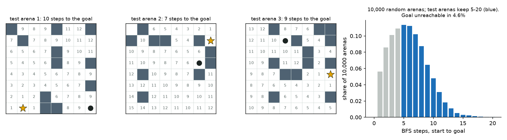
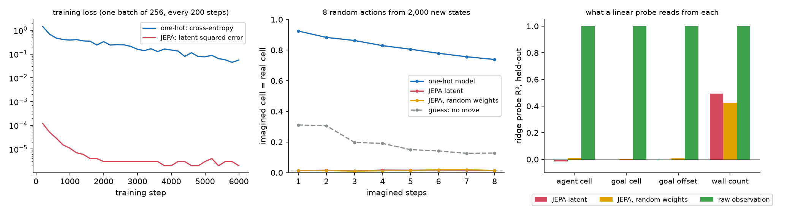
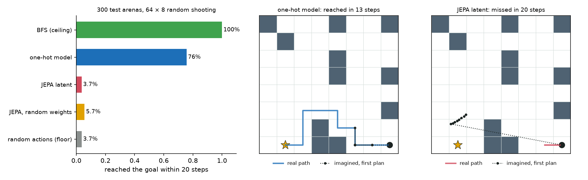

# Module 25: World models and planning

Module 24's learners found good actions by trying them in the world. This
module gives the agent a **world model**: something that predicts what an
action will do, so the agent can try actions in its head before it takes one.
It builds a small world, models it two ways, and plans in each. It has four
sections, each with a figure and the numbers beside it:

1. **An 8 × 8 grid world**: walls, a goal, four actions, written here in about 40 lines.
2. **Two models of it**: a one-hot model that predicts the agent's next cell; a JEPA that predicts the next latent (module 16's objective).
3. **Planning by random shooting** in each model, against random actions, a shortest-path agent and a JEPA with random weights.
4. **The JEPA argument for world models**, and what this grid can and cannot show.

Every number in this README comes from a JSON file in [`results/`](results/),
written by the script that measured it.

This is the second module of track 9, **Acting and planning**. It
comes after [module 24](../24-reinforcement-learning/README.md), and uses
[module 16](../16-self-supervised-and-jepa/README.md)'s JEPA objective and
collapse meters. Next, [module 26](../26-rl-with-a-checker/README.md) applies
module 24's policy gradient to a language model;
[module 31](../31-world-model-from-pixels/README.md) then returns to this
module's failure.

**🕹 Interactive:** [World models and planning](../../explorables/25-world-models-and-planning.html):
draw walls, drop the agent and the goal, and watch both planners choose
their moves, with the path each one imagines.

**✅ Quiz:** [10 questions](../../quizzes/25.html): check yourself once you have run the three scripts.

## Goals

By the end you will be able to:

- write a grid world, its rules and a breadth-first search for its distances;
- train a model that predicts the next state, and one that predicts the next latent;
- plan by random shooting: imagine many action sequences, score them, act, replan;
- read a planner's result against a floor, a ceiling and a random-weight control;
- say why a low JEPA loss does not mean a useful latent, and how to check;
- say what the JEPA argument for world models claims, and what a toy can test of it.

## Setup

```bash
cd modules/25-world-models-and-planning/python
```

```bash
uv sync
```

Nothing to download: the world, the data and both models are made here.

**The laptop guard.** Every script imports `src/common.py` before torch. It
sets `PYTORCH_MPS_HIGH_WATERMARK_RATIO=0.5` and
`PYTORCH_MPS_LOW_WATERMARK_RATIO=0.4`, as in every module, though nothing here
uses the GPU: the models are small, and the CPU is quick and repeatable for
them. `common.py` also fixes torch at 4 threads. Each script logs its time and
peak memory into its results file:

| Script | Minutes | Peak RSS | Peak MPS driver |
|---|---|---|---|
| `src/world.py` | 0.03 | 0.58 GB | 0 (CPU) |
| `src/train.py` | 0.13 | 0.73 GB | 0 (CPU) |
| `src/plan.py` | 0.07 | 0.22 GB | 0 (CPU) |

Measured on an Apple M5 with 16 GB, Python 3.12, torch 2.14.1. Since no model
runs on MPS, there is no MPS-against-CPU check. Run a second time on another
setup (Python 3.14, torch 2.14.0), the same code gave the same success rates
in section 3, to the last digit.

## 1 · An 8 × 8 grid world

[`src/grid.py`](python/src/grid.py) holds the whole world. The first five
functions are about 40 lines:

```python
def make_arena(rng):           # each cell a wall with chance 0.2; agent and goal on two free cells
def step(walls, pos, action):  # up, down, left, right; into a wall or off the grid: stay put
def bfs(walls, goal):          # steps from every cell to the goal, by breadth-first search; -1 if cut off
def observe(walls, agent, goal):  # three 8 × 8 one-hot planes (walls, agent, goal): 192 numbers
def bfs_action(walls, pos, dist): # a move that lowers the BFS distance by one
```

The agent sees the whole grid. The goal ends an episode only when the agent
stands on it.



[`src/world.py`](python/src/world.py) draws 10,000 arenas to show what the
generator makes:

| | Value |
|---|---|
| Wall share | 20.0% |
| Free cells per arena, mean | 51.2 |
| Goal reachable from the start | 95.4% |
| BFS distance when reachable: mean, max | 5.87, 21 |
| Arenas with distance 5 to 20 | 60.1% |

**Test arenas.** Planning is scored on 300 arenas from their own seed, kept
only when the start is 5 to 20 BFS steps from the goal: far enough that
random moves seldom stumble on it, near enough that 20 steps always suffice.
It took 494 draws to get 300. Their mean distance is 7.75 (median 7, max 17).

**Training data.** 4,000 other arenas, 25 uniform random actions in each:
100,000 transitions. 30.1% of those moves hit a wall or the edge and leave
the agent where it was. The agent stands on the goal in 1.65% of them.

## 2 · Two models of it

Both models see the observation and the action. Both train for 6,000 Adam
steps of 256 transitions, rate 10⁻³, on the CPU, in seconds
([`src/models.py`](python/src/models.py), [`src/train.py`](python/src/train.py)).

- **One-hot model** (49,984 parameters): an MLP from the 192 numbers plus a
  one-hot action to a score for each of the 64 cells; cross-entropy against
  the agent's real next cell. Walls and goal never move, so the predicted
  next observation is the old one with the agent moved to the cell with the
  highest score. It
  can be fed back to itself to imagine several steps.
- **JEPA** (encoder 28,832 parameters, predictor 8,864): an encoder maps the
  192 numbers to a 32-number latent z; a predictor maps (z, action) to
  z + a learned change. The target for the next latent comes from a second
  encoder, a slow moving average (EMA) of the first, momentum 0.996 rising
  to 1.0 on a cosine ramp, with no gradient: module 16's I-JEPA-lite objective, applied to
  time instead of hidden patches. The loss is the squared error between
  latents. Nothing asks the model to rebuild a cell.

A planner needs to read a distance to the goal from what a model imagines.
For the one-hot model that is direct: it imagines a cell. For the JEPA a
**probe** does it: a ridge regression from the latent to the goal's offset
from the agent (goal row − agent row, goal column − agent column), fitted on
20,000 training observations. The probe reads the target encoder's latents,
the space the predictor writes to.

All numbers below are on held-out data: 500 new arenas, 12,500 transitions.



**The one-hot model** picks the right next cell 93.8% of the time. When the
agent really moved it is right 97.9% of the time, so most of its misses are
moves that a wall blocks. Fed back to itself for 8 random actions from 2,000
new states, it imagines the right cell 92.5% of the time after one step and
73.9% after eight. Guessing "the agent did not move" scores 31.2% and 12.8%.

**The JEPA** reaches a held-out loss of 3 × 10⁻⁶; its training loss was
already 1.2 × 10⁻⁴ at step 200. Yet its imagined cell matches the real one
1.4% of the time after one step and 1.5% after eight, about 1 in 64: chance.
The probe tells why:

| Ridge probe R², held-out | agent cell | goal cell | goal offset | number of walls |
|---|---|---|---|---|
| JEPA latent, trained | −0.015 | −0.002 | −0.006 | 0.494 |
| JEPA latent, random weights | 0.009 | 0.003 | 0.009 | 0.425 |
| raw observation (192 numbers) | 1.000 | 1.000 | 1.000 | 1.000 |

The trained latent holds no linear trace of where the agent or the goal is.
It holds some of the walls, about as much as a random encoder does. One real
step moves the trained latent by 0.0066 on average, while the latents of two
different arenas sit 0.454 apart; for the random-weight encoder the numbers
are 0.131 and 0.390. Reading: the encoder learned to describe the arena and
drop the agent, the one thing an action changes. Then the next latent equals
the current one, and the predictor's job is trivial. The loss is near zero
because the latent says nothing about what moves.

**The collapse meters miss it.** Module 16's two meters on 2,048 held-out
latents: normalised std 0.566, effective rank 16.5 of 32; for the
random-weight encoder 0.569 and 21.2. Neither flags a problem: the latents are
spread out, but along what does not move. Module 16's meters catch a latent
that shrinks to a point or a line; this is a third failure, a latent that
spreads well over the wrong things. Only a probe for the right label shows it.

**What this shows, and what it does not.** One seed, one size, one setting,
on a one-hot input where the agent is 1 number in 192. It shows that the JEPA
objective, with an EMA target and nothing else, *can* settle on a latent that
ignores the agent. It does not show that every JEPA does: a bigger latent, a
variance-and-covariance term or module 16's SIGReg, an input centred on the
agent, longer-range targets, or a predictor that does not start from "no
change" might change the outcome; none was tried here. (This predictor
outputs z plus a learned change, so "nothing moves" is its easy default.) For a contrast,
section 4 of [module 13](../13-inside-vision-and-jepa/README.md)
read a JEPA trained on a larger tile world through a window centred on the
agent, where every step changes most of the input; its latent held the
agent's position (R² 0.983), though random encoders came close (0.944 to
0.960). That is a different world, model and training run, so it is a hint,
not a test.

## 3 · Planning by random shooting

[`src/plan.py`](python/src/plan.py) plans the same way in either model, and
replans at every step:

1. draw 64 sequences of 8 random actions;
2. imagine each sequence in the model, from the current observation;
3. score each by the sum, over its 8 imagined steps, of the distance to the
   goal: the Manhattan distance of the imagined cell for the one-hot model,
   the length of the probed offset for the JEPA;
4. take the first action of the lowest score in the real world, and repeat.

This is **random shooting** with model-predictive control: the plan is
thrown away after one step. It needs no training beyond the model. The score
ignores walls on purpose, so walls are the model's to handle.

Besides the two planners, four agents frame them:

- **BFS** follows a shortest path: the ceiling.
- **Random actions**: the floor.
- **JEPA, random weights**: the same JEPA at its initial weights, with its
  own probe and the same planner. If this reached the goal often, the probe
  or the planner would be doing the work, not the learned model.
- **The true world as the model**: random shooting with a perfect model. What
  this score and this search can do at best.

Each gets 20 real steps per arena. Arena i seeds the random numbers of every
agent the same way.



| Agent | Reached the goal | of 300 | Mean steps when reached | BFS 5–6 (109) | 7–8 (91) | 9–10 (64) | 11–20 (36) |
|---|---|---|---|---|---|---|---|
| BFS (ceiling) | 100% | 300 | 7.75 | 100% | 100% | 100% | 100% |
| true world as the model | 89.0% | 267 | 8.73 | 95% | 96% | 83% | 64% |
| **one-hot model** | **75.7%** | **227** | 8.94 | 88% | 84% | 56% | 53% |
| **JEPA latent** | **3.7%** | **11** | 13.64 | 6% | 3% | 2% | 0% |
| JEPA, random weights | 5.7% | 17 | 10.47 | 6% | 9% | 3% | 0% |
| random actions (floor) | 3.7% | 11 | 14.00 | 10% | 0% | 0% | 0% |

What the runs show:

- **The one-hot planner reaches 75.7% of goals**, 13.3 points under the same
  planner with a perfect model (89.0%). Roughly, then, of the 24.3 points it
  misses against BFS, 11.0 belong to the planner and its wall-blind score, and
  13.3 to the model's mistakes. Both lose most on far goals.
- **The JEPA planner does no better than random actions** (11 arenas each).
  The section 2 probe explains it: the latent holds no offset to read, so the
  planner ranks its 64 sequences by noise.
- **The random-weight JEPA lands at chance too** (5.7%), so the probe and the
  planner add nothing by themselves. The control behaves.

**Written down before the first run**, with these settings: BFS 100%,
one-hot at least 60%, JEPA 20% to 50%, random 5% to 15%, random-weight JEPA
within 5 points of random. BFS, one-hot and the control met them. The JEPA
missed, far below its range; so did random actions, at 3.7%: the 5-step
minimum distance makes random hits rarer than expected. Nothing was changed
after the run.

## 4 · The JEPA argument, and what this grid can show

**The argument.** Yann LeCun's position paper [A Path Towards Autonomous
Machine Intelligence](https://openreview.net/forum?id=BZ5a1r-kVsf) (2022)
proposes that an agent should plan with a world model that predicts in a
learned latent space, not in pixels. A JEPA is that model. The claim is that a
latent can drop the details no one can predict and keep what matters for acting, so prediction becomes easier and planning
cheaper. Planning is then a search over actions whose imagined outcome
scores best, which is what section 3 does.

**What the grid shows.** It tests one step of the argument, at toy scale:
does a JEPA trained on its own prediction loss keep what a planner needs?
Here it did not. The latent dropped the agent, the one thing that matters for
reaching the goal, and the loss rewarded it for doing so. "Drop what is hard
to predict" turned into "drop what changes". The one-hot model, which must
name the next cell, could not take that way out.

**What the grid cannot show.** Everything about scale. A one-hot model wins
here because the state is 64 cells; for camera images there is no list of
cells to predict, and that is the case the argument is about. Nothing here
says a pixel or one-hot model would win on video. The grid has nothing
unpredictable to drop, so the JEPA's main promised gain never comes into
play. And one seed of one small setting is a demo, not a law. On the pixel
side, [Navigation World Models](https://arxiv.org/abs/2412.03572) (Bar et
al., 2024) predict the next camera frame with a 1B-parameter diffusion model
and plan by imagining routes.

**How larger systems keep the latent useful.** Each published system that
plans in a learned latent adds something that stops the encoder from
dropping what matters:

| System | The latent model is trained on | How it plans |
|---|---|---|
| [World Models](https://arxiv.org/abs/1803.10122) (Ha and Schmidhuber, 2018) | a VAE that rebuilds frames, then a recurrent model of its latents | a small controller, trained in the real game or inside the model |
| [PlaNet](https://arxiv.org/abs/1811.04551) (Hafner et al., 2019) | rebuilding the frames, plus reward | CEM, a refined version of random shooting |
| [MuZero](https://arxiv.org/abs/1911.08265) (Schrittwieser et al., 2020) | predicting reward, value and the policy; no frames | tree search |
| [TD-MPC2](https://arxiv.org/abs/2310.16828) (Hansen et al., 2024) | latent prediction plus reward and value | MPPI, another sampling planner |
| [DreamerV3](https://arxiv.org/abs/2301.04104) (Hafner et al., 2023; Nature 2025) | rebuilding frames, plus reward and continuation | an actor-critic trained inside the model |
| [PLDM](https://arxiv.org/abs/2502.14819) (Sobal et al., 2025) | latent prediction, plus variance, covariance, temporal smoothness and inverse-dynamics terms | MPPI towards a goal |
| [DINO-WM](https://arxiv.org/abs/2411.04983) (Zhou et al., 2024) | a frozen, pretrained DINOv2 encoder; only the predictor trains | CEM towards a goal image |
| [V-JEPA 2-AC](https://arxiv.org/abs/2506.09985) (Assran et al., 2025) | a frozen V-JEPA 2 video encoder; an action-conditioned predictor trained on robot video | CEM towards a goal image |

The last two are the JEPA argument put into practice, and both freeze an
encoder trained first on another task, so the planning loss cannot shrink
it. Section 2 is a small picture of why a frozen or otherwise anchored
encoder helps; it does not measure how much. PLDM's inverse-dynamics term,
which asks the latent to say which action was taken, is one direct answer to
the failure of section 2.

## Run it

Each script prints its numbers, writes `results/<name>.json`, and with
`--figures` redraws its figure. `train.py` saves both models to
`artifacts/models.pt` (0.7 MB), which `plan.py` loads.

```bash
uv run python src/world.py --figures
```

```bash
uv run python src/train.py --figures
```

```bash
uv run python src/plan.py --figures
```

Redraw every figure from the committed JSON, with no model loaded:

```bash
uv run python src/figures.py
```

Rewrite the explorable's data block (results and weights) from the JSON and
`artifacts/models.pt`:

```bash
uv run python src/export_explorable.py
```

## Exercises

Skeletons with `# TODO(you):` live in [`exercises/`](exercises/); reference
solutions are in [`solutions/`](solutions/). Each asks you to predict before
you run, and runs in seconds on the CPU.

- **(a) `exercise_a_grid.py`**: write `step` and the breadth-first search;
  count the arenas whose goal cannot be reached. The test checks both against
  `src/grid.py` on 200 arenas.
- **(b) `exercise_b_shooting.py`**: write random shooting's scoring and
  choice, with the true world as the model; run it on 100 test arenas. The
  test checks your choices against `src/plan.py`.
- **(c) `exercise_c_jepa.py`**: write the JEPA loss and the EMA update; train
  a small JEPA for 1,500 steps and probe its latent for the agent and the
  goal. The test checks both functions against `src/models.py`.

## Tests

```bash
uv run pytest
```

Sixteen tests, a few seconds, no training. They check the solutions against
the scripts, the world's rules, the committed results against the laptop
budget and each other, and the explorable against the results.

## To go further

- Replace random shooting with CEM: keep the best 8 of 64 sequences, refit a
  distribution over actions to them, sample again. Does the one-hot planner
  close the gap to the perfect model? MPPI, used by TD-MPC2 and PLDM, averages
  the sequences with weights that grow exponentially with their score,
  instead of keeping the best 8 as equals.
- Give the JEPA something that forces the agent into its latent, for example
  an input centred on the agent, or a term that predicts the action from two
  successive latents, and probe again. Write down what you expect first.
- Score with the BFS distance instead of the Manhattan distance, and see how
  much of the one-hot planner's miss was the score.

## Checkpoint: you should now be able to…

- write a grid world and its BFS distances;
- train a next-state model and a JEPA on the same transitions;
- plan by random shooting and say what each part does;
- read a planner against BFS, random actions, a perfect model and a random-weight control;
- say why a JEPA loss near zero can hide a useless latent, and which check finds it;
- say what the JEPA argument claims, and why a toy grid tests only one step of it.

## Links

- LeCun, [A Path Towards Autonomous Machine Intelligence](https://openreview.net/forum?id=BZ5a1r-kVsf) (2022)
- Ha and Schmidhuber, [World Models](https://arxiv.org/abs/1803.10122) (2018)
- Nagabandi et al., [Neural Network Dynamics for Model-Based Deep RL](https://arxiv.org/abs/1708.02596) (2018), random-shooting planning with a learned model
- Hafner et al., [PlaNet](https://arxiv.org/abs/1811.04551) (2019)
- Schrittwieser et al., [MuZero](https://arxiv.org/abs/1911.08265) (2020)
- Hansen et al., [TD-MPC2](https://arxiv.org/abs/2310.16828) (2024)
- Hafner et al., [Mastering Diverse Domains through World Models](https://arxiv.org/abs/2301.04104) (2023): DreamerV3
- Sobal et al., [Learning from Reward-Free Offline Data: A Case for Planning with Latent Dynamics Models](https://arxiv.org/abs/2502.14819) (2025): PLDM
- Bar et al., [Navigation World Models](https://arxiv.org/abs/2412.03572) (2024)
- Zhou et al., [DINO-WM](https://arxiv.org/abs/2411.04983) (2024)
- Assran et al., [V-JEPA 2](https://arxiv.org/abs/2506.09985) (2025)
- Grill et al., [BYOL](https://arxiv.org/abs/2006.07733) (2020), the EMA target and predictor this JEPA borrows
