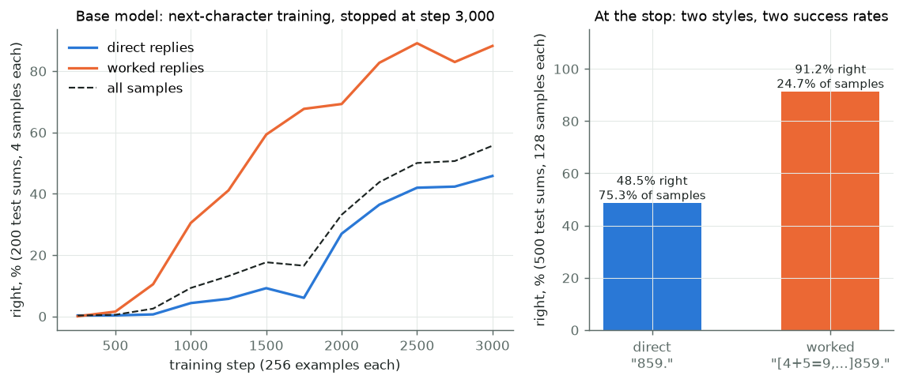
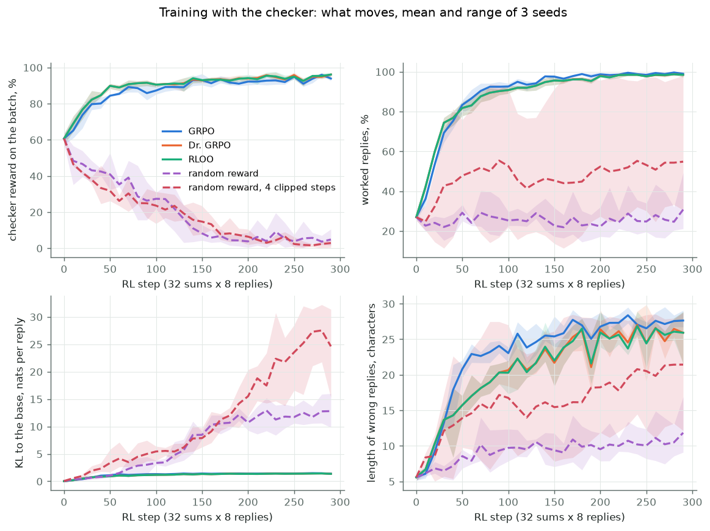
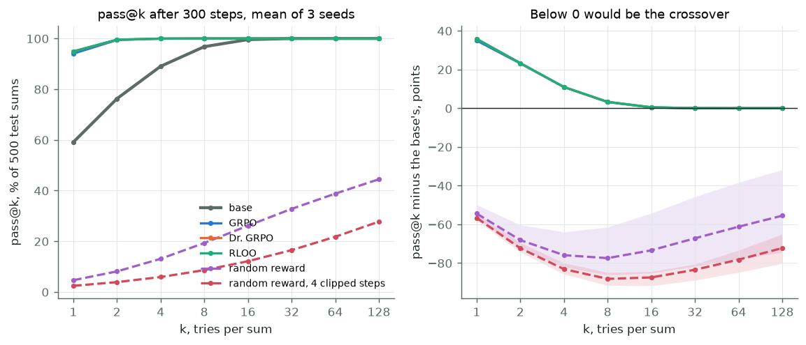
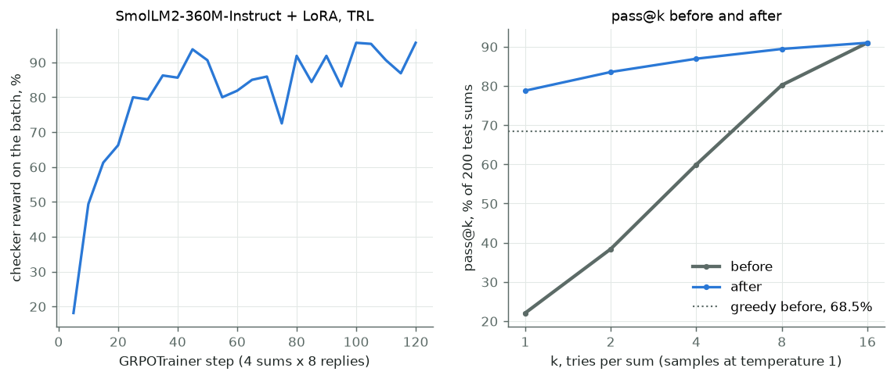

# Module 26: RL with a checker

When a program grades the answer, what does reinforcement learning on a
language model actually change?

Module 24 trained a policy from rewards on CartPole. Module 22 ended with
reasoning models, trained by reinforcement learning against a rule that
checks the final answer. This module puts the two together at toy scale.
A small model adds 3-digit numbers; a program says right or wrong; the
model learns from that alone. It has four sections, each with a figure and
the numbers beside it:

1. **The base model**: module 04's char-GPT, trained on sums and stopped early, so it is right 59% of the time.
2. **GRPO, Dr. GRPO and RLOO by hand**: three ways to turn a group's rewards into a push, 3 seeds each.
3. **What changed, and two controls**: pass@1 against pass@k, reply length, distance from the base, and rewards from a coin.
4. **The library way**: TRL's `GRPOTrainer` with LoRA on SmolLM2-360M-Instruct, same sums, same rule.

Every number in this README comes from a JSON file in [`results/`](results/),
written by the script that measured it. What we expected was written down in
[`results/expectations.json`](results/expectations.json) before the runs of
sections 2 and 3; section 3 scores each line.

This is the third module of track 9, **Acting and planning**. It comes after
[module 25](../25-world-models-and-planning/README.md) in reading order, and
uses [module 24](../24-reinforcement-learning/README.md)'s policy gradient,
[module 22](../22-reasoning-at-test-time/README.md)'s pass@k ceiling,
[module 17](../17-learning-from-preferences/README.md)'s KL to a reference
model, and [module 04](../04-attention-transformer/README.md)'s char-GPT.
Next, [module 31](../31-world-model-from-pixels/README.md) learns a world
model from pixels.

**🕹 Interactive:** [RL with a checker](../../explorables/26-rl-with-a-checker.html):
flip the rewards in a group and watch the three advantages; replay the
training curves; slide k and compare pass@k before and after.

**✅ Quiz:** [10 questions](../../quizzes/26.html): check yourself once you have run the scripts.

## Goals

By the end you will be able to:

- write a checker reward and the group advantages of GRPO, Dr. GRPO and RLOO;
- say why RLOO and Dr. GRPO train alike under Adam, and what GRPO's division by length does;
- read pass@k with the unbiased estimator, and say what a crossover with the base would mean;
- read KL to the base model as a measure of how far training moved the policy;
- run a random-reward control and say what it rules out;
- run the same recipe with TRL and LoRA on a real chat model.

## Setup

```bash
cd modules/26-rl-with-a-checker/python
```

```bash
uv sync
```

| Need | Size | Where |
|---|---|---|
| Nothing, for sections 1 to 3 | | the sums, the model and the checker are made here |
| `HuggingFaceTB/SmolLM2-360M-Instruct`, revision `a10cc151` | ~700 MB | Hugging Face cache; module 05 or 17 already fetched it; only section 4 needs it |

**The laptop guard.** Every script imports `src/common.py` before torch. It
sets `PYTORCH_MPS_HIGH_WATERMARK_RATIO=0.5` and
`PYTORCH_MPS_LOW_WATERMARK_RATIO=0.4` and fixes torch at 4 CPU threads.
Sections 1 to 3 run on the CPU: the model has 59,376 weights, and the CPU is
quick and repeatable at that size. Runs longer than a few
minutes go in chunks of under five, each picking up where the last stopped.
Each script logs its time and peak memory into its results file:

| Script | Minutes | Peak RSS | Peak MPS driver |
|---|---|---|---|
| `src/sft.py` | 1.69 | 0.85 GB | 0 (CPU) |
| `src/rl.py --base` | 0.88 | 0.79 GB | 0 (CPU) |
| `src/rl.py`, one run of 300 steps (15 runs) | 2.08 to 4.13 | 0.93 GB at most | 0 (CPU) |
| `src/library.py`, each stage or chunk (6 in all) | 1.97 to 4.27 | 0.75 GB at most | 2.39 GB at most |

Measured on an Apple M5 with 16 GB, Python 3.12, torch 2.14.1, TRL 1.14.2,
while other jobs shared the machine; most of the spread in minutes is that
load. Every run and evaluation is seeded; the base model came out
byte-identical when trained twice.

## 1 · The base model

[`src/task.py`](python/src/task.py) holds the task and the checker. A prompt
is `374+485=`, both numbers from 100 to 999. A reply ends with `.` and comes in
one of two styles:

| Style | Reply | Characters |
|---|---|---|
| direct | `859.` | 4 to 5 |
| worked | `[4+5=9,7+8+0=15,3+4+1=8]859.` | 27 to 31 |

The worked style adds column by column from the right, carry included, then
writes the sum: a chain of thought, written out. The **checker** reads only
the number after the last `]` (or the whole reply when there is none): reward
1 if it equals the sum and the reply ended, else 0. It never grades the steps.

[`src/sft.py`](python/src/sft.py) trains module 04's char-GPT
([`src/gpt.py`](python/src/gpt.py), copied unchanged) by next-character loss
on examples, 80% direct and 20% worked. We made it smaller than module 04's,
2 layers of width 48, so that it is still learning when we stop it: run long
enough, a model this size learns 3-digit addition outright, and then RL has
nothing to do. 3,000 Adam steps of 256 examples, rate 10⁻³; 500 test sums are
held out from all training, here and in section 2.



| Base model, 500 test sums, 128 samples each at temperature 1 | Value |
|---|---|
| Right, one sample (pass@1) | 59.1% |
| Right, greedy (always the likeliest character) | 58.4% |
| Samples in the worked style | 24.7% |
| Direct samples right | 48.5% |
| Worked samples right | 91.2% |
| Mean reply length | 10.7 characters |

The base model already knows a better way to answer: worked replies are right
91.2% of the time, direct ones 48.5%. But it chooses the worked style only a
quarter of the time, about as often as in its training data. Greedy decoding
picks it for 2% of the sums (`results/sft.json`). That gap is what RL has to work with.

## 2 · GRPO, Dr. GRPO and RLOO by hand

[`src/rl.py`](python/src/rl.py) runs one loop for every method. At each of
300 steps it:

1. draws 32 training sums;
2. samples a **group** of G = 8 replies to each, at temperature 1;
3. scores all 256 replies with the checker;
4. turns each group's 8 rewards into 8 **advantages**: how far to push each reply up or down;
5. takes one Adam step (rate 5 × 10⁻⁵) on the policy-gradient loss: minus the advantage times the log-probability of each character of the reply.

Step 5 is module 24's REINFORCE. There is no value network: the group is the
baseline. The methods differ in step 4 and in how step 5 adds up characters:

| Method | Advantage of reply i | A reply's characters are |
|---|---|---|
| **GRPO** (Shao et al., 2024) | (rᵢ − group mean) / (group std + 10⁻⁴) | averaged over the reply's own length |
| **Dr. GRPO** (Liu et al., 2025) | rᵢ − group mean | summed, then divided by 32 for every reply |
| **RLOO** (Ahmadian et al., 2024) | rᵢ − mean of the other 7 | summed, then divided by 32 for every reply |

Three facts follow from the formulas, before any run:

- **A group where all 8 replies score the same teaches nothing**: every advantage is 0. As the model improves, more groups are all right, and the push fades.
- **RLOO is Dr. GRPO times 8/7.** rᵢ − (S − rᵢ)/7 = (8/7)(rᵢ − S/8), with S the group's sum. Adam divides each step by a running size of the gradient, so a constant factor cancels.
- **GRPO's length average favours long wrong replies.** A reply of 28 characters with advantage −1 gets, on each character, 1/7 the push of a 4-character one. Dr. GRPO drops the average, and with it the bias (`tests/test_solutions.py` checks the 1/7).

The DeepSeekMath paper's GRPO also clips the update and adds a KL penalty.
The **clip**, taken from PPO (module 24), watches the ratio between a reply's
probability under the new and the old policy: once a batch has pushed it past
0.8 or 1.2, that reply gets no further push from the batch. We take one step per batch, so that ratio is 1 and
the clip never acts (section 3's last control turns it on). We use no KL
penalty, as Dr. GRPO and TRL's default do, and measure the KL instead.
**KL to the base** (Kullback-Leibler divergence, module 17) is how much more
likely the trained model finds its own replies than the base model does, on
average, in log units: 0 when the two agree, larger as they part. We measure it
in **nats** (natural log) per reply, summed over the reply's characters.



| After 300 steps, mean of 3 seeds (range) | GRPO | Dr. GRPO | RLOO |
|---|---|---|---|
| pass@1 | 94.0% (93.9–94.2) | 94.9% (94.7–95.1) | 94.9% (94.7–95.1) |
| Greedy | 99.9% | 99.7% | 99.8% |
| Worked replies | 99.2% | 98.4% | 98.4% |
| Worked replies right | 94.3% | 95.5% | 95.5% |
| Mean reply length | 29.0 | 28.8 | 28.9 |
| Length of wrong replies, steps 100–290 | **26.4** | 24.2 | 24.1 |
| Groups all right or all wrong, steps 100–290 | 55.5% | 61.3% | 60.7% |
| KL to the base, nats per reply | 1.40 | 1.36 | 1.36 |

What the runs show:

- **All three methods lift pass@1 from 59.1% to about 94–95%.** Most of the gain comes in the first 50 steps.
- **Most of it is a change of style.** The worked share goes from 24.7% to over 98%, and the mean reply from 10.7 characters to about 29. Accuracy within the worked style moves less: 91.2% to 94–96%. RL found the way of answering that the base already did well, and made it the default. This is a small picture of R1-Zero's chains growing longer during training (module 22, section 4): no reward asked for longer replies; longer replies were right more often.
- **RLOO and Dr. GRPO are one method here.** With the same seed they sampled the same replies, and logged the same batch reward at every logged step before steps 110, 180 and 170 of the three seeds; after that, float rounding makes one sample differ and the runs part, by under 0.5 points at the end.
- **GRPO keeps wrong replies longer**: 26.4 characters against 24.2 and 24.1, over steps 100 to 290, in all 3 seeds (ranges 26.2–26.5 against 23.5–24.7). Its pass@1 ends about 0.8 points lower. Both are the direction Liu et al. (2025) describe; here the effect is small, since every reply is at most 31 characters.
- **The model moved about 1.4 nats per reply from the base**, and stopped moving once most groups were all right.

## 3 · What changed, and two controls

**pass@1 against pass@k.** pass@k is the chance that at least one of k tries
is right: module 22's "any of n right". From n = 128 samples with c right,
the unbiased estimate is 1 − C(n − c, k) / C(n, k) (Chen et al., 2021).

Yue et al. (2025) found that models trained this way win at pass@1, but
their untrained base wins at large k: training narrows the model onto answers
it already gave, and loses some it sometimes found. That would show here as
the base's curve crossing above the trained one.



| pass@k, 500 test sums | k = 1 | 2 | 4 | 8 | 16 | 128 |
|---|---|---|---|---|---|---|
| Base | 59.1% | 76.3% | 89.0% | 96.8% | 99.56% | 100% |
| GRPO | 94.0% | 99.38% | 99.94% | 99.995% | 100% | 100% |
| Dr. GRPO | 94.9% | 99.50% | 99.93% | 99.99% | 99.999% | 100% |
| RLOO | 94.9% | 99.55% | 99.95% | 99.99% | 99.999% | 100% |
| Random reward | 4.6% | 8.1% | 13.1% | 19.3% | 26.1% | 44.5% |
| Random reward, 4 clipped steps | 2.4% | 3.9% | 5.9% | 8.6% | 12.1% | 27.7% |

**No crossover.** The trained models match or beat the base at every k. The
base gets every one of the 500 test sums right at least once in 128 tries,
and so does every trained model: no sum is lost. The test cannot show a
crossover here, for a plain reason: at k = 16 the base is already at 99.56%,
so there is no room above it. On this task the base "knows" every answer; RL
made it say the right one first. That fits the narrowing reading of Yue et
al. (the gain is in picking, not in new answers) without testing its claim
that something is lost. A harder task, where the base misses some sums even
at large k, is the place to test it.

**Two controls with coin-flip rewards.** If the reward carries no
information, does RL still help? R. Shao et al. (2025; not the GRPO paper's Shao) lifted a Qwen2.5 maths
model by 21.4 points on MATH-500, a test of 500 competition maths problems, with random rewards, against 29.1 with true
ones, and traced it to GRPO's clip, which favours what the model already does
often; other model families did not gain. Our controls hand out 1s at random,
at the batch's true success rate, so they give as many 1s as the checker
would, on the wrong replies as often as on the right ones:

- **random**: GRPO, one step per batch, as above;
- **random_clip**: GRPO with 4 Adam steps per batch and PPO's clip at 0.2, the setting where Shao et al. see the clip at work.

Neither helps. Both wreck the model: pass@1 falls from 59.1% to 4.6% (seeds
2.0 to 9.2) and 2.4% (1.0 to 4.6), and the KL to the base climbs to 12.8 and
24.6 nats per reply, nine to eighteen times the true-reward runs'. A coin's
advantages average zero over many draws, but each step still takes a full
Adam step in a random direction, and nothing pulls the model back: no KL
penalty, and, unlike the true-reward runs, almost no all-equal groups at the
start (2% of groups at step 0, against 17%) to damp the steps. The damage
then feeds itself: as the model gets worse, the coin's rate falls with the
true rate, and more groups score all 0. We read this as a random walk; we did
not test that reading.

**Written down before the runs** ([`results/expectations.json`](results/expectations.json),
scored in `results/rl.json` → `expectations_met`). Before writing them we had
seen the base model and two trial runs of GRPO, seed 0, used to pick the
learning rate (3 × 10⁻⁴ moved the policy 0.9 nats in one step; 5 × 10⁻⁵ did
not); both trials were deleted.

| | Expectation | Result |
|---|---|---|
| E1 | every true-reward arm reaches pass@1 ≥ 85%, every seed | met: 93.9% at least |
| E2 | RLOO and Dr. GRPO end within 2 points | met: 94.9% and 94.9% |
| E3 | GRPO's wrong replies longer than Dr. GRPO's by ≥ 1 character | met: 26.4 against 24.2 |
| E4 | worked share above 90% in every true-reward run | met: 98.1% at least |
| E5 | no crossover; at most 5 sums lost per run | met, though the test had no room (see above) |
| E6 | random: pass@1 within 5 points of 59.1%, KL under 0.3 | **missed**: 4.6%, KL 12.8 |
| E7 | random_clip: the likelier direct style grows; pass@1 falls 0 to 10 points | **missed**: worked share 32% to 98% by seed, pass@1 2.4% |
| E8 | KL to the base above 1 nat in every true-reward run | met: 1.32 at least |

Nothing was changed after the runs. The two misses teach the most: on this
model, a reward that does not track the truth does not leave the model alone;
it wrecks it. That fits Shao et al.'s own note that the gain from random
rewards depends on the model; it does not tell why their Qwen model gained.

**What this shows, and what it does not.** One task, one small model, one
learning rate, 3 seeds. It shows on a model whose every number is ours that
a checker reward can lift pass@1 by 35 points mostly by choosing a style
the base already had, that RLOO and Dr. GRPO coincide under Adam, and that
GRPO's length average leaves wrong replies longer. It does not test the
crossover, and it does not say how any of this scales to models with
billions of weights.

## 4 · The library way

[`src/library.py`](python/src/library.py) runs the same recipe with TRL's
`GRPOTrainer` and a LoRA adapter (module 06: small low-rank matrices trained beside frozen weights; rank 16 on every attention and MLP matrix)
on SmolLM2-360M-Instruct, the chat model of modules 05 and 17, in bfloat16 on
the GPU. The prompt is a chat turn, `What is 374+485? Reply with the number
only.`; the sums are drawn the same way, and the 200 test sums are the first
200 of section 1's 500. The settings follow section 2 where TRL allows:
`loss_type="grpo"`, `scale_rewards="group"`, `beta=0` (no KL penalty), 8
replies per sum at temperature 1, 4 sums per step, 120 steps, rate 10⁻⁴,
replies cut at 16 tokens. The checker is a plain Python function that TRL
calls with each batch of replies.

**The checker had to change once.** The model ignores "number only" and
repeats the question: `865 + 673 = 1548`. A first checker read the first
number in the reply, so it read the question, and scored the untrained model
0.0% greedy (`results/library_base_first_number.json`). The checker now reads
the last number. Two training chunks had started with the first checker (one
of them in float32, before the switch to bfloat16); we stopped and deleted
both. The module keeps both evaluations of the untrained model. A reward
program is code, and it needs tests like any other: `tests/test_solutions.py`
checks it on hand-written replies.



| SmolLM2-360M-Instruct, 200 test sums, 16 samples each | Before | After 120 steps |
|---|---|---|
| pass@1 (one sample, temperature 1) | 22.1% | 78.8% |
| pass@4 | 59.9% | 86.9% |
| pass@16 | 91.0% | 91.0% |
| Greedy | 68.5% | 80.5% |
| Reply length, tokens | 11.4 | 14.5 |
| Sums right at least once in 16, only before / only after | 16 | 16 |

Training took 15.0 minutes in four chunks; the batch reward rose from 18% at
step 5 to 92% on average over steps 105 to 120 (`results/library_train.json`).

What the run shows:

- **Most of the pass@1 gain closes the gap between sampling and greedy.** Sampled at temperature 1, the untrained model is right 22.1% of the time; greedy, 68.5%. Training moved the likely answer from right in 68.5% of sums to 80.5%, and made samples agree with it.
- **At k = 16 the two meet: 91.0% each.** 16 sums the base got right at least once in 16 are never right after training, and 16 others are newly right. That is the narrowing Yue et al. describe, on a small scale, balanced here by as many gains; 200 sums and one seed are too few to say which side wins.
- **The format moved too.** After training, greedy replies read `865 + 673 = 1538.`: the same shape, the right sum more often.

Section 2 did by hand what `GRPOTrainer` does here: sample a group, call the
reward function, normalise within the group, weight each token's
log-probability. TRL adds batching, generation, LoRA, logging and resuming
from checkpoints, and names every choice of section 2 in its config:
`loss_type="dr_grpo"` with `scale_rewards="none"` would be Dr. GRPO.

## Run it

Rebuild the base model, every run and every number (about 50 minutes of
runs in chunks, on the CPU):

```bash
uv run python src/sft.py
```

```bash
uv run python src/rl.py --base
```

```bash
uv run python src/rl.py --all
```

Repeat the last command until it prints `remaining: 0`; it skips runs whose
file exists. Then score the runs and redraw:

```bash
uv run python src/analyse.py --figures
```

The library way, each command under five minutes; repeat `train` until it
prints `remaining steps: 0`:

```bash
uv run python src/library.py base
```

```bash
uv run python src/library.py train
```

```bash
uv run python src/library.py after
```

Redraw the figures, or rewrite the explorable's data block, from the
committed JSON with no model:

```bash
uv run python src/figures.py
```

```bash
uv run python src/export_explorable.py
```

## Exercises

Skeletons with `# TODO(you):` live in [`exercises/`](exercises/); reference
solutions are in [`solutions/`](solutions/). Each asks you to predict before
you run, and runs in a second with no training. `tests/test_solutions.py`
checks each solution against `src/`; run the solution beside your own to
compare.

- **(a) `exercise_a_advantages.py`**: write the three advantages and print
  them for four groups. Predict first what the one right reply in a group of
  8 gets under each rule.
- **(b) `exercise_b_pass_at_k.py`**: write the unbiased pass@k and the curve
  over the 500 test sums; print it for the base and each seed-0 run, and
  compare with section 3's table.
- **(c) `exercise_c_loss.py`**: write how the loss adds up a reply's
  characters, both ways. Predict first how much smaller the push on each
  character of a 28-character reply is under GRPO.

## Tests

```bash
uv run pytest
```

37 tests, a few seconds, no training. They check the task and both
checkers on hand-written cases, the solutions against `src/`, every pass@k
against the per-sum counts, the summary against the runs, the laptop budget,
and the explorable against the results.

## To go further

- Add a KL penalty to the random-reward arm (β = 0.04, as in DeepSeekMath)
  and see whether it holds the model near the base. Write down first what
  you expect.
- Make the task harder (4-digit sums, or a base stopped earlier), so that the
  base misses some sums even at k = 128, and look for the crossover again.
- Train on a single sum, as Wang et al. (2025) do with one maths problem,
  and measure pass@1 on the 500 test sums.
- Give the worked style a reward of its own and watch whether the steps get
  more accurate, or only longer.

## Checkpoint: you should now be able to…

- write a checker reward and the three group advantages;
- say why an all-right group teaches nothing, and what that does late in training;
- say why RLOO and Dr. GRPO are one method under Adam, and what GRPO's length average does;
- read pass@k against pass@1 and say what a crossover would mean, and when a test cannot show one;
- say why a random-reward control matters, and what it showed here;
- run GRPO with TRL and LoRA, and read its logs.

## Links

- Shao et al., [DeepSeekMath](https://arxiv.org/abs/2402.03300) (2024), which introduces GRPO
- Ahmadian et al., [Back to Basics: Revisiting REINFORCE Style Optimization for Learning from Human Feedback in LLMs](https://arxiv.org/abs/2402.14740) (2024), RLOO
- Liu et al., [Understanding R1-Zero-Like Training: A Critical Perspective](https://arxiv.org/abs/2503.20783) (2025), Dr. GRPO
- DeepSeek-AI, [DeepSeek-R1](https://arxiv.org/abs/2501.12948) (2025)
- Yue et al., [Does Reinforcement Learning Really Incentivize Reasoning Capacity in LLMs Beyond the Base Model?](https://arxiv.org/abs/2504.13837) (2025)
- Liu et al., [ProRL: Prolonged Reinforcement Learning Expands Reasoning Boundaries in Large Language Models](https://arxiv.org/abs/2505.24864) (2025), the counter to Yue et al.
- Shao et al., [Spurious Rewards: Rethinking Training Signals in RLVR](https://arxiv.org/abs/2506.10947) (2025)
- Wang et al., [Reinforcement Learning for Reasoning in Large Language Models with One Training Example](https://arxiv.org/abs/2504.20571) (2025)
- Wang et al., [Tina: Tiny Reasoning Models via LoRA](https://arxiv.org/abs/2504.15777) (2025)
- Chen et al., [Evaluating Large Language Models Trained on Code](https://arxiv.org/abs/2107.03374) (2021), the unbiased pass@k estimator
- Schulman et al., [Proximal Policy Optimization Algorithms](https://arxiv.org/abs/1707.06347) (2017), the clip
- [TRL GRPOTrainer](https://huggingface.co/docs/trl/grpo_trainer) · [HuggingFaceTB/SmolLM2-360M-Instruct](https://huggingface.co/HuggingFaceTB/SmolLM2-360M-Instruct)
