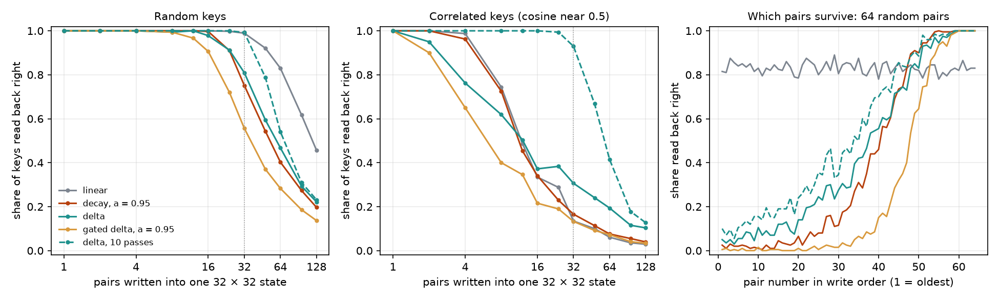
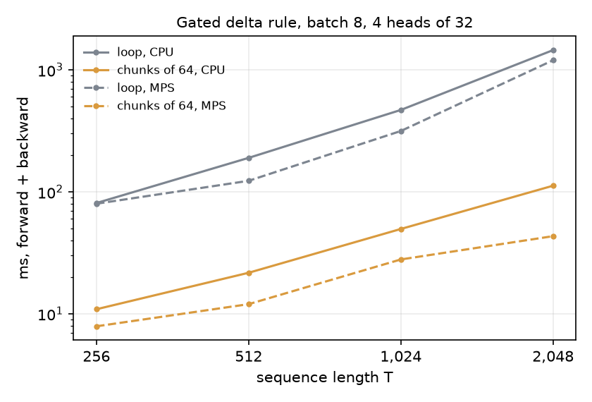
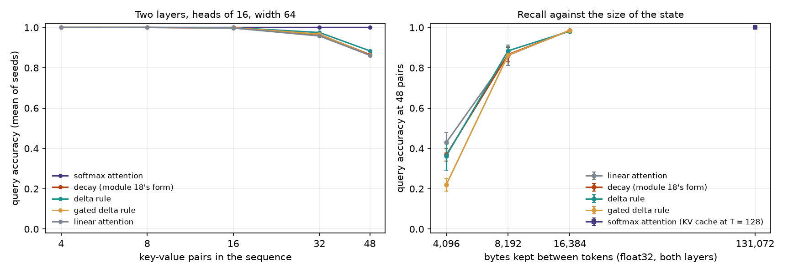
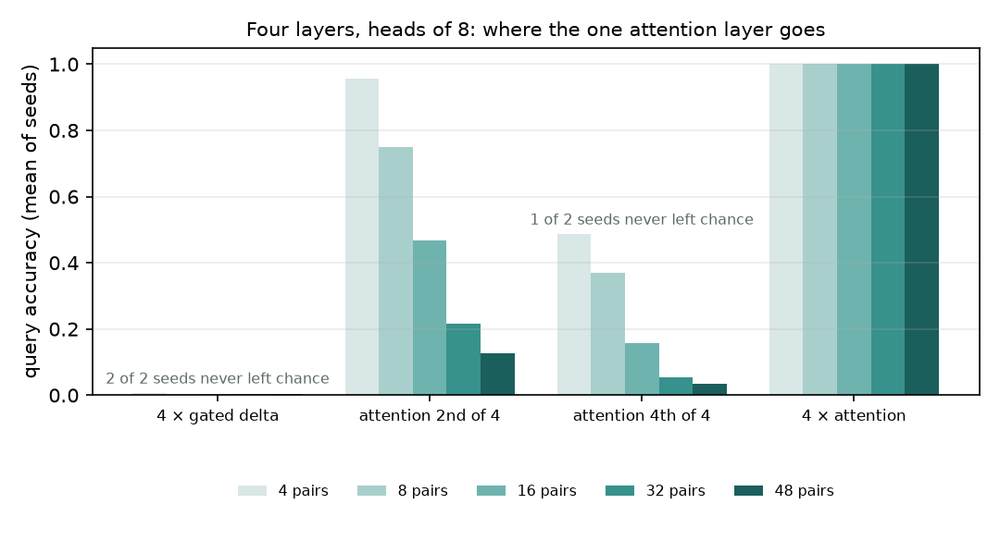
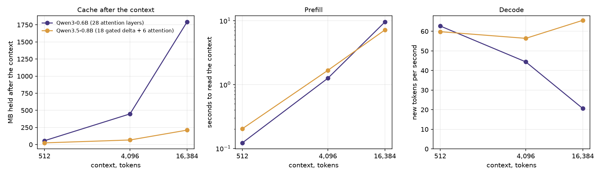

# Module 27: Memory as a matrix: the delta rule

Module 18 built recurrent models that carry a fixed-size state instead of a
KV cache. This module asks one question about that state:

> **How much can a fixed-size state recall, and why did the field move from
> decay to the delta rule?**

Here the state is a matrix S that stores values under keys. Write value v under
key k; later, `S k` returns it. Every layer in this module reads that way. They
differ in one line: how they write. The module has five sections, each with a
figure and the numbers beside it:

1. **Writing into one matrix, no training**: four write rules, how many pairs each keeps, and which.
2. **Two ways to compute the same layer**: a loop over tokens, and chunks of 64 tokens at once; they agree, and the chunks are 7 to 28 times faster.
3. **Trained models on a recall task**: five mixers, three state sizes, two seeds each.
4. **One attention layer in four**: a hybrid on the same task.
5. **The library way**: Qwen3.5-0.8B, a Gated DeltaNet hybrid, against Qwen3-0.6B, a transformer, on MLX.

Every number in this README comes from a JSON file in [`results/`](results/),
written by the script that measured it. Each experiment's expectation was
written down before it ran; the README gives each one and says where it
missed.

This is the third module of track 6, **Other recipes**. Read it after
[module 18](../18-beyond-attention/README.md), whose selective recurrence
returns here as the "decay" rule. Next, [module 19](../19-scaling-laws/README.md)
opens track 7.

**🕹 Interactive:** [Memory as a matrix](../../explorables/27-memory-as-a-matrix.html):
write pairs into a state of two numbers and watch which survive under each
rule; then 32 numbers; then the trained models and the two real ones.

**✅ Quiz:** [10 questions](../../quizzes/27.html): check yourself once you have read the five sections.

## Goals

By the end you will be able to:

- write linear attention, decay, the delta rule and the gated delta rule as one line each;
- show that the delta rule's write is one step of gradient descent;
- say which pairs each rule keeps when the state is full, and why;
- compute the delta rule a chunk at a time with one triangular solve, and check it against the loop;
- train small models on multi-query associative recall and read recall against state size;
- count what a hybrid model keeps between tokens from its config, and check it against a measurement.

## Setup

```bash
cd modules/27-memory-as-a-matrix/python
```

```bash
uv sync
```

| Need | Size | Where |
|---|---|---|
| Module 04's corpus, tiny-shakespeare | 1.1 MB | committed: `../04-attention-transformer/corpus/`, filler text for section 5 |
| `mlx-community/Qwen3-0.6B-4bit`, revision `73e3e38d` | 351 MB | Hugging Face cache, on the first run of `library.py qwen3` |
| `mlx-community/Qwen3.5-0.8B-4bit`, revision `da28692b` | 652 MB | Hugging Face cache, on the first run of `library.py qwen3.5` |

Sections 1 to 4 need no download. Both Qwen models are Apache-2.0. The
Qwen3.5 file also holds a vision encoder, which `mlx-lm` drops on load.

**The laptop guard.** Every script imports `src/common.py` before torch. It
sets `PYTORCH_MPS_HIGH_WATERMARK_RATIO=0.5`, as in every module. This module's
own budget is tighter: every script and every chunk must peak under 4 GB and
finish under five minutes, and `tests/test_results.py` checks every logged
peak against that. MLX has no such cap, so `library.py` limits MLX's buffer
cache to 256 MB and empties it after each trial: a first run without that
limit left about 10 GB of freed buffers held by the process. The training
runs of sections 3 and 4 take longer than five minutes in all, so they run in
chunks of at most 4.5 minutes, each resuming from a checkpoint.

| Script | Minutes | Peak RSS | Peak GPU memory |
|---|---|---|---|
| `src/capacity.py` | 0.04 | 0.22 GB | 0 (CPU) |
| `src/forms.py` | 0.29 | 0.51 GB | 0.11 GB (MPS driver) |
| `src/mqar.py`, 44 chunks | 185 min in all, longest chunk 4.52 | 1.00 GB | 1.71 GB (MPS driver) |
| `src/library.py qwen3` | 0.69 | 0.89 GB | 2.62 GB (MLX peak) |
| `src/library.py qwen3.5` | 0.57 | 1.22 GB | 1.41 GB (MLX peak) |

Measured on an Apple M5 with 16 GB, torch 2.14.1, MLX 0.32.4, mlx-lm 0.32.2,
while other jobs shared the Mac. Times carry that noise; byte counts do not.

## 1 · Writing into one matrix, no training

A state S of size d_v × d_k stores values under keys: write v under k, read
`S q` for a query q. Four ways to write, each one line
([`src/memory.py`](python/src/memory.py)):

```
linear attention   S ← S + β v kᵀ
decay              S ← α S + β v kᵀ
delta rule         S ← S + β (v − S k) kᵀ
gated delta rule   S ← α S + β (v − α S k) kᵀ
```

β in (0, 1] is the write strength, α in (0, 1] a decay. Linear attention adds
the new pair on top of everything (Katharopoulos et al., 2020). Decay first
shrinks everything, so old pairs fade; with one α per head and step, chosen
from the input, this is module 18's selective recurrence, Mamba-2's form,
written with q, k and v (section 2 checks the two give the same numbers). The
delta rule first asks what S already returns for k, `S k`, and writes only
the difference. If k was written before with another value, the old value is
replaced, not added to (Schlag et al., 2021, brought it to linear attention;
the rule itself is Widrow and Hoff's, from 1960). A layer that writes this way
is called DeltaNet. The gated delta rule does both; its layer is Gated
DeltaNet (Yang, Kautz and Hatamizadeh, 2024).

**The delta rule is a gradient step.** Take the loss ½‖S k − v‖²: how far the
state's answer for k is from v. Its gradient in S is (S k − v) kᵀ. One step
of gradient descent at rate β gives `S − β (S k − v) kᵀ`, the delta rule. The
state learns, one token at a time, to map keys to values.
[`src/capacity.py`](python/src/capacity.py) checks it with autograd on 100
random cases: the largest difference is 0: identical, in float64. Exercise (a) writes it.

**How many pairs fit.** `capacity.py` writes n pairs of random unit vectors
into a 32 × 32 state (d_k = d_v = 32), with β = 1, then reads every key back.
A read counts as right when it lies closer to its own value than to any other
of the n values. Each point is the mean of 20 draws. The same runs with keys
that share one direction, so that any two have a cosine near 0.5, show what
happens when keys look alike, as learned keys often do.



| Pairs written | 8 | 16 | 32 | 64 | 128 |
|---|---|---|---|---|---|
| linear | 1.00 | 1.00 | 0.99 | 0.83 | 0.46 |
| decay, α = 0.95 | 1.00 | 1.00 | 0.75 | 0.40 | 0.20 |
| delta | 0.99 | 0.98 | 0.81 | 0.47 | 0.22 |
| gated delta, α = 0.95 | 0.99 | 0.91 | 0.56 | 0.28 | 0.14 |
| delta, 10 passes over the pairs | 1.00 | 1.00 | 0.99 | 0.54 | 0.23 |
| *correlated keys:* linear | 0.74 | 0.33 | 0.13 | 0.06 | 0.03 |
| *correlated keys:* delta | 0.62 | 0.37 | 0.31 | 0.19 | 0.10 |
| *correlated keys:* delta, 10 passes | 1.00 | 1.00 | 0.93 | 0.41 | 0.13 |

**Written down before the first run**: linear falls below 0.5 near 64 pairs;
the delta rule reads at least as many pairs right as linear at every n; decay
keeps only the last 20 or so; the delta rule with 10 passes is exact up to 32
pairs; on overwrite, the delta rule returns the new value and linear a blend.

What the runs show:

- **With random keys, linear attention beats the one-pass delta rule.** At 64
  pairs, linear reads 0.83 right, the delta rule 0.47. That misses the
  expectation. Random keys in 32 dimensions are nearly at right angles, so a
  plain sum mixes the pairs only a little. The delta rule's erase step, with
  β = 1, also removes part of every older pair whose key leans on the new
  one.
- **The two keep different pairs.** At 64 pairs (right panel), linear keeps
  every pair about equally, 0.83 of the oldest 16 and 0.82 of the
  newest 16. The delta rule keeps 0.96 of the newest and 0.07 of the
  oldest; decay is starker still (0.98 against 0.02). A delta-rule
  state stays exact for what it saw last and lets the rest go.
- **Overwrite.** Write k₁ with one value, eight other pairs, then k₁ with a
  new value. The delta rule's read has cosine 1.00 with the new value and
  -0.03 with the old: replaced. Linear attention's read is a blend, cosine
  0.66 with the new and 0.66 with the old.
- **Correlated keys hurt every one-pass rule.** Linear falls below one half
  at 12 pairs, the delta rule at 16. From 12 pairs on, the
  delta rule keeps more than linear (0.31 against 0.13 at 32).
- **More passes make the delta rule a least-squares fit.** Repeat the writes
  ten times and the state converges to the S that best maps all keys to all
  values: exact up to 32 random pairs (0.99), since 32 keys in 32
  dimensions fit exactly, and 1.00 at 16 correlated pairs. The gap
  between one pass and ten is what a learned key and a learned β can buy back.

**Against the expectations:** linear attention held up far longer than
expected (above one half until 128 pairs, not 64), and the delta rule did not
match it at every n: two misses. Decay kept about the newest 24 pairs above
one half, near the 20 expected; ten passes were exact to 32 pairs, and the
overwrite test came out as expected.

## 2 · Two ways to compute the same layer

Generation runs the loop: one write and one read per token. Training wants
every position at once. For linear attention and decay, unrolling the loop
gives a (T × T) matrix applied to the values, the same matrix form as module
18's selective recurrence. The delta rule is harder: each write depends on
what S returns for k, which depends on every earlier write.

The way out is to work a chunk of C tokens at a time (Yang et al., 2024,
[arXiv 2406.06484](https://arxiv.org/abs/2406.06484)). Inside a chunk that
starts from state S₀, write each step's change as `u_t k_tᵀ`, with u_t the
scaled error at step t. Each u_t depends on the earlier ones through one
lower-triangular system:

```
(I + A) U = diag(β) (V − diag(g) K S₀ᵀ)      A[t, i] = β_t (g_t / g_i) k_t · k_i  for i < t
O = diag(g) Q S₀ᵀ + (tril(Q Kᵀ) ⊙ Γ) U        Γ[t, i] = g_t / g_i, the decay from i to t
```

g_t is the product of the decays since the chunk began (all 1 without a
gate). One triangular solve gives every u_t, then every output is a matrix
product. The chunk hands its last state to the next. `memory.chunked` does
this for all four rules; for the two rules with no delta, A is 0 and U is
just diag(β) V. Exercise (b) solves the system by forward substitution, one
row at a time. `memory.py` does the same substitution in blocks: invert
1 × 1 blocks, join pairs into 2 × 2, then 4 × 4, up to 64 × 64, six rounds of
matrix products. torch's own triangular solve gives the same answer but runs
slowly on Apple's GPU.

**A bug the first grid ran with.** The first version used a shorter formula,
(I + A)⁻¹ = (I − A)(I + A²)(I + A⁴)…, exact in exact arithmetic since A^64 =
0. In float32 it is useless when keys are alike: the powers of A grow like
binomial coefficients and cancel, and on near-equal keys the result was off
by up to 4.3 × 10¹⁰. Random test keys did not show it. A trained model's keys
do lean on each other, and at the end of the first grid one model's chunked
output differed from its own loop by 0.40 in the logits. We replaced the
formula, added a test with near-equal keys, and reran every run that uses a
write rule. The first grid's summary is kept in
`results/mqar_superseded/mqar.json`; no number below comes from it unless
marked.

[`src/forms.py`](python/src/forms.py) runs both forms on the same random
inputs (batch 8, 4 heads, d_k = 32, T = 512, chunks of 64):

| Rule | Largest gap, loop against chunks | Largest output |
|---|---|---|
| linear | 5.2 × 10⁻⁶ | 9.8 |
| decay | 7.2 × 10⁻⁷ | 2.1 |
| delta | 1.5 × 10⁻⁶ | 4.2 |
| gated delta | 7.2 × 10⁻⁷ | 1.9 |

Float32 rounding, nothing more. Module 18's selective recurrence, copied into
[`src/m18_selective.py`](python/src/m18_selective.py), against the decay rule
with q = C, k = B, v = x, β = Δ: 1.4 × 10⁻¹³ in float64. The two are one layer.



| ms, forward + backward | T = 256 | 512 | 1,024 | 2,048 |
|---|---|---|---|---|
| loop, CPU | 80.9 | 189.8 | 468.9 | 1,450.4 |
| chunks of 64, CPU | 10.9 | 21.7 | 49.6 | 112.2 |
| loop, MPS | 79.9 | 123.1 | 315.2 | 1,197.8 |
| chunks of 64, MPS | 7.9 | 12.0 | 27.9 | 43.3 |

On MPS the chunks run 10 to 28 times faster than the loop; on the CPU,
7 to 13 times. The loop's time grows faster than T: 18-fold on the CPU for 8 times the length. Other jobs shared the Mac, so read the ratios, not the
milliseconds. Every training run in section 3 uses the chunked form; at the
end of each run, the trained model's chunked output was checked against its
loop on two sequences: the largest gap over all runs is 2.2 × 10⁻⁴ in the
logits.

## 3 · Trained models on a recall task

**The task.** Multi-query associative recall, MQAR (Arora et al., 2023,
[arXiv 2312.04927](https://arxiv.org/abs/2312.04927)): a sequence lists
key-value pairs, then asks for keys again; at each query the model must name
the value that went with it. Zoology, the paper that built it, found that 82%
of the perplexity gap between attention and the gated-convolution models of
its day came from this kind of recall. Here ([`src/models.py`](python/src/models.py)):
a vocabulary of 512 tokens (keys from the first half, values from the
second), sequences of 128 tokens with 4 to 48 pairs, then queries in every
remaining position. Only queries are scored.

**The models.** One shell for all: embedding, two blocks, norm, head; width
64; about 134,000 parameters. A block is a mixer then a small MLP, each
pre-norm and residual. The mixer projects q, k and v, passes them through a
short causal convolution (kernel 4, so the key token can shape what is
written at the value's position), and then either runs one of the four
write rules over heads of size d_k, or softmax attention. Keys and queries
are scaled to unit length, as DeltaNet does. Only the mixer differs.

**The size of the state.** A memory mixer keeps H × d_k × d_k numbers per
layer, with H = 64 / d_k heads: 64 × d_k. Heads of 8, 16 and 32 give 4,096,
8,192 and 16,384 bytes over two layers, in float32. Softmax attention keeps
every key and value: 131,072 bytes after 128 tokens, and growing.

**Training** ([`src/mqar.py`](python/src/mqar.py)): AdamW, peak rate 3 × 10⁻³,
100 warm-up steps, cosine decay to 10%, weight decay 0.1, batch 32, 4,000
steps. The first 1,000 steps use only 4 and 8 pairs, then each batch takes
the next of 4, 8, 16, 32 and 48. Accuracy on 512 held-out sequences per pair
count, the same for every run. Seed 0 ran on MPS and seed 1 on the CPU, to
use both at once.

**Three changes after pilot runs, before the grid.** In pilots with every
pair count from the start, the delta-rule models stayed at chance for
thousands of steps while linear attention learned in a few hundred; a pilot
after the fix of section 2 still did. Three changes, made for all mixers: the 1,000-step curriculum; the write strength
β starting near 0.12 instead of 0.5, so a fresh delta-rule state behaves
like linear attention; and the grid shrunk from width 128 and 256 tokens to
width 64 and 128 tokens, to fit the time.



| Accuracy at 48 pairs, mean of 2 seeds | Heads of 8 (4,096 B) | Heads of 16 (8,192 B) | Heads of 32 (16,384 B) |
|---|---|---|---|
| linear attention | 0.429 (±0.050) | 0.862 (±0.052) | 0.985 (±0.000) |
| decay | 0.368 (±0.031) | 0.866 (±0.036) | 0.985 (±0.000) |
| delta rule | 0.363 (±0.070) | 0.884 (±0.020) | 0.982 (±0.001) |
| gated delta rule | 0.220 (±0.031) | 0.863 (±0.013) | 0.986 (±0.003) |
| softmax attention, heads of 16 (cache 131,072 B) | 1.000 | | |

| Accuracy at 16 pairs | Heads of 8 | Heads of 16 | Heads of 32 |
|---|---|---|---|
| linear attention | 0.941 (±0.021) | 0.997 (±0.002) | 1.000 (±0.000) |
| decay | 0.912 (±0.014) | 0.998 (±0.001) | 1.000 (±0.000) |
| delta rule | 0.898 (±0.049) | 0.999 (±0.000) | 1.000 (±0.000) |
| gated delta rule | 0.774 (±0.055) | 0.999 (±0.000) | 1.000 (±0.000) |

± is half the gap between the two seeds. Seed values for every run are in
`results/mqar.json` (`grid.*.seeds`). Every seed of every two-layer model
learned: it read at least half the queries right with 4 pairs.

**Written down before the grid**: attention at least 0.95 everywhere; at heads
of 32 the delta rules at least as good as linear attention at 48 pairs;
accuracy rising with head size for every rule; delta and gated delta within
0.1 of linear at heads of 16; decay the lowest at 48 pairs. What would change
our mind: linear attention ahead of the delta rule at every head size by more
than the seed spread.

What the runs show:

- **The size of the state decides; the write rule hardly does.** At 48
  pairs, every rule climbs from about 0.2 to 0.4 with heads of 8, to about
  0.86 to 0.88 with heads of 16, to 0.98 or 0.99 with heads of 32. Within one
  head size the four rules sit inside one another's seed spread, with one
  exception: the gated delta rule trails at heads of 8 (0.220 against 0.429
  for linear attention).
- **Softmax attention reads every query right** (1.000 at 48 pairs) with a
  cache of 131,072 bytes, 8 times the largest recurrent state. Its cache would
  keep growing with a longer sequence; the states would not.
- **No rule is clearly better at this scale.** The pre-registered test of the
  delta rule's edge, linear attention ahead by more than the seed spread at
  every head size, did not trigger, but neither did the opposite: at heads of
  8, linear attention leads the delta rule by 0.066, inside the seeds'
  gap. Section 1 predicts this for keys a model can spread out; the delta
  rule's edge, overwriting a key, never comes up here, since MQAR writes each
  key once.
- **Every memory-layer run of the grid was still improving at the end.** Over the last
  1,000 steps, accuracy at 48 pairs rose by up to 0.045 (heads of 8 most). Longer
  training would raise the small-state numbers; whether it would separate the
  rules, this grid cannot say.

Against the expectations: attention at least 0.95, met; delta rules level
with linear attention at heads of 32, met (all within 0.005); accuracy rising
with head size for every rule, met; delta and gated delta within 0.1 of
linear at heads of 16, met; decay the lowest at 48 pairs, missed (at heads
of 8 the gated delta rule is lowest; elsewhere decay sits mid-pack).

**A gate that started too low.** In the first grid (the one with the bug of
section 2), the gated delta rule's decay α started at 0.95 for every head. At
heads of 8 neither seed learned (0.010 at 48 pairs), nor did a four-layer
model of four gated delta layers. At 0.95, a pair written 90
tokens back keeps 0.95⁹⁰ = 1% of its size, so early in training no recall
signal reaches the gradient. Two extra runs with α starting at 0.99 learned
(0.245 at 48 pairs). The rerun starts every gate, in both gated rules, at
0.99. We did not retest 0.95 once the bug was fixed.

## 4 · One attention layer in four

Production hybrids keep a few attention layers among many recurrent ones;
Qwen3.5 keeps one in four (section 5). [Jelassi et al.](https://arxiv.org/abs/2402.01032)
prove the reason for copying: a fixed state cannot copy strings longer than
it can hold, while two attention layers can. Section 4 trains four-layer
models on the same task: all gated delta, attention as the second or as the
last layer, and all attention. Heads of 8, where section 3's states are
smallest, two seeds each, the same recipe. A memory layer here keeps 2,048
bytes, an attention layer 65,536 after 128 tokens.



| Four layers, heads of 8 | 16 pairs | 32 pairs | 48 pairs | Seeds that learned | Bytes kept after 128 tokens |
|---|---|---|---|---|---|
| 4 × gated delta | 0.004 (±0.001) | 0.004 (±0.001) | 0.004 (±0.000) | 0 of 2 | 8,192 |
| attention second | 0.467 (±0.300) | 0.217 (±0.158) | 0.127 (±0.092) | 2 of 2 | 71,680 |
| attention last | 0.156 (±0.145) | 0.054 (±0.047) | 0.033 (±0.027) | 1 of 2 | 71,680 |
| 4 × attention | 1.000 (±0.000) | 1.000 (±0.000) | 1.000 (±0.000) | 2 of 2 | 262,144 |

**Written down before the runs**: one attention layer recovers more than 80% of
the gap between all gated delta and all attention at 48 pairs; where it sits
matters less than the seed spread.

What the runs show:

- **Four gated delta layers never learned.** Both seeds stayed at chance
  (0.004 at 48 pairs, 0.005 at 4) through all 4,000 steps, under the
  recipe that trained every two-layer model of section 3. Four attention
  layers learned on both seeds (1.000).
- **One attention layer let the hybrids learn, partly.** With attention second,
  both seeds learned, but reached only 0.127 at 48 pairs, below the
  two-layer gated delta model at the same head size (0.220). With attention
  last, one seed learned and one did not (0.033 on average).
- **So this section measures training, not memory.** With the pure recurrent
  model at chance, there is no gap to recover. The test written down before
  the runs, more than 80% of the gap recovered, missed by far (12%), and
  where the attention layer sits cannot be read from two seeds whose spread
  is this large (0.183 at 48 pairs for attention second).

The likely cause is the recipe, not the layers: one learning rate and 4,000
steps for every depth. Section 3's two-layer models left chance (half the
queries right with 4 pairs) after 500 to 1,250 steps; the
four-layer hybrids that learned took 2,000 to 3,000. Four
stacked memory layers may need more steps or a lower rate. This
module did not test either. Zoology's own hybrids
([arXiv 2312.04927](https://arxiv.org/abs/2312.04927)) and Gated DeltaNet's
were trained with tuned rates and far more data.

## 5 · The library way: a Gated DeltaNet hybrid against a transformer

[Qwen3.5-0.8B](https://huggingface.co/Qwen/Qwen3.5-0.8B) stacks 24 layers: three
Gated DeltaNet layers, then one attention layer, six times over. Each Gated
DeltaNet layer keeps 16 matrices of 128 × 128 in float32, plus the last three
inputs of its short convolution. Its six attention layers keep 2 key-value
heads of 256 per token. [Qwen3-0.6B](https://huggingface.co/Qwen/Qwen3-0.6B)
is a plain transformer: 28 attention layers, 8 key-value heads of 128. Both run
here with 4-bit weights through `mlx-lm`:

```python
model, tok = load("mlx-community/Qwen3.5-0.8B-4bit")
cache = make_prompt_cache(model)          # one ArraysCache per Gated DeltaNet layer, one KVCache per attention layer
```

[`src/library.py`](python/src/library.py) gives each model a text from
tiny-shakespeare of exactly 512, 4,096 or 16,384 tokens, with "Remember this:
the pass code is 4817." after the first 5% and "What was the pass code? The
pass code is" at the end. It reads the text in steps of 512 tokens, then
writes 24 tokens greedily. Three pass codes per length. The two models have
different tokenizers, so the same length in tokens is a slightly different
text.



| | 512 tokens | 4,096 | 16,384 |
|---|---|---|---|
| Qwen3-0.6B, cache | 58,720,256 B | 469,762,048 B | 1,879,048,192 B |
| Qwen3.5-0.8B, cache | 25,829,376 B | 69,869,568 B | 220,864,512 B |
| Qwen3-0.6B, seconds to read the context | 0.12 | 1.26 | 9.54 |
| Qwen3.5-0.8B, seconds to read the context | 0.20 | 1.67 | 7.16 |
| Qwen3-0.6B, new tokens per second | 62.7 | 44.4 | 20.6 |
| Qwen3.5-0.8B, new tokens per second | 59.8 | 56.4 | 65.6 |
| Qwen3-0.6B, pass codes found | 3 of 3 | 3 of 3 | 3 of 3 |
| Qwen3.5-0.8B, pass codes found | 3 of 3 | 3 of 3 | 3 of 3 |

The cache bytes are counted from the cache's own arrays, after the context.
Qwen3-0.6B adds 114,688 bytes per token. Qwen3.5-0.8B adds 12,288, its six
attention layers, on top of a fixed 19,537,920 bytes (18.6 MB) for its
18 Gated DeltaNet layers. Its cache is the smaller one from 191 tokens on;
at 16,384 tokens it holds 211 MB against 1.75 GB. Exercise (c)
predicts every one of these counts from the configs alone.

Speeds are medians of three trials (the first trial of each pair of model and
length is slower, since MLX compiles its kernels then), with other jobs on
the Mac. Reading the context costs about the same for both. Writing differs:
Qwen3-0.6B slows from 62.7 to 20.6 new tokens per second as its
cache grows, since each new token reads all of it, while Qwen3.5-0.8B stays
between 56.4 and 65.6. Both models found every pass code, at
every length: the pass code sat in plain view, near the start, and one fact is far
below what MQAR asks of a state.

**Written down before the run**: Qwen3.5's cache smaller from about 200 tokens
on; Qwen3-0.6B faster to decode at 512 tokens and Qwen3.5 faster at 16k; both
find the pass code at 512 and 4,096 tokens. All met: 191 tokens; 62.7
against 59.8 at 512 (a margin inside the noise), 65.6 against
20.6 at 16k.

**Where this sits.** Gated DeltaNet's authors report that it beats Mamba-2 and
DeltaNet, and that hybrids with attention do better still
([arXiv 2412.06464](https://arxiv.org/abs/2412.06464)). RWKV-7 writes with a
generalised delta rule, with gates per channel and learned write rates
([arXiv 2503.14456](https://arxiv.org/abs/2503.14456)). Kimi Linear mixes a
finer-gated delta rule with attention, layer by layer, and reports up to 75%
less KV cache and up to 6× decoding speed at 1M tokens
([arXiv 2510.26692](https://arxiv.org/abs/2510.26692)). Mamba-3 keeps decays
but makes the state complex, and reports +0.6 points over Gated DeltaNet at
1.5B ([arXiv 2603.15569](https://arxiv.org/abs/2603.15569)). DeltaProduct
takes several delta steps per token for better state tracking
([arXiv 2502.10297](https://arxiv.org/abs/2502.10297)). LFM2 goes another way
for phones: short gated convolutions with a few attention layers
([arXiv 2511.23404](https://arxiv.org/abs/2511.23404)). One reading is
disputed: whether layers that learn at test time really memorise keys to
values, or act as learned linear attention; Liu et al. argue the second
([arXiv 2602.21204](https://arxiv.org/abs/2602.21204)). This module's section
1 shows the gradient-step view; it does not settle what trained layers do.

## Run it

Sections 1 and 2, each well under a minute:

```bash
uv run python src/capacity.py --figures
```

```bash
uv run python src/forms.py --figures
```

Sections 3 and 4: run until it prints `pending: 0` (about 3 hours of
training on one device), then summarise:

```bash
uv run python src/mqar.py run
```

```bash
uv run python src/mqar.py summarize --figures
```

`--only grid,_s0` or `--device cpu` split the runs, for example over two
terminals, one on MPS and one on the CPU.

Section 5, one model per call, then merge:

```bash
uv run python src/library.py qwen3
```

```bash
uv run python src/library.py qwen3.5
```

```bash
uv run python src/library.py merge --figures
```

Redraw every figure, or rewrite the explorable's data block, from the
committed JSON:

```bash
uv run python src/figures.py
```

```bash
uv run python src/export_explorable.py
```

## Exercises

Skeletons with `# TODO(you):` live in [`exercises/`](exercises/); reference
solutions are in [`solutions/`](solutions/). Each asks you to predict before
you run. All three run on the CPU in a second.

- **(a) `exercise_a_delta_step.py`**: write linear attention's write and the
  delta rule's, and one gradient step with autograd; check the delta rule is
  that step. Then write one key twice and predict what each rule returns.
- **(b) `exercise_b_chunk.py`**: solve (I + A) U = diag(β) V by forward
  substitution and compute a chunk of the delta rule at once; the test checks
  it against the loop and against `memory.unit_lower_inverse`.
- **(c) `exercise_c_cache.py`**: from each model's config, the bytes its cache
  holds after T tokens; the test checks your count against all six
  measurements of section 5.

## Tests

```bash
uv run pytest
```

78 tests, a few seconds, no model loaded. They check the solutions
against `src/`, the loop against the chunks for every rule (with and without
a state carried in), the decay rule against module 18's form, the product
formula for the triangular inverse, that every model is causal, the MQAR
batches, every logged peak against the 4 GB and five-minute budget, the
results against each other, and the explorable against the results.

## Checkpoint: you should now be able to…

- write the four rules and say what each does to a key written twice;
- derive the delta rule from the loss ½‖S k − v‖²;
- say which pairs survive in a full state under each rule;
- explain why the chunked form needs a triangular solve, and check it against the loop;
- read a recall-against-state-size result, with its seeds, and say what it does not show;
- count a hybrid's cache from its config, and say from which length it pays.

## Links

- Widrow and Hoff, "Adaptive switching circuits" (1960), the delta rule
- Katharopoulos et al., [Transformers are RNNs: Fast Autoregressive Transformers with Linear Attention](https://arxiv.org/abs/2006.16236) (2020)
- Schlag, Irie and Schmidhuber, [Linear Transformers Are Secretly Fast Weight Programmers](https://arxiv.org/abs/2102.11174) (2021)
- Arora et al., [Zoology: Measuring and Improving Recall in Efficient Language Models](https://arxiv.org/abs/2312.04927) (2023), MQAR
- Jelassi et al., [Repeat After Me: Transformers are Better than State Space Models at Copying](https://arxiv.org/abs/2402.01032) (2024)
- Dao and Gu, [Transformers are SSMs](https://arxiv.org/abs/2405.21060) (2024), Mamba-2
- Yang et al., [Parallelizing Linear Transformers with the Delta Rule over Sequence Length](https://arxiv.org/abs/2406.06484) (2024), DeltaNet's chunked form
- Yang, Kautz and Hatamizadeh, [Gated Delta Networks: Improving Mamba2 with Delta Rule](https://arxiv.org/abs/2412.06464) (2024)
- Siems et al., [DeltaProduct](https://arxiv.org/abs/2502.10297) (2025)
- Peng et al., [RWKV-7 "Goose" with Expressive Dynamic State Evolution](https://arxiv.org/abs/2503.14456) (2025)
- Qwen Team, [Qwen3 Technical Report](https://arxiv.org/abs/2505.09388) (2025)
- Kimi Team, [Kimi Linear](https://arxiv.org/abs/2510.26692) (2025)
- Amini et al., [LFM2 Technical Report](https://arxiv.org/abs/2511.23404) (2025)
- Liu et al., [Test-Time Training with KV Binding Is Secretly Linear Attention](https://arxiv.org/abs/2602.21204) (2026)
- Lahoti et al., [Mamba-3](https://arxiv.org/abs/2603.15569) (2026)
- [mlx-community/Qwen3.5-0.8B-4bit](https://huggingface.co/mlx-community/Qwen3.5-0.8B-4bit) · [mlx-community/Qwen3-0.6B-4bit](https://huggingface.co/mlx-community/Qwen3-0.6B-4bit) · [mlx-lm](https://github.com/ml-explore/mlx-lm)
