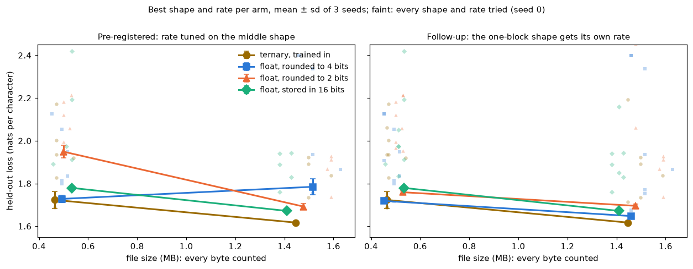
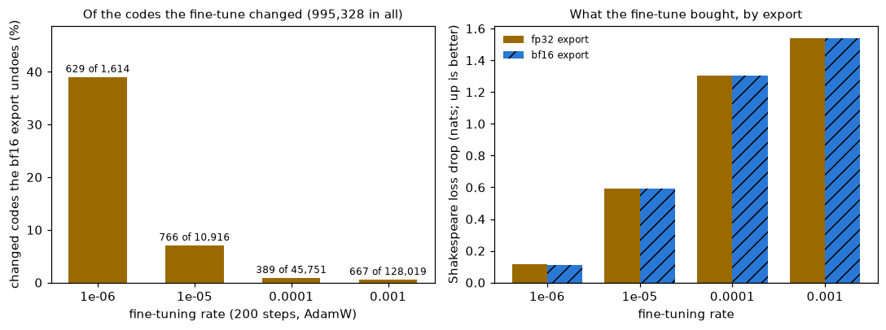
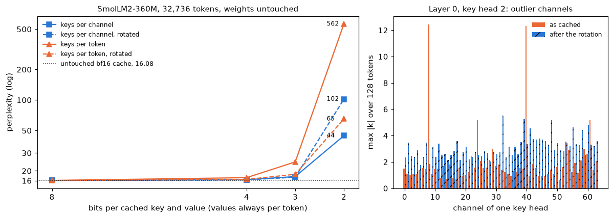
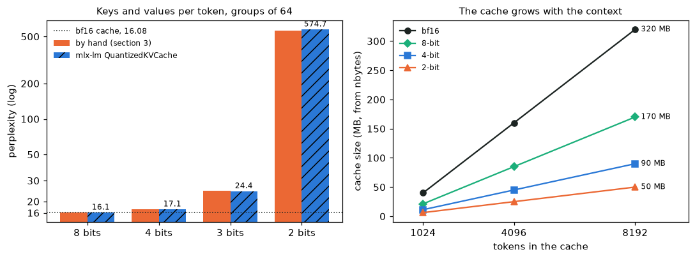

# Module 28: Fewer bits, trained in

Module 23 rounded a trained model's weights to 8 and 4 bits and paid for it
in perplexity. This module asks two harder questions about bits:

**The question.** At a fixed file size, does training in very low bits beat
rounding a float model, and where does the KV cache break?

It has four sections, each with a figure and the numbers beside it:

1. **Ternary, trained in**: module 04's char-GPT with every block weight in {−1, 0, 1} during training (BitLinear), against float models rounded to 4 and 2 bits, at the same file size.
2. **The bf16 cast at export**: how a ternary model's file can differ from the model that trained, and how a cast can undo a fine-tune.
3. **The KV cache by hand**: SmolLM2-360M's keys and values rounded to 8, 4, 3 and 2 bits, two layouts, with and without a rotation.
4. **The library way**: mlx-lm's own quantised cache, its perplexity, size and speed beside the hand version.

Every number in this README comes from a JSON file in [`results/`](results/),
written by the script that measured it. Before any run we wrote down what we
expected; [What we expected, and what happened](#what-we-expected-and-what-happened)
scores each guess.

This is the fourth module of track 8, **Using models well**. Read it after
[module 23](../23-compression/README.md). Next,
[module 24](../24-reinforcement-learning/README.md) starts track 9 with
reinforcement learning.

**🕹 Interactive:** [Fewer bits, trained in](../../explorables/28-fewer-bits-trained-in.html):
replay the matched-size runs; move a latent weight across the ternary
threshold and watch the bf16 cast; round a real model's cached keys at the
bits and layout you pick and watch the cliff.

**✅ Quiz:** [10 questions](../../quizzes/28.html): check yourself once you have read the four sections.

## Goals

By the end you will be able to:

- write BitLinear: absmean ternary weights, 8-bit inputs and the straight-through gradient;
- count a model's bytes and compare models at the same file size, not the same parameter count;
- say why a fair comparison tunes every arm's shape and rate, and scores on text no choice looked at;
- say how a bf16 cast at export can change a ternary model's codes;
- quantise a KV cache per token and per channel, and say what a Hadamard rotation does to outliers;
- use mlx-lm's quantised cache and check it against your own rule.

## Setup

```bash
cd modules/28-fewer-bits-trained-in/python
```

```bash
uv sync
```

| Need | Size | Where |
|---|---|---|
| Module 04's char-GPT code and trained weights | 2.5 MB | committed: `../04-attention-transformer/` |
| wikitext-103, first 20,000,000 characters | about 12 MB read from a 157 MB file | `~/.cache/huggingface/mlcourse/`; reused if an earlier module cached a longer slice of the same file (on this Mac one holds 21.5 million characters) |
| SmolLM2-360M-Instruct (tokenizer only) | a few MB | Hugging Face cache; module 05 already fetched it |
| `mlx-community/SmolLM2-360M-Instruct` (bf16, MLX layout) | 724 MB | Hugging Face cache; module 23 already fetched it |
| wikitext-103, first 2 row groups | 0.37 MB | `~/.cache/huggingface/mlcourse/`; modules 11, 12 and 23 already fetched it |

Section 1 reads wikitext the way module 19 does. A token there is one
character; the vocabulary is every character seen at least 10 times in the
training part (316), plus one id for the rarer ones: 317. The last 200,000
characters are held out and cut in two halves of 100,000: the **tune** half
picks shapes and rates, the **report** half scores the winners. No choice
looks at the report half.

**The laptop guard.** Every script imports `src/common.py` before torch. It sets
`PYTORCH_MPS_HIGH_WATERMARK_RATIO=0.5` and `PYTORCH_MPS_LOW_WATERMARK_RATIO=0.4`:
the Apple GPU may take at most 5.92 GB on this 16 GB Mac, and a run that grows
past that stops with an error instead of pushing the Mac into swap. MLX has no
such cap, so the MLX scripts only measure. Section 1 trains 89 models;
`src/matched.py` trains for at most 4.5 minutes per call, then pauses the
current run (model, optimiser and step saved outside the repo) and exits; the
next call resumes it. A test checks, on the CPU, that a paused and resumed
run ends with the same weights as an unbroken one.

| Script | Minutes | Peak RSS | Peak GPU |
|---|---|---|---|
| `src/matched.py`, 61 runs in 17 chunks | 65.8 in all, longest chunk 4.22 | 0.69 GB | 2.21 GB (MPS driver) |
| `src/followup.py`, 28 more runs in 8 chunks | 25.5 in all, longest chunk 4.10 | 0.63 GB | 2.21 GB (MPS driver) |
| `src/export.py` | 1.07, plus about 1 to train its base model once (cached) | 0.63 GB | 1.07 GB (MPS driver) |
| `src/kv_hand.py` | 1.37 | 1.17 GB | 2.03 GB (MLX's own peak) |
| `src/kv_mlx.py` | 1.38 | 1.23 GB | 2.14 GB (MLX's own peak) |

From the `guard` and `chunks` fields of each results file.

Measured on an Apple M5 with 16 GB, torch 2.14.1, MLX 0.32.4, mlx-lm 0.32.2,
while other jobs shared the machine.

**Seeds.** `train.py` calls `seed_all(seed)` (Python, NumPy, torch) before
building each model; its batches come from `torch.Generator().manual_seed(1000 + seed)`,
so two arms with the same seed read the same characters in the same order.
Section 3's rotation draws its signs from NumPy with seed 0. Generation is greedy.

## 1 · Ternary, trained in, against floats rounded after

Module 23 rounded weights after training. BitNet b1.58 (Ma et al.,
[arXiv:2402.17764](https://arxiv.org/abs/2402.17764), 2024) trains with the
rounding in place. Every linear layer in the blocks becomes a **BitLinear**
(`src/bitlinear.py`):

```
weights      g = mean |W| over the matrix;  code = clamp(round(W / g), −1, 1);  W′ = code · g
inputs       per token: s = 127 / max |x|;   x′ = clamp(round(x · s), −128, 127) / s
forward      y = x′ W′ᵀ + b
backward     as if both roundings were the identity
```

The last line is the **straight-through estimator** (Bengio et al.,
[arXiv:1308.3432](https://arxiv.org/abs/1308.3432), 2013): `round` has zero
gradient almost everywhere, so the backward pass skips it and the gradient
lands on float **latent** weights, which the optimiser keeps. Only the codes
and one scale per matrix go in the file. Three codes need log₂ 3 = 1.58 bits,
hence "b1.58"; five codes fit in a byte (3⁵ = 243 ≤ 256), so we count 1.6
bits per weight. Exercise (a) shows why training matters: module 04's trained
char-GPT, rounded to ternary after training, goes from 1.69 to 4.34 nats.

**Four arms, two budgets.** Every model is module 04's char-GPT class (heads
of 32 channels), trained for 1,000 steps of 32 × 128 characters, 4,096,000
characters in all, with AdamW, warm-up and cosine decay. A file holds:

| Arm | Block weights | Everything else |
|---|---|---|
| ternary, trained in | 1.6 bits, one 16-bit scale per matrix | 16 bits |
| float, rounded to 4 bits | 4 bits + a 16-bit scale and bias per group of 32 = 5 bits | 16 bits |
| float, rounded to 2 bits | 2 + 1 = 3 bits | 16 bits |
| float, stored in 16 bits | 16 bits | 16 bits |

"Everything else" is the token and position embeddings, the LayerNorms and
the biases. The rounded arms use module 23's affine rule (MLX's) after
training, on weights only; the ternary arm also rounds its activations to 8
bits, a handicap the rounded arms do not carry. Groups of 32, not 64, let widths be any multiple
of 32.

Each arm gets three shapes (the deepest, a middle one and one block, wide)
whose file lies within 10% of the budget, 0.5 MB or 1.5 MB (here MB means 10⁶ bytes). So at 0.5 MB the
ternary arm runs 288 × 1, 160 × 5 and 128 × 10 (width × blocks) while the
4-bit arm runs 192 × 1, 128 × 3 and 96 × 6. Veldanda
([arXiv:2609.29397](https://arxiv.org/abs/2609.29397), 2026) showed that in
models this small the baseline's shape alone can decide the verdict, so
every arm runs the same protocol, written before any run:

1. the middle shape at rates 1e-3, 3e-3 and 1e-2, seed 0, and one step further if the best is at an end;
2. the other two shapes at the best rate, seed 0;
3. the best shape and rate with seeds 1 and 2.

Choices use the tune half; the tables report the report half, mean ± standard
deviation over the three seeds.



**As pre-registered:**

| Budget | Arm | Shape, rate | File | Chars per parameter | Loss (nats per char) |
|---|---|---|---|---|---|
| 0.5 MB | ternary | 288 × 1, 1e-2 | 464,034 B | 3.6 | **1.723** ± 0.041 |
| | 4-bit | 128 × 3, 1e-2 | 493,056 B | 6.3 | 1.728 ± 0.016 |
| | 2-bit | 128 × 5, 1e-2 | 499,712 B | 3.9 | 1.949 ± 0.030 |
| | 16-bit | 96 × 2, 1e-2 | 533,184 B | 15.4 | 1.779 ± 0.008 |
| 1.5 MB | ternary | 608 × 1, 3e-3 | 1,446,562 B | 0.9 | **1.617** ± 0.007 |
| | 4-bit | 160 × 7, 1e-2 | 1,516,160 B | 1.8 | 1.785 ± 0.037 |
| | 2-bit | 480 × 1, 3e-3 | 1,478,400 B | 1.4 | 1.692 ± 0.015 |
| | 16-bit | 224 × 1, 3e-3 | 1,410,304 B | 5.8 | 1.672 ± 0.006 |

Two things in this table look wrong. The 4-bit arm does worse at 1.5 MB
(1.785) than at 0.5 MB (1.728). And four of the eight winners have one block,
yet the protocol tuned the rate on the middle shape only, so they ran at a
rate chosen for another shape. In the 4-bit cell at 1.5 MB the one-block
shape (384 × 1) ran at 1e-2 and scored 2.399.

**Follow-up, not pre-registered.** We wrote it after seeing the table above:
`src/followup.py` gives the one-block shape of every cell its own rate (the
same grid and rule), then seeds 1 and 2 at its best rate. A cell keeps
whichever of the two winners scores lower on the tune half.

| Budget | Arm | Winner | Shape, rate | Loss | Change |
|---|---|---|---|---|---|
| 0.5 MB | ternary | unchanged | 288 × 1, 1e-2 | 1.723 ± 0.041 | |
| | 4-bit | one block | 192 × 1, 3e-3 | **1.718** ± 0.006 | −0.010 |
| | 2-bit | one block | 256 × 1, 3e-3 | 1.759 ± 0.007 | −0.190 |
| | 16-bit | unchanged | 96 × 2, 1e-2 | 1.779 ± 0.008 | |
| 1.5 MB | ternary | unchanged | 608 × 1, 3e-3 | **1.617** ± 0.007 | |
| | 4-bit | one block | 384 × 1, 3e-3 | 1.648 ± 0.005 | −0.137 |
| | 2-bit | one block | 480 × 1, 1e-3 | 1.695 ± 0.009 | +0.004 |
| | 16-bit | unchanged | 224 × 1, 3e-3 | 1.672 ± 0.006 | |

(The 2-bit winner at 1.5 MB moved to 1e-3, which beat 3e-3 on the tune half
by 0.002 on seed 0 and then scored 0.004 worse on the report half.)

What rounding cost each float model, the same model before and after (report
half, mean of three seeds):

| Budget | Arm (follow-up winner) | Before rounding | After | Cost |
|---|---|---|---|---|
| 0.5 MB | 4-bit | 1.713 | 1.718 | 0.006 |
| | 2-bit | 1.661 | 1.759 | 0.098 |
| 1.5 MB | 4-bit | 1.646 | 1.648 | 0.002 |
| | 2-bit | 1.634 | 1.695 | 0.061 |

What this shows:

- **At 1.5 MB the ternary model wins under both protocols**: by 0.031 nats
  against the best rounded float (4-bit), 0.055 against the 16-bit float,
  0.078 against 2-bit. The pre-registered margin over 4-bit, 0.168, was mostly
  a badly tuned baseline: one shape given its own rate took away 0.137 of it.
- **At 0.5 MB ternary and 4-bit tie.** After the follow-up 4-bit is ahead by
  0.005, but the ternary arm's three seeds spread from 1.688 to 1.768.
  Retraining seed 0 on the GPU gave 1.704 against 1.688 the first time
  (`results/export.json`, `base`): MPS training is not exactly repeatable,
  so part of that spread is the hardware, not the seed.
- **Rounding to 4 bits after training is nearly free** here (0.002 to 0.007
  nats); **rounding to 2 bits is not** (0.03 to 0.19). The 2-bit arm's float
  model at 0.5 MB was the best model of the cell before rounding (1.661) and
  lost 0.098 to it.
- **Shape and rate matter more than the format.** At the tuned rate the three
  shapes of one cell span 0.18 to 0.65 nats, more than any gap between the
  arms' winners after the follow-up (0.08 at most).

What it does not show. These models see 0.9 to 15 characters per parameter,
far fewer than real models see; Ouyang et al.
([arXiv:2411.17691](https://arxiv.org/abs/2411.17691), 2024) found that low
bits hurt more the longer a model trains, and ParetoQ (Liu et al.,
[arXiv:2502.02631](https://arxiv.org/abs/2502.02631), 2025) finds a change
between 2 and 3 bits: at 3 bits and above, training keeps the model close to
the float one; at 2 and below, its representations change a lot. One corpus, one step count, two budgets, three seeds.
The deepest shape never got its own rate. The rounded arms keep float
activations. We measured loss, not speed: a 1.6-bit file needs a kernel that
unpacks codes to run fast, such as the CPU and GPU code released with the open
BitNet b1.58 2B4T ([arXiv:2504.12285](https://arxiv.org/abs/2504.12285), 2025).

## 2 · The bf16 cast at export

A ternary model's file holds codes, not latents. Sahai et al.
([arXiv:2610.07853](https://arxiv.org/abs/2610.07853), 2026) found that the
export tools of BitNet b1.58 2B4T, Falcon-E and BitCPM cast the latents to
**bf16** before taking the codes. bf16 is a 16-bit float with float32's range
but only 8 significant bits. A latent just
above the threshold 0.5 · g can land exactly on it, and `round` sends an exact
half to the even neighbour, 0. In their checkpoints 0.83 to 1.77% of codes
disagree; after a fine-tune at a low rate, the cast undid most of it (accuracy
on GSM8K, module 22's school maths problems, from 58.79% to 0.78% for
Falcon-E-1B).

Our ternary models, exported both ways (`src/matched.py`, every ternary run):

| Model | Codes | Flipped by the bf16 cast | Exactly on the threshold in bf16 | Loss change |
|---|---|---|---|---|
| 0.5 MB, three seeds | 995,328 | 1,255 to 1,566 (0.13 to 0.16%) | 2,530 to 3,051 | under 0.001 |
| 1.5 MB, three seeds | 4,435,968 | 5,420 to 6,028 (0.12 to 0.14%) | 10,318 to 10,422 | under 0.001 |

After normal training the cast changes little. `src/export.py` then
fine-tunes the 0.5 MB ternary model on tiny-shakespeare, text it never saw,
for 200 steps at four constant rates (AdamW, no weight decay), and exports
twice.



| Rate | Codes changed (fp32 export) | Undone by the bf16 export | Latent move, median (bf16 steps) | Shakespeare loss, fp32 export | bf16 export |
|---|---|---|---|---|---|
| (before) | | | | 3.346 | 3.349 |
| 1e-6 | 1,614 | 629 (39.0%) | 0.33 | 3.228 | 3.237 |
| 1e-5 | 10,916 | 766 (7.0%) | 2.6 | 2.754 | 2.754 |
| 1e-4 | 45,751 | 389 (0.9%) | 12.3 | 2.041 | 2.041 |
| 1e-3 | 128,019 | 667 (0.5%) | 38.7 | 1.807 | 1.806 |

The smaller the rate, the larger the share undone: at 1e-6 the median latent
moves a third of a bf16 step, and the cast takes back 39% of the code
changes. The loss barely notices (3.228 against 3.237): in this small model
the embeddings, norms and biases stay float and take much of what the
fine-tune buys. In Sahai et al.'s models almost every weight is a ternary
code, which may be why they saw a collapse and we do not; we did not test it. The fix they tested is simple: write the codes the training
quantiser computes, from fp32 latents.

## 3 · The KV cache by hand

Module 07 measured what a model keeps for every past token: one key and one
value per layer and key head. SmolLM2-360M has 32 layers, 5 key heads of 64
channels: 32 × 2 × 5 × 64 × 2 bytes = 40,960 bytes per token in bf16, about
335 million bytes at 8,192 tokens, almost half the 724 MB of weights. Rounding the cache cuts
that.

`src/kvquant.py` writes a cache that rounds what the model stores, by module
23's affine rule in groups of 64, written again in MLX ops (a test checks it
against `mx.quantize` bit for bit at 2, 3, 4 and 8 bits). Two layouts:

- **per token**: a group is the 64 channels of one token in one head;
- **per channel**: a group is 64 tokens of one channel.

KIVI (Liu et al., [arXiv:2402.02750](https://arxiv.org/abs/2402.02750), 2024)
rounds keys per channel and values per token, since keys carry a few large
channels. The third choice is a **rotation**: multiply keys and values by an
orthogonal 64 × 64 matrix R before rounding and by Rᵀ after. Attention
scores do not change, since (qR)(kR)ᵀ = qkᵀ, but each channel of kR mixes all
64 channels of k, so one large channel spreads over all of them. We use a
random Hadamard matrix (±1 entries / 8, rows times random signs), as QuaRot
does (Ashkboos et al., [arXiv:2404.00456](https://arxiv.org/abs/2404.00456),
2024).

The weights stay untouched; values are always per token; perplexity is
module 23's (32,736 tokens). Each query attends to rounded keys and values,
its own included, which is stricter than KIVI, which keeps recent tokens in
full precision.



| Bits | Keys per channel | per channel, rotated | Keys per token | per token, rotated |
|---|---|---|---|---|
| 16 (untouched) | 16.08 | | | |
| 8 | 16.08 | 16.08 | 16.10 | 16.08 |
| 4 | 16.36 | 16.30 | 17.14 | 16.45 |
| 3 | 17.57 | 17.32 | 24.50 | 18.51 |
| 2 | 44.45 | 101.93 | 562.46 | 65.07 |

- 8 bits cost nothing; 4 bits cost 2% per channel and 7% per token.
- **The cliff is between 3 and 2 bits** in every setting: at 2 bits the
  perplexity is 2.8 times the untouched model's at best, 35 times at worst.
- Without the rotation, keys per channel beat keys per token at every width.
- The rotation helps keys per token a lot (562 to 65 at 2 bits), and keys
  per channel a little at 3 and 4 bits. At 2 bits it **hurts** keys per
  channel (44 to 102). We did not expect that. One guess, untested: per
  channel, the large channels already get their own scale, and the rotation
  spreads each token's large values over all channels, so token-to-token
  spikes now land in every channel's group.
- In 11 of 32 layers some key head has a channel whose largest |k| is at
  least 5 times the median channel's (8.64 at most, layer 0). After the
  rotation the worst ratio is 2.04 (layer 29).

TurboQuant (Zandieh et al., [arXiv:2504.19874](https://arxiv.org/abs/2504.19874),
2025) also rotates, then uses a scalar quantiser tuned to the rotated
distribution, and reports no loss at 3.5 bits per channel. SPECTRA (Zhang et
al., [arXiv:2608.07915](https://arxiv.org/abs/2608.07915), 2026) names the
2-bit cliff and spends bits unevenly after its own rotation.

## 4 · The library way: mlx-lm's quantised cache

mlx-lm ships a cache that stores integers:

```python
from mlx_lm.models.cache import QuantizedKVCache
cache = [QuantizedKVCache(group_size=64, bits=4) for _ in model.layers]
logits = model(tokens, cache=cache)
# or, when generating: stream_generate(model, tok, prompt, kv_bits=4, kv_group_size=64)
```

It quantises keys and values per token with `mx.quantize` and attends with
`mx.quantized_matmul`, without rebuilding the floats. That is section 3's
per-token layout without rotation, so the two should agree; the gap is the
kernels' arithmetic. (One trap: mlx-lm sends any cache object with a `bits`
attribute down this integer path, so our hand cache names its field
`n_bits`.)



| Cache | By hand | mlx-lm | Bytes at 1,024 / 4,096 / 8,192 tokens |
|---|---|---|---|
| bf16 | 16.083 | 16.083 | 40.0 / 160.0 / 320.0 MB |
| 8-bit | 16.099 | 16.099 | 21.3 / 85.0 / 170.0 MB |
| 4-bit | 17.136 | 17.143 | 11.3 / 45.0 / 90.0 MB |
| 3-bit | 24.500 | 24.431 | |
| 2-bit | 562.46 | 574.67 | 6.3 / 25.0 / 50.0 MB |

Bytes are each cache's `nbytes` after a prompt of that length (MB = 2²⁰
bytes). A 4-bit cache holds 4 bits plus a bf16 scale and bias per 64 values:
4.5 / 16 = 0.28 of the bf16 bytes, exactly what `nbytes` reports.

The two columns agree to 0.04% at 4 bits and 0.3% at 3; at 2 bits they
differ by 2.2%, where small arithmetic differences move a perplexity that
has already blown up.

Speed, after a 4,096-token prompt, 64 greedy tokens, median of three: bf16
cache 72.1 tokens per second, 8-bit 67.4, 4-bit 68.9. At 4,096 tokens the
cache (160 MB) is small next to the weights, so a smaller cache saves little
reading; the gain is memory, which lets longer contexts or more requests fit.
One of the 4-bit runs read 124.4 against 67.5 and 68.9 for the others; the
machine was shared, so read the speeds as rough.

## What we expected, and what happened

Written on 2026-10-19 before any run of the four scripts (P1 to P6 score the
pre-registered protocol; the follow-up changes P1 and P2 as noted):

| | Expectation | Result | |
|---|---|---|---|
| P1 | ternary beats 2-bit by ≥ 0.10 nats at both budgets | 0.226 at 0.5 MB, 0.075 at 1.5 MB (follow-up: 0.036, 0.078) | missed |
| P2 | ternary beats 4-bit by ≥ 0.02 at both budgets | 0.005 at 0.5 MB, 0.168 at 1.5 MB (follow-up: −0.005, 0.031) | missed |
| P3 | ternary beats 16-bit at both budgets | by 0.056 and 0.055 | met |
| P4 | rounding costs < 0.03 at 4 bits and > 0.30 at 2 bits | 0.004 to 0.007 at 4 bits; 0.034 to 0.191 at 2 bits | missed (the 2-bit half) |
| P5 | at the tuned rate, shapes span ≥ 0.05 nats in at least half the cells | 0.18 to 0.65 in all eight | met |
| P6 | ternary's best rate ≥ the 16-bit arm's at both budgets | equal at both (1e-2, 3e-3) | met, as a tie |
| P7 | the bf16 cast flips < 0.5% of codes and moves the loss < 0.005 | 0.12 to 0.16%; under 0.001 | met |
| P8 | the cast undoes > 50% of a 1e-6 fine-tune's code changes, < 10% at 1e-4 | 39.0% and 0.9% | missed |
| P9 | KV per channel: 8 bits within 1%, 4 bits within 5% | 0.01% and 1.7% | met |
| P10 | at 2 bits, no rotation, perplexity more than doubles for both layouts | 2.8 and 35 times | met |
| P11 | keys per channel beat per token at 4, 3 and 2 bits | yes at all three | met |
| P12 | rotation lowers per-token perplexity at 3 and 2 bits and narrows the gap | 24.5 to 18.5, 562 to 65 | met |
| P13 | some layer ≥ 5× before rotation; < 2× in every layer after | 8.64 before; 2.04 in layer 29 after | missed, narrowly |
| P14 | mlx-lm within 0.5% of the hand rule at every width | 0.0, 0.04, 0.3, 2.2% | missed at 2 bits |
| P15 | 4-bit cache = 0.28 of the bf16 bytes | 0.28125 at all three lengths | met |
| P16 | 4-bit cache decodes within 20% of bf16 | 4% slower | met |

Ten met, six missed. We did not expect the pre-registered protocol to be the
weak point, nor the rotation to hurt per-channel keys at 2 bits.

## Run it

Each script prints its numbers, writes `results/<name>.json`, and with
`--figures` redraws its figure. `matched.py` and `followup.py` run in chunks
of at most 4.5 minutes: call each again until it prints `done` (about 66 and
26 minutes of training on an M5). `export.py` needs `matched.json`;
`kv_mlx.py` needs `kv_hand.json`.

```bash
uv run python src/matched.py
```

```bash
uv run python src/followup.py
```

```bash
uv run python src/export.py --figures
```

```bash
uv run python src/kv_hand.py --figures
```

```bash
uv run python src/kv_mlx.py --figures
```

Redraw every figure from the committed JSON, with no model loaded:

```bash
uv run python src/figures.py
```

Rewrite the explorable's data block from the JSON:

```bash
uv run python src/export_explorable.py
```

## Exercises

Skeletons with `# TODO(you):` live in [`exercises/`](exercises/); reference
solutions are in [`solutions/`](solutions/). Each asks you to predict before
you run, and each runs on the CPU in seconds.

- **(a) `exercise_a_bitlinear.py`**: write absmean ternary codes and the
  straight-through trick; check the gradient; round module 04's trained
  char-GPT to ternary after training and see what it costs. The test checks
  your codes against `src/bitlinear.py`.
- **(b) `exercise_b_bytes.py`**: count a model's bytes per arm and find the
  width that fills 1.5 MB. The test checks your count against
  `src/matched.py` and against the model's real parameters.
- **(c) `exercise_c_kv_layout.py`**: build a Hadamard matrix; round made-up
  keys with two large channels per token and per channel, with and without
  the rotation. The test checks the layouts and the rotation.

## Tests

```bash
uv run pytest
```

Twenty-one tests, under 10 seconds. They check the solutions against the
scripts, the hand KV rule against `mx.quantize` bit for bit, that a paused and
resumed run matches an unbroken one, the committed results against the
laptop budget and the protocol, and the explorable against the results.

## To go further

- ParetoQ (Liu et al., [arXiv:2502.02631](https://arxiv.org/abs/2502.02631),
  2025) compares 1, 1.58, 2, 3 and 4 bits with one training recipe at up to
  billions of parameters.
- BitNet (Wang et al., [arXiv:2310.11453](https://arxiv.org/abs/2310.11453),
  2023) introduced BitLinear with 1-bit weights; b1.58 added the zero.
- Run section 1 longer: 20 or 200 characters per parameter, where Ouyang et
  al. predict low bits lose more. Pre-register the crossover first.
- Fine-tune the ternary model at 1e-6 with frozen embeddings, norms and
  biases, so that only codes can move, and export both ways.
- Rotate the per-channel keys only in the layers whose outlier ratio exceeds
  5, and see whether the 2-bit loss of section 3 goes away.

## Checkpoint: you should now be able to…

- write BitLinear and say why it needs the straight-through estimator;
- count a model's file in bytes, and say why "1.58 bits" is a storage claim;
- say why a comparison at matched size tunes every arm's shape and rate;
- say how a bf16 cast can change a ternary code, and when it matters;
- round a KV cache per token and per channel, and say what a rotation does;
- check a library's quantised cache against your own rule.

## Links

- Ma et al., [The Era of 1-bit LLMs: All Large Language Models are in 1.58 Bits](https://arxiv.org/abs/2402.17764) (2024) · [BitNet b1.58 2B4T Technical Report](https://arxiv.org/abs/2504.12285) (2025)
- Wang et al., [BitNet: Scaling 1-bit Transformers for Large Language Models](https://arxiv.org/abs/2310.11453) (2023)
- Bengio, Léonard, Courville, [Estimating or Propagating Gradients Through Stochastic Neurons for Conditional Computation](https://arxiv.org/abs/1308.3432) (2013)
- Liu et al., [ParetoQ: Improving Scaling Laws in Extremely Low-bit LLM Quantization](https://arxiv.org/abs/2502.02631) (2025)
- Veldanda, [Baseline Shape Decides the Verdict](https://arxiv.org/abs/2609.29397) (2026)
- Sahai, Raj, Srivastava, [Lost in the bf16 Cast](https://arxiv.org/abs/2610.07853) (2026)
- Ouyang et al., [Low-Bit Quantization Favors Undertrained LLMs](https://arxiv.org/abs/2411.17691) (2024)
- Liu et al., [KIVI: A Tuning-Free Asymmetric 2bit Quantization for KV Cache](https://arxiv.org/abs/2402.02750) (2024)
- Ashkboos et al., [QuaRot](https://arxiv.org/abs/2404.00456) (2024) · Zandieh et al., [TurboQuant](https://arxiv.org/abs/2504.19874) (2025) · Zhang et al., [SPECTRA](https://arxiv.org/abs/2608.07915) (2026)
- [MLX](https://github.com/ml-explore/mlx) · [mlx-lm](https://github.com/ml-explore/mlx-lm) · [SmolLM2-360M-Instruct](https://huggingface.co/HuggingFaceTB/SmolLM2-360M-Instruct)
