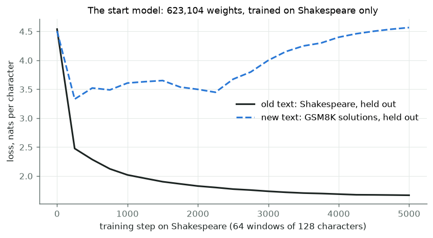
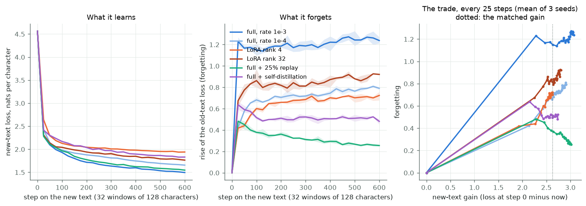
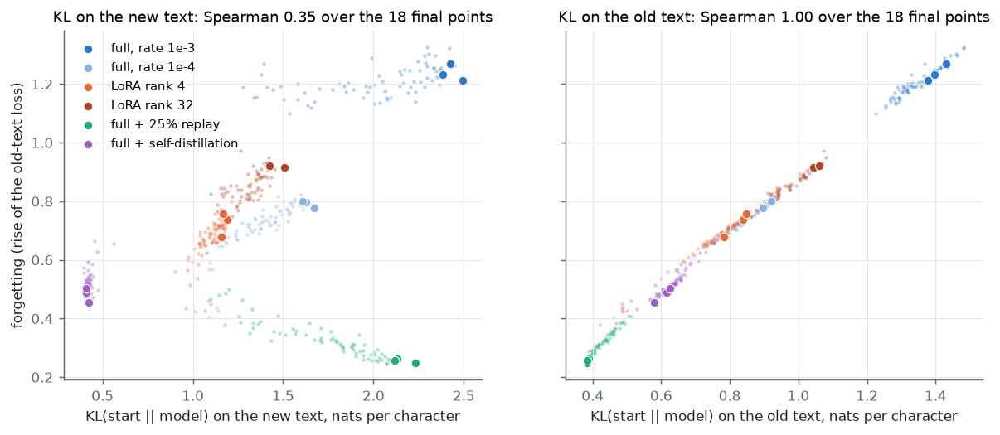
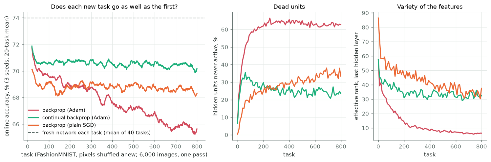
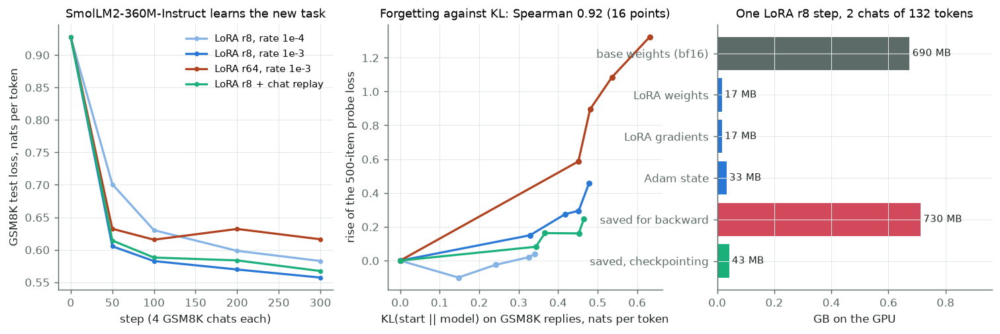

# Module 29: Learning something new without losing the old

When a small model learns a new task, what does it forget, and does a single
number predict how much?

Module 06 fine-tuned a chat model and looked only at the new task. This
module looks at the other side: what the model was good at before. A small
model learns Shakespeare, then learns a second text, and we measure how much
of the first it loses, six ways, 3 seeds each. It has five sections, each
with a figure and the numbers beside it:

1. **The start model and the new text**: module 04's char-GPT, trained on Shakespeare only; the new text is GSM8K's worked maths solutions.
2. **Four ways to learn the new text**: full fine-tuning, LoRA, replay of the old text, and self-distillation toward the start model.
3. **Does one number predict forgetting?** The KL divergence from the start model, measured on the new text and on the old.
4. **Losing the ability to learn**: a network meets 800 tasks in a row; plain backprop against continual backprop.
5. **The library way**: PEFT's LoRA on SmolLM2-360M-Instruct, a fixed 500-item forgetting probe, and where the memory of one training step goes.

Every number in this README comes from a JSON file in [`results/`](results/),
written by the script that measured it; the one number taken from module 04
names its file. What we expected was written down in
[`results/expectations.json`](results/expectations.json) before the runs of
sections 2 to 5; each section scores its lines, misses included.

This is the fourth module of track 5, **How learning works**. It comes after
[module 16](../16-self-supervised-and-jepa/README.md) in that track, and
uses [module 04](../04-attention-transformer/README.md)'s char-GPT,
[module 06](../06-fine-tuning/README.md)'s LoRA,
[module 02](../02-neural-networks/README.md)'s FashionMNIST network and
[module 14](../14-how-training-finds-a-solution/README.md)'s view of
training as a path through weight space. KL to a reference model is the
quantity [module 17](../17-learning-from-preferences/README.md) penalises.
Next, [module 30](../30-learning-without-a-backward-pass/README.md) asks what
backpropagation costs in memory.

**🕹 Interactive:** [Learning something new without losing the old](../../explorables/29-learning-new-keeping-old.html):
a scatter of every run, forgetting against the measure you pick; read what
each model writes after training; watch plain backprop lose the ability to
learn; split one LoRA step's memory.

**✅ Quiz:** [10 questions](../../quizzes/29.html): check yourself once you have run the scripts.

## Goals

By the end you will be able to:

- measure forgetting as the rise of a held-out loss on the old task;
- measure how far a model moved as the forward KL from the start model, KL(start ‖ model), and say on which inputs you measured it;
- write LoRA by hand and say why it learns less and forgets less;
- compare methods at a matched new-task score, not only at the end;
- say when one number predicts forgetting, and when it does not;
- tell forgetting from loss of plasticity, and say what continual backprop does;
- split the memory of a LoRA training step into weights, gradients, optimiser state and activations.

## Setup

```bash
cd modules/29-learning-new-keeping-old/python
```

```bash
uv sync
```

| Need | Size | Where |
|---|---|---|
| Tiny Shakespeare | 1.1 MB | `corpus/`, copied from module 04 |
| `openai/gsm8k`, revision `740312ad` | 2.7 MB | Hugging Face cache; module 22 fetched it |
| `zalando-datasets/fashion_mnist`, revision `531be5e2` | 30 MB | Hugging Face cache; module 02 fetched it |
| `rajpurkar/squad` validation, revision `7b6d24c4` | 1.8 MB | Hugging Face cache; module 21 fetched it; section 5 only |
| `HuggingFaceTB/smoltalk` everyday-conversations, revision `5feaf2fd` | under 3 MB | Hugging Face cache; module 06 fetched it; section 5 only |
| `HuggingFaceTB/SmolLM2-360M-Instruct`, revision `a10cc151` | ~700 MB | Hugging Face cache; module 05 or 17 fetched it; section 5 only |

Every script reads the cache with `HF_HUB_OFFLINE=1`; nothing is downloaded.

**The laptop guard.** Every script imports `src/common.py` before torch. It
sets `PYTORCH_MPS_HIGH_WATERMARK_RATIO=0.5` and
`PYTORCH_MPS_LOW_WATERMARK_RATIO=0.4` and fixes torch at 4 CPU threads.
Sections 1 to 4 run on the CPU. Runs longer than a few minutes go in chunks
of about four minutes, each picking up where the last stopped. Each script logs its
time and peak memory into its results file:

| Script | Minutes | Peak RSS | Peak MPS driver |
|---|---|---|---|
| `src/forget.py start` (4 chunks) | 12.51 in all | 0.85 GB | 0 (CPU) |
| `src/forget.py run`, one run of 600 steps (18 runs) | 0.62 to 1.38 | 0.71 GB at most | 0 (CPU) |
| `src/plasticity.py`, one run of 800 tasks (9 runs; 4-minute chunks) | 0.13 to 4.74 in all | 0.76 GB at most | 0 (CPU) |
| `src/library.py memory` | 0.13 | 0.63 GB | 2.54 GB |
| `src/library.py train`, 10 chunks of about 4 minutes | 40.9 of training in all | 0.93 GB at most | 2.95 GB at most |

Measured on an Apple M5 with 16 GB, Python 3.12, torch 2.14.1, PEFT 0.21.2,
while other jobs shared the machine; most of the spread in minutes is that
load. Every run is seeded.

## 1 · The start model and the new text

[`src/data.py`](python/src/data.py) holds both texts.

| | Old text (A) | New text (B) |
|---|---|---|
| What | tiny Shakespeare, module 04's corpus | GSM8K's grade-school maths problems with worked solutions, as `Q: …\nA: …` |
| Training characters | 1,003,855 (the first 90%) | 3,968,039 (GSM8K's train file) |
| Held-out characters | 111,539 (the last 10%) | 714,561 (GSM8K's test file) |

GSM8K writes its sums as `16 - 3 - 4 = <<16-3-4=9>>9` and ends each answer
with `#### 18`. Digits, `=`, `<<`, `$` and `#` never occur in Shakespeare:
26 of the 91 characters in the shared vocabulary appear only in the new text.
A few typographic characters are mapped to ASCII (`’` to `'`, `×` to `*`).

[`src/forget.py`](python/src/forget.py) `start` trains module 04's char-GPT
([`src/gpt.py`](python/src/gpt.py), copied unchanged) with module 04's
settings: 3 layers, width 128, 128-character context, 5,000 AdamW steps of
64 windows, rate 3 × 10⁻⁴ with warm-up and cosine decay. One change: dropout
0, so that a model in training mode and in evaluation mode is the same
function, and every loss and KL below compares like with like. The model has
623,104 weights. It sees only Shakespeare.



A loss here is the cross-entropy in **nats per character**: the mean over
characters of −ln p(the true next character), with the natural logarithm. A
loss of 1.667 means the model gives the true character a probability of
e^−1.667 ≈ 0.19, as a geometric mean.

Every run in sections 2 and 3 is scored on the same fixed windows: 128 windows
of 128 characters from each held-out text, 16,384 predicted characters each.

| Start model, after 5,000 steps | Nats per character |
|---|---|
| Shakespeare, held out | 1.667 |
| GSM8K solutions, held out | 4.565 |

Module 04's model, with dropout 0.1, ended at 1.725 (its `results/train_summary.json`). Its loss
on GSM8K falls at first (common letters and spaces) and then rises from 3.33
at step 250 to 4.57: the more Shakespeare it learns, the worse it predicts
the new text.

## 2 · Four ways to learn the new text

Each arm starts from the same model and takes 600 AdamW steps of 32 windows
of the new text (2.5 million characters, under one pass), a 20-step warm-up,
no weight decay, gradients clipped at 1. Every 25 steps it measures four
numbers on the fixed windows:

- **new-text loss**, and the **gain**: its value at step 0 minus now;
- **forgetting**: the Shakespeare loss now minus at step 0, in nats per character;
- **KL on the new text** and **KL on the old text**: the mean over positions
  of KL(start ‖ model) = Σ p_start(c) (log p_start(c) − log p_model(c)), how
  far the next-character predictions moved from the start model's. This is
  the forward KL that Shenfeld et al. (2025) measure, on new-task inputs.

The six arms:

| Arm | What trains | Rate | Twist |
|---|---|---|---|
| **full** | all 623,104 weights | 10⁻³ | none |
| **full_slow** | all weights | 10⁻⁴ | none |
| **lora4** | 24,576 LoRA weights, rank 4 | 3 × 10⁻³ | the rest frozen |
| **lora32** | 196,608 LoRA weights, rank 32 | 3 × 10⁻³ | the rest frozen |
| **replay** | all weights | 10⁻³ | 8 of each 32 windows are Shakespeare |
| **distill** | all weights | 10⁻³ | target = ½ the true next character + ½ the start model's prediction |

**LoRA** ([`src/lora.py`](python/src/lora.py)) wraps each of the four linear
layers in a block (attention in and out, MLP up and down): y = Wx + b +
(α/r)·B(Ax), with W and b frozen, A small and random, B zero, so the model
starts unchanged. The embeddings stay frozen too, so the 26 new characters
keep the vectors the start model gave them. At this size LoRA is not small:
rank 32 trains 31.6% as many weights as the whole model.

**Self-distillation** here mixes the target: half the one-hot true character,
half the start model's own prediction for that position. Its loss is half
the usual cross-entropy plus half KL(start ‖ model) on the new text, up to a
constant: cross-entropy and the KL weighted equally
(`tests/test_solutions.py` checks both ends of the mix). It penalises, on the
training text, the very number section 3 measures. It is not SDFT (Shenfeld
et al., 2026), where the teacher is the model shown a demonstration in its
context and the student learns on its own samples: a char-GPT this size has no
in-context learning to speak of.



| After 600 steps, mean of 3 seeds (range) | new-text loss | forgetting | KL on new text | KL on old text |
|---|---|---|---|---|
| full | 1.495 (1.489–1.503) | 1.238 (1.212–1.270) | 2.433 | 1.402 |
| full_slow | 1.655 (1.653–1.656) | 0.791 (0.776–0.800) | 1.636 | 0.912 |
| lora4 | 1.940 (1.928–1.959) | 0.724 (0.678–0.757) | 1.172 | 0.823 |
| lora32 | 1.764 (1.746–1.781) | 0.921 (0.916–0.924) | 1.450 | 1.056 |
| replay | 1.546 (1.534–1.559) | **0.255** (0.247–0.263) | 2.161 | 0.385 |
| distill | 1.830 (1.826–1.837) | 0.481 (0.454–0.501) | **0.415** | 0.607 |

What the runs show:

- **Forgetting is fast.** Full fine-tuning has lost 1.229 nats per character
  on Shakespeare by step 25, almost all of its final 1.238. Our first
  measurement comes after 25 steps, so we cannot say how the first steps
  share it out. The warm-up reached the full rate at step 20.
- **LoRA learns less and forgets less**, as Biderman et al. (2024) found on
  large models: both LoRA arms end with a higher new-text loss and less
  forgetting than the full arm (rate 10⁻³). But read the next line.
- **At a matched gain, a slow full fine-tune beats LoRA.** Read each run's
  curve at the same new-text loss, 1.940 (the worst arm's end, lora4's; one
  lora4 seed never reached it). Forgetting there: full 1.151, lora32 0.811,
  lora4 0.715, full_slow **0.667**, distill 0.510, replay **0.377**. Much of
  LoRA's "forgets less" here is "learns less"; a smaller rate for all weights
  does as well.
- **Replay keeps the old text best.** A quarter of each batch from Shakespeare
  cuts forgetting to 0.255, a fifth of full's, for a new-text loss 0.052
  worse. Its forgetting peaks early (0.482 at step 25) and then falls while
  it keeps learning GSM8K.
- **The samples say the same.** Asked to continue `ROMEO:`, the full model
  writes "In together addet of the tstave 2 car times of total from the have
  2 pounds the cost…": GSM8K's words in place of Shakespeare's. The distilled
  model still writes "Tells is thicke that they of the beal…" and line
  breaks in verse (all from `results/forget.json`, seed 0).

## 3 · Does one number predict forgetting?

Shenfeld et al. (2025), "RL's Razor", fine-tuned language models and robot
policies by supervised learning and by reinforcement learning, and found that
one number measured on the new task alone predicts how much each forgets:
the forward KL from the base model on new-task inputs. If that holds here, the
six arms should line up on one curve of forgetting against KL on the new
text.

The **Spearman rank correlation** asks whether one number puts the runs in
the same order as their forgetting: rank the runs by each, then take the
ordinary correlation of the two lists of ranks. It is 1 when the orders
match exactly, 0 when they are unrelated, and it ignores whether the curve is
straight.



| Spearman rank correlation with forgetting | 18 final points | 432 points (every run, every 25 steps after 0) |
|---|---|---|
| KL on the new text | **0.35** | 0.36 |
| KL on the old text | **0.998** | 0.998 |
| new-text gain | 0.31 | |
| KL on the new text, without replay (15 runs) | 0.85 | |
| KL on the new text, full, full_slow, lora4 and lora32 only (12 runs; chosen after the runs) | 0.73 | |

What the runs show:

- **KL on the new text does not predict forgetting across these methods.**
  Two arms break the rule, in opposite directions. Replay moves far on the new
  text (KL 2.16, near full's 2.43) yet forgets least: at its KL, full
  fine-tuning had forgotten 1.175, replay 0.255. Self-distillation moves least
  on the new text (KL 0.415, a sixth of full's), because its loss penalises
  that number, yet it forgets 0.481, more than replay.
- **Without those two, the rule holds roughly** (Spearman 0.73 over the 12
  plain runs; we chose that subset after seeing the plot, so it is a
  description, not a test).
- **KL on the old text predicts forgetting almost perfectly** (0.998). That is
  close to a tautology: forgetting is the loss on Shakespeare, and KL on
  Shakespeare measures how far the predictions on Shakespeare moved. It needs
  old data, which is the thing the new-task KL was meant to spare.

Why replay escapes: KL on the new text measures how far the model moved
*where the new task lives*. Replay lets it move there as much as full
fine-tuning, and holds it still on Shakespeare, so the two places come apart.
Self-distillation does the reverse: it pins the predictions on GSM8K windows
to the start model's, but nothing in its loss looks at Shakespeare, so the
weights can still drift in ways that hurt there. Here the new-task KL is a
fair guide only when nothing in training looks at either place on purpose.
That fits Shenfeld et al.'s own scope (they compare SFT with RL, neither of
which replays old data), and the "change our mind" line of the scout's
question: a method with high KL and low forgetting.

**Written down before the runs** ([`results/expectations.json`](results/expectations.json),
scored in `results/forget.json` → `expectations_met`). We had seen the start
model's curve up to step 3,214, and nothing of sections 2 and 3.

| | Expectation | Result |
|---|---|---|
| E1 | full forgets at least 0.5 nats per character | met: 1.238 |
| E2 | both LoRA arms: higher new-text loss and less forgetting than full, every seed | met |
| E3 | replay: under a third of full's forgetting, new-text loss within 0.1 | met: 0.255 against 1.238; gap 0.052 |
| E4 | distill forgets less than full | met: 0.481 |
| E5 | Spearman(forgetting, KL on new text) ≥ 0.7 over 18 final points | **missed**: 0.35 |
| E6 | KL on the old text ranks forgetting better | met: 0.998 against 0.35 |
| E7 | replay forgets less than half what full forgets at the same new-text KL | met: 0.255 against 1.175 |
| E8 | at matched new-text loss, replay forgets least | met: 0.377 |

Nothing was changed after the runs. E5 is the module's question, and the
answer here is no: one number on the new task did not rank six methods. E7
said where we expected it to fail; we did not expect self-distillation to
fail as well, the other way round.

**What this shows, and what it does not.** One small model, one pair of
texts, one rate per arm, 3 seeds. It shows, with every number ours, that
replay and a KL penalty on the new task both break a ranking by new-task KL,
and that LoRA's lower forgetting is partly lower learning. It does not test
RL against SFT, the comparison Shenfeld et al. made, and it says nothing about
models with billions of weights. Section 5 checks the same question on a real
chat model.

## 4 · Losing the ability to learn

Forgetting is losing what you knew. Dohare et al. (2024) showed a second
failure in networks that keep learning: they lose the ability to learn at all.
[`src/plasticity.py`](python/src/plasticity.py) tests it at laptop scale:

- a network 784 → 256 → 256 → 10 with ReLU (module 02's, one layer deeper);
- 800 tasks in a row; each task is FashionMNIST with its 784 pixels shuffled
  by a new random permutation, so every task needs new input weights;
- each task: 6,000 training images seen once in batches of 32 (188 steps),
  never reset between tasks;
- **online accuracy**: the share of a task's training images it classifies
  right just before it learns from them, the measure Dohare et al. use.

Four arms, 3 seeds each:

| Arm | Optimiser | Twist |
|---|---|---|
| **backprop** | Adam, rate 10⁻³ | none |
| **cbp** | Adam, rate 10⁻³ | continual backprop |
| **sgd** | plain SGD, rate 0.1 | none |
| **fresh** | Adam, rate 10⁻³ | a new network for every task, 40 tasks: the bar a network that never aged would reach |

**Continual backprop** keeps a running score for each hidden unit: its mean
|activation| times the summed |weights| that carry it to the next layer.
Every step each layer owes 10⁻⁴ of a replacement per unit; when a whole one
is owed, the lowest-scoring unit older than 100 steps gets fresh input
weights and zero output weights (so the network's output does not jump), and
its Adam moments are zeroed. Over 800 tasks that is 7,700 replacements, 15
times the 512 hidden units.



| 3 seeds | Tasks 1–50 | Tasks 751–800 | Drop | Dead units at task 800 | Effective rank at task 800 | Mean |weight| at task 800 |
|---|---|---|---|---|---|---|
| backprop (Adam) | 70.8% | 65.6% | **5.2 points** | 62.7% | 6.3 | 0.237 |
| continual backprop (Adam) | 71.2% | 70.3% | 0.9 points | 23.5% | 32.6 | 0.181 |
| backprop (plain SGD) | 69.5% | 68.5% | 1.0 point | 33.4% | 37.6 | 0.119 |
| fresh network each task | 74.0% (40 tasks) | | | 7.4% (task 40) | 55.3 (task 40) | 0.053 (task 40) |

A **dead unit** never fires on 1,000 test images of the task: ReLU outputs 0,
so it passes no gradient and cannot come back. **Effective rank** counts how
many directions the last hidden layer's 1,000 feature vectors really use (the
exponential of the entropy of their normalised singular values). One
effective-rank value is missing: backprop, seed 1, task 480 came out NaN; the
figure and the means skip it, and `health()` now guards against it.

What the runs show:

- **Plain backprop with Adam loses the ability to learn.** Each new task goes
  worse than the last: 70.8% on the first 50, 65.6% on the last 50, in all 3
  seeds (drops 5.2 to 5.3 points). A fresh network reaches 74.0% on the same
  kind of task. The network has not forgotten anything it needs: every task
  is new. It has lost the means to learn.
- **The signs line up.** By task 800, 62.7% of its hidden units are dead,
  its features span about 6 directions instead of 57 after the first task, and its
  weights are 4.5 times larger.
- **Continual backprop holds it.** 71.2% to 70.3%, under a point, with a
  quarter of its units dead and a rank of 33. It does not reach the fresh
  network's 74.0%.
- **The optimiser matters.** Plain SGD lost 1.0 point over the same 800
  tasks, from a lower start (69.5%).

**Written down before the runs** (`results/plasticity.json` →
`expectations_met`). Before writing them we ran four trials of 400 tasks,
one seed, then deleted them: SGD and Adam, with and without continual
backprop. Adam's online accuracy fell about 2 points and its dead units
reached 62%; SGD lost about 1 point. We chose Adam and 800 tasks from those
trials, so these expectations are informed guesses, not blind ones.

| | Expectation | Result |
|---|---|---|
| P1 | backprop (Adam) drops at least 3 points | met: 5.2 |
| P2 | continual backprop drops at most 1 point | met, narrowly: 0.9 |
| P3 | dead units: backprop over 50%, continual backprop under 30% | met: 62.7% and 23.5% |
| P4 | plain SGD loses less than Adam | met: 1.0 against 5.2 |
| P5 | a fresh network beats backprop's last 50 tasks by at least 3 points | met: 74.0% against 65.6% |

**What this shows, and what it does not.** A small network, 800 tasks, one
setting of each optimiser. It shows plasticity loss and its fix on a laptop
in minutes. It does not show that a language model fine-tuned once, as in
sections 2 and 5, loses plasticity: one new task is not 800. It matters for
a model that keeps learning for a long time, the case on-device learning
would be.

## 5 · The library way

[`src/library.py`](python/src/library.py) asks section 3's question of a real
chat model. PEFT's LoRA (alpha = 2r, on every attention and MLP matrix) trains
SmolLM2-360M-Instruct, the chat model of modules 05 and 17, in bfloat16 on the
GPU, to write GSM8K's worked solutions: the user turn is the question, the
assistant turn the solution, and only the solution's tokens count in the loss.
300 AdamW steps of 4 chats (as 2 micro-batches of 2), with gradient
checkpointing: the forward pass keeps only each layer's input, and the
backward pass recomputes the rest, trading time for memory (measured
below). Every arm is measured at steps 0, 50, 100, 200 and 300 on
fixed sets:

| Set | Items | Scored tokens | Measures |
|---|---|---|---|
| new task | 200 GSM8K test chats | 25,054 | loss on the solution, per token; KL(start ‖ model) on the same tokens |
| probe, half 1 | 250 SQuAD validation questions with their paragraph; the reply is the first gold answer | 1,747 | loss on the answer |
| probe, half 2 | 250 assistant replies from smoltalk's everyday-conversations test chats, with the chat before them | 7,327 | loss on the reply |

The **probe loss** is the mean of its two halves' per-token losses, and
**forgetting** is its rise since step 0. The start model is the same network
with the adapter switched off, so the KL needs no second copy in memory.

| Arm | LoRA rank | Rate | Trains | Twist |
|---|---|---|---|---|
| lora8_gentle | 8 | 10⁻⁴ | 4,341,760 weights | none |
| lora8 | 8 | 10⁻³ | 4,341,760 | none |
| lora64 | 64 | 10⁻³ | 34,734,080 | none |
| lora8_replay | 8 | 10⁻³ | 4,341,760 | 1 of the 4 chats per step is a smoltalk training chat |

One run per arm, one seed: MPS sums in bfloat16 do not repeat to the last
digit, so read differences of a few hundredths as noise.



| After 300 steps | GSM8K loss (start 0.928) | Probe rise | SQuAD half | chat half | KL on GSM8K | KL on the probe |
|---|---|---|---|---|---|---|
| lora8_gentle | 0.583 | 0.039 | +0.031 | +0.047 | 0.341 | 0.056 |
| lora8 | 0.557 | 0.457 | +0.846 | +0.068 | 0.478 | 0.261 |
| lora64 | 0.616 | **1.324** | +2.134 | +0.513 | 0.632 | 0.943 |
| lora8_replay | 0.567 | 0.248 | +0.498 | −0.002 | 0.465 | 0.146 |

| Spearman with the probe's rise, 16 points (4 arms × steps 50 to 300) | |
|---|---|
| KL on GSM8K | **0.92** |
| KL on the probe | 0.997 |
| KL on GSM8K, without replay (12 points) | 0.97 |

What the runs show:

- **All four learn GSM8K about equally** (loss 0.557 to 0.616), but forget
  very differently: from 0.039 at rate 10⁻⁴ to 1.324 at rank 64. Rank 64 learns
  the least of the three at rate 10⁻³ and forgets the most.
- **Here KL on the new task does rank forgetting** (Spearman 0.92 over 16
  points). Unlike section 3, these four arms are plain updates but for one
  mild replay arm, the case where the char-GPT also lined up.
- **Replay helps, less than in section 2.** One chat in four cut forgetting
  from 0.457 to 0.248, at a GSM8K loss 0.010 worse. Its chat half did not move;
  its SQuAD half still rose by 0.498. The replay data was chat, so it
  protected chat.
- **Most of the rise is the SQuAD half.** Its gold answers are a few words,
  where GSM8K's are long worked solutions; part of the rise may be the model
  wanting to say more, not knowing less. We did not test that.
- **The gentle arm first improves the probe** (0.965 at step 50, from 1.065)
  and then gives it back.

**Written down before the runs** (`results/library.json` → `expectations_met`):

| | Expectation | Result |
|---|---|---|
| L1 | every arm lowers the GSM8K loss; the probe rises in the three plain arms, more at 10⁻³ than at 10⁻⁴ | met: 0.457 against 0.039 |
| L2 | Spearman(probe rise, KL on GSM8K) ≥ 0.7 over 16 points | met: 0.92 |
| L3 | rank 64 forgets more than rank 8 at the same rate | met: 1.324 against 0.457 |
| L4 | replay forgets less than half of lora8, GSM8K loss within 0.05 | **missed**: 0.248 against 0.457, a little over half; loss gap 0.010 met |

Nothing was changed after the runs. A first full run of this section was
discarded: it held GPU memory it no longer used and went over the 4 GB guard,
and its replay arm crashed on a smoltalk chat that ends on a user turn. Its
three finished arms are kept in `results/library_first_try.json`; they forgot
about as much as the rerun (0.040, 0.489 and 1.250 against 0.039, 0.457 and
1.324).

**Where the memory goes.** `library.py memory` times one LoRA rank-8 step on
2 GSM8K chats of 132 tokens and splits the GPU memory
(`results/library_memory.json`):

| Part | Size |
|---|---|
| Base weights, bfloat16, frozen (361,821,120 weights) | 690 MB |
| LoRA weights, float32 | 17 MB |
| LoRA gradients | 17 MB |
| Adam state (two numbers per LoRA weight) | 33 MB |
| Activations saved for the backward pass | **730 MB** |
| The same, with gradient checkpointing | 43 MB |

LoRA makes the gradients and optimiser state small; the activations then
cost more than the frozen model. Gradient checkpointing keeps only each
layer's input and recomputes the rest during the backward pass: 43 MB
instead of 730, for a step 1.35 times slower (0.525 s against 0.39 s). A first
try at 4 chats of 218 tokens saved 2,572 MB for the backward pass and peaked
at 4.44 GB on the GPU (`results/library_memory_batch4.json`), over the guard;
that is why training runs as 2 micro-batches with checkpointing. Full
fine-tuning in float32 with Adam would need 16 bytes per weight for weights,
gradients and state, 5.39 GB before any activation; we did not run it.
Song et al. (2025, MeBP) fine-tune 0.5B to 4B models in under 1 GB on an
iPhone 15 Pro Max by attacking the same two costs.

Section 2 did by hand what PEFT does here: freeze the base, wrap the linear
layers, train only A and B. PEFT adds the bookkeeping: saving and loading
adapters, switching them off (`disable_adapter()`, which the KL uses), and
targeting layers by name.

## Run it

Rebuild the start model, every run and every number (about 60 minutes of
CPU runs in chunks of about four minutes, plus about 45 minutes on the GPU):

```bash
uv run python src/forget.py start
```

Repeat it until it prints `start: done`. Then the 18 runs; repeat until it
prints `remaining: 0`:

```bash
uv run python src/forget.py run --all
```

The plasticity runs, the same way:

```bash
uv run python src/plasticity.py
```

The library way: one memory measurement, then the four LoRA arms (repeat
`train` until it prints `remaining: 0`):

```bash
uv run python src/library.py memory
```

```bash
uv run python src/library.py train
```

Score every expectation and redraw:

```bash
uv run python src/analyse.py --figures
```

Redraw the figures, or rewrite the explorable's data block, from the
committed JSON with no model:

```bash
uv run python src/figures.py
```

```bash
uv run python src/export_explorable.py
```

## Exercises

Skeletons with `# TODO(you):` live in [`exercises/`](exercises/); reference
solutions are in [`solutions/`](solutions/). Each asks you to predict before
you run. `tests/test_solutions.py` checks each solution against `src/`; run
the solution beside your own to compare.

- **(a) `exercise_a_kl.py`**: write the forward KL and the forgetting
  measure; check that KL is not symmetric; then fine-tune the start model 50
  steps on the new text and measure both KLs and the forgetting (about 10
  seconds; needs `artifacts/start.pt`).
- **(b) `exercise_b_lora.py`**: write LoRA's forward pass, its merged matrix
  and its weight count. Predict first how many weights rank 4 and rank 32
  train on the char-GPT, and what share of the model that is.
- **(c) `exercise_c_cbp.py`**: write continual backprop's utility and its
  choice of units to replace. Predict first how many replacements a layer of
  256 units makes over 800 tasks.

## Tests

```bash
uv run pytest
```

34 tests, a few seconds, no training. They check the texts and the
vocabulary, LoRA (unchanged at the start, weight counts), the KL and the
distillation loss against their formulas, the solutions against `src/`, the
summaries against the runs, the laptop budget, and the explorable against the
results.

## To go further

- Log every step for the first 25, and see how forgetting starts.
- Replay at 5% and 50%: how little old data is enough?
- Let LoRA train the embeddings of the 26 new characters (PEFT's
  `modules_to_save`), and see whether it closes the gap to full fine-tuning.
- Distil on Shakespeare windows instead of GSM8K windows: the start model as
  teacher where the old task lives. Write down first where it should land on
  the KL plot.
- Add L2 toward the start weights, or shrink-and-perturb, to the plasticity
  test; Dohare et al. report both help.

## Checkpoint: you should now be able to…

- measure forgetting and the forward KL to the start model, and say on which text each was measured;
- write LoRA by hand and count its weights;
- compare methods at a matched new-task score;
- say why replay and a KL penalty on the new task each break a ranking by new-task KL;
- tell forgetting from loss of plasticity, and read dead units and effective rank;
- say where the memory of a LoRA step goes, and what gradient checkpointing buys.

## Links

- Biderman et al., [LoRA Learns Less and Forgets Less](https://arxiv.org/abs/2405.09673) (2024)
- Shenfeld, Pari and Agrawal, [RL's Razor: Why Online Reinforcement Learning Forgets Less](https://arxiv.org/abs/2509.04259) (2025)
- Shenfeld et al., [Self-Distillation Enables Continual Learning](https://arxiv.org/abs/2601.19897) (2026), SDFT
- Lin et al., [Continual Learning via Sparse Memory Finetuning](https://arxiv.org/abs/2510.15103) (2025)
- Dohare et al., [Maintaining Plasticity in Deep Continual Learning](https://arxiv.org/abs/2306.13812) (2023; Nature 2024), continual backprop
- Sun et al., [How new data permeates LLM knowledge and how to dilute it](https://arxiv.org/abs/2504.09522) (2025)
- Song et al., [Memory-Efficient Backpropagation for Fine-Tuning LLMs on Resource-Constrained Mobile Devices](https://arxiv.org/abs/2510.03425) (2025), MeBP
- [PEFT LoRA](https://huggingface.co/docs/peft/developer_guides/lora) · [HuggingFaceTB/SmolLM2-360M-Instruct](https://huggingface.co/HuggingFaceTB/SmolLM2-360M-Instruct) · [GSM8K](https://huggingface.co/datasets/openai/gsm8k)
