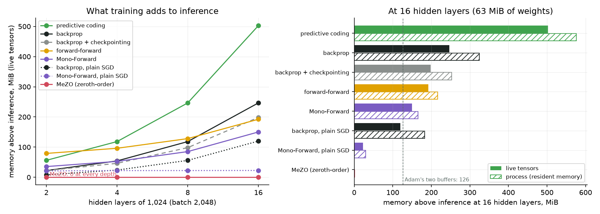
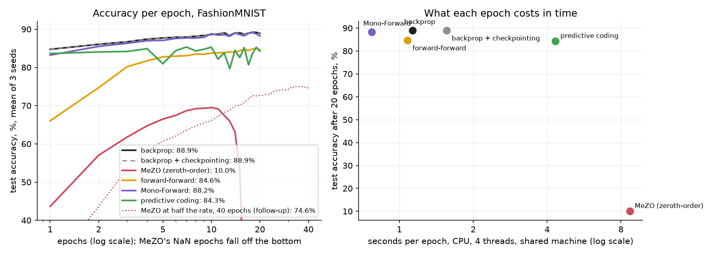
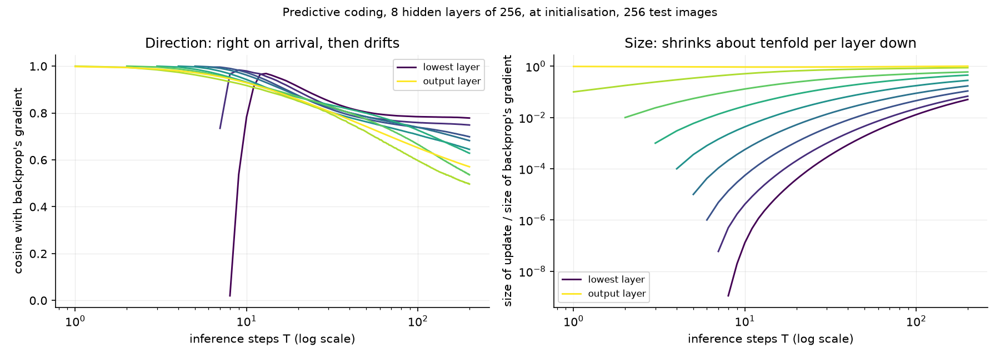
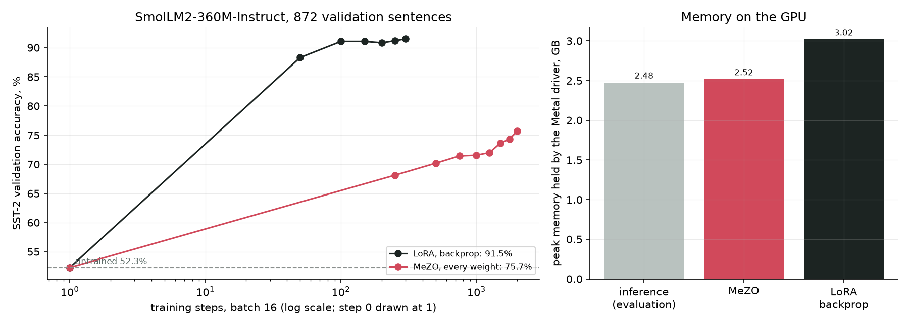

# Module 30: Learning without a backward pass

Backprop trains in two passes. The forward pass computes each layer and
keeps what it computed; the backward pass sends the error from the output
down, layer by layer, and uses the kept values to turn it into a gradient
for every weight. This module asks one question:

**What does backpropagation cost in memory, and what do forward-only and
local rules give back?**

It trains one small network six ways and measures what each holds, how well
each learns, and how long each takes:

1. **What training holds**: every rule's memory above plain inference, on a network 2 to 16 layers deep.
2. **Six rules on FashionMNIST**: backprop, backprop with checkpointing, MeZO, forward-forward, Mono-Forward and predictive coding, 3 seeds each.
3. **How predictive coding's error travels**: its updates against backprop's, step by step, layer by layer.
4. **The library way**: MeZO against LoRA backprop on a 360M-parameter language model.

Every number in this README comes from a JSON file in [`results/`](results/),
written by the script that measured it. Each experiment's expectation was
written down before it ran, in
[`results/expectations.json`](results/expectations.json); the README gives
each one and says where it missed.

This is the fifth module of track 5, **How learning works**. Read it after
[module 29](../29-learning-new-keeping-old/README.md); it uses
[module 01](../01-autograd/README.md)'s autograd,
[module 02](../02-neural-networks/README.md)'s FashionMNIST network and
[module 14](../14-how-training-finds-a-solution/README.md)'s Adam. Next,
[module 17](../17-learning-from-preferences/README.md) opens track 6.

**🕹 Interactive:** [Learning without a backward pass](../../explorables/30-learning-without-a-backward-pass.html):
race the five rules on two spirals in your browser and watch each one's
memory meter; then drag the inference steps of predictive coding and watch
the error reach the lower layers.

**✅ Quiz:** [10 questions](../../quizzes/30.html): check yourself once you have read the four sections.

## Goals

By the end you will be able to:

- say what backprop keeps for its backward pass, and count it for a given network and batch;
- write a two-point zeroth-order step (MeZO) that stores no random direction and no gradient;
- write a layer that learns from a goal of its own (forward-forward, Mono-Forward);
- write predictive coding's inference and learning steps, and say why its error fades with depth;
- tell the memory a learning rule saves from the memory its optimizer costs;
- read a memory claim with its meter: tensors alive, or what the process holds.

## Setup

```bash
cd modules/30-learning-without-a-backward-pass/python
```

```bash
uv sync
```

| Need | Size | Where |
|---|---|---|
| `zalando-datasets/fashion_mnist`, revision `531be5e2` | 34 MB | Hugging Face cache, on the first run (module 02's pin) |
| `HuggingFaceTB/SmolLM2-360M-Instruct`, revision `a10cc151` | 724 MB | Hugging Face cache, section 4 only (module 17's pin) |
| `stanfordnlp/sst2`, revision `8d51e7e4` | 3 MB | Hugging Face cache, section 4 only (module 11's pin) |

Sections 1 to 3 run on the CPU, with 4 threads. Section 4 runs on Apple
silicon's GPU through MPS.

**The laptop guard.** Every script imports `src/common.py` before torch. It
sets `PYTORCH_MPS_HIGH_WATERMARK_RATIO=0.5`, as in every module, and fixes
torch at 4 threads. Long runs go in chunks of about 4.5 minutes (a chunk
finishes the epoch or step under way when its budget runs out), each picking up where the
last stopped. Each script logs its time and peak memory:

| Script | Minutes | Peak RSS | Peak Metal driver |
|---|---|---|---|
| `src/memory.py`, 36 fresh processes | 2.31 | 0.95 GB (largest child) | 0 (CPU) |
| `src/train.py`, 11 chunks | 48 in all, longest chunk 4.63 | 0.66 GB | 0 (CPU) |
| `src/credit.py` | 0.03 | 1.19 GB | 0 (CPU) |
| `src/library.py`, LoRA and MeZO, 16 chunks | 64 in all, longest chunk 4.01 | 2.4 GB | 3.02 GB |

Measured on an Apple M5 with 16 GB, Python 3.12, torch 2.14.1, while other
jobs shared the machine: read the times as rough. **Energy was not
measured.** The plan was joules per run from `powermetrics`, which needs
root; this account cannot get it without a password. Wall time stands in.

## 1 · What training holds

A layer computes z = a Wᵀ + b, then a ReLU. To get the gradient of W,
backprop needs the layer's input a, so the forward pass keeps it, for every
layer, until the backward pass comes back down. That is the **kept
activations**: one batch × width matrix per layer. Add the gradients (one
number per weight) and, for Adam, two running averages per weight (module
14). Inference needs none of it: the weights and one layer at a time.

The six rules, as [`src/rules.py`](python/src/rules.py) writes them:

| Rule | What it updates with | What it must keep during a step |
|---|---|---|
| **backprop** | the exact gradient, from autograd's backward pass | every layer's input, then every gradient |
| **checkpointing** (Chen et al., 2016) | the same gradient | only the inputs of √n segments; each segment runs forward again during the backward pass |
| **MeZO** (Malladi et al., 2023) | the loss difference along one random direction z: g = (L(θ + εz) − L(θ − εz)) / 2ε, then θ ← θ − lr · g · z | nothing: z is redrawn from its seed each time it is needed |
| **forward-forward** (Hinton, 2022) | each layer alone: high "goodness" (mean square of its outputs) for an image with its right label written in its first 10 pixels, low for the same image with a wrong label | one layer, twice (right and wrong label) |
| **Mono-Forward** (Gong et al., 2025) | each layer alone: its own 10-way head and its own cross-entropy | one layer |
| **predictive coding** (Whittington and Bogacz, 2017) | each layer keeps a value that may differ from what the layer below predicts; values settle for T steps, then each weight shrinks its own layer's error | a value and an error for every layer |

MeZO, forward-forward and Mono-Forward never send anything backwards through
the network: two of them still take a gradient, but inside one layer.
Predictive coding sends errors down too, by local steps instead of one pass.

**The measurement.** [`src/memory.py`](python/src/memory.py) builds a wider
copy of section 2's network (hidden layers of 1,024, a batch of 2,048 random
images), takes three training steps, and repeats this in a fresh process for
each rule at 2, 4, 8 and 16 hidden layers. Two meters:

- **live tensors**: a torch dispatch mode sees every tensor created, from
  the first weight to the end of the last step, and keeps the running total
  of bytes still alive; its peak is what the rule needs. It is the CPU twin
  of `torch.cuda.max_memory_allocated`. A test checks it on known tensors.
- **whole process**: the peak resident memory the operating system saw,
  which adds torch itself and memory the C allocator kept after use.

Each rule's number is its peak minus that of an inference-only process at
the same depth (weights, batch, one forward pass).



| Memory above inference, MiB (live tensors) | 2 layers | 4 | 8 | 16 | share of backprop at 16 |
|---|---|---|---|---|---|
| backprop | 22.3 | 54.3 | 118.3 | 246.4 | 100% |
| checkpointing | 22.3 | 46.3 | 98.3 | 198.4 | 81% |
| MeZO | 0.0 | 0.0 | 0.0 | 0.0 | 0% |
| forward-forward | 79.2 | 96.2 | 128.2 | 192.3 | 78% |
| Mono-Forward | 35.6 | 52.7 | 85.2 | 150.2 | 61% |
| predictive coding | 56.3 | 118.4 | 246.4 | 502.5 | 204% |
| backprop, plain SGD | 8.0 | 24.0 | 56.0 | 120.0 | 49% |
| Mono-Forward, plain SGD | 21.3 | 22.3 | 22.4 | 22.7 | 9% |

At 16 hidden layers the weights take 63 MiB, so Adam's two buffers take
126 MiB, and one layer's kept input takes 8 MiB.

What the meters show:

- **MeZO holds exactly what inference holds**, 0 MiB more at every depth:
  its whole cost is the weights and one layer at a time. The slice of z it
  draws for one weight matrix is smaller than the layer output the forward
  pass holds anyway.
- **The optimizer is half of backprop's bill.** At 16 layers, backprop holds
  246 MiB above inference; with plain SGD instead of Adam,
  120. Backprop with SGD grows by one layer's input per layer, about
  8 MiB each: kept activations, nothing else.
- **Mono-Forward with SGD is flat**: 21 MiB at 2 layers,
  23 at 16. Locality is what that buys. With Adam, its two buffers
  per weight swamp it: 150 MiB at 16 layers.
- **Checkpointing saves less than expected.** What autograd saves for the
  backward pass falls from 194 MiB (the weights themselves among it, which
  inference holds too) to 38 MiB (only the inputs of 4 segments) at 16 layers, but the peak
  moves to the end of the backward pass, where every gradient and Adam's
  buffers sit together: 198 MiB, 81% of backprop's.
- **Predictive coding costs the most**: 502 MiB at 16 layers,
  2.0 times backprop. It keeps a value and an error for every layer,
  plus the gradients and Adam.
- **The process meter** reads up to 80 MiB higher than the live meter (MeZO
  about 1 MiB, backprop 78 at 16 layers) and ranks the six rules in the same
  order. Only backprop with plain SGD and Mono-Forward with Adam change
  places: 183 and 166 MiB.

The two plain-SGD rows were added after the first measurement, to separate
the optimizer from the rule; they were not in the expectations.

**Written down before the run**: at 16 layers, MeZO, forward-forward and
Mono-Forward each need at most 60% of backprop's extra memory, MeZO the
least (E7); checkpointing stays more than 10% above Mono-Forward (E8);
predictive coding within 30% of backprop at every depth (E9). MeZO least,
met (0%). Forward-forward 78% and Mono-Forward 61%: both
missed 60%, by Adam's buffers. E8 met: checkpointing is 32% above
Mono-Forward. E9 missed: predictive coding needs about twice backprop, not
about the same.

## 2 · Six rules on FashionMNIST

One network for all six, module 02's on a larger scale: 784 → 256 → 256 →
256 → 10, ReLU, He initialisation. All 60,000 training images, batch 64, 20
epochs, scored on the 10,000 test images after each epoch; 3 seeds. The
settings were fixed after short pilots that scored on the last 10,000
training images, never the test set (all in `results/expectations.json`):

| Rule | Optimizer | Other settings |
|---|---|---|
| backprop, checkpointing | Adam, rate 10⁻³ | checkpointing in 3 segments |
| MeZO | plain SGD, rate 2 × 10⁻⁴ | ε = 10⁻³; one direction per step |
| forward-forward | Adam, 3 × 10⁻³ | threshold θ = 2; classify by trying all 10 labels and summing goodness |
| Mono-Forward | Adam, 10⁻³ | classify with the last layer's head |
| predictive coding | Adam, 10⁻³ | T = 20 inference steps of size γ = 0.1; classify by the plain forward pass |



| Rule | Test accuracy after 20 epochs, mean | per seed | best epoch, mean | seconds per epoch | × backprop |
|---|---|---|---|---|---|
| backprop | 88.9% | 89.3, 88.6, 88.8 | 89.4% | 1.13 | 1.00 |
| checkpointing | 88.9% | 89.3, 88.6, 88.8 | 89.4% | 1.56 | 1.38 |
| MeZO | 10.0% | 10.0, 10.0, 10.0 | 69.8% | 8.69 | 7.69 |
| forward-forward | 84.6% | 85.0, 83.7, 85.2 | 85.1% | 1.08 | 0.96 |
| Mono-Forward | 88.2% | 88.3, 87.4, 88.9 | 89.4% | 0.77 | 0.68 |
| predictive coding | 84.3% | 85.1, 82.8, 84.9 | 86.2% | 4.33 | 3.83 |

What the runs show:

- **Checkpointing gives the same network as backprop**, to every digit of
  every seed, at 1.38 times the time: it computes the same gradient,
  running each segment forward twice.
- **Mono-Forward comes within 0.7 points of backprop**, and is the
  fastest: each layer does one small extra matrix product for its head and
  none of the backward pass through the stack.
- **Forward-forward and predictive coding sit about 4.5 points below.**
  Forward-forward also pays at test time: ten forward passes per image, one
  per label. Predictive coding's training is bumpy: its energy jumps and its
  accuracy dips by up to 13 points in single epochs, so its last epoch is
  1.9 points under its best.
- **MeZO diverged in every seed.** It rose to about 70% by epoch 10
  (best 69.8% on average, at epochs 11, 10 and 8), then its loss climbed
  and turned to NaN (not a number) at epochs 16, 16 and 17; the network then answers one class for every image, 10%.

**Why MeZO drifts.** Each step moves the weights by lr · g · z, and z holds
a random number of size about 1 for each of the 335,114 weights. Most of that step is
noise, since g measures the slope along one direction only; over many steps
the noise piles up and the weights grow. **Follow-up, added after the
divergence** (not part of the registered comparison; its expectation was
written first): the same rule at half the rate, 10⁻⁴, 40 epochs, 3 seeds,
logging the length of the weight vector. No seed diverged. They reached
71.3% to 73.5% at epoch 20 and 74.3% to 74.8% at epoch 40 (mean 74.6%; best
epochs 74.9% to 75.9%), still 14 points under backprop and rising slowly. The
weights' length grew every epoch in every seed, from 39.7 to between 51.9
and 53.2, about a third more: the drift is still there, only slower. The expectation
(no divergence; 68% to 76% at the end; length growing every epoch) was met.
The 100-epoch registered run, seed 0 at the registered rate, repeated the
20-epoch run of seed 0 to the digit (same seeds) and stayed at NaN from
epoch 16 to the end.

**Written down before the runs** (E1–E6): backprop 88–90%, met
(88.9%); checkpointing identical, met, at 1.0–1.5 times the time,
1.38, met; Mono-Forward within 2 points, met; predictive coding within
1.5, missed (4.6 points); forward-forward 3–8 points under backprop
and under Mono-Forward, met; MeZO 65–80% after 20 epochs and under 85% after
100, missed (it diverged; under 85% only in the trivial sense); predictive
coding 4–10 times backprop's time, missed by being faster (3.83); MeZO
3–10 times, met (7.7); Mono-Forward and forward-forward 1–3 times: forward-forward
met (0.96), Mono-Forward missed by being faster (0.68).

**What this shows, and what it does not.** One small network, one data set,
one setting per rule, chosen by short pilots; each rule might do better with
more tuning, and backprop got the least. The times come from a shared CPU.
It shows that at this size two local rules come within a few points of
backprop, and that the zeroth-order rule needs care that backprop does not.

## 3 · How predictive coding's error travels

Predictive coding replaces the backward pass with a settling process. Start
from the forward pass, where every layer's value equals its prediction and
every error is zero. Clamp the label on top: now only the top layer has an
error. Each inference step, every value moves to lower the energy

  F = Σ ½‖x_l − μ_l‖² + cross-entropy at the top,

which moves the layer just below the error a little, which creates an error
there, and so on down. [`src/credit.py`](python/src/credit.py) takes two
networks at their initial weights and 256 test images, runs 200 inference
steps, and after each compares the update each weight matrix would get with
backprop's gradient, by direction (the cosine: 1 when they point the same
way, 0 when they are unrelated) and by size.



| 8 hidden layers, after T steps | lowest weight matrix | 4th | 8th | output |
|---|---|---|---|---|
| T = 1 | — | — | cos 1.00, size 0.1 | cos 1.00, size 1 |
| T = 5 | — | cos 1.00, size 1e-05 | cos 0.96, size 0.3 | cos 0.97, size 0.9 |
| T = 10 | cos 0.78, size 1e-07 | cos 0.96, size 0.0006 | cos 0.92, size 0.5 | cos 0.93, size 0.9 |
| T = 20 | cos 0.91, size 4e-05 | cos 0.87, size 0.005 | cos 0.85, size 0.7 | cos 0.86, size 0.9 |
| T = 50 | cos 0.80, size 0.002 | cos 0.78, size 0.03 | cos 0.72, size 0.8 | cos 0.74, size 0.9 |
| T = 200 | cos 0.78, size 0.05 | cos 0.68, size 0.2 | cos 0.50, size 0.9 | cos 0.57, size 1 |

What the runs show:

- **The error moves down one layer per step**, exactly: in the 8-hidden-layer
  network the lowest weight matrix gets its first non-zero update at step
  8, the next at 7, and so on (a test checks this for both networks).
- **It arrives pointing the right way, and ten times smaller each layer
  down.** On arrival, a layer's update has cosine 1.00 with backprop's
  gradient for the top six matrices, and size γ^k = 0.1^k of it, k layers
  below the top, within 1% for the top seven.
- **At the bottom, float32 drowns it.** The lowest two should arrive at
  10⁻⁷ and 10⁻⁸ of backprop's size; a change that small in a value near 1 is
  at or below float32's resolution (about 10⁻⁷), so what arrives is rounding: sizes 6 × 10⁻⁸
  and 1 × 10⁻⁹, cosines 0.73 and 0.02. The lowest points the
  right way (above 0.95) only from step 12.
- **Then it drifts.** As the values settle, the network they describe moves
  away from the one backprop differentiates, and the cosines fall: to
  0.50–0.78 by step 200 in the 8-hidden-layer network.

This is the depth problem of predictive coding that the recent papers
attack: the error decays geometrically on its way down (ePC, Goemaere et
al., 2025, calls it exponential signal decay in digital simulation),
μPC (Innocenti et al., 2025) rescales the network so 128 layers train, and
PC-ALM (Seely, 2026) adds a per-layer multiplier so the credit spreads
evenly. With Adam, which rescales each weight's step by its own history, the
tiny updates still move the lower layers; that is why section 2's three
hidden layers train at all.

**Written down before the run** (E12): the update to the layer k below the
top is zero for the first k steps, met; on arrival its cosine with
backprop's is above 0.95, met for seven of nine matrices and missed for the
lowest two (0.02 and 0.73); the lowest's size under 1% of
backprop's at 20 steps, met (3.9e-05).

## 4 · The library way: MeZO against LoRA on a language model

MeZO was made for this case: fine-tuning a large language model in the
memory of inference. [`src/library.py`](python/src/library.py) takes
SmolLM2-360M-Instruct in float32 on MPS and turns it into a sentiment
classifier with MeZO's own prompt for SST-2 (movie-review sentences, each
labelled positive or negative): "*sentence* It was", then compare the model's scores for " great" and " terrible". Training: 1,000
training sentences (500 per label), batches of 16, the two-way
cross-entropy. Scoring: all 872 validation sentences.

- **LoRA, backprop** (module 06): the model's weights stay frozen and only
  small low-rank matrices added to some of them train; here rank-8 adapters on
  the attention's query and value projections (819,200 trainable weights), AdamW at 3 × 10⁻⁴, 300
  steps, each batch run as two halves of 8 to halve the kept activations.
- **MeZO, every weight**: all 362 million weights, rate 10⁻⁵, ε = 10⁻³,
  2,000 steps. Its whole run is stored as 2,000 (seed, g) pairs,
  166 KB in [`results/library/mezo_steps.jsonl`](results/library/mezo_steps.jsonl):
  replaying them from the downloaded model rebuilds the trained weights, one
  nudge per step and no forward pass. The chunks use that to resume.



| | Steps | Validation accuracy | Seconds per step | Live tensors, peak | Metal driver, peak |
|---|---|---|---|---|---|
| untrained | 0 | 52.3% | | | 2.48 GB |
| LoRA, backprop | 300 | 91.5% | 0.71 | 2.61 GB | 3.02 GB |
| MeZO, every weight | 2,000 | 75.7% | 0.99 | 1.36 GB | 2.52 GB |

What the runs show:

- **LoRA learns in a few dozen steps**: 88.3% after 50, 91.5% after 300,
  from 52.3% untrained (the model barely prefers the right word before
  training).
- **MeZO learns, slowly and steadily**: 68.1% after 250 steps, 75.7% after
  2,000, still rising. It never reached LoRA's final accuracy; at its pace
  over the last 1,000 steps, about 4 points per 1,000, it would need about
  4,000 more, if the pace held.
- **Its memory is inference's**: the Metal driver (what Apple's GPU driver
  holds for the process) held 2.52 GB at MeZO's
  peak, against 2.48 GB for the untrained model's evaluation, at batch 32,
  and 3.02 GB for LoRA, even with LoRA's batch split in two halves. That is
  83% of LoRA's. The live-tensor column is not a fair comparison here: it
  is read between operations, after MeZO's no-grad forward pass has freed
  its activations but while LoRA's are still held.
- **Each MeZO step costs about 1.4 times a LoRA step** (0.99 s against
  0.71 s, both counting their evaluations): two forward passes and four
  passes of random numbers over 362 million weights, against two halves of
  8, each a forward and a backward pass; the backward pass runs through every
  layer but makes gradients only for the adapters' weights.

Here the gap in memory is small, because LoRA already freezes the weights:
it has no gradients or Adam buffers for the 362 million, only for its
adapters. MeZO's memory case is against full fine-tuning, which this
module did not run.

The pilots that set MeZO's rate scored on 300 training sentences outside the
1,000 (all in `results/expectations.json`); the first, at 10⁻⁶, moved 1 point in 100 steps.

**Written down before the run** (E11): MeZO's peak memory at most 70% of
LoRA's; LoRA at least 88% within 300 steps; MeZO at least 3 points over the
untrained model within 2,000 steps, but under LoRA. LoRA at 88% or more,
met (88.3% at step 50); MeZO more than 3 points up, met (+23.4), and under LoRA, met; MeZO's
memory at most 70% of LoRA's, missed: 83% by the driver's peak.

## What the papers claim

| Paper | Claim | Seen here |
|---|---|---|
| Malladi et al., 2023 (MeZO) | fine-tunes with the memory of inference, up to 12 times less than backprop; comparable accuracy | memory: yes, 0 MiB above inference; accuracy: far slower per step, and unstable from scratch |
| Katti et al., 2025 (on-device ZO) | MeZO fits larger models under a device's memory limit, given enough wall time | the same trade: MeZO held 83% of LoRA's GPU memory and reached 75.7% against 91.5% in more steps |
| Inoue et al., 2026 (weight perturbation) | about 97% on MNIST with large batches, but 90.2% against 97.4% for backprop under 10 epochs | not run; at batch 64, MeZO here peaked near 70% on FashionMNIST |
| Hinton, 2022 (forward-forward) | two forward passes replace forward and backward | 4.3 points under backprop; ten passes to classify |
| Gong et al., 2025 (Mono-Forward) | beats forward-forward; 31% of backprop's memory on MLP-Mixers | beats forward-forward, near backprop; the memory gain depends on the optimizer |
| Li et al., 2025 (NoProp) | each block learns on its own to denoise a noisy label, with no forward or backward pass through the whole network; tested on MNIST and CIFAR | not run |
| Millidge et al., 2020; Whittington and Bogacz, 2017 | predictive coding approaches backprop's gradients with only local rules | yes on arrival; then the drift and the decay of section 3 |
| Pinchetti et al., 2024 (PCX) | a benchmark for predictive coding that names scaling to larger, deeper networks as its main open problem | one cause of the depth problem, measured |
| Innocenti et al., 2025 (μPC); Goemaere et al., 2025 (ePC); Seely, 2026 (PC-ALM) | three fixes for the depth problem: rescaling, a new variable, a multiplier per layer | not run |

## Run it

Rebuild the figures and the explorable's data from the committed JSON, with
no training:

```bash
uv run python src/figures.py
```

```bash
uv run python src/export_explorable.py
```

Section 1 (about 2.5 minutes) and section 3 (seconds):

```bash
uv run python src/memory.py --figures
```

```bash
uv run python src/credit.py --figures
```

Section 2, in chunks of about 4.5 minutes (about 48 minutes in
all); run it until it prints `"remaining": 0`, then summarise. Delete
`results/runs/` to start over.

```bash
uv run python src/train.py
```

```bash
uv run python src/train.py --figures
```

Section 4, on Apple silicon: the untrained model once, then each arm until
it prints `"remaining": 0`, then the summary. Delete `results/library/` to
start over.

```bash
uv run python src/library.py base
```

```bash
uv run python src/library.py lora
```

```bash
uv run python src/library.py mezo
```

```bash
uv run python src/library.py summary
```

## Exercises

Skeletons with `# TODO(you):` live in [`exercises/`](exercises/); reference
solutions are in [`solutions/`](solutions/). Each asks you to predict before
you run, and runs in seconds on the CPU.

- **(a) `exercise_a_mezo.py`**: write MeZO's nudge and its two-point
  estimate, with z drawn from a seed and never stored. Average it over 1 to
  10,000 directions on a 20-weight quadratic and watch the cosine with the
  true gradient climb (0.18 with one direction). The test checks it against
  `src/rules.py`.
- **(b) `exercise_b_mono_forward.py`**: write one Mono-Forward layer's loss
  and gradients by hand, then train the network for 2 epochs. Predict first
  which hidden layer's head scores best on the test set.
- **(c) `exercise_c_pc.py`**: write the gradient of predictive coding's
  energy at each hidden value. Predict first after how many steps the first
  of five hidden layers moves at all. The test checks it against
  `src/rules.py`, which `tests/test_rules.py` checks against autograd.

## Tests

```bash
uv run pytest
```

24 tests, a few seconds, no training and no model. They check every
hand-written gradient against autograd, checkpointing against backprop to
the bit, MeZO's estimate against the exact slope along its direction,
predictive coding against backprop on arrival, the live-tensor meter on
known tensors, the solutions against `src/`, the committed results against
the laptop budget and each other, and the explorable against the results.

## To go further

- Give MeZO a schedule: decay its rate, or add weight decay to hold the
  weights' length. Does it pass 75% without diverging?
- Average MeZO's estimate over several directions per step (n = 4, 16):
  each step costs n times more forward passes; does it reach a given
  accuracy in less time?
- Run predictive coding in float64 and see whether the lowest layer's
  update arrives pointing the right way at step 8.
- Train the 8-hidden-layer network with predictive coding and with backprop
  for a few epochs: how much does the decay of section 3 cost in accuracy?
- Put Mono-Forward on a phone-sized head over a frozen encoder: the case
  where memory is fixed and small.

## Checkpoint: you should now be able to…

- say what backprop keeps for its backward pass, and how checkpointing trades it for compute;
- write MeZO's step and say why it needs no memory beyond inference;
- say why Adam can hide the memory a local rule saves;
- say how predictive coding's error reaches a layer k steps below the top, and how big it is when it gets there;
- name the cost each rule pays instead: time, accuracy, stability or memory;
- read a memory number and ask which meter produced it.

## Links

- Chen et al., [Training Deep Nets with Sublinear Memory Cost](https://arxiv.org/abs/1604.06174) (2016), checkpointing
- Malladi et al., [Fine-Tuning Language Models with Just Forward Passes](https://arxiv.org/abs/2305.17333) (2023), MeZO
- Katti et al., [On-Device Fine-Tuning via Backprop-Free Zeroth-Order Optimization](https://arxiv.org/abs/2511.11362) (2025)
- Inoue et al., [Approaching Backpropagation Accuracy with Weight Perturbation on MNIST](https://arxiv.org/abs/2610.21665) (2026)
- Hinton, [The Forward-Forward Algorithm: Some Preliminary Investigations](https://arxiv.org/abs/2212.13345) (2022)
- Gong et al., [Mono-Forward: Revisiting Forward-Forward through Objective-Locality Decomposition](https://arxiv.org/abs/2501.09238) (2025)
- Li et al., [NoProp: Training Neural Networks without Full Back-propagation or Full Forward-propagation](https://arxiv.org/abs/2503.24322) (2025)
- Whittington and Bogacz, An Approximation of the Error Backpropagation Algorithm in a Predictive Coding Network with Local Hebbian Synaptic Plasticity, *Neural Computation* 29 (2017)
- Millidge et al., [Predictive Coding Approximates Backprop along Arbitrary Computation Graphs](https://arxiv.org/abs/2006.04182) (2020)
- Pinchetti et al., [Benchmarking Predictive Coding Networks -- Made Simple](https://arxiv.org/abs/2407.01163) (2024), PCX
- Innocenti et al., [μPC: Scaling Predictive Coding to 100+ Layer Networks](https://arxiv.org/abs/2505.13124) (2025)
- Goemaere et al., [ePC: Fast and Deep Predictive Coding in Digital Simulation](https://arxiv.org/abs/2505.20137) (2025)
- Seely, [Augmented Lagrangian Predictive Coding](https://arxiv.org/abs/2605.31022) (2026), PC-ALM
- [zalando-datasets/fashion_mnist](https://huggingface.co/datasets/zalando-datasets/fashion_mnist) · [stanfordnlp/sst2](https://huggingface.co/datasets/stanfordnlp/sst2) · [HuggingFaceTB/SmolLM2-360M-Instruct](https://huggingface.co/HuggingFaceTB/SmolLM2-360M-Instruct) · [PEFT](https://github.com/huggingface/peft)
