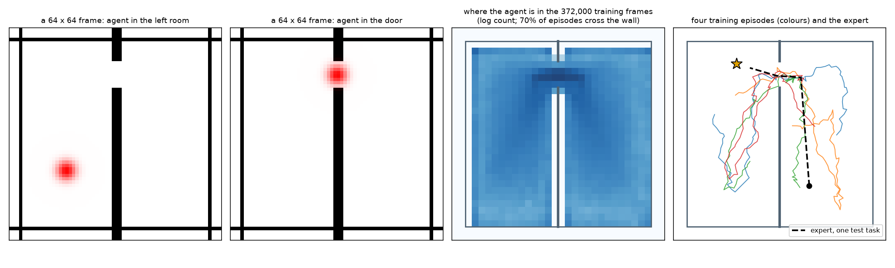
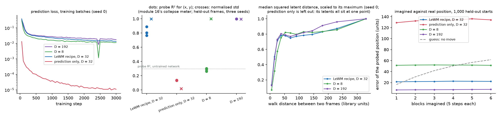
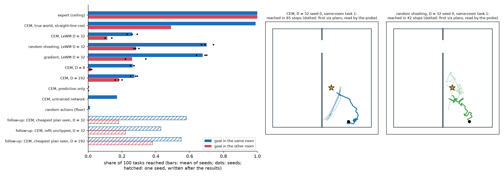
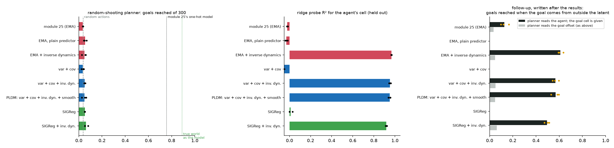

# Module 31: A world model from pixels

Module 25's JEPA learned to drop the agent, and its planner reached the goal
no more often than random moves. This module asks one question:

> **Can a small JEPA trained end to end from frames plan without collapse,
> and what fixes module 25's failure?**

It builds a world model from pixels the way LeWorldModel (LeWM, 2026) does,
with two losses and nothing else, at laptop scale; plans in it three ways; then
goes back to module 25's grid and adds, one at a time, the extra terms of
PLDM (2025), a JEPA world model that adds terms against collapse and a term
that names the action between two frames. It has five sections, each with a figure and the numbers beside it:

1. **Two rooms in 64 × 64 pixels**: a port of stable-worldmodel's TwoRoom task, its data and its test tasks.
2. **A LeWorldModel in miniature**: an encoder, a predictor, a prediction loss and SIGReg; four recipes, three seeds each.
3. **Planning in the latent**: CEM, random shooting and gradient descent, against an expert, random moves, a perfect model and an untrained network.
4. **Back to module 25's grid**: inverse dynamics, variance and covariance, smoothness and SIGReg, one at a time.
5. **The library way**: stable-worldmodel's env, losses and CEM solver against ours.

Every number in this README comes from a JSON file in [`results/`](results/),
written by the script that measured it. What we expected, written before any
of those runs, is in [`results/expectations.json`](results/expectations.json);
the end of the README scores it.

This module belongs to track 9, **Acting and planning**. It builds on
[module 16](../16-self-supervised-and-jepa/README.md) (JEPA, SIGReg, the
collapse meters) and [module 25](../25-world-models-and-planning/README.md)
(world models, random shooting, the JEPA that dropped the agent). Read it
after [module 26](../26-rl-with-a-checker/README.md); it is the last module in
the course's reading order.

**🕹 Interactive:** [A world model from pixels](../../explorables/31-world-model-from-pixels.html):
drop the agent and the goal, see the planner's cost over the rooms, watch
CEM's imagined paths narrow round by round, and switch PLDM's terms on
module 25's grid.

**✅ Quiz:** [10 questions](../../quizzes/31.html): check yourself once you have read the five sections.

## Goals

By the end you will be able to:

- write a small world, render it as frames, and collect trajectories from a noisy expert;
- train a JEPA world model end to end from pixels with a prediction loss and SIGReg, and say what each term does;
- tell a collapsed latent from a useful one with probes, collapse meters and a distance curve;
- plan in a latent with CEM, random shooting and gradients, and read each against a floor, a ceiling and controls;
- say why a latent that holds the agent can still fail a planner, and how to check;
- check your own code against a library's, line for line.

## Setup

```bash
cd modules/31-world-model-from-pixels/python
```

```bash
uv sync
```

Nothing to download from the Hub. `uv sync` installs `stable-worldmodel`
0.1.1 from PyPI for section 5, with OpenCV and imageio, which its import
needs. The world, the data and every model are made here.

**The laptop guard.** Every script imports `src/common.py` before torch. It
sets `PYTORCH_MPS_HIGH_WATERMARK_RATIO=0.5` and
`PYTORCH_MPS_LOW_WATERMARK_RATIO=0.4`, as in every module, and fixes torch at
4 threads. Training runs on the GPU (MPS); planning and the grid run on the
CPU. Any run longer than 5 minutes saves itself and goes on in a new process,
so no process runs over 5 minutes. Each script logs its time and peak memory:

| Script | Processes | Longest | Total | Peak RSS | Peak MPS driver |
|---|---|---|---|---|---|
| `src/world.py` | 1 | 0.0 min | 0.0 min | 0.25 GB | 0 (CPU) |
| `src/train.py --all` (12 runs) | 19 | 4.54 min | 59.0 min | 1.39 GB | 1.08 GB |
| `src/train.py --summary` | 1 | 2.14 min | 2.1 min | 1.60 GB | 0 (CPU) |
| `src/plan.py --all`, `--followup` (25 rows) | 25 | 4.51 min | 68.3 min | 0.55 GB | 0 (CPU) |
| `src/grid_terms.py --all` (8 arms) | 8 | 2.69 min | 7.7 min | 0.71 GB | 0 (CPU) |
| `src/grid_terms.py --followup all` (5 arms) | 5 | 2.91 min | 5.7 min | 0.68 GB | 0 (CPU) |
| `src/library.py --checks`, `--plan` | 2 | 2.51 min | 2.5 min | 0.47 GB | 0 (CPU) |

Measured on an Apple M5 with 16 GB, Python 3.12, torch 2.14.1, while other
jobs shared the machine. MPS training is not bit-for-bit repeatable; the
CPU parts are.

## 1 · Two rooms in 64 × 64 pixels

[`src/tworoom.py`](python/src/tworoom.py) holds the world. It is a port of
stable-worldmodel's `TwoRoomEnv` at its default settings, a task where
PLDM and DINO-WM (a world model built on a frozen, pretrained image encoder)
beat LeWM. The state lives in the library's own units, a 224 × 224
frame, so section 5 can check the port step for step; only the picture is
drawn at 64 × 64, 3.5 units a pixel.

```python
def step(pos, action):   # move 5 units times the action (in [-1, 1]^2); border; a wall at x = 112 with one door
def render(pos):         # 64 x 64 RGB: white rooms, black wall and border, the agent a red Gaussian dot
def geodesic(p, g):      # walk length: straight within a room, through the door between rooms
def expert_action(pos, goal):  # full speed at the goal, by way of the door
```



The frame shows only the agent: walls never move and the goal is not drawn.
The goal reaches a planner as a second frame, the agent drawn where the goal
is, as in LeWM.

| | Value |
|---|---|
| Frame | 64 × 64 RGB; 224 library units across, 3.5 a pixel |
| Agent | moves at most 5 units along each axis per step; its centre stays in [21, 203] |
| Wall and door | x = 112, 10 units thick; door for y in [35, 63] |
| Goal reached | within 16 units |
| Training data | 4,000 episodes × 92 steps = 368,000 moves (372,000 frames) |
| Episodes that cross the wall | 70.3% |
| Mean move | 3.99 units; 3.6% of moves under 0.5 units |
| Test tasks, other room | 100 (from 101 draws); walk 64.6 to 276.3 units, mean 170.6; expert 34.4 steps on average, 58 at most |
| Test tasks, same room | 100 (from 171 draws); walk 60.4 to 182.6 units, mean 98.1; expert 16.9 steps on average, 34 at most |

**Training data.** LeWM's TwoRoom data came from a noisy heuristic, 10,000
episodes of 92 steps on average. Here: 4,000 episodes of 92 steps. In 70% of them a
noisy expert walks to random goals (Gaussian noise of sd 0.5 on each move);
in 30% the agent wanders with a slowly drifting move. Every cell of a 32 × 32 grid
laid over the free floor holds some training frames. Frames are drawn when a batch is
drawn, so the data is a few megabytes of positions, not 372,000 images.

**Test tasks.** 100 with the goal in the other room and 100 in the same
room, each pair at least 60 units apart along the walk. Each agent gets 150
steps per task.

## 2 · A LeWorldModel in miniature

[`src/lewm.py`](python/src/lewm.py), [`src/train.py`](python/src/train.py).

**The model.** An encoder of four strided convolutions (64 → 4 pixels) and a
linear layer to 256 numbers, then a projector (linear, BatchNorm, GELU,
linear) to the embedding z. A predictor maps z and one block of 5 moves (10
numbers) to the next z, through two hidden layers of 256 and the same kind
of projector. Encoder 904,768 parameters, predictor 245,024. LeWM has a
ViT-Tiny encoder and a 6-layer transformer predictor, about 15 million in
all; this one has 1.15 million. Unlike module 25's, the predictor does not
output z plus a change, so "nothing moves" is not free.

**The loss** (LeWM's equation 3), on batches of 128 clips of 4 frames, 5
steps apart:

```python
z = encoder(frames)                                   # (B, 4, D), gradient flows here...
pred = predictor(z[:, :-1], actions)                  # (B, 3, D)
loss = mse(pred, z[:, 1:]) + 0.1 * sigreg(z)          # ...and here: no EMA copy, no stop-gradient
```

SIGReg ([LeJEPA](https://arxiv.org/abs/2511.08544), module 16) draws 1,024
random directions, projects the batch on each, and measures how far each
projection's characteristic function sits from a standard normal's. It is
zero only when every projection looks like N(0, 1). It is the only thing that
stops the encoder from mapping every frame to one point.

**Four recipes**, three seeds each, 3,000 Adam steps at rate 3 × 10⁻⁴:

- **LeWM recipe**, D = 32, λ = 0.1;
- **prediction only**, D = 32, λ = 0: the collapse control;
- **D = 8** and **D = 192** (LeWM's own size), λ = 0.1.

**One fix before any number.** BatchNorm keeps running averages of each
feature's mean and spread for use at test time. The features before each
BatchNorm here vary very little, and the averages, gathered while the
weights still moved, sat far from the final weights' true values in units
of that small spread. A pilot run showed it: held-out loss 0.26 in test mode,
and 0.018 once the averages were recomputed (`results/expectations.json`). `lewm.recalibrate` recomputes the averages on the
final weights over 50 batches; every number below comes after it.



On held-out frames (500 new episodes), three seeds each:

| Recipe | Probe R² (x, y), 3 seeds | Probe error | Normalised std | Effective rank | Spearman with walk distance | Held-out prediction loss |
|---|---|---|---|---|---|---|
| LeWM recipe, D = 32 | 0.77, 0.89, 0.80 | 22.0 units | 1.00 | 30.9 of 32 | 0.32 | 0.0098 |
| prediction only, D = 32 | 0.14, 0.14, 0.13 | 54.4 units | **0.02** | 28.9 of 32 | 0.31 | 0.000012 |
| LeWM recipe, D = 8 | 0.26, 0.28, 0.30 | 51.1 units | 1.00 | 7.9 of 8 | 0.34 | 0.0074 |
| LeWM recipe, D = 192 | 1.00, 1.00, 1.00 | 1.4 units | 1.00 | 41.8 of 192 | 0.41 | 0.0131 |
| untrained network, D = 32 | 0.30 | 46.1 units | 0.71 | 23.1 of 32 | 0.03 | |

Probe: closed-form ridge from the embedding to (x, y), fitted on 20,000
training frames, scored on 5,000 held-out ones; error is the mean distance
between the probed and the true position. Spearman: 5,000 random pairs of
held-out frames, latent distance against walk distance. Columns after the
second give the mean of three seeds.

How to read it:

- **Prediction only collapses to a point.** Its prediction loss falls to
  1.2 × 10⁻⁵, because every frame maps to nearly the same 32 numbers (spread
  about 0.0004 per number). Module 16's normalised-std meter flags it at
  0.02; the effective rank does not (about 29 of 32), because it is blind to
  scale and the tiny leftover spread points every way. The probe reads 14% of
  the position, less than the untrained network's 30%.
- **SIGReg stops the collapse in every seed and every size.** Normalised std
  is about 1.0, and the effective rank uses most of D.
- **But what the latent keeps depends on D, the other way from what we
  expected.** At D = 192 a linear probe reads the position almost exactly
  (R² 0.999, 1.4 units off); at D = 32, 0.82; at D = 8, 0.28, less than the
  untrained network. The world has two degrees of freedom; SIGReg asks for D
  directions that look Gaussian. Our reading, not tested here: with few
  directions to fill, the encoder folds the rooms over themselves, and a
  straight-line probe cannot unfold them; with 192 it can lay the rooms out
  flat in a few directions and fill the rest some other way. The
  explorable's cost shading shows such folds: spots far from the goal that
  the latent puts near it.
- **Latent distance is local.** Panel 3: the squared distance between two
  frames' embeddings grows over the first 30 units of walk, then flattens
  (D = 32, seed 0: median 10.8 at under 10 units, 56.6 at 20 to 30, 59 to 69 from
  30 to 200). Spearman correlation with walk distance is 0.31 to 0.41 for
  every trained recipe. A planner's cost built on this distance can tell "near"
  from "far", but not "far" from "farther".
- **The predictor is good.** At D = 192 the position the probe reads off an
  imagined embedding is 6.6 units off after one block and 7.6 after six
  (the probe on real frames: 1.4); guessing "no move" is off by 16.5 after
  one block and 61.7 after six. At D = 32 the imagined error is 21.5 to 22.6,
  no worse than the probe's own error on real frames (22.0).

## 3 · Planning in the latent

[`src/plan.py`](python/src/plan.py). Every planner sees two frames, now and
the goal, and returns 5 blocks of 5 moves. Its cost is LeWM's: the squared
distance between the imagined embedding after the last block and the goal's
embedding. The agent takes the first block, 5 moves, then plans again
(model-predictive control): at most 30 plans, 150 steps.

- **CEM**, LeWM's settings: draw 300 plans from a Gaussian (mean 0, spread 1
  at first), keep the 30 cheapest, refit the Gaussian to them, 10 rounds;
  the plan is the final mean.
- **Random shooting**: 3,000 random plans, keep the cheapest: as many
  imagined plans as CEM.
- **Gradient**: 20 random starts, 25 Adam steps each through the predictor,
  keep the cheapest.

Fixed agents: the **expert** (ceiling), **random moves** (floor), **CEM with
the true world as its model** and the straight-line distance as its cost,
and **CEM on the untrained network** (control).



| Agent | Same room, 3 seeds | Mean | Other room, 3 seeds | Mean |
|---|---|---|---|---|
| expert (ceiling) | | 100% | | 100% |
| CEM, true world, straight-line cost | | 99% | | 49% |
| **CEM**, D = 32 | 26, 23, 29 | **26.0%** | 10, 14, 10 | **11.3%** |
| **random shooting**, D = 32 | 74, 67, 69 | **70.0%** | 30, 28, 27 | **28.3%** |
| **gradient**, D = 32 | 70, 64, 69 | **67.7%** | 34, 22, 22 | **26.0%** |
| CEM, D = 8 | 27, 25, 27 | 26.3% | 2, 1, 2 | 1.7% |
| CEM, D = 192 | 29, 28, 25 | 27.3% | 20, 18, 16 | 18.0% |
| CEM, prediction only | 0, 0, 0 | 0% | 0, 0, 0 | 0% |
| CEM, untrained network | | 17% | | 0% |
| random actions (floor) | | 1% | | 0% |
| *follow-up:* CEM, cheapest plan seen, D = 32, seed 0 | | 58% | | 18% |
| *follow-up:* CEM, refit to unclipped plans, D = 32, seed 0 | | 43% | | 22% |
| *follow-up:* CEM, cheapest plan seen, D = 192, seed 0 | | 55% | | 38% |

The three follow-up rows were written after the results, to test the
explanation below; they are one seed each and were not in the expectations.

What the runs show:

- **The model plans, within a room.** Random shooting on the D = 32 model
  reaches 70.0% of same-room goals; random moves reach 1%. The model is good
  enough for the search to use it.
- **CEM, LeWM's planner, does worst of the three searches**: 26.0% within a
  room, against 70.0% for random shooting with as many imagined plans. Section
  2 gives the reason: the cost is flat beyond about 30 units. When most plans
  land on that flat part, the 30 cheapest differ by noise, and the mean CEM
  refits points nowhere in particular: CEM's runs end a median 84 to 92 units
  from the goal, random shooting's 15. Two follow-ups, written after the
  results, back this. Return the cheapest plan CEM has seen instead of its
  final mean, and CEM reaches 58% (seed 0, from 26%). Refit the Gaussian to
  the candidates before they are clipped to [-1, 1], as stable-worldmodel
  does (section 5), and it reaches 43%. Clipping first pulls each elite's
  large moves back to ±1, so the refitted mean, and with it the plan, is
  shorter than the elites it came from.
- **Gradient descent nearly matches random shooting** (67.7% and 26.0%,
  against 70.0% and 28.3%). JEPA-WMs (2025) found gradient planners stall on
  2-D navigation; with 20 random starts, ours did not, here.
- **Across the wall every planner struggles, and the cost is to blame.**
  CEM with a perfect model and the straight-line cost reaches 99% within a
  room but 49% across: a plan moves the agent at most 125 units along each
  axis, and when the door
  lies away from the goal, the cheapest plans walk into the wall. A latent
  cost has the same trouble. The goal frames in this split sit a mean 170.6
  units of walk away; the expert, which aims for the door first, needs 58
  steps at most.
- **A better latent did not make CEM better within a room.** D = 192 reads
  the position almost exactly, but CEM on it reaches 27.3%, like D = 32
  (26.0%) and D = 8 (26.3%). Across the wall it does better (18.0%, against
  11.3% and 1.7%), and with the cheapest plan kept it reaches 38%.
- **The controls behave.** The collapsed model (prediction only) reaches
  nothing. The untrained network reaches 17% within a room: random
  convolutions already make frames with nearby dots look alike, so a search
  over them finds a near goal now and then. Training raises that to 70%
  with random shooting.

## 4 · Back to module 25's grid

[`src/grid_terms.py`](python/src/grid_terms.py), with module 25's grid,
models and planner copied unchanged into [`src/grid.py`](python/src/grid.py),
[`src/grid_models.py`](python/src/grid_models.py) and
[`src/grid_plan.py`](python/src/grid_plan.py). Module 25's JEPA (encoder to 32
numbers, an EMA target: a slowly averaged copy of the encoder that makes the
targets, a predictor that outputs z plus a change) learned to drop
the agent. Each arm here changes one thing and keeps the rest: the data, the
6,000 steps, the 300 test arenas, the ridge probe for the goal's offset and
the random-shooting planner.

| Arm | What it adds to module 25 |
|---|---|
| module 25 (EMA) | nothing: module 25's own training function |
| plain predictor | the predictor outputs the next latent, not z plus a change |
| + inverse dynamics | a small head must name the action from (z, next z) |
| var + cov | no EMA: one encoder on both sides, with gradient; VICReg's variance and covariance terms |
| var + cov + inverse dynamics | both |
| PLDM | var + cov + inverse dynamics + temporal smoothness: PLDM's full set |
| SIGReg | no EMA; SIGReg (256 directions) |
| SIGReg + inverse dynamics | both |

Weights, fixed before any run: variance 1, covariance 0.04, inverse dynamics
1, smoothness 0.1, SIGReg 0.1. Seed 0 of the first arm reproduces module 25
exactly: 11 of 300 goals (3.7%), agent-cell R² −0.015.



| Arm | Goals reached (of 300), 3 seeds | Mean | Agent-cell R² | Goal-offset R² | Wall-count R² | Effective rank |
|---|---|---|---|---|---|---|
| module 25 (EMA) | 3.7, 3.3, 3.3% | 3.4% | −0.02 | 0.00 | 0.47 | 16.0 |
| plain predictor | 6.7, 4.3, 5.0% | 5.3% | −0.03 | −0.01 | 0.65 | 19.9 |
| + inverse dynamics | 6.0, 2.7, 5.7% | 4.8% | **0.97** | 0.50 | 0.66 | 2.3 |
| var + cov | 3.7, 2.3, 4.3% | 3.4% | −0.05 | −0.03 | 0.95 | 22.7 |
| var + cov + inverse dynamics | 4.7, 5.0, 5.7% | 5.1% | **0.95** | 0.49 | 0.70 | 9.5 |
| PLDM: var + cov + inverse dynamics + smoothness | 2.7, 5.3, 6.3% | 4.8% | **0.95** | 0.49 | 0.69 | 10.1 |
| SIGReg | 5.3, 5.0, 5.3% | 5.2% | 0.01 | 0.01 | 0.05 | 22.8 |
| SIGReg + inverse dynamics | 5.3, 5.3, 8.0% | 6.2% | **0.92** | 0.47 | 0.06 | 23.2 |
| random actions (module 25) | | 3.7% | | | | |
| true world as the model (module 25) | | 89.0% | | | | |

R² values are means of three seeds, held out (500 new arenas).

What the runs show:

- **Inverse dynamics puts the agent back.** Every arm with it reads the
  agent's cell at R² 0.92 to 0.97; every arm without it, at 0.01 or less.
  Neither the plain predictor, nor variance and covariance, nor SIGReg alone
  brings the agent in: they spread the latent over the walls instead (wall
  count R² up to 0.95 with var + cov).
- **And planning does not move.** Every arm stays at 3.4% to 6.2%, beside
  random actions (3.7%). Our expectation, that inverse dynamics would lift
  planning to 20% or more, missed in every arm.
- **Why, in a follow-up written after the results**
  ([`results/grid_followup.json`](results/grid_followup.json)): the planner
  reads the goal's *offset* from the latent, so the goal must be in the latent
  too. It is not: a probe reads the goal's cell at R² 0.01 to 0.03 in every
  arm. The goal never moves within an episode, so nothing in any of these
  losses asks for it, just as nothing asked for the agent in module 25.
  Retraining the same arms (CPU, same seeds: the same weights; each reproduced
  its success to the last digit) and planning with a probe that reads only
  the agent, the goal's cell given from outside as the one-hot planner gets
  it: 61.0% with inverse dynamics on module 25's
  JEPA (60.0, 59.3, 63.7), 56.8% with var + cov + inverse dynamics, 57.0%
  with PLDM's full set, 49.6% with SIGReg + inverse dynamics, and 12.8% for
  module 25's own latent. Module 25's one-hot model reached 75.7% with the
  same planner, the true world 89.0%.

So module 25's failure had two layers. Its latent dropped the agent, and the
inverse-dynamics term fixes that. Its planner also needed the goal inside
the same latent, and no term here supplies that; LeWM and DINO-WM avoid the
problem by encoding the goal as its own frame, as section 3 does.

## 5 · The library way: stable-worldmodel

[`src/library.py`](python/src/library.py) runs
[stable-worldmodel](https://arxiv.org/abs/2605.21800) 0.1.1, the harness
LeWM's authors released for this kind of work, against the code above.

| Check | Result |
|---|---|
| Our `step` against `TwoRoomEnv.step`, 50 noisy-expert episodes | 4,600 steps, largest position gap **0** units |
| Our 64-pixel frame against the library's 224-pixel frame shrunk by OpenCV's area filter, 200 frames | mean pixel gap 0.018 (of 1); 2.7% of pixels differ by over 0.25 |
| Our `sigreg` against `SIGReg`, same random directions, 50 batches | largest relative gap **0** |
| Section 4's variance and covariance terms against `VCReg` | largest relative gap **0** |
| `CEMSolver` (300, best 30, 10 rounds, cold start) driving the D = 32 seed-0 model in `TwoRoomEnv`, 200 tasks | same room **43%**, other room **22%**; ours **26%** and **10%** |

The world and both losses match to the last bit. The planner did not, and
we had expected it to (within 10 points). The cause is one line. Our CEM
clips each candidate to [-1, 1] before it refits the Gaussian; the library
refits to the candidates as drawn and lets the env clip the moves. Run our
loop the library's way (`plan.py`'s `cem_noclip`, written after this
result) and it reaches 43% and 22%, with the same outcome as the library on
all 200 tasks, task by task: same seeds, same random numbers, same model.
Neither is wrong, but the difference is worth 17 points within a room.

For scale, two published numbers on this kind of task, neither a bar for
this run: EB-JEPA reports 97% planning success on its Two Rooms task, and
LeWM reports PLDM and DINO-WM ahead of it on TwoRoom. Both use larger models,
their own data and their own test tasks.

The library also ships model code for LeWM, PLDM and TD-MPC2, and gradient
and MPPI solvers; this module did not use them. Training its LeWM
(a ViT-Tiny and a transformer predictor at 224 pixels) is a one-GPU,
few-hour job, beyond the laptop guard.

## Written down before the runs

[`results/expectations.json`](results/expectations.json) lists what we
expected, written before any run whose numbers appear here, with what we had
seen by then: the world checked against the library, one 1,000-step pilot of
the LeWM recipe, a pilot of the planners on 15 tasks per kind, and a smoke
test of the grid arms. The pilots were deleted and none of their numbers is
reported as a result. Nothing was changed after the runs except two
bookkeeping bugs in `plan.py`: the expert's row crashed on a missing field
before it wrote anything, and the untrained network's row took 6.0 minutes,
over the guard, because it refitted its probe; it now reads the probe from
`train.json`, and the rerun gave the same outcome on all 200 tasks. The
follow-ups in sections 3, 4 and 5 were written after the results and are
marked as such.

Twelve met, eight missed.

| | Expected | Measured | Verdict |
|---|---|---|---|
| E1 | prediction only collapses: effective rank under 2, probe R² under 0.2 | R² 0.13 to 0.14; effective rank 28.7 to 29.2: it collapsed to a point, which the rank cannot see (normalised std 0.02 does) | missed (the rank half) |
| E2 | LeWM recipe: probe R² ≥ 0.9 and effective rank ≥ 20, every seed | R² 0.77, 0.89, 0.80; rank 30.9 | missed |
| E3 | D = 8 and D = 192 also reach R² ≥ 0.9 | D = 192: 1.00; D = 8: 0.26 to 0.30 | missed |
| E4 | Spearman with walk distance ranks D = 8 > 32 > 192, D = 8 at least 0.1 above D = 192 | 0.34, 0.32, 0.41: D = 192 first | missed |
| E5 | imagined position after 6 blocks within 1.5 × the probe's error on real frames (D = 32) | 22.2 units against 22.0 | met |
| E6 | perfect-model CEM: ≥ 95% within a room, ≤ 50% across | 99%, 49% | met |
| E7 | CEM on D = 32: 10 to 50% within, under 20% across | 26.0%, 11.3% | met |
| E8 | random shooting beats CEM within a room by ≥ 20 points | 70.0% against 26.0% | met |
| E9 | the gradient planner below random shooting in both splits | 67.7% < 70.0%, 26.0% < 28.3% (seed 0 across: 34% > 30%) | met, narrowly |
| E10 | prediction only with CEM ≤ random actions + 5 points | 0% in both | met |
| E11 | CEM on D = 8 beats D = 32 across rooms by ≥ 10 points | 1.7% against 11.3% | missed |
| E12 | expert 100%; random actions ≤ 10% within, ≤ 5% across | 100%; 1%, 0% | met |
| E13 | grid, module 25's arm, seed 0 reproduces 11 of 300 and R² −0.015 | 11 of 300; −0.0154 | met |
| E14 | grid, + inverse dynamics: agent R² ≥ 0.5 and planning ≥ 20% | 0.97; 4.8% | missed (the planning half) |
| E15 | grid, plain predictor: agent R² under 0.1 | −0.03 | met |
| E16 | grid, var + cov and PLDM: agent R² ≥ 0.5, planning ≥ 20%, PLDM ≥ var + cov | var + cov −0.05; PLDM 0.95; planning 3.4% and 4.8% | missed |
| E17 | grid, SIGReg alone: agent R² under 0.3; SIGReg + inverse dynamics ≥ 0.5 | 0.01; 0.92 | met |
| E18 | grid: no arm reaches 75.7%; the best at most 60% | best 6.2% | met |
| E19 | our SIGReg and VC terms equal the library's to 1e-5 relative | gap 0 | met |
| E20 | the library's CEMSolver within 10 points of our CEM | 43% against 26%, 22% against 10% (explained in section 5) | missed |

The misses that change what the module teaches: E2 to E4 (a 2-D world under
SIGReg reads best at a large D, not a small one), E14 and E16 (a latent that
holds the agent still fails a planner that needs the goal in it too), and E20
(a one-line difference in CEM moves the result by 17 points).

## Run it

Each script prints its numbers and writes its JSON. Order matters: `plan.py`
and `library.py` load the checkpoints `train.py` writes to `artifacts/runs/`
(18 to 22 MB each, with the optimiser state; not in git). Long steps run as many short processes; the
`--all` forms run them one after another.

```bash
uv run python src/world.py --figures
```

```bash
uv run python src/train.py --all                 # 12 runs, about 60 minutes on MPS
uv run python src/train.py --summary --figures
```

```bash
uv run python src/plan.py --all                  # 22 rows, about 70 minutes on the CPU
uv run python src/plan.py --followup             # 3 rows written after the results
uv run python src/plan.py --summary --figures
```

`--summary` also rounds the paths and plans kept for the figures to whole
library units (a third of a pixel), which shrinks the files.

```bash
uv run python src/grid_terms.py --all            # 8 arms, about 12 minutes on the CPU
uv run python src/grid_terms.py --summary --figures
uv run python src/grid_terms.py --followup all && uv run python src/grid_terms.py --followup summary
```

```bash
uv run python src/library.py --checks
uv run python src/library.py --plan              # run until it prints "done"
uv run python src/library.py --summary
```

Redraw every figure from the committed JSON, with no model loaded:

```bash
uv run python src/figures.py
```

Rewrite the explorable's data block from the JSON and
`artifacts/lewm_planner.pt` (the predictor, the probe and a 48 × 48 table of
the encoder's outputs, 0.65 MB):

```bash
uv run python src/export_explorable.py
```

## Exercises

Skeletons with `# TODO(you):` live in [`exercises/`](exercises/); reference
solutions are in [`solutions/`](solutions/). Each asks you to predict before
you run, and runs in seconds on the CPU.

- **(a) `exercise_a_world.py`**: write the two-room `step`, border, wall and
  door; count how many random moves the wall stops. The test checks it
  against `src/tworoom.py` on 100,000 moves.
- **(b) `exercise_b_sigreg.py`**: write SIGReg and LeWM's two-term loss; rank
  six latents by SIGReg, two of them from a 2-D world. The test checks both
  against `src/lewm.py`.
- **(c) `exercise_c_cem.py`**: write CEM's loop with the true world as the
  model; run it on 20 tasks of each kind. The test checks your plans against
  `src/plan.py`.

## Tests

```bash
uv run pytest
```

Twenty-one tests, a few seconds, no training. They check the solutions and
the world's rules against `src/`, every chunk against the laptop guard, the
committed results against each other and against module 25, the library
checks, that the follow-ups are marked as such and reproduce, and the
explorable against the results.

## To go further

- Plan with the D = 192 model's latent but a cost that knows the door: give
  CEM a waypoint at the door when the goal is in the other room. This is the
  idea behind hierarchical planning ([HWM](https://arxiv.org/abs/2604.03208)):
  a slower model proposes subgoals, the fast one reaches them.
- Train the grid JEPA with the goal drawn as its own frame (module 25's
  observation without the goal plane, and a second observation with the agent
  on the goal), then plan with LeWM's cost. Write down first what you expect.
- Give CEM a warm start, as stable-worldmodel's policy does by default: begin
  each plan from the last one, shifted by one block.
- Sweep SIGReg's λ at D = 8 and D = 32, three seeds each, and watch the
  probe R²: does a weaker pull towards the Gaussian let the rooms lie flat?

## Checkpoint: you should now be able to…

- write a world, render it, and check it against a library step for step;
- train a JEPA world model from pixels with a prediction loss and SIGReg;
- spot a collapsed latent and say which meter catches which kind of collapse;
- plan with CEM, random shooting and gradients, and say what each needs from the cost;
- say why a latent that holds the agent can still fail a planner;
- say what PLDM's inverse-dynamics term fixes, and what it does not.

## Links

- Maes et al., [LeWorldModel: Stable End-to-End Joint-Embedding Predictive Architecture from Pixels](https://arxiv.org/abs/2603.19312) (2026)
- Balestriero and LeCun, [LeJEPA: Provable and Scalable Self-Supervised Learning Without the Heuristics](https://arxiv.org/abs/2511.08544) (2025): SIGReg
- Sobal et al., [Learning from Reward-Free Offline Data: A Case for Planning with Latent Dynamics Models](https://arxiv.org/abs/2502.14819) (2025): PLDM
- Terver et al., [What Drives Success in Physical Planning with Joint-Embedding Predictive World Models?](https://arxiv.org/abs/2512.24497) (2025)
- Zhang et al., [Hierarchical Planning with Latent World Models](https://arxiv.org/abs/2604.03208) (2026): HWM
- Maes et al., [stable-worldmodel: A Platform for Reproducible World Modeling Research and Evaluation](https://arxiv.org/abs/2605.21800) (2026)
- Terver et al., [A Lightweight Library for Energy-Based Joint-Embedding Predictive Architectures](https://arxiv.org/abs/2602.03604) (2026): EB-JEPA
- Zhou et al., [DINO-WM](https://arxiv.org/abs/2411.04983) (2024)
