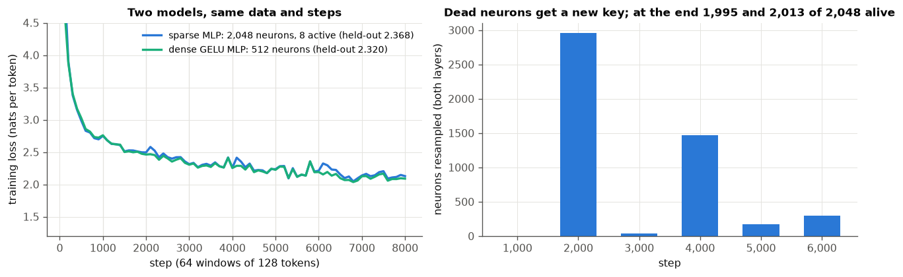
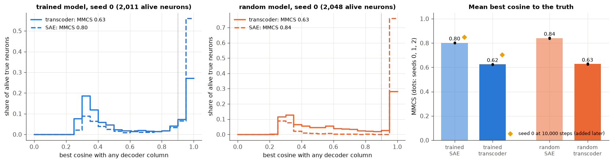
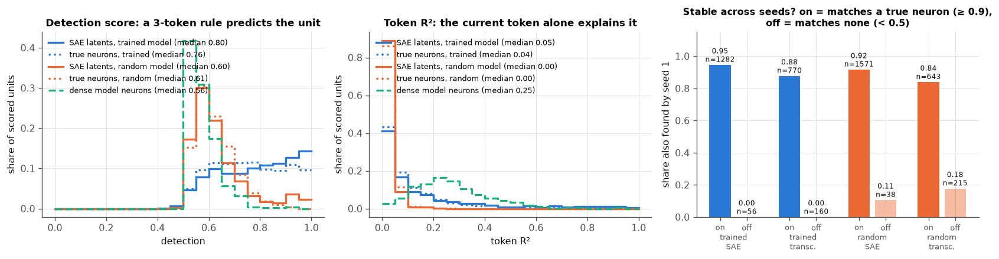
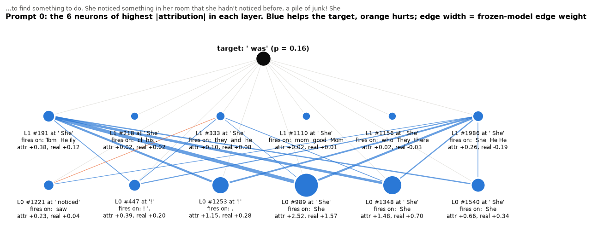
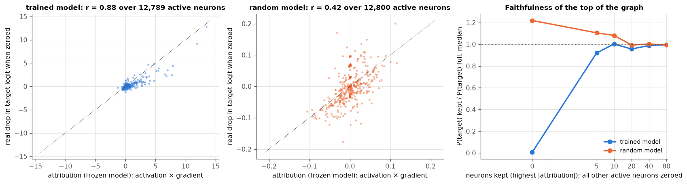
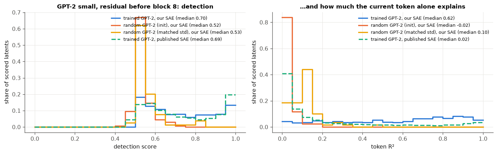

# Module 32: Is the explanation real?

Modules 11 and 12 read neurons and trained a sparse autoencoder, and found
units that looked clean. Looking clean is not proof. This module asks one
question:

> **Which interpretability findings survive a random-weight model, a second
> seed and a known ground truth?**

To answer it, it builds a model whose units we know, then grades the usual
tools against it. It has six sections, each with a figure and the numbers
beside it:

1. **A model whose neurons are the truth**: a two-layer transformer on TinyStories whose MLPs keep only 8 of 2,048 neurons per token.
2. **Grade the dictionaries against the truth**: an SAE and a transcoder fitted to one MLP, scored by how well they find its neurons.
3. **The random-weight control**: the same dictionaries and scores on a copy of the model that never trained.
4. **A second seed**: which latents come back when only the seed changes, and whether those are the true ones.
5. **An attribution graph, then ablation**: which neurons drive one prediction, and whether zeroing them agrees.
6. **The library way**: SAELens on GPT-2 small and on two random-weight GPT-2s.

Before any run we wrote down what each experiment should show
([`results/expectations.json`](results/expectations.json)); the last section
scores them. Eight of sixteen were met. Every number in this README comes from
a JSON file in [`results/`](results/), written by the script that measured it.

This is the fourth module of track 4, **Looking inside**, after
[module 11](../11-inside-a-language-model/README.md),
[module 12](../12-features-and-dictionaries/README.md) and
[module 13](../13-inside-vision-and-jepa/README.md). Next,
[module 14](../14-how-training-finds-a-solution/README.md) opens track 5.

**🕹 Interactive:** [Is the explanation real?](../../explorables/32-is-the-explanation-real.html):
browse latents with the true neuron beside each, switch between the trained
and the random model, and click through an attribution graph to see each
neuron's real ablation effect.

**✅ Quiz:** [10 questions](../../quizzes/32.html): check yourself once you have read the six sections.

## Goals

By the end you will be able to:

- build a model whose units are known, and say what that buys;
- score a dictionary against a ground truth with best cosines (MMCS);
- run the random-weight control, and say which scores it changes and which it does not;
- match two dictionaries one to one, and read what seed agreement tells you;
- compute an attribution as activation × gradient in a frozen model, and test it by ablation;
- train an SAE with SAELens on a model you pass in, including one with random weights.

## Setup

```bash
cd modules/32-is-the-explanation-real/python
```

```bash
uv sync
```

| Need | Size | Where |
|---|---|---|
| `roneneldan/TinyStories`, revision `f54c09fd`, file `TinyStories-valid.txt` | 19.4 MB | Hugging Face cache, on the first run of any script |
| GPT-2 small (`gpt2`), tokenizer and weights | 548 MB | Hugging Face cache; module 12 already fetched it |
| GPT-2 SAE, layer 8 (`jbloom/GPT2-Small-SAEs-Reformatted`) | 151 MB | Hugging Face cache; module 12 already fetched it |
| The trained sparse model | 3.5 MB | committed: `artifacts/sparse.pt` (float16) |
| The dense baseline | 1.9 MB | committed: `artifacts/dense.pt` (float16) |
| Our vocabulary (our id to GPT-2 id) | 26 KB | committed: `artifacts/vocab.json` |

TinyStories (Eldan and Li, 2023) holds short stories written by GPT-3.5 and
GPT-4 in the words a small child knows. We use one file of it, 21,990 stories:
the first 90% train, the last 10% are held out. GPT-2's tokenizer splits them
into 4,162,954 training and 504,198 held-out tokens. We keep the 4,095 most
frequent tokens of the training stories, plus one id for any other token,
which covers all but 1.3% of held-out tokens. The story separator stays a
token; on the page it shows as ¶.

**The laptop guard.** Every script imports `src/common.py` before torch. It
sets `PYTORCH_MPS_HIGH_WATERMARK_RATIO=0.3`: the Apple GPU may take at most
0.3 of the working set Metal recommends, 3.55 GB on this 16 GB Mac, so a run
that grows past the module's 4 GB budget stops with an error instead of
pushing the Mac into swap. That happened twice while we built this module,
and both times the fix was to hold less at once. Every long job stops and
saves once 4.5 minutes have passed, after finishing the step or dictionary in
hand (so one chunk ran 4.8), and picks up where it stopped on the next call. Each
chunk's time and peak memory is logged in `results/*_log.jsonl`:

| Script | Chunks | Minutes in all | Longest chunk | Peak RSS | Peak MPS driver |
|---|---|---|---|---|---|
| `src/train.py sparse` | 5 | 20.6 | 4.5 | 0.52 GB | 1.23 GB |
| `src/train.py dense` | 3 | 9.5 | 4.5 | 0.51 GB | 1.21 GB |
| `src/dicts.py` (12 dictionaries) | 3 | 13.9 | 4.8 | 0.50 GB | 3.06 GB |
| `src/dicts.py --long` (2 dictionaries) | 2 | 4.9 | 2.5 | 0.52 GB | 3.06 GB |
| `src/analyse_dicts.py` | 1 | 1.1 | 1.1 | 1.84 GB | 2.05 GB |
| `src/attribution.py` | 1 | 0.3 | 0.3 | 1.57 GB | 0 (CPU) |
| `src/library.py train` (3 SAEs) | 3 | 11.0 | 4.6 | 1.87 GB | 3.02 GB |
| `src/library.py eval` | 1 | 1.6 | 1.6 | 2.75 GB | 0 |

Measured on an Apple M5 with 16 GB, torch 2.14.1, while other jobs shared the
GPU, so the times are on the slow side. The first dictionary chunk saved its
four dictionaries and then stopped at the MPS cap while recording the random
model; its row in `results/dicts_log.jsonl` says so and has no memory figure.
`results/library_log.jsonl` keeps two discarded runs, each with a note: a
smoke test, and a random GPT-2 built with its weights left unset (section 6).

## 1 · A model whose neurons are the truth

To grade a tool that claims to find a model's features, you need to know the
features. In a normal network you do not. Korznikov et al.
([2026](https://arxiv.org/abs/2610.19907)) build a model where you do: each
MLP is wide, and a TopK gate keeps only a few neurons per token. We build a
small copy:

```
h   = TopK_8(ReLU(W_in · LN(x) + b_in))      2,048 neurons, 8 kept per token
out = W_out · h + b_out                      added to the residual stream
```

Each MLP output is b_out plus at most 8 columns of W_out, scaled. Column i of
W_out is neuron i's **value**, the direction it writes; row i of W_in is its
**key**, the direction it reads. The model computes with exactly these units,
so they are the truth any dictionary should find.

`src/model.py` has two blocks, a 128-wide residual stream, 4 attention heads,
128-token windows and a head tied to the token embedding: 1,726,976
parameters. Their model has 5 layers, a 256-wide stream, 8,192 neurons and
k = 8. The **dense baseline** swaps each sparse MLP for a plain GELU MLP of
512 neurons (937,472 parameters). `src/train.py` trains both the same way:
8,000 steps of 64 windows (65.5M tokens, about 16 passes over the training
stories), AdamW, rate 3 × 10⁻³ with warmup and cosine decay. Every 1,000
steps a sparse neuron that never fired in that stretch gets a new random key,
as in their paper; that happened to 2,959 neurons at step 2,000 and 1,470 at
step 4,000.



| Model | Held-out loss (nats per token) | Neurons alive at the end |
|---|---|---|
| Sparse MLPs, 8 of 2,048 | 2.368 | 1,995 and 2,013 of 2,048 (blocks 0 and 1) |
| Dense GELU MLPs, 512 | 2.320 | all |

"Alive" means firing on at least 1 in 100,000 held-out tokens. The sparse
model pays 0.048 nats for its gate. Replacing block 1's whole MLP output with
its mean raises the loss on the first 2¹⁸ held-out tokens from 2.297 to
2.838, so that MLP matters.

**Are its neurons easier to read?** A score stands in for auto-interp, the
pipeline where a language model reads a unit's top contexts, writes an
explanation, then predicts from it where the unit fires. Here a rule plays
the language model:

- **explain**: the 3 tokens most common among the unit's 50 strongest
  activations on the first half of 2¹⁸ held-out tokens;
- **detect**: on the second half, call a token "strongly active" when the
  unit reaches 20% of its first-half maximum; predict that from "is the
  current token one of the 3?"; score the balanced accuracy (mean of the hit
  rates on active and on silent tokens; 0.5 is chance).

The median sparse neuron of block 1 scores **0.76** (middle half 0.65 to
0.88, 1,875 neurons fire often enough to score); the median dense neuron
**0.56** (0.53 to 0.61). The paper's language-model judge gave 0.866 against
0.605 on its larger model. The rule is narrow: it only sees the current
token. A second number shows what it misses. **Token R²** is the share of a
unit's activation, on the second half, explained by its average on each
token in the first half. Dense neurons score 0.25, sparse neurons 0.04: a
sparse neuron fires on a few tokens but only in some contexts, so the token
alone predicts its strength badly.

## 2 · Grade the dictionaries against the truth

Two dictionaries, each with the true MLP's own shape (2,048 latents, TopK
k = 8), fitted to block 1's MLP on 2²⁰ training tokens:

- an **SAE** rebuilds the MLP output from itself, as in module 12;
- a **transcoder** (Dunefsky et al., [2024](https://arxiv.org/abs/2406.11944))
  predicts the MLP output from the MLP input, so it must do the MLP's work.

Both train 3,000 steps of 4,096 tokens with Adam at 10⁻³, decoder columns
held at norm 1, three seeds each. The score is the paper's **MMCS** (mean max
cosine similarity): for each alive true neuron, the highest cosine between
its value vector and any decoder column, averaged. A neuron counts as
**recovered** at cosine 0.9 or more. For scale: 2,048 random directions in
128 dimensions give an MMCS of 0.30 (exercise a).



| Dictionary, trained model | MMCS (seeds 0, 1, 2) | Recovered | Unexplained variance | Dead latents | Loss gap closed |
|---|---|---|---|---|---|
| SAE | 0.800 · 0.804 · 0.802 | 63.0% | 3.5% | 202 | 97.5% |
| Transcoder | 0.627 · 0.624 · 0.624 | 34.9% | 11.1% | 703 | 92.7% |

Recovered is the mean of three seeds; the other columns are seed 0. "Loss gap
closed" puts the dictionary's output in place of the MLP's: 0% is the
mean-ablated loss (2.838), 100% the intact one (2.297). A dead latent never
fires on the held-out tokens.

**Here the SAE wins, the opposite of the paper.** Korznikov et al. report
value MMCS 0.709 for the transcoder against 0.464 for the SAE (+52.6%), at
their scale. We expected the transcoder ahead by at least 0.10 and it trails
by 0.18. The three seeds of each sit within 0.005 of each other, so the gap
is not noise; it belongs to this setup. One likely cause is budget: our
transcoder still leaves 11% of the variance unexplained, three times the
SAE, and a third of its latents are dead, while in the paper the transcoder
had the lower error. A check we added after seeing this, not planned before:
seed 0 of each at 10,000 steps instead of 3,000. The transcoder gains more
(MMCS 0.70, recovers 51%) than the SAE (0.85, recovers 74%), but stays
behind. So with our recipe and budget, the claim does not carry over; with
theirs it may.

**What a dictionary misses.** Even the better one, at cosine 0.9, finds about
two neurons in three. In the left panel, most of the rest sit near cosine
0.3, which is chance: the dictionary has no latent for them at all. With 2,048
latents for 2,048 neurons, every latent spent on a mix of neurons is one
neuron left out.

## 3 · The random-weight control

Heap et al. ([2025](https://arxiv.org/abs/2501.17727)) trained SAEs on
Pythia models whose weights were random, and found that automatic
interpretability scores could not tell them from SAEs on the trained models.
Their reading: random models still have easy single-token features. We run
the control on our testbed: the same architecture with every weight at its
initial random value (`model.random_copy`, torch seed 1), and the same twelve
dictionaries (two kinds, three seeds).

The random copy has true neurons too, since its gate is the same. So we can
ask both questions at once: do the dictionaries find its neurons, and do the
scores tell it apart?



| Median over scored units | Trained model | Random copy |
|---|---|---|
| MMCS, SAE (mean of 3 seeds) | 0.802 | 0.840 |
| MMCS, transcoder | 0.625 | 0.627 |
| Detection, true neurons | 0.76 | 0.61 |
| Detection, SAE latents (seed 0) | 0.80 | 0.60 |
| Detection, transcoder latents | 0.84 | 0.78 |
| Token R², SAE latents | 0.05 | 0.00 |
| Token R², transcoder latents | 0.14 | 0.02 |

Three readings:

- **Finding the truth needs no training.** The dictionaries recover the
  random model's neurons as well as the trained model's; the SAE does a
  little better there. A dictionary that matches a model's units says
  nothing about whether the model learned anything. It only says the layer
  is sparse in some basis.
- **Here the detection score does tell them apart**, for neurons and SAE
  latents: 0.80 against 0.60. We expected Heap et al.'s result, within 0.05,
  and the gap is 0.19. Our setup differs from theirs in three ways that could
  matter: our explainer is a token rule, not a language model; our random
  copy keeps the small initial weights rather than redrawing each matrix at
  its trained scale; and our model has two layers, not up to 32. Section 6
  tries their way of randomising on GPT-2.
- **Token R² did not do what we expected.** We thought random-model latents
  would be plain token detectors, with a high token R². They are not: medians
  near 0 on both models. One likely reason, not tested here: at
  initialisation attention spreads evenly over the past tokens, so the
  context mean it adds can rival the current token's embedding, and the 8
  neurons the gate picks then depend on the whole context.

## 4 · A second seed

Paulo and Belrose ([2025](https://arxiv.org/abs/2501.16615)) found that two
SAEs that differ only in their seed share as few as 30% of their latents
(131K latents on Llama 3 8B). Here we can also ask *which* latents come back.
`scores.seed_match` pairs the decoder columns of two seeds one to one,
maximising the summed cosine (the Hungarian method,
`scipy.optimize.linear_sum_assignment`); a latent is **shared** when its
partner sits at cosine 0.7 or more.

| | Shared, mean of 3 pairs | Of latents on a true neuron (≥ 0.9) | Of latents on none (< 0.5) | The rest |
|---|---|---|---|---|
| SAE, trained | 79.3% | 94.5% of 1,282 | 0.0% of 56 | 42.5% of 355 |
| Transcoder, trained | 70.4% | 87.7% of 770 | 0.0% of 160 | 60.3% of 325 |
| SAE, random copy | 82.3% | 91.6% of 1,571 | 10.5% of 38 | 25.2% of 214 |
| Transcoder, random copy | 54.6% | 83.8% of 643 | 17.7% of 215 | 42.0% of 846 |

Shares are of the first seed's alive latents. The other columns compare
seeds 0 and 1.

**Seed agreement tracks the truth.** On the trained model, a latent that
matches a true neuron comes back in the other seed 95 times in 100 (SAE); a
latent that matches none never does. With no ground truth, as in a real
model, this is a cheap test you can run: train twice and trust the latents
that come back. It cannot tell a learned unit from a random model's unit,
though: section 3 showed both are found.

We expected the SAEs to share under 80% (79.3%, met, narrowly) and the
transcoders to share more than the SAEs; they share less (70.4%), a miss.

## 5 · An attribution graph, then ablation

An **attribution graph** names the units that drive one prediction and how
they feed each other (Anthropic's circuit tracing builds one from
cross-layer transcoders; [Dunefsky et al.](https://arxiv.org/abs/2406.11944)
did it with transcoders). On this model we need no replacement: the neurons
are the units. `src/attribution.py`:

1. **Freeze what is not linear**: the attention patterns, the LayerNorm
   scales, and which 8 neurons each gate keeps, at their values on the
   prompt. Each kept neuron's ReLU stays; it acts as a straight line
   unless a change pushes that neuron's input below zero. So the target
   logit is a linear function of every neuron's activation, for changes
   that small.
2. **Attribution** of an active neuron = its activation × the gradient of the
   target logit with respect to it, through every later path. In the frozen
   model this equals the drop when the neuron is zeroed, as long as no kept
   neuron's input crosses zero (checked to 3 × 10⁻⁶ on the top five
   neurons).
3. **Edges** from a block-0 neuron to a block-1 neuron: activation × the
   later neuron's derivative with respect to it × the later neuron's
   gradient.
4. **Break it**: zero one active neuron at a time and rerun the real model,
   with nothing frozen. Compare.

The prompts are 20 held-out story openings of 40 tokens; the target is the
model's top next token. Prompt 0:

> Once there was a little girl who was very restless. One day she decided to
> find something to do. She noticed something in her room that she hadn't
> noticed before, a pile of junk! She → **was** (p = 0.16)



The top node is block-0 neuron 989 on the last token, " She", a neuron whose
explanation is the single token " She": attribution +2.52, real drop +1.57.
It, a second " She" neuron (1348) and a neuron for the end of a sentence
(1253, on "!") feed block-1 neuron 191 most strongly; 191 fires on names and
subject pronouns ("Tom", " He"). The story so far, read by the graph: a
subject pronoun was just written, so a verb comes next.



| Over 20 prompts | Trained model | Random copy |
|---|---|---|
| Pearson r, attribution against real drop, all active neurons pooled | 0.88 (12,789 neurons) | 0.42 (12,800) |
| Median per prompt | 0.91 | 0.56 |
| Top 10 by attribution lower the target more than 10 random active neurons (mean of 100 draws) | 20 of 20 prompts | 4 of 20 |
| Median drop in the target logit, top 10 against random 10 | 4.93 against 0.05 | −0.11 against 0.00 |
| Keep only the top 20 neurons, zero every other active one: P(target) / full, median | 0.96 | 0.99 |
| Keep none (all active neurons zeroed) | 0.01 | 1.22 |

On the trained model the graph holds up: a linear account predicts the real
effect of most single neurons, the top 10 matter 73 times more than random
ones (median ratio over the 16 prompts where the random 10 lower the logit at
all), and 20 neurons out of about 640 active carry the prediction. Korznikov et al. report a median circuit of 12 neurons on their
model, found by a different search.

**Faithfulness** here is the last two rows of the table: P(target) with
only the top neurons kept, over P(target) with all of them.

**The random copy fails, and the faithfulness score would hide it.** We
expected attribution to work on the random copy too (r ≥ 0.8), since the
method is the same arithmetic. It does not: r = 0.42. Its effects are tiny
(logits move by hundredths), and at random weights the gate's 8th and 9th
neurons are so close that zeroing one neuron reshuffles the picks
downstream; the frozen model cannot see that. Yet "keep the top 20" scores
0.99 on the random copy, better than on the trained model, because its MLP
neurons barely matter: zeroing all of them leaves P(target) at 1.22 of its
value. A faithfulness ratio near 1 means little unless removing everything
first moves the answer.

## 6 · The library way: SAELens on GPT-2

[SAELens](https://github.com/jbloomAus/SAELens) trains SAEs as well as
loading them. Its `LanguageModelSAETrainingRunner` takes a model you pass in,
so it can train on a model with random weights:

```python
cfg = LanguageModelSAERunnerConfig(
    sae=TopKTrainingSAEConfig(d_in=768, d_sae=6144, k=32),
    hook_name="blocks.8.hook_resid_pre", context_size=128, exclude_special_tokens=True,
    training_tokens=1_500_000, train_batch_size_tokens=4096, lr=3e-4, ...)
sae = LanguageModelSAETrainingRunner(cfg, override_dataset=ds, override_model=model).run()
```

One recipe, three models, all read before block 8 (module 12's layer), all on
our TinyStories training stories tokenised by GPT-2:

- **trained**: GPT-2 small, loaded as module 12 loads it;
- **random (init)**: TransformerLens's GPT-2 built from the same config,
  weights drawn by its GPT-2 init (normal, std 0.02);
- **random (matched)**: added after the first results, not planned before:
  every parameter (weight matrices, biases, LayerNorm gains, embeddings)
  redrawn from a Gaussian with that parameter's trained mean and spread. This is Heap et al.'s main scheme.

A bug worth knowing: a TransformerLens model built from a loaded GPT-2's
config inherits `init_weights=False`, so its weights are left as whatever
memory held. Our first random run trained on that; we caught it when the SAE
explained less than nothing (−714% of the variance), and now call
`init_weights()` explicitly.

Each SAE trains on 1.5M tokens (366 steps), a short run chosen to stay under
five minutes. The published SAE of module 12 (`gpt2-small-res-jb`, trained on
300M tokens of web text) is scored too, as a reference. All on 129,615
held-out tokens, special tokens left out.



| SAE | Variance explained | Dead latents | Scored latents | Detection (median) | Token R² (median) |
|---|---|---|---|---|---|
| Trained GPT-2, ours | 77.0% | 4,412 of 6,144 | 1,441 | 0.70 | 0.62 |
| Random GPT-2 (init), ours | 54.0% | 5,993 | 136 | 0.52 | −0.02 |
| Random GPT-2 (matched), ours | 39.3% | 6,057 | 79 | 0.53 | 0.10 |
| Trained GPT-2, published | 84.2% | 1,400 of 24,576 | 11,854 | 0.69 | 0.02 |

On GPT-2 too, our scores separate trained from random: detection 0.70
against 0.52 and 0.53. We expected the random ones within 0.05 (missed), and
a higher token R² for random (missed: lower). Take this lightly: the SAEs on
random models mostly died in their 366 steps, so their medians rest on 136
and 79 latents; and our SAE on the trained model reads as a token detector
(token R² 0.62) where the published one does not (0.02), so a short run on
children's stories gives a different dictionary than 300M tokens of web text.
This lane shows the library call; it does not settle the question.

## What held, what did not

| | Expected before the runs | Result |
|---|---|---|
| T1 | Sparse model within 0.10 nats of dense; ≥ 90% of neurons alive | **met**: 0.048 nats; 1,995 and 2,013 of 2,048 |
| T2 | Sparse neurons beat dense on detection by ≥ 0.05 | **met**: 0.76 against 0.56 |
| G1 | Transcoder MMCS ≥ SAE + 0.10 | **missed, reversed**: 0.625 against 0.802 |
| G2 | Seed spread smaller than the method gap | **met**: spreads 0.004, gap 0.18 |
| G3 | Transcoder recovers ≥ half the neurons, the SAE fewer | **missed**: 34.9%, SAE 63.0% |
| R1 | Random copy's SAE detection within 0.05 of trained | **missed**: 0.60 against 0.80 |
| R2 | Dictionaries recover the random copy's neurons as well (MMCS within 0.10) | **met**: 0.840 and 0.627 against 0.802 and 0.625 |
| R3 | Token R² higher for the random copy by ≥ 0.10 | **missed**: 0.00 against 0.05 |
| S1 | SAE seeds share < 80%; transcoder seeds share more | **half**: SAE 79.3%; transcoder 70.4%, less |
| S2 | ≥ 90% of on-truth latents shared, < 50% of off-truth | **met for the SAE** (94.5%, 0%); transcoder 87.7%, 0% |
| A1 | Attribution against real ablation, r ≥ 0.8 | **met**: 0.88 |
| A2 | Top 10 beat random 10 on every prompt, median ≥ 5× | **met**: 20 of 20, 73× |
| A3 | Top 20 keep ≥ 0.8 of P(target) | **met**: 0.96 |
| A4 | Random copy also r ≥ 0.8 | **missed**: 0.42 |
| L1 | Random GPT-2's SAE detection within 0.05 of trained | **missed**: 0.52 against 0.70 |
| L2 | Token R² higher for random GPT-2 by ≥ 0.10 | **missed**: −0.02 against 0.62 |

Counting S1 as a miss and S2 as met, eight of sixteen held.

So, to the question. **Survives**: seed agreement as a sign that a latent is
real (on this testbed it tracked the truth almost perfectly); attribution
checked by ablation, on a trained model. **Does not survive as evidence of
learning**: "the dictionary recovers clean units", since a random model gives
units as clean. **Did not transfer**: the published transcoder advantage,
at our scale and budget. **Open here**: whether auto-interp scores separate
trained from random. Ours did, on both models, against the published result,
but with a token rule for a judge, short SAE runs and small models.

## Run it

Everything from the committed results, no model needed:

```bash
uv run python src/figures.py
```

```bash
uv run python src/export_explorable.py
```

Rebuild from scratch, in order. Each chunked script prints "done" when it has
nothing left; run it again until it does.

```bash
uv run python src/train.py sparse      # 5 chunks
```

```bash
uv run python src/train.py dense       # 3 chunks
```

```bash
uv run python src/dicts.py             # 3 chunks
```

```bash
uv run python src/dicts.py --long      # 2 chunks
```

```bash
uv run python src/analyse_dicts.py
```

```bash
uv run python src/attribution.py
```

```bash
uv run python src/library.py train trained
```

```bash
uv run python src/library.py train random
```

```bash
uv run python src/library.py train matched
```

```bash
uv run python src/library.py eval
```

Training rewrites `artifacts/sparse.pt`; checkpoints, dictionaries and the
GPT-2 SAEs go to `artifacts/runs/`, which git ignores.

## Exercises

Skeletons with `# TODO(you):` live in [`exercises/`](exercises/); reference
solutions are in [`solutions/`](solutions/). Each asks you to predict before
you run. All run on the CPU in seconds, from the committed model.

- **(a) `exercise_a_truth.py`**: write the best-cosine score and the
  one-to-one seed matching. Then shuffle W_out and flip the sign of half its
  columns: the MMCS of W_out against itself falls to 0.66, and only 48% match
  one to one. Cosine is signed; a dictionary that learns −w for a neuron's w
  scores badly. Against 2,048 random directions the MMCS is 0.30.
- **(b) `exercise_b_detection.py`**: write the explanation rule, the
  detection score and token R², and try two made-up units. A unit that fires
  on token 7 only half the time still scores 0.99 on detection, while its
  token R² falls to 0.45: detection forgives a lot.
- **(c) `exercise_c_attribution.py`**: write activation × gradient in the
  frozen model and a one-neuron ablation. On prompt 0 the top neuron's
  attribution is +2.52 and its real drop +1.57 on the trained model; on the
  random copy −0.035 against −0.095.

## Tests

```bash
uv run pytest
```

Twenty-two tests, about 10 seconds, no training. They check the solutions
against `src/`, the chunk logs against the 5-minute and 4 GB budget, the
results against each other, and the explorable against the results.

## To go further

- Give the transcoder its due: AuxK (an extra loss that trains dead latents
  on what the live ones miss) or resampling for its dead latents, and
  more steps, until its unexplained variance falls below the SAE's, as in the
  paper. Does it then pass the SAE on MMCS?
- Redo section 3 with Heap et al.'s matched randomisation on the testbed, and
  with a language model as the judge; which one closes the 0.19 gap?
- Train the SAEs on random GPT-2 with more steps or with a resampling rule, so
  that they do not die; then rescore.
- A width sweep (1,024 to 8,192 latents) on the testbed: does a dictionary
  wider than the truth split neurons into finer latents, as Leask et al. found
  for SAEs of different widths on real models?

## Checkpoint: you should now be able to…

- say what a model with known units lets you test that a normal model does not;
- compute MMCS and say what 0.30, 0.6 and 0.8 mean here;
- say which finding the random-weight control removes, and which it left standing here;
- say why seed agreement is a useful, cheap check and what it cannot show;
- explain why activation × gradient is exact in the frozen model (while no kept neuron's input crosses zero) and only close in the real one;
- say why a faithfulness ratio near 1 can mean nothing.

## Links

- Korznikov, Dontsov and Tutubalina, [Sparse Transformer: a Controlled Testbed for Mechanistic Interpretability](https://arxiv.org/abs/2610.19907) (2026)
- Heap, Lawson, Farnik and Aitchison, [Automated Interpretability Metrics Do Not Distinguish Trained and Random Transformers](https://arxiv.org/abs/2501.17727) (2025)
- Paulo and Belrose, [Sparse Autoencoders Trained on the Same Data Learn Different Features](https://arxiv.org/abs/2501.16615) (2025)
- Paulo, Shabalin and Belrose, [Transcoders Beat Sparse Autoencoders for Interpretability](https://arxiv.org/abs/2501.18823) (2025)
- Dunefsky, Chlenski and Nanda, [Transcoders Find Interpretable LLM Feature Circuits](https://arxiv.org/abs/2406.11944) (2024)
- Karvonen et al., [SAEBench](https://arxiv.org/abs/2503.09532) (2025): gains on proxy scores do not reliably carry over to practical tasks
- Wu et al., [AxBench](https://arxiv.org/abs/2501.17148) (2025): simple baselines beat SAEs at steering and concept detection
- Leask et al., [Sparse Autoencoders Do Not Find Canonical Units of Analysis](https://arxiv.org/abs/2502.04878) (2025)
- Eldan and Li, [TinyStories](https://arxiv.org/abs/2305.07759) (2023) · [roneneldan/TinyStories](https://huggingface.co/datasets/roneneldan/TinyStories)
- [SAELens](https://github.com/jbloomAus/SAELens) · [TransformerLens](https://github.com/TransformerLensOrg/TransformerLens)
