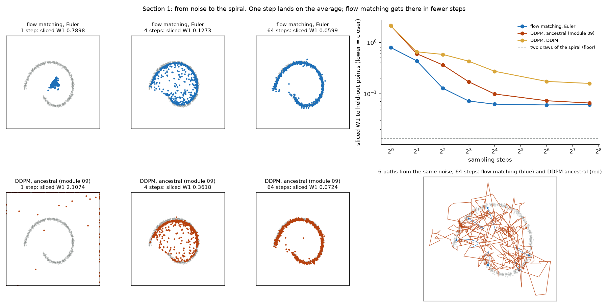
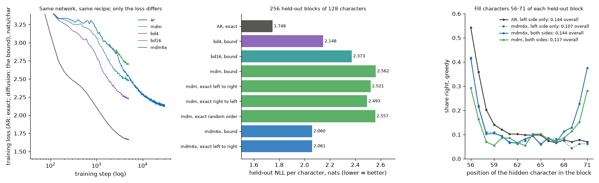
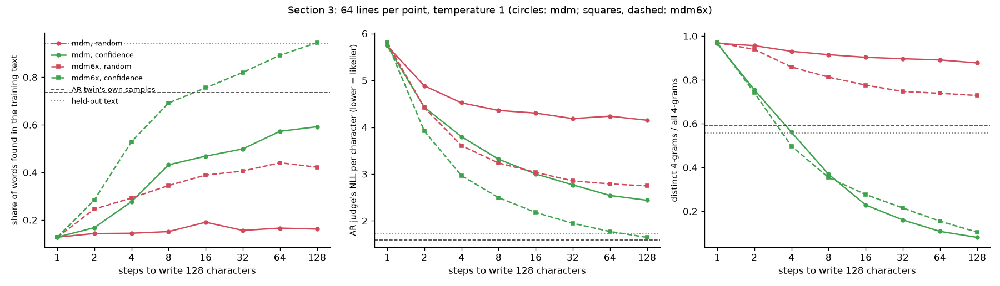
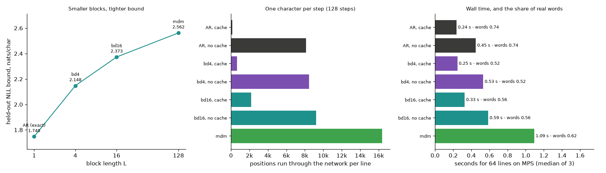
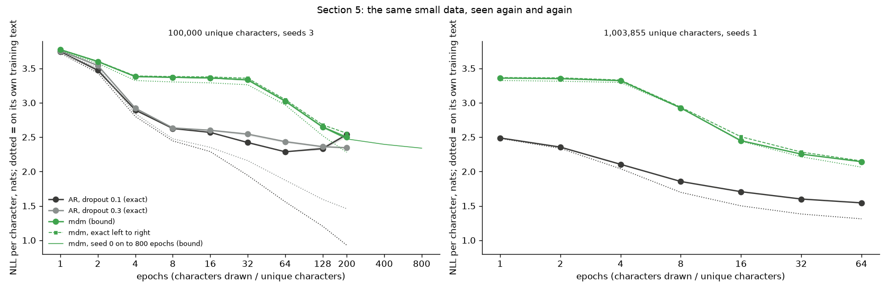

# Module 33: Text by denoising

Module 09 drew pictures by removing noise step by step. Module 04 wrote text
one character at a time, left to right. This module asks one question:

> **Can a model write text by unmasking instead of left to right, and when
> is that better?**

It takes module 04's small character model, drops its causal mask, and
trains it as a masked diffusion model: hide a random share of the characters
behind a [MASK] token, and learn to guess them back. An autoregressive twin,
the same network trained module 04's way, is the yardstick throughout. Six
sections, each with a figure and the numbers beside it:

1. **From noise to a spiral**: flow matching against DDPM on module 09's 2-D spiral, the bridge from images to text.
2. **A masked diffusion model**: the loss, held-out likelihoods, four ways to score one model, and filling a gap.
3. **Writing in steps**: a 128-character line in 1 to 128 steps, revealing at random or most-confident first.
4. **Block diffusion with a KV cache**: left to right across blocks, denoising inside each. A KV cache stores the keys and values of finished positions so later steps need not recompute them (module 07).
5. **The data-repeat test**: both objectives on 100,000 characters, seen up to 800 times.
6. **The library way**: Meta's `flow_matching` package and LLaDA's sampler against our code.

Every number in this README comes from a JSON file in [`results/`](results/),
written by the script that measured it. What we expected, written before the
runs, is in [`results/expectations.json`](results/expectations.json); the end
of the README scores it.

This module belongs to track 3, **Breadth**. It builds on
[module 04](../04-attention-transformer/README.md) (the char-GPT, its corpus
and its recipe) and [module 09](../09-diffusion/README.md) (diffusion, the
spiral, DDPM); read it after module 10. Next,
[module 11](../11-inside-a-language-model/README.md) opens track 4.

**🕹 Interactive:** [Text by denoising](../../explorables/33-text-by-denoising.html):
watch a recorded line unmask step by step, slide the number of steps, play a
block-diffusion line, and read the data-repeat curves.

**✅ Quiz:** [10 questions](../../quizzes/33.html): check yourself once you have read the six sections.

## Goals

By the end you will be able to:

- say what flow matching regresses on, and why one sampling step lands on the average;
- turn an autoregressive transformer into a masked diffusion model, and write its loss;
- say why the diffusion loss is a bound, and score one model exactly in a fixed order;
- sample a line in any number of steps, and say what the reveal rule does to it;
- build block diffusion's attention pattern and its KV cache, and say what each saves;
- read a data-repeat curve and say when diffusion beats left to right, and when it does not.

## Setup

```bash
cd modules/33-text-by-denoising/python
```

```bash
uv sync
```

Nothing to download from the Hub. The corpus is module 04's tiny-shakespeare
(1,115,394 characters, 65 distinct), copied into [`corpus/`](corpus/). `uv
sync` installs Meta's `flow_matching` 1.0.10 from PyPI for section 6 (CC
BY-NC licence; it imports `tqdm` without declaring it, so the project adds it).

**The laptop guard.** Every script imports `src/common.py` before torch. It
sets `PYTORCH_MPS_HIGH_WATERMARK_RATIO=0.3` and
`PYTORCH_MPS_LOW_WATERMARK_RATIO=0.2`, which caps the GPU allocator at
3.55 GB, under the module's 4 GB budget, and fixes torch at 4 threads.
Training runs on the GPU (MPS) in processes of at most 270 seconds of
training; a run saves itself and goes on in a new process. Each process logs
its time and peak memory to [`results/guards.jsonl`](results/guards.jsonl):

| Script | Processes | Longest | Total | Peak RSS | Peak MPS driver |
|---|---|---|---|---|---|
| `src/flow2d.py` | 1 | 0.15 min | 0.15 min | 0.32 GB | 0 (CPU) |
| `src/train.py --main`: ar, mdm | 2 | 3.99 min | 7.0 min | 0.51 GB | 1.09 GB |
| `src/train.py --main`: bd4, bd16 | 7 | 4.53 min | 27.3 min | 0.50 GB | 2.07 GB |
| `src/train.py --main`: mdm6x | 7 | 4.53 min | 28.5 min | 0.50 GB | 1.09 GB |
| `src/train.py --repeat`, 100,000 characters (9 runs) | 9 | 3.45 min | 27.0 min | 0.50 GB | 1.09 GB |
| `src/train.py --repeat`, whole split (2 runs) | 4 | 4.53 min | 17.1 min | 0.51 GB | 1.09 GB |
| `src/train.py --repeat`, 800 epochs (1 run) | 3 | 4.53 min | 10.8 min | 0.50 GB | 1.09 GB |
| `src/evaluate.py` | 1 | 0.50 min | 0.50 min | 0.45 GB | 3.06 GB |
| `src/sample.py` | 1 | 0.29 min | 0.29 min | 0.55 GB | 1.06 GB |
| `src/block.py` | 1 | 0.30 min | 0.30 min | 0.73 GB | 1.14 GB |
| `src/library.py` | 1 | 0.58 min | 0.58 min | 0.64 GB | 0 (CPU) |

Measured on an Apple M5 with 16 GB, Python 3.12, torch 2.14.1, while other
jobs shared the machine. MPS training is not bit-for-bit repeatable; the CPU
parts are.

## 1 · From noise to a spiral

Module 09 trained a small MLP to predict the noise in a noised point (DDPM).
**Flow matching** (Lipman et al., 2022) trains the same network on a simpler
target. Draw a noise point x₀ and a data point x₁, put x_t = (1 − t)x₀ + t·x₁
on the straight line between them, and regress the network on the line's
direction:

```python
def fm_target(x0, x1, t):
    xt = (1 - t[:, None]) * x0 + t[:, None] * x1
    return xt, x1 - x0          # the velocity the network learns at (xt, t)
```

Sampling starts from noise and follows the learned velocity with Euler steps
from t = 0 to 1. [`src/flow2d.py`](python/src/flow2d.py) copies module 09's
spiral, MLP and time embedding, trains both models for 4,000 Adam steps with
the same data, rate and seed, and samples each from the same 4,000 noise
points. DDPM is sampled two ways: module 09's stochastic (ancestral) sampler
and DDIM's deterministic one (DDIM: the same trained network, sampled without fresh noise at each step). The score is the sliced Wasserstein-1 distance
to 4,000 held-out spiral points (mean over 64 directions of the gap between
sorted projections); two draws of the spiral sit 0.013 apart, and the noise
itself 0.253.



| Steps | 1 | 2 | 4 | 8 | 16 | 64 | 200 |
|---|---|---|---|---|---|---|---|
| Flow matching, Euler | 0.790 | 0.434 | **0.127** | 0.072 | 0.062 | 0.060 | 0.061 |
| DDPM, ancestral | 2.107 | 0.598 | 0.362 | 0.170 | 0.098 | 0.072 | 0.065 |
| DDPM, DDIM | 2.107 | 0.651 | 0.580 | 0.428 | 0.272 | 0.173 | 0.158 |

**One step lands on the average.** At t = 0 the velocity that minimises the
squared error is E[x₁] − x₀, so one Euler step sends every point to the
data's mean: flow matching's one-step cloud has a spread (standard deviation per axis,
averaged over the two axes) of 0.13, against 1 for the data. Section 3 meets the same thing in text. DDPM's one step is
worse: at noise level 1 the cosine schedule keeps no signal, so its data
estimate divides by almost zero and lands on the clip at ±3.

**Fewer steps.** Flow matching reaches 0.127 in 4 steps, where the ancestral
sampler needs between 8 and 16 and DDIM does not get there in 200. Two misses: flow
matching levels off at 0.060, short of our 0.04 to 0.05; and its paths are
not straight (path length over end-to-end distance 1.81 at 64 steps, against
DDIM's 1.41). Each training pair is joined by a straight line, but the
network learns the average over all pairs that pass through a point, and
that field bends.

Two fixes went in after the first run, both in DDIM: the data estimate is
clipped to ±3, and the noise estimate is recomputed from the clipped one.
Without them DDIM diverged (points at 10⁸).

**From points to characters.** Text has no straight line between "the" and
noise. Masked diffusion replaces the line with a coin per character: at time
t each character has turned into [MASK] with probability t. Discrete flow
matching (Gat et al., 2024) calls this a mixture path, and section 6 checks
that Meta's library computes the same loss.

## 2 · A masked diffusion model

[`src/model.py`](python/src/model.py) copies module 04's GPT (3 layers, 4
heads, width 128, context 128, dropout 0.1, tied embeddings; 619,904
parameters with the [MASK] row) and changes three things: the causal mask is
a switch, the vocabulary gets a [MASK] row the head never predicts, and the
forward pass takes an attention pattern, positions and a KV cache. LLaDA's
own model code makes the same first change and nothing more
(`is_causal=False`, with the comment "MDM set causal to False").

[`src/diffusion.py`](python/src/diffusion.py) holds the process and the
loss, as LLaDA writes it (its Eq. 3):

```python
def mdm_loss(model, x0, t):
    xt, masked = mask_line(x0, t, model.cfg.mask_id)     # each character -> [MASK] with probability t
    ce = F.cross_entropy(model(xt).transpose(1, 2), x0, reduction="none")
    return ((ce * masked) / t[:, None]).sum(1).div(x0.size(1)).mean()
```

The 1/t weight matters. With it, the loss's expectation over t is an upper
bound on the line's negative log-likelihood (the ELBO, short for evidence
lower bound: a lower bound on the log-likelihood, so an upper bound on its
negative), in nats per character, the same unit as the autoregressive loss. MaskGIT, an image model
that fills in masked image tokens, dropped the weight and lost that link
(LLaDA, Section 2.1). Because it is a bound, every
comparison below with the autoregressive twin's exact loss is biased against
diffusion.

[`src/train.py`](python/src/train.py) trains both with module 04's recipe:
5,000 AdamW steps of 64 windows of 128 characters, rate 3e-4 with warm-up and
cosine decay. The twin `ar` reproduces module 04: 1.748 nats per character on
256 held-out blocks, against module 04's 1.725 on random windows. (A block's
first character has no context, so the twin scores it by the training text's
character frequencies; every other number is its own prediction.) A third
run, `mdm6x`, is the diffusion model at 30,000 steps, six times the compute;
we added it after seeing `mdm`'s result, with its expectation written first.



| Model | Held-out NLL per character (nats) |
|---|---|
| ar, exact | **1.748** |
| mdm, bound (ELBO; a second mask seed: 2.558) | 2.562 |
| mdm, exact left to right | 2.521 |
| mdm, exact right to left | 2.493 |
| mdm, exact in a random order per block | 2.557 |
| mdm6x, bound | 2.060 |
| mdm6x, exact left to right | 2.061 |
| unigram (character frequencies alone) | 3.358 |

**At equal compute, diffusion is far behind.** The gap is 0.81 nats per
character, more than the 0.15 to 0.6 we expected. Six times the training
closes 62% of it (2.060), and the curve was still falling. Large studies put
the compute a diffusion model needs to match an autoregressive one at 16
times when scored by the ELBO; Wang et al. (2026) bring it to 12.8 times with
exact scoring, and to 3.0 to 7.8 times with block diffusion and an
encoder-decoder. This toy needed more than 6 times.

**Scoring one model four ways.** A masked diffusion model that reveals one
character at a time in a fixed order defines a proper distribution, so it
can be scored exactly in that order (`ordered_nll`). In a random order the
exact score is 2.557, a hair from the bound's 2.562: the bound is that
score's average over orders. So one fixed order can land on either side of the
bound; in section 5, left to right lands above it. Left to right is a little better (2.521), and
right to left better still (2.493). The model has no preferred direction,
which is the point of LLaDA's reversal test: it completes a poem's previous
line about as well as its next one.

**Filling a gap.** In each held-out block we hid characters 56 to 71 and
filled them greedily. The diffusion models see both sides; the twin, which
can only continue text, sees the left.

| Who fills characters 56-71 | Characters right | Character 71 (last) |
|---|---|---|
| ar, left side only | **0.144** | 0.070 |
| mdm, both sides | 0.117 | 0.281 |
| mdm6x, both sides | **0.144** | 0.375 |
| mdm6x, left side only (56-127 hidden) | 0.107 | 0.062 |

We expected the right side to win by 10 points. It ties: a 0.6 M-parameter
model fills the middle of a 16-character gap with stock words ("you you
you"), from either side. The right side does help where it can, at the end
of the gap: 0.375 against 0.062 without it (right panel). A check we added
after these results: hide one character (position 63) and guess it. mdm6x,
seeing both sides, gets 73.4% right; the twin, seeing the left, 53.9%; `mdm`
42.2%.

## 3 · Writing in steps

[`sample_mdm`](python/src/diffusion.py) starts from 128 [MASK] tokens. At each
step it guesses every hidden character at once and keeps k of the guesses;
the rest stay hidden. k is 128 divided by the number of steps. Which k it
keeps is the rule:

- **random**: k hidden positions at random. With one character per step this samples the model's own distribution in a random order.
- **confidence**: the k guesses the model gives the highest probability. LLaDA calls this low-confidence remasking (it re-hides the least sure); MaskGIT used it for images.

[`src/sample.py`](python/src/sample.py) writes 64 lines at temperature 1 for
each setting and scores them three ways: the **word score** (share of whole
words found in the training text), the **judge NLL** (the twin's NLL per
character of the line), and **distinct 4-grams** (repetition).



| mdm6x | 1 | 2 | 4 | 8 | 16 | 32 | 64 | 128 |
|---|---|---|---|---|---|---|---|---|
| random: word score | 0.13 | 0.25 | 0.29 | 0.34 | 0.39 | 0.41 | 0.44 | 0.42 |
| random: judge NLL | 5.81 | 4.42 | 3.61 | 3.24 | 3.04 | 2.85 | 2.79 | 2.75 |
| confidence: word score | 0.13 | 0.28 | 0.53 | 0.69 | 0.76 | 0.82 | 0.89 | 0.95 |
| confidence: distinct 4-grams | 0.97 | 0.74 | 0.50 | 0.35 | 0.28 | 0.21 | 0.15 | 0.10 |

For reference, the twin's own samples: word score 0.74, judge NLL 1.59,
distinct 4-grams 0.59; held-out text: 0.94, 1.73, 0.56.

**One step: each character alone.** With one step every character is guessed
from an all-[MASK] line, independently of the others, so the line is
character frequencies and nothing more (word score 0.13, judge NLL 5.8), as
section 1's one step landed on the mean:

```
 \noe aedwe.ttEresSel u  b nn e\n eit r s  maa ce foe, whrreo lnlwlb\nahRaiko okddr ...
```

**More steps, more agreement.** At 8 random steps, about 16 characters a step:

```
ounds kng in he hisgsighfrthe annind ceug\nhe all restought,\nAme, amow,\n\nAndinkshands; wherpend ...
```

and at 128, one at a time:

```
 tit obody waides,\nAnd for'd seantled ses,\nWe graver takinkex to machonght, all f\nI ldake bof im ...
```

**The confidence rule buys words with repetition.** From 4 steps on it beats
the random rule in word score by 0.13 to 0.52. But it picks the
safest guesses first, and the safest guesses at this size are "the" and
"you": at 128 steps its lines reach a word score of 0.95, above the twin's,
but only 10% of their 4-grams are distinct (the twin's lines: 59%):

```
are in the the you your your you you you you yould be of to me you is youre, if you you with ...
```

LLaDA reports the same trade at 8 B parameters: low-confidence remasking
beats random remasking on every benchmark (GSM8K, grade-school maths
problems: 70.0 against 21.3, their Table 9), and they suggest it works like
the annealed sampling autoregressive models use, cutting diversity. Neither rule matches the twin's own lines on all three counts. With the model
trained at the twin's compute (`mdm`), random-order lines never get past a
word score of 0.19.

**Cost.** Each step is one pass over all 128 positions, so 128 steps cost
128 passes over the line, against the twin's 127 passes over one new
position each with its KV cache. Section 4 closes some of that gap.

## 4 · Block diffusion with a KV cache

A diffusion line can be written in blocks: left to right across blocks,
denoising inside each one (Arriola et al., 2025). A block sees itself and the
finished blocks before it. Blocks of 1 give back an autoregressive model;
one block of 128 is section 2's model. Two runs, `bd4` and `bd16`, train the
same network for blocks of 4 and 16 characters with the same recipe.

Training sees every block at once by feeding the noisy line and the clean
line side by side, 256 positions, under one attention pattern
([`block_mask`](python/src/diffusion.py), exercise c):

```
noisy block b -> noisy block b, clean blocks before b
clean block b -> clean blocks up to b
clean         -> never the noisy half
```

Each block draws its own masking rate. Sampling then works like an
autoregressive model with a cache: denoise block b while it attends to the
cached keys and values of blocks 0 to b − 1, then run the finished block once
more to store its own keys and values. The finished blocks never change, so
their keys and values stay valid; in plain masked diffusion nothing is
final until the end, so nothing can be cached.



| Model | Held-out bound (nats/char) |
|---|---|
| ar (blocks of 1, exact) | 1.748 |
| bd4 | 2.148 |
| bd16 | 2.373 |
| mdm (one block of 128) | 2.562 |

Smaller blocks, tighter bound: the same order as Wang et al.'s scaling study
(with an encoder-decoder, their compute gap falls from 7.8 times at block 32
to 3.0 at block 4).

| One character per step, 64 lines, most confident first | Network calls | Positions run | Seconds | Word score |
|---|---|---|---|---|
| ar, cache | 127 | 127 | 0.24 | 0.74 |
| ar, no cache | 127 | 8,128 | 0.45 | 0.74 |
| bd4, cache | 160 | 640 | 0.25 | 0.52 |
| bd4, no cache | 128 | 8,448 | 0.53 | 0.52 |
| bd16, cache | 136 | 2,176 | 0.33 | 0.56 |
| bd16, no cache | 128 | 9,216 | 0.59 | 0.56 |
| mdm | 128 | 16,384 | 1.10 | 0.62 |

With and without the cache, the block models wrote the same characters at
every position, from the same random draws. The cache cuts the positions run
by 4 to 13 times; wall time falls less (bd16: 0.33 s against mdm's 1.10 s,
3.3 times), since this network is small enough that the number of calls,
not their size, sets much of the time. One expectation missed: bd16's lines
did not beat mdm's on word score (0.56 against 0.62), though they repeat
less (distinct 4-grams 0.28 against 0.08, in
[`results/block.json`](results/block.json)).

## 5 · The data-repeat test

Prabhudesai et al. (2025) and Ni et al. (2025) found that when unique data is
scarce and must be seen again and again, masked diffusion overtakes
autoregressive training: random masks train on many orders of the same text,
a built-in data augmentation, so it overfits later. Prabhudesai et al. used
25 to 100 million unique tokens and models of 7 M to 2.5 B parameters; on 100
million tokens diffusion reached its best loss at 500 epochs, the
autoregressive model at 50. Here: the same 0.6 M network, both objectives, on the
first 100,000 characters of the training split, three seeds each, scored at
every epoch mark on the 256 held-out blocks; then once on the whole split.
Rate 1e-3, constant after warm-up, so one run gives every mark. A third AR arm
uses dropout 0.3, the usual answer to overfitting.



| 100,000 characters, mean of 3 seeds | 1 | 4 | 16 | 32 | 64 | 128 | 200 |
|---|---|---|---|---|---|---|---|
| ar, dropout 0.1 (exact) | 3.744 | 2.894 | 2.569 | 2.421 | **2.287** | 2.333 | 2.538 |
| ar, dropout 0.3 (exact) | 3.754 | 2.920 | 2.600 | 2.544 | 2.434 | 2.361 | 2.346 |
| mdm (bound) | 3.773 | 3.380 | 3.362 | 3.333 | 3.025 | 2.648 | **2.498** |
| mdm (exact left to right) | 3.774 | 3.390 | 3.376 | 3.357 | 3.047 | 2.679 | 2.556 |

**What happened.** The twin is best at epoch 64 (2.287), then overfits: by
epoch 200 its loss on its own text is 0.93 and its held-out loss 2.538. The
diffusion model sits near the unigram level (3.36) for 30 epochs, then falls,
and is still falling at 200. At epoch 200 its bound (2.498) is below the
twin's 2.538: a crossover at equal epochs. It is not a win. The twin stopped
at its best epoch is still 0.21 nats ahead, and the twin with dropout 0.3
is 0.15 ahead at 200 epochs (2.346).

**Running on.** Because the diffusion curve was still falling, we ran seed 0
on to 800 epochs, with its expectation written first: 2.395 at 400 and 2.339
at 800, still falling, still 0.05 above the twin's best. So at this size the
answer is "not yet": diffusion keeps getting better with repeats long after
the twin stops, but within 800 epochs it does not reach the twin's best.
The papers found the crossover arrives earlier for larger models; a 0.6 M
model that needs 30 epochs to leave the unigram level is far from that.

**On the whole split** (1,003,855 characters, one seed, 64 epochs), neither
overfits and the twin leads at every mark: 1.544 against 2.143 at epoch 64.

## 6 · The library way

**Meta's `flow_matching`.** The package that comes with Lipman et al.'s 2024
guide has both kinds of flow this module builds by hand.
[`src/library.py`](python/src/library.py) checks each against ours:

| Check | Result |
|---|---|
| `AffineProbPath` + `CondOTScheduler` against `fm_target` (512 pairs) | x_t and velocity equal, gap 0 |
| `ODESolver`, Euler, 16 steps, against `sample_fm` | gap 0 |
| `MixtureDiscreteProbPath` (all-[MASK] source, linear schedule) + `MixturePathGeneralizedKL` against our loss, 128 lines | 2.60456 both; largest relative gap 2.4 × 10⁻⁷ |
| the same, without copying unmasked characters through | 5.52 |
| `MixtureDiscreteEulerSolver` driving `mdm`, 128 steps: word score | 0.140 (ours, random rule: 0.152) |

Two details matter. The library's time runs the other way (t = 1 is data),
so its 1/(1 − t) is our 1/t. And its loss has an extra term at the positions
that are not masked; it vanishes only if the model copies those characters
through with probability 1 ("carry-over", as in MDLM, Sahoo et al.'s masked
diffusion language model). Our model does not
predict at unmasked positions, so the wrapper copies them; without that the
library's loss reads 5.52 instead of 2.60.

**LLaDA's sampler.** LLaDA publishes its sampler as `generate()` in
[github.com/ML-GSAI/LLaDA](https://github.com/ML-GSAI/LLaDA), read at commit
`9182493`. The repository has no licence, so we re-typed the function
(`llada_generate`, without its chat-only options) rather than copy it. Given
the same random draws it writes the same characters as our confidence
sampler, at 16 and at 128 steps. Its `block_length` option runs the plain
diffusion model block by block, without training for blocks (LLaDA calls it
semi-autoregressive remasking). On `mdm`, blocks of 16, 128 steps: word score
0.48 and distinct 4-grams 0.28, against 0.60 and 0.08 for one block; the
trained `bd16` scores 0.56 and 0.28.

The 8 B LLaDA itself needs about 16 GB in bfloat16, four times this module's
budget; no small masked diffusion model sits in the local cache, so the
library section runs on our own models.

## Written down before the runs

[`results/expectations.json`](results/expectations.json) lists what we
expected, written before any run whose numbers appear here, with what we had
seen by then: a smoke test of the samplers on untrained networks, and a
200-step pilot of three objectives (deleted, not reported). Two groups were
added later, each before its own run, and say so in the file: E29 and E30,
after `mdm`'s result, for `mdm6x`; E31, after the 200-epoch runs, for the
800-epoch run. After the runs we changed two things in section 1 (DDIM's
clip, and the ancestral sampler added beside DDIM), added the one-character
check in section 2, and fixed a logging slip in `train.py`: the 50-step loss
average did not carry across chunks, so the committed logs hold one short
average per chunk, which `figures.py` drops. No model or measurement changed.

Twenty-one met, ten missed.

| | Expected | Measured | Verdict |
|---|---|---|---|
| E1 | one step collapses toward the centre: spread under 0.3, W1 above 0.3 (both samplers) | flow matching: 0.13, 0.79; DDIM: spread 1.88, points on the ±3 clip | missed (the DDIM half) |
| E2 | flow matching W1 under 0.05 at 16 steps, under 0.04 at 64 | 0.062, 0.060 | missed |
| E3 | at 4 steps flow matching beats DDIM | 0.127 against 0.580 | met |
| E4 | flow matching's paths straighter than DDIM's, under 1.2 | 1.81 against 1.41 | missed |
| E5 | the twin within 0.08 of module 04's 1.725 | 1.748 | met |
| E6 | diffusion bound 0.15 to 0.6 above the twin | 0.81 above | missed |
| E7 | left to right below the bound; right to left within 0.1 of left to right | 2.521 < 2.562; 2.493 | met |
| E8 | random order within 0.05 of the bound | 2.557 against 2.562 | met |
| E9 | both sides beats the twin by 10 points on the gap; left only within 5 | 0.117 against 0.144; 0.095 | missed |
| E10 | one step: word score under 0.3, judge NLL above 3 | 0.13, 5.74 | met |
| E11 | word score rises with steps; random at 128 within 0.1 of the twin's lines | mdm random flat at 0.13 to 0.19; 0.16 against 0.74 | missed |
| E12 | at 4 to 16 steps confidence beats random by 0.1 | +0.13, +0.28, +0.28 | met |
| E13 | at 128 steps confidence repeats more than random | distinct 4-grams 0.08 against 0.88 | met |
| E14 | bound orders ar < bd4 < bd16 < mdm | 1.748 < 2.148 < 2.373 < 2.562 | met |
| E15 | cache and no cache agree at 99% of positions | 100% | met |
| E16 | bd16 with cache at least twice as fast as mdm | 0.33 s against 1.10 s | met |
| E17 | bd16's word score at least mdm's | 0.56 against 0.62 | missed |
| E18 | 100,000 characters: the twin's best before epoch 32, rising 0.2 by 200 | best at 64; rise 0.25 | missed (the timing half) |
| E19 | the diffusion bound stays within 0.03 of its lowest value until epoch 64 (read as: never 0.03 above its best so far) | it never rose | met |
| E20 | at epoch 200 the diffusion bound below the twin | 2.498 against 2.538 | met |
| E21 | the twin's best below diffusion's best by 0.05 | 2.287 against 2.498 | met |
| E22 | dropout 0.3: lower best than dropout 0.1, smaller rise | 2.346 against 2.287; no rise | missed (the first half) |
| E23 | whole split: no crossover by epoch 64 | twin ahead at every mark | met |
| E24 | library loss equals ours with carry-over, differs without | 2.4 × 10⁻⁷; 5.52 against 2.60 | met |
| E25 | library sampler within 0.05 of ours at 128 steps | 0.140 against 0.152 | met |
| E26 | re-typed LLaDA sampler equals ours | equal at 16 and 128 steps | met |
| E27 | LLaDA's semi-autoregressive mdm below trained bd16 by 0.03 | 0.48 against 0.56 | met |
| E28 | library path and Euler solver equal ours | gap 0 | met |
| E29 | mdm6x bound at most 2.15 | 2.060 | met |
| E30 | mdm6x random-order lines at 128 steps: word score at least 0.4 | 0.42 | met |
| E31 | 800 epochs on 100,000 characters: diffusion below the twin's best | 2.339 against 2.287 | missed |

The misses that change what the module teaches: E6 and E11 (at this size,
equal compute leaves the diffusion model writing non-words; six times the
compute is needed for words), E9 (a bidirectional view only helps at the gap's
edges), and E31 (the data-repeat crossover holds at equal epochs, but not
against a twin stopped at its best).

## Run it

Each script prints its numbers and writes its JSON. Order matters: the
measuring scripts load the checkpoints `train.py` writes to `artifacts/runs/`
(7.5 MB each with the optimiser state; not in git), or else the committed
16-bit copies in `artifacts/models.pt` (6.3 MB). Long runs go as many short
processes, one after another.

```bash
uv run python src/flow2d.py                      # section 1, 10 seconds on the CPU
```

```bash
uv run python src/train.py --main                # ar, mdm, bd4, bd16, mdm6x: about 65 minutes on MPS
uv run python src/train.py --repeat              # 12 runs: about 55 minutes on MPS
uv run python src/train.py --export              # artifacts/models.pt
```

```bash
uv run python src/evaluate.py                    # section 2
uv run python src/sample.py                      # section 3
uv run python src/block.py                       # section 4
uv run python src/repeat.py                      # section 5, from results/runs/
uv run python src/library.py                     # section 6, on the CPU
```

Redraw every figure from the committed JSON, with no model loaded, and
rewrite the explorable's data block:

```bash
uv run python src/figures.py
uv run python src/export_explorable.py
```

## Exercises

Skeletons with `# TODO(you):` live in [`exercises/`](exercises/); reference
solutions are in [`solutions/`](solutions/). Each asks you to predict before
you run, and runs in seconds on the CPU.

- **(a) `exercise_a_masked_loss.py`**: write the masking process and the
  1/t-weighted loss; predict an untrained model's loss at three masking
  rates. The test checks both against `src/diffusion.py`.
- **(b) `exercise_b_unmask.py`**: write one unmasking step, most confident
  first or left to right, and the reveal schedule. The test checks them
  against the sampler.
- **(c) `exercise_c_block_mask.py`**: write block diffusion's attention
  pattern over [noisy ; clean]; count the pairs that may attend for blocks
  of 1, 4, 16 and 128. The test checks it against `src/diffusion.py`.

## Tests

```bash
uv run pytest
```

Thirty-nine tests, a few seconds, no training. They check the solutions
against `src/`; that blocks of 128 give plain masked diffusion and blocks of
1 a causal model; that the KV caches change no character; every process
against the laptop guard; the committed results against each other; the
library checks; and the explorable against the results.

## To go further

- Train `mdm6x` on: the curve in section 2 was still falling at 30,000 steps.
  Where does the gap to the twin settle?
- Sample with the confidence rule at temperature 0.8 and 1.2 and watch the
  word score and the 4-grams trade places.
- Score the block models exactly in their own order, block by block, as Wang
  et al. (2026) do, and compare with their bound.
- Run the data-repeat test at a size where the papers saw the crossover: the
  same code with `n_layer=6, d_model=256` (about 5 M parameters) fits the
  guard in more chunks. Write down first what you expect.

## Checkpoint: you should now be able to…

- say what flow matching regresses on, and what one step of any of these samplers gives;
- write the masked diffusion loss, and say why it is a bound and the twin's loss is not;
- score a masked diffusion model exactly in a fixed order;
- say what the confidence rule buys and what it costs;
- draw block diffusion's attention pattern and say why its finished blocks can be cached;
- read a data-repeat curve, and say what "diffusion beats autoregressive" did and did not mean here.

## Links

- Nie et al., [Large Language Diffusion Models](https://arxiv.org/abs/2502.09992) (2025): LLaDA
- Arriola et al., [Block Diffusion: Interpolating Between Autoregressive and Diffusion Language Models](https://arxiv.org/abs/2503.09573) (2025)
- Prabhudesai et al., [Diffusion Beats Autoregressive in Data-Constrained Settings](https://arxiv.org/abs/2507.15857) (2025)
- Ni et al., [Diffusion Language Models are Super Data Learners](https://arxiv.org/abs/2511.03276) (2025)
- Wang et al., [Revisiting the 16x Pretraining Compute Gap between Diffusion and Autoregressive Language Models](https://arxiv.org/abs/2610.17590) (2026)
- Lipman et al., [Flow Matching Guide and Code](https://arxiv.org/abs/2412.06264) (2024); [flow_matching on PyPI](https://pypi.org/project/flow-matching/)
- Lipman et al., [Flow Matching for Generative Modeling](https://arxiv.org/abs/2210.02747) (2022)
- Gat et al., [Discrete Flow Matching](https://arxiv.org/abs/2407.15595) (2024)
- Sahoo et al., [Simple and Effective Masked Diffusion Language Models](https://arxiv.org/abs/2406.07524) (2024): MDLM, carry-over
- Shi et al., [Simplified and Generalized Masked Diffusion for Discrete Data](https://arxiv.org/abs/2406.04329) (2024)
- Austin et al., [Structured Denoising Diffusion Models in Discrete State-Spaces](https://arxiv.org/abs/2107.03006) (2021): D3PM
- Chang et al., [MaskGIT: Masked Generative Image Transformer](https://arxiv.org/abs/2202.04200) (2022)
- Zheng et al., [Masked Diffusion Models are Secretly Time-Agnostic Masked Models and Exploit Inaccurate Categorical Sampling](https://arxiv.org/abs/2409.02908) (2024): why the sampler draws in float64
