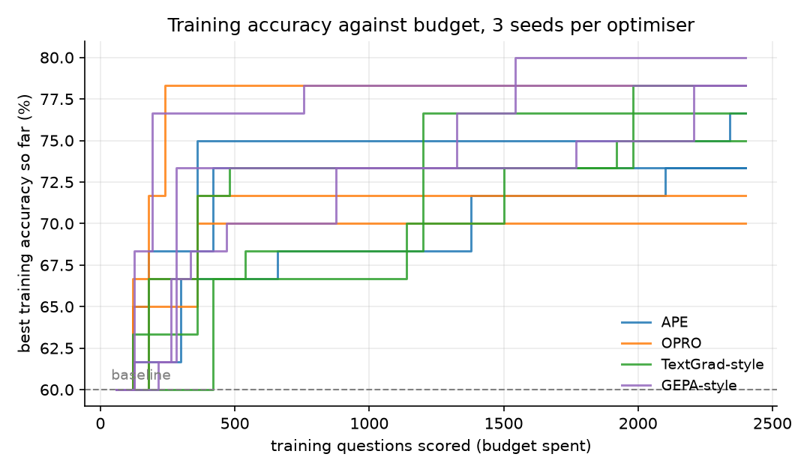
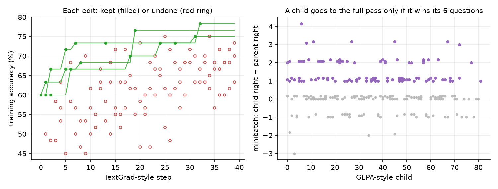
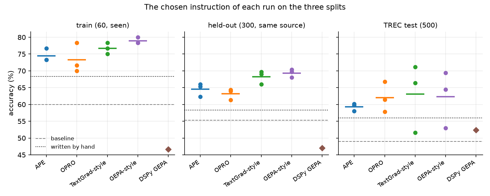
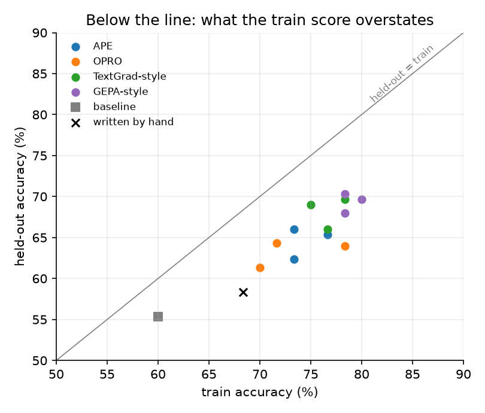

# Module 34: Prompts as parameters

If a model's weights stay frozen, can we train the words in front of it
instead, and does that training behave like training?

This module treats the instruction of a prompt as the parameter of a frozen
model. A small Qwen3 labels questions by the kind of thing they ask for; a
fixed program scores its answers; four optimisers rewrite the instruction to
raise that score on 60 training questions, all on the same budget. Then the
chosen instructions meet 800 questions they never saw. It has six sections:

1. **The task, the splits and the scorer**: TREC question types, a frozen model, a score with no luck in it.
2. **APE and OPRO by hand**: write instructions from examples; let the optimiser read its own score history.
3. **A text "gradient"**: a TextGrad-style critique and edit, with the step undone when it hurts.
4. **A GEPA-style loop**: reflect on a few answers, keep a child only if it wins them, draw parents from a Pareto front.
5. **What the runs show**: held-out gains over 3 seeds, the overfitting gap, and the scored expectations.
6. **The library way**: the same task in DSPy, tuned by its GEPA optimiser.

Then one section on the maths: what here is like gradient descent, and what is not.

Every number in this README comes from a JSON file in [`results/`](results/),
written by the script that measured it, or from a run log in
[`results/runs/`](results/runs/), one line per event. What we expected was
written in [`results/expectations.json`](results/expectations.json) before the
runs; section 5 scores each line.

This module belongs to track 8, **Using models well**. Read it after
[module 22](../22-reasoning-at-test-time/README.md), which spent more tokens
on each question with the prompt held fixed; here the prompt is what moves.
It reuses module 22's model and MLX setup, and the reading of a model's
next-token scores from [module 05](../05-transformers-library/README.md).
Next, [module 21](../21-retrieval-and-memory/README.md) fetches a passage
for the model to read.

**🕹 Interactive:** [Prompts as parameters](../../explorables/34-prompts-as-parameters.html):
five slides, a prediction, a replay of any of the twelve runs event by event,
and every chosen instruction with its test score per label.

**✅ Quiz:** [10 questions](../../quizzes/34.html): check yourself once you have read the sections.

## Goals

By the end you will be able to:

- set up a prompt as a parameter: a frozen model, a fixed scorer, a training and a held-out split, a budget;
- write APE, OPRO, a TextGrad-style step and a GEPA-style loop, each in under a hundred lines;
- compare optimisers at equal budget, over seeds, on questions the search never saw;
- measure how much a training score overstates, and say why a prompt search overfits;
- say what a "text gradient" shares with a gradient and what it lacks;
- run the same search through DSPy.

## Setup

```bash
cd modules/34-prompts-as-parameters/python
```

```bash
uv sync
```

| Need | Size | Where |
|---|---|---|
| `mlx-community/Qwen3-1.7B-4bit`, revision `3b1b1768` | 923 MB | Hugging Face cache; module 22 fetched it |
| `mlx-community/Qwen3-4B-Instruct-2507-4bit`, revision `50d42775` | 2.1 GB | Hugging Face cache, on the first optimiser run |
| `CogComp/trec`, its parquet files (revision `65752bf5`, `refs/convert/parquet`) | 0.4 MB | Hugging Face cache, on the first run |
| The run logs | committed | `results/runs/` |

**Two models, two jobs.** The task model, whose prompt we tune, is
Qwen3-1.7B with 4-bit weights and thinking off (module 22's model). The
optimiser, which writes and edits instructions, is Qwen3-4B-Instruct-2507
with 4-bit weights; it has no thinking mode. Both are Apache-2.0 and run on
MLX through `mlx-lm`. **No API key was used**: every call here runs on the
Mac, so the proposals are those of a 4B model. The papers below report
results with larger models (TextGrad's headline numbers tune prompts for
GPT-4o, for one; Yuksekgonul et al., 2024, abstract); our numbers say what
these methods do with a 4B optimiser, not what they do at that scale.

**The data.** TREC (Li and Roth, 2002) asks of each question what kind of
answer it wants, in six coarse labels: abbreviation, entity, description,
human, location, number. "Who wrote Hamlet?" wants a human; "What is a
fjord?" a description; "How tall is Everest?" a number. The labels follow
the dataset's own rules, which a reader cannot guess from the label names
alone: a definition is a description, but a question that asks for a
colour or an animal wants an entity. That gap is what an instruction can
fill. The dataset card states no licence; we fetch it from the Hub and
commit only the questions that the logs and the instructions quote.

**The laptop guard.** MLX has no memory cap like torch's MPS watermark, so
the scripts only measure: time, peak process RSS and MLX's peak Metal
memory. A run stops after 3.5 minutes and resumes from its state file; one
step can take a minute, so a chunk stays under five.

| Script | Chunks | Minutes per chunk | Minutes per run | Peak RSS | Peak Metal |
|---|---|---|---|---|---|
| `src/baseline.py` | 1 | 1.70 | | 1.29 GB | 2.41 GB |
| `src/optimise.py ape`, 3 runs | 3 | 3.68 to 3.89 | 3.7 to 3.9 | 3.53 GB | 4.54 GB |
| `src/optimise.py opro`, 3 runs | 6 | 1.14 to 4.07 | 5.2 to 5.5 | 3.53 GB | 7.07 GB |
| `src/optimise.py textgrad`, 3 runs | 12 | 0.35 to 3.74 | 11.2 to 12.1 | 3.53 GB | 4.67 GB |
| `src/optimise.py gepa`, 3 runs | 9 | 3.08 to 3.59 | 10.2 to 10.4 | 3.53 GB | 4.67 GB |
| `src/library.py compile`, `evaluate`, `score` | 3 | 5.03, 3.99, 1.30 | | 0.15 GB, 0.15 GB, 1.26 GB | not measured, not measured, 2.31 GB |

From the `chunks` field of each `results/runs/*.json` and the `guard` field
of the other results files. A run's last chunk also scores the winner on
held-out and test, about half a minute the table leaves out. OPRO's peak
comes from its long prompt: twenty instructions with their scores. DSPy's
`compile` stage ran 5.03 minutes, just past our five-minute rule: GEPA's
budget runs inside one DSPy call, which we cannot cut into chunks. Its two
model servers are separate processes, so the guard does not measure their
memory.

Measured on an Apple M5 with 16 GB, MLX 0.32.4, mlx-lm 0.32.2.

Two problems we hit, both fixed before the runs here. Without a cap on
MLX's buffer cache, the first APE run grew to 12 GB of resident memory in
20 minutes, as MLX kept freed buffers in its cache for reuse, and the Mac
swapped; `common.limit_cache()` caps it at 512 MB. And with the display
off the Mac went into a light sleep that stalled one evaluation for 17
minutes; the runs here held it awake with `caffeinate`. We deleted both
first runs and started again.

## 1 · The task, the splits and the scorer

[`src/task.py`](python/src/task.py). The prompt has a fixed frame and one
free part, the instruction:

```
user:      <instruction>

           Question: <the question>
           Reply with one word: abbreviation, entity, description, human, location or number.
assistant: <think>

           </think>

           ▸ the scorer reads the next token here
```

**The scorer never samples.** It reads the task model's scores for the next
token, takes the first token of each label (lower or capital case), and
answers with the label whose token scores highest. The same instruction
always gets the same score, so a change in score is a change in the
instruction, not luck. Activations run in float32: in bfloat16 a question's
label scores (log-probabilities, in nats: natural-log units) moved by up to
2.25 with the batch it sat in (no answer
changed); in float32 by up to 0.15.

**Three splits**, all drawn once with seed 0:

| Split | Questions | From | Label mix | Who sees it |
|---|---|---|---|---|
| train | 60 | TREC's train file | 10 per label | the optimisers, as scores and errors |
| held-out | 300 | TREC's train file, other questions | 50 per label | nobody, until the end |
| test | 500 | TREC's test file | the file's own | nobody, until the end |

Train minus held-out is **overfitting**: same source, same mix, only the
questions differ. Test adds a change of mix (TREC's test has 138
descriptions and 9 abbreviations) and of source.

**The budget.** Each run may score **2,400 training questions**: 40 full
passes over the 60, or more passes on smaller batches. A repeated
instruction is looked up, not scored again. When the budget is spent, the
run keeps the instruction with the best training accuracy, and only then
scores it on held-out and test.

Two fixed instructions set the scale ([`src/baseline.py`](python/src/baseline.py),
[`results/baseline.json`](results/baseline.json)):

| Instruction | Words | train | held-out | test |
|---|---|---|---|---|
| baseline: "Classify the question by the type of its answer." | 9 | 60.0% | 55.3% | 49.0% |
| written by hand from TREC's label definitions, before any run | 106 | 68.3% | 58.3% | 56.0% |

Every run starts from the baseline. The baseline already shows a gap of 4.7
points from train to held-out: 60 questions are few, and the two sets differ
by chance. A run's gap counts only beyond that. On test the baseline is right
on 97% of number questions and on 3% of description questions: it almost
never answers "description". The hand-written instruction wins 77
test questions and loses 42 against the baseline. The exact sign test asks
how likely so uneven a split of the disagreements would be if each were a
coin flip: p = 0.0017.

## 2 · APE and OPRO by hand

[`src/optimise.py`](python/src/optimise.py). Both use the optimiser model to
write instructions and the scorer to judge them; they differ in what the
optimiser is shown.

**APE** (Zhou et al., 2022) works backwards from examples. We show the
optimiser six labelled training questions and ask what instruction a person
was given to label them so. That gives 32 instructions, each from its own
six examples; all are scored. Then APE's second stage: ask for rewordings of
the best four, until the budget runs out. Nothing in APE reads the errors.

**OPRO** (Yang et al., 2023) shows the optimiser its own history: the 20
best instructions so far, each with its training accuracy, worst first, plus
three labelled questions, and asks for a new instruction that should beat
them all. Four proposals per step. The score history plays the part of a
loss curve the optimiser can read.

| Seed | APE: train | held-out | test | OPRO: train | held-out | test |
|---|---|---|---|---|---|---|
| 0 | 73.3% | 62.3% | 58.0% | 78.3% | 64.0% | 61.4% |
| 1 | 73.3% | 66.0% | 60.2% | 70.0% | 61.3% | 57.8% |
| 2 | 76.7% | 65.3% | 59.8% | 71.7% | 64.3% | 66.8% |
| mean ± sd | 74.4 ± 1.9 | 64.6 ± 2.0 | 59.3 ± 1.2 | 73.3 ± 4.4 | 63.2 ± 1.6 | 62.0 ± 4.5 |

From [`results/analysis.json`](results/analysis.json); sd is over the 3
seeds. Both beat the baseline's 55.3% held-out and 49.0% test in every seed,
and both beat our hand-written instruction on held-out.

**Where the budget went.** APE's best instruction turned up after 420, 2,100
and 2,340 of its 2,400 questions: in two seeds the winner was a rewording,
from the second stage. OPRO's turned up after 240, 360 and 360, and the
last 85% or more of its budget found nothing better (figure below, `found_at_calls`
in the analysis). The optimiser kept proposing, but the history it read was
already near the ceiling of what it could write.



## 3 · A text "gradient"

TextGrad (Yuksekgonul et al., 2024) builds an analogy with backpropagation:
an LLM's critique of an output plays the part of a gradient, and an LLM
edit that follows the critique plays the part of a step. Pryzant et al.
(2023) ran the same idea earlier for prompts, with beam search over the
edits. Our step, in the same spirit and written from scratch:

1. Draw 12 training questions; keep those the current instruction gets wrong.
2. **"Gradient"**: show the optimiser the instruction and those errors
   (question, model's answer, right answer); ask what in the instruction
   caused them and how it should change, without rewriting it.
3. **"Step"**: show it the instruction and the critique; ask for a rewrite.
4. Score the rewrite on all 60. **Keep it only if training accuracy does
   not fall**; otherwise undo the step.

Step 4 is ours. Without it a run is a random walk with a drift of unknown
sign; with it, the method is hill climbing on proposals that a critique has
aimed.

| Seed | train | held-out | test | words |
|---|---|---|---|---|
| 0 | 76.7% | 66.0% | **71.2%** | 152 |
| 1 | 75.0% | 69.0% | 66.4% | 190 |
| 2 | 78.3% | 69.7% | 51.6% | 154 |
| mean ± sd | 76.7 ± 1.7 | 68.2 ± 2.0 | 63.1 ± 10.2 | 165 |

**Most steps went the wrong way.** Over the 3 seeds the loop took 117 edit
steps. Against the instruction each edit was made from, 12 raised training
accuracy, 4 left it equal (kept, as the rule allows) and 101 lowered it and
were undone (left panel below; `raised`, `tied` and `worse` in the
analysis). The comparison is not quite fair to the critique: it saw the
errors among about 12 questions, and the edit was judged on all 60. Still, a
gradient step with a small enough step size lowers the loss on the batch it
came from; most of these edits did not even help on the whole set.

**It copied training questions into the rule.** The winners run to 152 to
190 words and name training questions as examples: 1 to 2 per run share a
run of five words with a training question, and none with a held-out or
test question (`quotes` in the analysis). Seed 0's instruction tells the
model that "Who was the Prophet of Medina?" asks for a human; the training
set holds "Who is the Prophet of Medina ?". That is
learning the examples, not the rule, and it is one source of the gap below.



## 4 · A GEPA-style loop

GEPA (Agrawal et al., 2025) adds two ideas. **Reflective mutation**: the
optimiser reads a few full cases, each with feedback, and proposes a child
instruction. **Pareto selection**: parents are not only the best on
average, but any candidate that is best on at least one training question,
so instructions that are good at different things all stay in play.

Our loop, per step:

1. Find the **Pareto front**: every candidate that ties the best score on at
   least one training question and that no other candidate dominates (as
   good everywhere, better somewhere). Draw a parent with weight equal to
   the number of questions it is best on, which with right-or-wrong scores
   is its number of right answers.
2. Draw 6 training questions. Show the optimiser the parent, and for each
   question its answer and "Right." or "Wrong. The correct label is X."
3. The optimiser writes a child. Score it on the same 6 (6 budget).
4. If it gets more of the 6 right than the parent, score it on all 60 (60
   budget) and add it to the pool. Otherwise drop it.

The cheap minibatch test lets the loop try many more children than a full
pass each would allow. GEPA proper scores candidates on a separate Pareto
set and adds a merge step that combines two parents; we use the 60 training
questions for both roles and leave merge out.

| Seed | train | held-out | test | words |
|---|---|---|---|---|
| 0 | 78.3% | 70.3% | 64.4% | 186 |
| 1 | 78.3% | 68.0% | 69.4% | 101 |
| 2 | 80.0% | 69.7% | 53.0% | 153 |
| mean ± sd | 78.9 ± 1.0 | **69.3 ± 1.2** | 62.3 ± 8.4 | 147 |

The loop wrote 222 children over 3 seeds; 96 (43%) won their 6 questions and
went on to a full pass, so each run's pool held 31 to 33 instructions. On
average 14.3 of them sat on the Pareto front, about 45% of the pool. With
right-or-wrong scores, "best on a question" just means "right on it", so a
parent's weight is simply its number of right answers. GEPA-style search has the best train and held-out means of the
four, with the smallest spread on held-out.

## 5 · What the runs show



| | train | held-out | test | test gain over baseline |
|---|---|---|---|---|
| baseline | 60.0% | 55.3% | 49.0% | |
| written by hand | 68.3% | 58.3% | 56.0% | +7.0 |
| APE | 74.4 ± 1.9 | 64.6 ± 2.0 | 59.3 ± 1.2 | +10.3 ± 1.2 |
| OPRO | 73.3 ± 4.4 | 63.2 ± 1.6 | 62.0 ± 4.5 | +13.0 ± 4.5 |
| TextGrad-style | 76.7 ± 1.7 | 68.2 ± 2.0 | 63.1 ± 10.2 | +14.1 ± 10.2 |
| GEPA-style | 78.9 ± 1.0 | 69.3 ± 1.2 | 62.3 ± 8.4 | +13.3 ± 8.4 |

**Held-out and test tell different stories.** On held-out, same source and
same balance as train, the spreads over seeds are 1 to 2 points, and in
every seed both methods that read errors (TextGrad-style, GEPA-style) beat
both that do not (APE, OPRO); the means differ by 3.6 to 6.1 points. On
test the spreads of those two grow to 8 to 10 points, and the order breaks. The cause is the label mix.
Test is 28% description and 23% number questions; train and held-out are 17%
each. TextGrad-style seed 2 and GEPA-style seed 2 score 69.7% held-out, near
the top, but on test they get 9% and 25% of descriptions right and 34% and
48% of numbers (the baseline: 3% and 97%). Their test gains over the baseline
are not significant (sign test, p = 0.36 and 0.17); the other ten runs'
are, with p below 0.002. These are twelve separate tests with no
correction for testing many times; at p below 0.002 the ten would survive a
Bonferroni correction for twelve (0.05 / 12 ≈ 0.004). A score on 60 balanced
questions cannot see what matters most on another mix.

**The overfitting gap.** Averaged per method, the chosen instructions score
8.4 to 10.1 points higher on train than on held-out, against 4.7 for the
baseline: 3.8 to 5.4 points beyond the baseline's own gap, 4.8 over all 12
runs. We read most of it as the cost of choosing the best of 30 to 40
candidates on 60 questions. A training accuracy near
75% on 60 questions has a standard error of about 5.6 points, so among 40
candidates of equal true worth, the one that scores best on train will tend
to have been lucky by a few points: the winner's curse. Copying training
questions into the instruction adds to it.



**Scored expectations**, from [`results/expectations.json`](results/expectations.json)
(written before the runs) and `expectations` in the analysis: 6 met, 2 missed.

| | Expected | Result |
|---|---|---|
| E1 | every run beats the baseline on test | met, by the letter: all 12 do, but 2 by margins within chance (p = 0.36, 0.17) |
| E2 | the best method gains at least 5 points on test | met: +14.1 (TextGrad-style) |
| E3 | the gap beyond the baseline's is 3 to 10 points on average | met: 4.8 |
| E4 | GEPA-style beats APE on test by at least 2 points | met: 3.0 |
| E5 | fewer than half the TextGrad-style steps raise train accuracy | met: 12 of 117 |
| E6 | at least two methods vary by 2 points or more over seeds on test | met: OPRO, TextGrad-style and GEPA-style |
| E7 | DSPy's GEPA lands within 5 points of our GEPA-style on test | missed: 52.4% against 62.3% (section 6) |
| E8 | no run reaches 70% on test | missed: TextGrad-style seed 0 scores 71.2% |

## 6 · The library way: DSPy

[`src/library.py`](python/src/library.py). DSPy (Khattab et al., 2023)
describes a model call as a typed signature, here `question -> label`, with
the label one of the six names, and optimises the text of the call against
a metric. Its `dspy.GEPA` optimiser implements the GEPA paper. DSPy reaches
models over an OpenAI-style HTTP interface, so the script starts two local
`mlx_lm.server` processes, the same two models as above, and points DSPy at
them. The metric returns the score and the same feedback our loop gave:
"Right." or "Wrong. The correct label is X." Settings: 600 metric calls, a
quarter of our runs' budget, so that it fits a sitting; the 60 training
questions as both its training and its Pareto set, as in our loop; seed 0;
one run.

DSPy does not use our scorer. It wraps the instruction in its own prompt,
asks the model to generate, and parses the label out of the text. So we
report two numbers for what it found: its own accuracy, and the found
instruction put into our template and scorer.

| | DSPy's own format, held-out | Our scorer: train | held-out | test |
|---|---|---|---|---|
| baseline instruction | 45.7% | 60.0% | 55.3% | 49.0% |
| instruction DSPy's GEPA found | **59.7%** | 46.7% | 47.0% | 52.4% |

From [`results/library_evaluate.json`](results/library_evaluate.json) and
[`results/library_score.json`](results/library_score.json). DSPy's GEPA
made 9 candidates in 603 metric calls and kept the first child of the
baseline, found after 69 calls; on the 60 training questions in its own
format it scored 61.7% against the baseline's 40.0%
([`results/library_compile.json`](results/library_compile.json)).

**In its own frame it worked**: +14.0 points held-out. **In ours it did
not**: it loses 8.3 points held-out and gains 3.4 on test, a split of 164
wins to 147 losses (p = 0.36). Read the instruction it found and the reason
is plain. It lists eight answer types: four real labels, four made up
("place", "date", "quantity", "concept"), and none of location or number.
It also calls a person an entity before correcting itself. Inside DSPy the
signature names the six real labels and its parser rejects any other
answer, and there the instruction still helped by 14 points; in our
template, where the instruction is the model's only account of the labels,
it misled. An instruction is
tuned for the frame it was scored in. That is one more reason a prompt is a
parameter of a whole program, not a portable piece of text, and why the
module's comparison runs through one fixed scorer.

## What is like gradient descent, and what is not

Write the model as f(θ, p, x): weights θ, prompt p, question x. Training a
network fixes p and moves θ. Here θ is fixed and p moves:

```
p* = argmax over strings p of  (1/60) · Σ  1[ f(θ, p, xᵢ) = yᵢ ]
```

**What carries over.** There is a loss on training data, a held-out set
that measures what the loss overstates, a budget, seeds, and a curve of
best score against budget spent. Overfitting behaves as it does with
weights: choosing among many candidates on the same 60 questions widened the
gap from train to held-out (section 5).
GEPA-style search scores children on 6 questions at a time, a noisy cheap
estimate in the place of a minibatch. Lee (2026) argues that this text layer
deserves to be treated as a thing to train in its own right, and that a short
text is a compact patch on what a pretrained model already knows, which
makes it sample-efficient when data is scarce; here 60 questions moved
held-out accuracy by 7.9 to 14.0 points, method by method, with no weight
changed.

**What does not.** Four things, each visible in the runs:

1. **There is no derivative.** Accuracy is a step function of a string;
   strings have no neighbourhood in which "a little more of this word"
   means anything. A gradient needs a loss that changes smoothly with the
   parameter; here the parameter is discrete and the loss jumps.
2. **A "text gradient" has no size and no guaranteed sign.** A gradient
   step with a small enough learning rate lowers the loss on its batch,
   always. Our critiques, applied as edits, lowered training accuracy in 101
   of 117 steps. There is no learning rate to shrink, and two critiques
   cannot be added or scaled.
3. **The optimiser is a sampler.** Each "step" draws a new string from the
   4B model, given the old one and some feedback. What makes the methods
   climb is the rule that keeps or drops the draw: best of a pool (APE,
   OPRO), undo if worse (TextGrad-style), win the minibatch then join the
   Pareto pool (GEPA-style). That is stochastic search, closer to module
   35's evolution than to module 14's optimisers.
4. **The parameter can store the data.** Weights can memorise too, but a
   prompt can quote a training question outright, and the TextGrad-style
   runs did (section 3).

So "prompt optimisation" is search over a space a language model makes
easy to propose in. The analogy with gradients names the parts; it does not
bring the guarantees.

## Run it

Rebuild every number, the scored expectations and the figures from the
committed logs, with no model (it reads TREC from the Hugging Face cache to
count quoted questions and score each label):

```bash
uv run python src/analyse.py --figures
```

Rewrite the explorable's data block:

```bash
uv run python src/export_explorable.py
```

The baseline and the hand-written instruction:

```bash
uv run python src/baseline.py
```

All twelve runs, chunk by chunk (each method and seed until it prints
`"remaining": 0`); one at a time with `src/optimise.py <method> <seed>`:

```bash
caffeinate -ims ./run_all.sh
```

The DSPy lane, in three stages:

```bash
uv run python src/library.py compile
```

```bash
uv run python src/library.py evaluate
```

```bash
uv run python src/library.py score
```

## Exercises

Skeletons with `# TODO(you):` live in [`exercises/`](exercises/); reference
solutions are in [`solutions/`](solutions/). Each asks you to predict before
you run, and none needs a model.

- **(a) `exercise_a_pareto.py`**: write the Pareto front GEPA-style search
  draws its parents from. The test compares it with `src/optimise.py` on 200
  random pools.
- **(b) `exercise_b_sign_test.py`**: write the exact sign test that says
  whether an instruction's test gain is more than luck. The test checks it
  against `results/analysis.json` for every run.
- **(c) `exercise_c_curve.py`**: rebuild each run's best-so-far curve from
  its log, and find how much of the budget the winner needed.

## Tests

```bash
uv run pytest
```

54 tests, about a second. They check the solutions against `src/`, that every run used its
budget and kept the earliest of its best, the laptop guard, that
`results/analysis.json` recomputes from the committed files, the splits, the
explorable's data and the quiz file. No model.

## To go further

- Give GEPA-style search its own Pareto set, separate from the training
  questions, as the paper does, and see whether the overfitting gap shrinks.
- Score each candidate on fresh questions every step (a minibatch, as SGD
  does) instead of the same 60, and compare the held-out gain.
- Swap the optimiser for the task model itself: can a 1.7B model improve its
  own instruction?
- Add few-shot examples to the parameter, as DSPy's MIPROv2 does
  (Opsahl-Ong et al., 2024), and see whether they beat a longer instruction.

## Checkpoint: you should now be able to…

- say what the parameter is, what is frozen, and why the scorer must have no luck in it;
- explain APE, OPRO, a TextGrad-style step and a GEPA-style loop in two lines each;
- read a best-so-far curve against budget, and say why it can only rise;
- say how much the training score overstated, and why choosing the best of many overfits;
- say what a text gradient lacks that a gradient has;
- run DSPy's GEPA on a local model.

## Links

- Zhou et al., [Large Language Models Are Human-Level Prompt Engineers](https://arxiv.org/abs/2211.01910) (2022), APE
- Yang et al., [Large Language Models as Optimizers](https://arxiv.org/abs/2309.03409) (2023), OPRO
- Pryzant et al., [Automatic Prompt Optimization with "Gradient Descent" and Beam Search](https://arxiv.org/abs/2305.03495) (2023)
- Yuksekgonul et al., [TextGrad: Automatic "Differentiation" via Text](https://arxiv.org/abs/2406.07496) (2024)
- Agrawal et al., [GEPA: Reflective Prompt Evolution Can Outperform Reinforcement Learning](https://arxiv.org/abs/2507.19457) (2025)
- Khattab et al., [DSPy: Compiling Declarative Language Model Calls into Self-Improving Pipelines](https://arxiv.org/abs/2310.03714) (2023)
- Opsahl-Ong et al., [Optimizing Instructions and Demonstrations for Multi-Stage Language Model Programs](https://arxiv.org/abs/2406.11695) (2024), MIPROv2
- Lee, [We Should Take Text Optimization More Seriously](https://yoonholee.com/blog/2026/we-should-take-text-optimization-more-seriously/) (2026): the text around a model as a thing to train
- Xia et al., [Regularized Recursive Self-Improvement of Agent Harnesses](https://arxiv.org/abs/2609.24972) (2026): text-layer search overfits the set it evolves on
- Li and Roth, [Learning Question Classifiers](https://aclanthology.org/C02-1150/) (COLING 2002), TREC's question types
- MIT MAS.S62, [How to AI an AI for (Almost) Anything](https://mit-mi.github.io/how2ai-course/fall2026/), fall 2026: a course that covers prompt optimisation; nothing here is taken from it
- [CogComp/trec](https://huggingface.co/datasets/CogComp/trec) · [mlx-community/Qwen3-1.7B-4bit](https://huggingface.co/mlx-community/Qwen3-1.7B-4bit) · [mlx-community/Qwen3-4B-Instruct-2507-4bit](https://huggingface.co/mlx-community/Qwen3-4B-Instruct-2507-4bit) · [DSPy](https://dspy.ai/) · [mlx-lm](https://github.com/ml-explore/mlx-lm)
