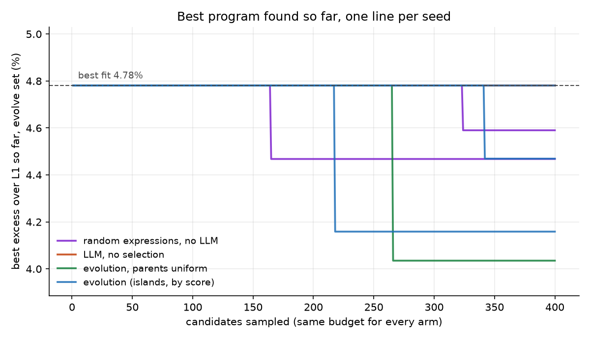
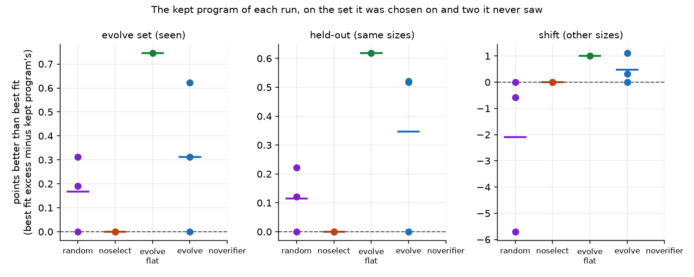
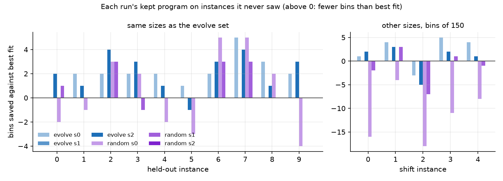
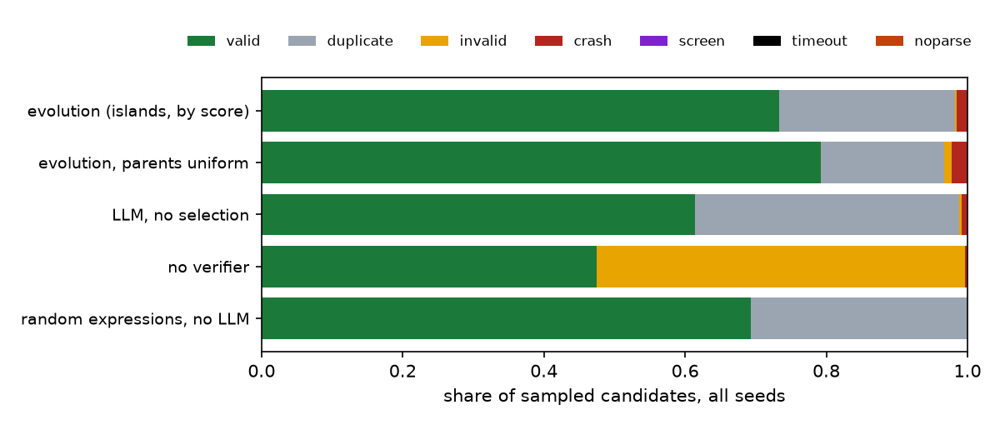
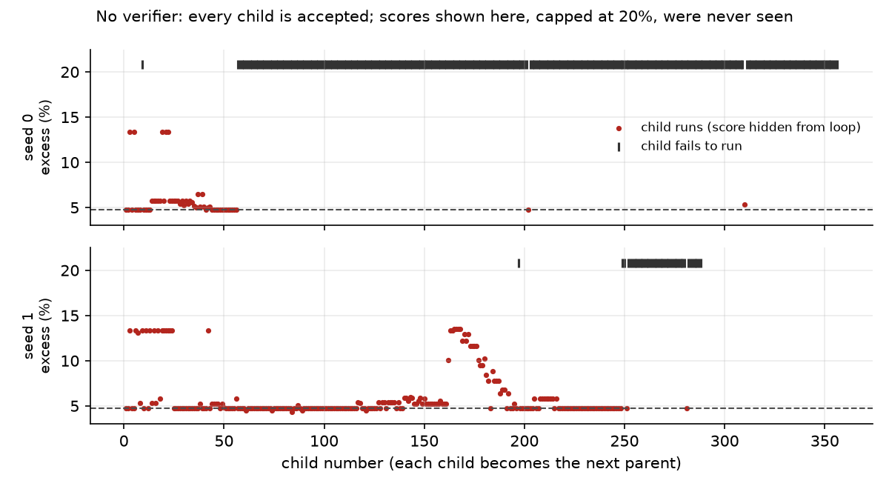

# Module 35: Evolution with an LLM as the mutator

Can a small language model, run on a laptop, improve a textbook algorithm if
a program checks every guess it makes?

The loop is FunSearch's, at toy scale (Romera-Paredes et al., 2024). The
problem is **online bin packing**: items arrive one at a time and each must
go, at once and for good, into a bin with room. A heuristic is a short Python
function, `priority(item, bins)`, that scores the open bins; the item goes to
the highest score. An LLM writes new versions of that function; a sandbox
runs each one on fixed instances and counts the bins. Only the count decides
what survives. The module has five sections:

1. **The problem and the checker**: instances, the L1 lower bound, first fit and best fit, the sandbox.
2. **The loop**: a program database with islands, parents drawn by score, a prompt, the LLM, dedupe.
3. **Against the same budget without it**: the LLM with no selection, and random search with no LLM.
4. **Without the verifier**: every child accepted untested.
5. **The library way**: the same problem through OpenEvolve, an open copy of AlphaEvolve's loop.

Every number in this README comes from a JSON file in [`results/`](results/),
written by the script that measured it, or from a run log in
[`results/runs/`](results/runs/), one line per candidate. What we expected was
written in [`results/expectations.json`](results/expectations.json) before the
runs; section 3 scores each line.

This is a module of track 9, **Acting and planning**. It comes after
[module 26](../26-rl-with-a-checker/README.md) in reading order: module 26
changed a model's weights against a program that checks its answers; here
the weights never change, and the same kind of checker drives a search over
programs instead. It uses [module 22](../22-reasoning-at-test-time/README.md)'s
batched sampling on MLX. Next, [module 31](../31-world-model-from-pixels/README.md)
learns a world model from pixels.

**🕹 Interactive:** [Evolution with an LLM as the mutator](../../explorables/35-evolution-with-an-llm-mutator.html):
a five-slide walkthrough, a prediction, a replay of one run prompt by
prompt, and the first 150 items of a held-out instance packed by four rules.

**✅ Quiz:** [10 questions](../../quizzes/35.html): check yourself once you have read the five sections.

## Goals

By the end you will be able to:

- write an online packer, its L1 lower bound and a checked score: the L1 floor stops honest tricks, and the sandbox keeps code from touching the checker;
- run untrusted code from a model in a subprocess with a screen, a timeout and output checks;
- build a program database with islands, clusters and parents drawn by score;
- say what selection pressure is, and measure what the loop gains over sampling alone and over random search, at equal budget;
- say why the checker makes the loop work, and show what the loop does without it;
- read an evolve-set gain against a held-out gain, and say why they differ.

## Setup

```bash
cd modules/35-evolution-with-an-llm-mutator/python
```

```bash
uv sync
```

| Need | Size | Where |
|---|---|---|
| `mlx-community/Qwen3-4B-Instruct-2507-4bit`, revision `50d42775` | 2.1 GB | Hugging Face cache, on the first run of `evolve.py` |
| The instances | | made by `src/task.py` from fixed seeds |
| The run logs | 2.6 MB | committed: `results/runs/` |

The mutator is Qwen3-4B-Instruct-2507 (Apache-2.0) with 4-bit weights, run on
MLX through `mlx-lm`. This instruct model has no thinking mode. No API key
was used anywhere: every model call runs on the Mac. A larger model would
very likely do better; FunSearch used Codey, a model tuned for code, and
drew far more samples per run than ours (Romera-Paredes et al., 2024,
Methods). Our runs draw 400 each.

**The laptop guard.** MLX has no memory cap like torch's MPS watermark, so
the scripts only measure: time, peak process RSS and MLX's peak Metal
memory. `evolve.py` stops after 4.5 minutes and picks up from its log when
run again; every random choice is seeded by (seed, prompt number), so a
resumed run rebuilds the same database.

| Script | Chunks | Minutes per chunk | Peak RSS | Peak Metal |
|---|---|---|---|---|
| `src/evolve.py evolve`, 3 runs | 5 | 0.43 to 4.55 | 2.46 GB | 3.11 GB |
| `src/evolve.py evolve_flat`, 1 run | 2 | 0.42 to 4.53 | 2.46 GB | 3.02 GB |
| `src/evolve.py noselect`, 2 runs | 3 | 0.82 to 4.50 | 2.46 GB | 2.93 GB |
| `src/evolve.py noverifier`, 2 runs | 3 logged | 4.54 to 4.74 | 2.46 GB | 3.17 GB |
| `src/random_search.py`, 3 runs | 3 | 0.26 to 0.34 | 0.03 GB | 0 |
| `src/library.py`, 5 chunks of 20 iterations | 5 | 1.20 to 2.23 | 0.08 GB | not measured |

From `results/runs/*.guards.jsonl` and `results/library.json`. Two
no-verifier chunks have no row: we stopped them by hand (section 4). The
library's guard measures only the client; the model runs in a separate
`mlx_lm.server` process, which loads the same 4-bit model as our loop and
which we did not measure.

Measured on an Apple M5 with 16 GB, MLX 0.32.4, mlx-lm 0.32.2, while module
34's model jobs shared the machine. The Mac also slept for most of the night
the runs took, waking about one minute in fifteen; the guard counts time
with `time.perf_counter`, which stops during sleep, so the minutes above are
compute time. The `wall` field of each log row shows the gaps.

## 1 · The problem and the checker

[`src/task.py`](python/src/task.py) makes three sets of instances from fixed
seeds:

| Set | Items | Sizes | Bin | Instances | Seen by the loop |
|---|---|---|---|---|---|
| evolve | 1,000 each | Weibull, shape 3, scale 45, rounded, clipped to 1..100 | 100 | 4 (seeds 0-3) | yes |
| held-out | 1,000 each | same | 100 | 10 (seeds 100-109) | never |
| shift | 500 each | uniform integers 20..100 | 150 | 5 (seeds 200-204) | never |

FunSearch reports on Weibull instances and on the OR-Library's uniform ones
(Romera-Paredes et al., 2024, "Online bin packing"); ours are our own draws
of the same two kinds, smaller.

**The score** is the excess over the L1 lower bound, in percent, averaged
over a set's instances: 100 × (bins used − L1) / L1, with
L1 = ⌈total size / capacity⌉. No packing beats L1, so 0% is a floor a rule
cannot pass, and any trick that "wins" by losing items or overfilling bins is
caught: the packer checks that no bin goes over capacity and that every item
was placed (`task.check_packing`). One bin on an evolve instance is about
0.24 points.

| Rule | evolve | held-out | shift |
|---|---|---|---|
| first fit: earliest bin with room | 5.340% | 4.854% | 5.409% |
| best fit: the bin left with least room | **4.781%** | **4.382%** | **5.012%** |

**The sandbox** ([`src/sandbox.py`](python/src/sandbox.py)). The candidate
never touches the packer or the checker: the parent process packs and checks
every instance, and asks the candidate only for `priority(item, bins)`, one
call at a time, over a pipe. Anything but a well-formed reply is a crash, so
a candidate cannot patch `np.argmax` or print a fake result. Around that:

- a **screen** parses the code: it must define `priority`, may import only
  `numpy` and `math`, never with `import *`, and may not use any name or
  attribute that starts with `_`, nor `open`, `eval`, `exec` and the like,
  nor numpy's file, network and foreign-function doors (`lib`, `ctypeslib`,
  `save`, `load`, `loadtxt`, `fromfile`, `memmap`, `DataSource`, ...);
- the **child** is a fresh `python -I -B` with a short list of builtins, a
  6-second CPU limit, a request for a 1 GB data limit (macOS may ignore
  it), an empty temporary folder as its
  working directory and no environment; it runs under macOS's
  `sandbox-exec` with a profile that denies the network, new processes,
  writes outside that folder, and reads outside the Python install, the
  venv, that folder and `sandbox.py` itself (file names and sizes stay
  visible, contents do not);
- the **parent** enforces a 10-second deadline and a 1 GB resident-memory
  cap, killing the child on breach (macOS ignores most memory limits);
- the **checker** fails a score that is NaN or of the wrong shape, and
  checks every packing.

`tests/test_sandbox.py` tries known escapes, through the screen and around
it: a shell command through `np.lib._datasource.os`, `np.savetxt` outside the
folder, `DataSource().open(url)` to a local server, patching `np.argmax` and
`np.isclose`, a fake result line followed by `os._exit`, a 16 GB
allocation, `from numpy import *` then `loadtxt` of a file in your home
folder, and `np.fromfile('~/.zshrc')`. All fail. This is defence in depth
for code a local model wrote, not a proof against a determined attacker;
run code from elsewhere in a virtual machine.

**The OS walls are macOS-only.** `sandbox-exec` exists only on macOS. On
any other system the scripts refuse to run candidates. Adding
`--unsafe-no-os-sandbox` to a script's command line runs them anyway, with
a warning: the screen, the limits and the parent-side checker still hold,
but the child can then read your files and reach the network if it gets
past the screen. On Linux, a container or a virtual machine is the place
for that. The tests that need the walls are skipped off macOS.

The runs in this README used an earlier sandbox, which ran the packer and
checker inside the child and had only the screen and the limits. Every
logged candidate that reached the evaluator, 3,207 in all, was run again
through the new one: each got the same status and, if valid, the same bin
counts, so no number in this README changed. They were run again after
each of the two rounds of review fixes, with the same result.

## 2 · The loop

[`src/evolve.py`](python/src/evolve.py), [`src/database.py`](python/src/database.py),
[`src/prompt.py`](python/src/prompt.py). One turn:

1. **Pick an island** at random among 4, then **two parents** from it. Inside
   an island, programs that use the same number of bins on every evolve
   instance form one cluster. A cluster is drawn with probability
   proportional to exp(−excess / T), T = 0.25 points; then a program in it,
   shorter ones more likely. FunSearch's database works this way (Romera-Paredes
   et al., 2024, Methods); its temperature schedule and sizes differ.
2. **Prompt**: the two parents, worse first, renamed `priority_v0` and
   `priority_v1`, and a request for `priority_v2` "that you expect to use
   fewer bins than every version above". FunSearch's "best-shot prompting"
   has this shape.
3. **Sample** 4 replies in one batch, temperature 1.0, top-p 0.95, at most
   512 tokens each.
4. **Dedupe**: drop comments and docstrings, parse, compare with every
   program seen in the run; an exact repeat is skipped and costs no
   evaluator call.
5. **Check** the rest in the sandbox; a valid child joins the island.
6. Every 25 prompts (100 candidates), **wipe the worse two islands** and
   restart each from the best program of a surviving one.

Each island starts with first fit and best fit. Each run gets **400 sampled
candidates** (100 prompts); 3 seeds.

| Evolution, by seed | 0 | 1 | 2 | mean ± sd |
|---|---|---|---|---|
| Kept program, evolve set | 4.159% | 4.781% | 4.469% | 4.470 ± 0.311 |
| Gain over best fit, evolve set (points) | 0.622 | 0.000 | 0.312 | 0.311 ± 0.311 |
| Gain over best fit, held-out | 0.520 | 0.000 | 0.517 | 0.346 ± 0.300 |
| Gain over best fit, shift | 1.111 | 0.000 | 0.312 | 0.474 ± 0.573 |
| Valid children | 74% | 67% | 79% | 73% |
| Exact repeats, skipped | 25% | 30% | 19% | 25% |
| Evaluator calls | 299 | 279 | 323 | |
| Distinct behaviours among valid children | 17 | 26 | 35 | |
| Compute minutes, all chunks | 4.98 | 4.13 | 6.33 | |

Two seeds of three beat best fit; seed 1 never did, and kept a child that
packs exactly like it. The gains are small: 0.62 points on the evolve set is
about 10 bins out of 1,700. Most children are best fit rewritten: in seed 0,
296 children ran and only 17 distinct bin counts came out. The model knows
the textbook rule and returns to it.



## 3 · Against the same budget without it

Two controls get the same 400 candidates and the same checker:

- **LLM, no selection** (`noselect`): every prompt shows the two seed
  programs. The LLM samples around best fit; no child ever becomes a
  parent. The best valid child is kept.
- **Random search, no LLM** ([`src/random_search.py`](python/src/random_search.py)):
  random expression trees, depth at most 3, over `item`, `bins`,
  `bins - item` and a few constants, with `+ − × ÷`, square, square root,
  log, exp and 1/(1+|x|). Wrapped so they always return one score per bin.
  Same sandbox, same dedupe.

| Arm (400 candidates each) | Seeds | Evolve set | Held-out | Shift |
|---|---|---|---|---|
| best fit, no search | | 4.781% | 4.382% | 5.012% |
| LLM, no selection | 2 | 4.781 ± 0.000 | 4.382 ± 0.000 | 5.012 ± 0.000 |
| random search, no LLM | 3 | 4.613 ± 0.158 | 4.268 ± 0.111 | 7.108 ± 3.136 |
| evolution, parents by score | 3 | **4.470 ± 0.311** | **4.037 ± 0.300** | **4.537 ± 0.573** |
| evolution, parents uniform | 1 | 4.035 | 3.764 | 4.002 |

Mean ± sd of each run's kept program, chosen on the evolve set only. We
planned 3 seeds of the no-selection control; the Mac's sleep (see Setup) left
time for 2.

**No selection found nothing.** Both runs kept a child equal to best fit:
shown only first fit and best fit, the model keeps writing best fit, and
37.5% of its candidates were exact repeats. Evolution beat it by 0.31 points
on the evolve set. That gap is the value of letting children become parents.

**Random search did better than the LLM without selection, and worse than
evolution on average**: 0.17 points over best fit on the evolve set, against
0.31. Two of its three seeds beat best fit, with one-line formulas no one
would write by hand. With 3 seeds and an sd as large as the mean, we cannot
say evolution beats random search; we can say it did not lose to it here.



**Held out.** The gains carried over. Evolution's kept programs gained 0.35
± 0.30 points on the 10 held-out instances, against 0.31 ± 0.31 on the 4
they were chosen on: the gap, evolve gain minus held-out gain, is −0.03 ±
0.16. With 1,000 items per instance and a rule of one or two lines, there is
little to overfit. The shift set tells another story for random search: its
seed-0 rule scored 10.71% on uniform sizes in bins of 150, against best fit's
5.01%. It had fit the Weibull sizes, not packing. Evolution's programs gained
on the shift set too (0.47 ± 0.57), more than on held-out in two seeds: we
expected the opposite (E5). Harness search shows the same trap at scale:
gains on the evolve set that do not survive another suite (Xia et al., 2026,
§1, §4.2).



**What the rules do.** The best programs of evolution and of random search
share one idea, plain in their code. Sizes are whole numbers, so after an
exact fit the room left is 0, and a term such as `1 / (room left + 1e-8)`
gives that bin a score near 10⁸; any other bin gets at most 1 from it. Added
terms, `0.1 * sqrt(bins)` or `log(bins + 1)`, then favour bins with more
room. So: an exact fit if there is one, else a roomier bin than best fit
would pick. Evolution seed 0's rule:

```python
def priority(item, bins):
    remaining = bins - item
    return 1.0 / (remaining + 1e-8) + 0.1 * np.log(1 + remaining)
```

We measured that it helps on these instances; we did not test why.

**Selection pressure.** The temperature T sets how hard the database leans
toward better clusters: for one draw at T = 0.25 points, best fit's cluster
(4.781%) beats first fit's (5.340%) 9 times in 10. But each prompt takes two
parents from two different clusters
([`database.py`](python/src/database.py), `sample_parents`), so while an
island holds only two clusters both are always drawn and T does nothing.
Pressure starts at three clusters. Replaying the logs, the sampled island
held three or more in 66%, 66% and 74% of the by-score runs' prompts
(median 4 to 5 clusters; `clusters_at_prompt` in the analysis), from the
third to fifth prompt on. So selection acted in about two prompts of three,
and the comparisons below stand, with that dilution. One extra run drew
clusters uniformly (`evolve_flat`, seed 0). It did best of all: 4.035% on the
evolve set, 3.764% held-out, and 52 distinct behaviours against 17 to 35 for
the by-score runs. We expected the opposite (E9). One seed proves little, but
it fits seed 1's story: strong pressure kept that run circling best fit for
400 candidates. FunSearch balances the two with islands and a cluster temperature
that changes with the number of programs in an island (Romera-Paredes et
al., 2024, Methods); at 400 candidates our islands had little room to work.



**Scored expectations**, from [`results/scored.json`](results/scored.json):
3 met, 6 missed.

| | Expected | Result |
|---|---|---|
| E1 | evolution beats best fit in every seed, mean ≤ 4.30% | missed: seed 1 kept best fit; mean 4.470% |
| E2 | evolution beats no selection by ≥ 0.2 points | met: 0.31 (2 seeds of no selection) |
| E3 | evolution beats random search by ≥ 0.2 points | missed: 0.14 |
| E4 | each seed keeps half its gain held-out | met in 2 seeds; seed 1 had no gain to keep |
| E5 | the gain shrinks or flips on the shift set in ≥ 2 seeds | missed: it grew in 2 seeds |
| E6 | no verifier: ends worse or broken in ≥ 2 seeds, ≥ 20% of children fail | missed: both ended broken, but seed 1 failed 13.5% |
| E7 | ≥ 60% of evolution's children valid | met: 73% |
| E8 | exact repeats under 10% | missed: 25% |
| E9 | uniform parents end worse than the by-score mean | missed: 4.035% against 4.470% |

## 4 · Without the verifier

`noverifier`: the sandbox still runs every child, but only so this README
can show the scores; the loop never reads them, and keeps no dedupe. Each
child is accepted as it is and becomes the next parent.

| No verifier, by seed | 0 | 1 |
|---|---|---|
| Children sampled | 356 | 288 |
| Children that fail to run | 84% | 13.5% |
| Best child, scored after the run | 4.781% | **4.345%** |
| Where the loop ends | NaN scores, fails | NaN scores, fails |
| Every child fails from child | 310 | 281 |

Seed 0 shows the usual failure. The prompt asks for a version better than
the last; with nothing to say "worse", the model escalates its own numbers:
a power of 12, then of 400 (child 80), then of 10,000 (child 160), constants
of 10¹⁸ and then 10⁷⁰⁰. Scores overflow, and from about child 57 almost
every child returns NaN. Seed 1 is worse news in a quieter way: at child 83
it wrote a rule at 4.345%, better than best fit and than two of the three
evolution seeds, and nothing kept it. The next child replaced it, and the
run ended in the same overflow. The model is not the part that improves the
rule; it proposes. The checker keeps what works and throws out what does
not, and that pair is what climbs.

We stopped both runs before 400 children: each child here is long (about
250 tokens, against about 70 for evolution's), the Mac slept most of the
night, and the outcome had settled. The last valid child of seed 0 was 309,
of seed 1 child 280.



## 5 · The library way: OpenEvolve

There is no Hugging Face library for this. [OpenEvolve](https://github.com/codelion/openevolve)
0.4.0, an open re-implementation of AlphaEvolve, plays that role
([`src/library.py`](python/src/library.py)). It talks to any OpenAI-style
endpoint, so the script starts `mlx_lm.server` with the same 4-bit model and
points OpenEvolve at it. The evaluator is ours
([`src/oe_evaluator.py`](python/src/oe_evaluator.py)): the same sandbox and
evolve set, score = minus the excess. Settings: 100 iterations, full rewrites
(not diffs, which a 4B model writes badly), 4 islands, temperature 1.0, 2 top
and 1 diverse program in each prompt.

| OpenEvolve, 100 iterations | |
|---|---|
| Programs it stored | 103 |
| Valid | 68 |
| Distinct scores among the valid | 1: all at best fit's 4.781% |
| Best program | the starting best fit, unchanged |

From [`results/library.json`](results/library.json). In 100 iterations
OpenEvolve did no better than our no-selection control: every valid program
it kept packed exactly like best fit. Its log also shows rewrites rejected as
"identical to the parent". This is one short run at a quarter of our budget,
not a verdict on the tool; AlphaEvolve's results come from far larger models
and budgets (Novikov et al., 2025, §2).

## What this shows, and what it does not

On a laptop, a 4B model with a checker improved a textbook rule a little: by
0.35 ± 0.30 points on held-out instances, in 2 of 3 seeds, at 400
candidates. Random search over one-line formulas, with the same checker, came
near. Without the checker the same model drifted into overflow, and a better
rule it once wrote was lost. The checker carries the result; the LLM makes
the guesses better than chance, but not by much at this size.

It does not show that evolution beats random search in general (3 seeds,
sd as large as the gap), that strong selection helps (one uniform run did
better), or anything about large models and budgets, where FunSearch and
AlphaEvolve found new results (Romera-Paredes et al., 2024; Novikov et al.,
2025). Our instances are our own draws; the gains are about 10 bins in 1,700.

## Run it

Rebuild every number, the scored expectations, the figures and the
explorable's data from the committed logs, with no model:

```bash
uv run python src/analyse.py
```

```bash
uv run python src/figures.py
```

```bash
uv run python src/export_explorable.py
```

Run the loop again (each call runs at most 4.5 minutes; repeat until it
prints 400/400). Delete a run's `.jsonl`, `.guards.jsonl` and
`.resets.jsonl` first to start it over:

```bash
uv run python src/evolve.py evolve --seed 0
```

```bash
uv run python src/evolve.py noselect --seed 0
```

```bash
uv run python src/evolve.py noverifier --seed 0
```

```bash
uv run python src/evolve.py evolve_flat --seed 0
```

```bash
uv run python src/random_search.py --seed 0
```

OpenEvolve, in chunks of 20 iterations, then its score:

```bash
uv run python src/library.py
```

```bash
uv run python src/library.py --score
```

## Exercises

Skeletons with `# TODO(you):` live in [`exercises/`](exercises/); reference
solutions are in [`solutions/`](solutions/). Each asks you to predict before
you run, and none needs the model.

- **(a) `exercise_a_pack.py`**: write the online packer and the L1 bound.
  The test packs the evolve and shift instances with first fit and best fit
  and compares with `src/task.py`.
- **(b) `exercise_b_sample.py`**: write the cluster probabilities. Predict
  first the share of draws that goes to best fit's cluster against first
  fit's at T = 0.25, and at T = 2.5.
- **(c) `exercise_c_dedupe.py`**: write the normalizer and count exact
  repeats in evolve seed 0's log. Predict the share first.

## Tests

```bash
uv run pytest
```

65 tests, a few seconds, no model. They check that the sandbox stops the
escapes listed in section 1, the solutions against `src/`, the
baselines, that every run is complete and inside the laptop budget, that the
status counts and best-so-far curves recompute from the logs, that the
no-verifier loop never read a score, that every skipped duplicate repeats an
earlier program, that kept programs score the same when run again, the
scored expectations, the explorable's data, and the quiz file.

## To go further

- Raise the budget, far below FunSearch's but well above 400. Watch
  whether the evolve-set and held-out curves part.
- Swap the mutator for a code model, or a larger one, and keep the rest.
- Score on more instances per evaluation, or on new ones each time, and see
  whether the held-out gap shrinks.
- Add a second objective, such as code length, and keep a Pareto front.

## Checkpoint: you should now be able to…

- say what the L1 floor stops, what the packer checks, and why the checker must run outside the candidate's process;
- say what each sandbox layer catches;
- explain islands, clusters and the temperature, and what wiping islands is for;
- compare a loop with its controls at equal budget, and say what each control rules out;
- say what the loop does without a checker, and why;
- read an evolve-set gain and a held-out gain side by side.

## Links

- Romera-Paredes et al., [Mathematical discoveries from program search with large language models](https://doi.org/10.1038/s41586-023-06924-6), Nature 625 (2024): FunSearch, cap sets and online bin packing
- Novikov et al., [AlphaEvolve: A coding agent for scientific and algorithmic discovery](https://arxiv.org/abs/2506.13131) (2025)
- Du et al., [MLEvolve](https://arxiv.org/abs/2606.06473) (2026): the same lineage, with memory and graph search
- Xia et al., [Regularized Recursive Self-Improvement of Agent Harnesses](https://arxiv.org/abs/2609.24972) (2026): overfitting to the evolve set, and held-out suites as the check
- [OpenEvolve](https://github.com/codelion/openevolve) 0.4.0 (author "codelion" on PyPI), an open re-implementation of AlphaEvolve (Apache-2.0)
- Coffman, Garey and Johnson, "Approximation algorithms for bin packing: a survey" (1996), first fit and best fit
- MIT MAS.S62, [How to AI an AI for (Almost) Anything](https://mit-mi.github.io/how2ai-course/fall2026/), fall 2026: a course that covers this topic; nothing here is taken from it
- [mlx-community/Qwen3-4B-Instruct-2507-4bit](https://huggingface.co/mlx-community/Qwen3-4B-Instruct-2507-4bit) · [mlx-lm](https://github.com/ml-explore/mlx-lm)
